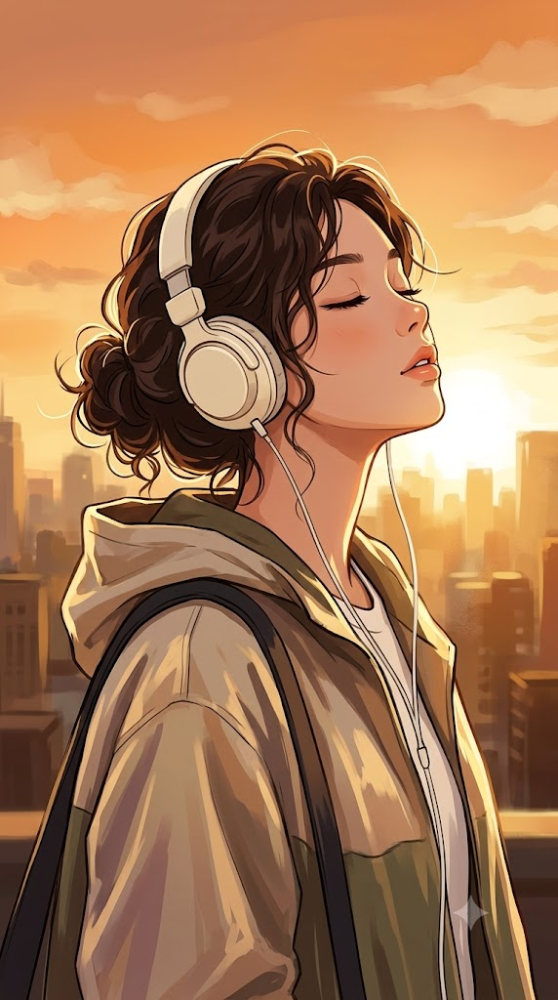
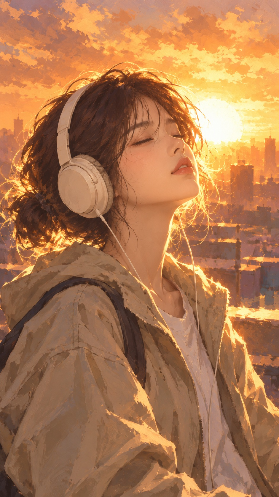

# Lo-fi Sunset, 노을 역광 헤드폰 애니메이션풍 일러스트 프롬프트

## 1. 개요 및 아트 디렉팅 가이드

- **컨셉**: 노을 지는 옥상에서 헤드폰을 쓰고 눈을 감은 채 음악에 빠진 인물을 강한 역광으로 그린, 로파이 음악 커버 느낌의 애니메이션풍 회화 일러스트 (세로 9:16)
- **얼굴 합성 규칙**:
  - 사진에서는 눈·코·입의 생김새와 인상만 가져와 일러스트 화풍으로 표현하고, 눈매·콧날·입술의 특징은 살려 본인으로 알아볼 수 있게 함
  - 얼굴형·피부·헤어·각도·시선·표정은 가져오지 않고 프롬프트 서술대로 새로 그림
  - 안경은 사진에 있을 때만 같은 테 모양·두께·색으로 착용하고, 안경다리는 헤드폰 이어컵 아래로 들어감
- **스타일 (가장 중요)**:
  - 일본 애니메이션 배경 미술풍의 감성 디지털 일러스트. 사진이 아닌 '그림'으로 보여야 함
  - 화면 전체에 눈에 띄게 남은 디지털 페인팅 붓터치
  - 매끈한 피부와 면 단위 음영, 가늘고 깔끔한 선의 감은 눈으로 단순화한 얼굴
  - 수채화처럼 번지는 배경, 디테일 없이 색 면으로만 표현한 빌딩
- **구도**: 가슴 위 상반신, 인물의 오른쪽 앞 대각선에서 눈높이보다 약간 낮게 본 시점, 양쪽 눈과 콧날·입술·턱선이 보이는 3/4 측면
- **인물 & 의상**:
  - 고개를 살짝 뒤로 젖혀 하늘 쪽을 향하고 눈을 편안하게 감은 평온한 표정
  - 느슨하게 묶은 진한 갈색 웨이브 로우번 헤어와 바람에 날리는 잔머리
  - 크고 둥근 아이보리색 오버이어 헤드폰과 흰색 케이블, 오버사이즈 베이지·카키색 후드 바람막이 재킷, 사선으로 멘 가방 끈
- **배경**: 금빛 안개에 녹아든 도시 스카이라인, 인물 머리 바로 뒤쪽 낮은 지평선에서 하얗게 타오르는 일몰 직전의 해, 크림·연주황에서 오렌지·앰버로 깊어지는 하늘
- **조명 (강한 역광)**:
  - 머리카락 가장자리와 잔머리가 빛을 투과해 금빛으로 빛나고, 얼굴 윤곽·목선·어깨선·헤드폰 가장자리에 두껍고 밝은 림라이트
  - 보는 사람을 향한 얼굴 앞면과 재킷 앞면은 짙은 앰버·적갈색의 그늘. 이목구비의 형태만 알아볼 수 있을 정도의 약한 반사광
  - 빛나는 윤곽과 어두운 그늘 면의 선명한 대비, 실루엣에 가까운 역광 느낌
- **제외**: 실사나 반실사, 사진 같은 피부 질감과 렌즈 플레어, 얼굴 앞면을 밝게 비추는 조명, 꽃과 꽃잎, 완전한 옆모습, 텍스트·워터마크

---

## 2. 프롬프트 전문

```text
업로드한 얼굴 사진의 인물을 주인공으로 한 애니메이션풍 회화 일러스트.

[얼굴 합성 규칙]
업로드 사진에서는 눈·코·입의 생김새와 인상만 가져와 일러스트 화풍으로 그릴 것.
얼굴형, 피부, 헤어, 이마·헤어라인은 사진에서 가져오지 말 것.
사진 속 머리 각도·고개 기울기·얼굴 방향·시선·표정은 절대 가져오지 말 것.
표정과 얼굴 각도는 아래 서술대로 새로 그릴 것. 얼굴 외의 구도·각도·헤어·의상·배경은 아래 서술에서 전혀 바뀌면 안 됨.
화풍은 일러스트로 바뀌어도 사진 속 인물로 알아볼 수 있게 눈매·콧날·입술의 특징은 살릴 것.

[안경]
업로드 사진 속 인물이 안경을 쓰고 있으면 반드시 그대로 착용시킬 것 — 테의 모양·두께·색상을 사진과 동일하게 일러스트로 표현.
안경은 3/4 측면 각도에 맞게 자연스럽게 얼굴에 얹히고, 안경다리는 헤드폰 이어컵 아래로 들어가 귀에 걸림.
렌즈는 투명하게, 감은 눈이 렌즈 너머로 또렷이 보임. 역광으로 안경테 바깥 가장자리에만 가는 금빛 하이라이트, 그늘진 쪽 안경테는 어둡게. 렌즈에는 은은한 반사만 살짝.
사진 속 인물이 안경을 쓰고 있지 않으면 안경을 씌우지 말 것.

[스타일 — 가장 중요]
세로 9:16 비율, 일본 애니메이션 배경 미술풍의 감성 디지털 일러스트(로파이 음악 커버 일러스트 느낌).
사진이 아닌 '그림'으로 보여야 함. 디지털 페인팅 붓터치가 화면 전체에 눈에 띄게 남아 있음.
얼굴은 애니메이션 일러스트 방식으로 단순화 — 매끈한 피부, 부드러운 면 단위 음영, 볼에 옅은 블러셔, 가늘고 깔끔한 선의 감은 눈과 속눈썹, 작고 단순한 코, 단순한 입술.
피부 모공·잔털·주름·사실적인 입술 질감·사진 같은 피부 반사 없음.
머리카락은 덩어리감 있는 붓터치와 흩날리는 가는 선으로 그림.
옷 주름은 큼직한 면과 붓터치로 단순하게 표현.
배경은 수채화처럼 번지는 회화적 표현, 빌딩은 디테일 없이 색 면으로만.

[구도]
가슴 위 상반신, 얼굴이 화면 상단 1/3 부근에 크게 위치.
시점은 인물의 오른쪽 앞 대각선, 눈높이보다 약간 낮은 위치.
얼굴은 완전한 옆모습이 아닌 3/4 측면 — 양쪽 눈, 콧날, 입술, 턱선이 보임.
머리카락과 헤드폰이 얼굴을 가리지 않음.

[인물]
젊은 여성. 몸은 화면 오른쪽 앞을 향하고, 고개를 살짝 뒤로 젖혀 하늘 쪽을 올려다보는 자세.
눈을 편안하게 감고, 입술은 살짝 다문 듯 벌어져 있으며, 음악에 빠져 평온한 표정. 입술은 연한 피치 톤.
진한 갈색의 곱슬기 있는 웨이브 머리를 뒤로 느슨하게 묶은 헝클어진 로우번 헤어. 잔머리가 바람에 날리되 얼굴을 덮지 않음.
머리에는 아무 장식도 없음.

[소품·의상]
크고 둥근 아이보리/크림색 오버이어 헤드폰, 이어컵에서 가는 흰색 케이블이 목 앞으로 늘어짐.
오버사이즈 베이지·카키색 후드 바람막이 재킷, 은은한 광택. 안에는 흰색 셔츠.
어깨에 짙은 색 가방 끈을 사선으로 멤.

[배경]
옥상에서 내려다본 도시 스카이라인, 금빛 안개에 녹아든 흐릿한 빌딩 실루엣.
해는 인물 머리 바로 뒤쪽 낮은 지평선에 있는 일몰 직전 골든아워, 화면 안에서 하얗게 타오르듯 강하게 빛남.
하늘은 해 주변이 거의 하얗게 날아간 밝은 크림·연주황, 바깥쪽으로 갈수록 진한 오렌지·앰버로 깊어지는 그라데이션, 붓터치로 그린 옅은 구름.
빌딩 실루엣은 해에서 멀어질수록 어두운 앰버·갈색으로 가라앉음.

[조명·연출 — 강한 역광]
매우 강한 역광. 지는 해가 인물 정면 뒤쪽에서 비추고, 빛이 인물 윤곽을 넘어 번져 들어옴.
머리카락 가장자리와 잔머리가 빛을 투과해 하얗게 타오르는 금빛으로 빛남.
얼굴 윤곽(이마·콧날 끝·턱선)·목선·어깨선·헤드폰 가장자리에 두껍고 밝은 금빛 림라이트, 해 쪽 윤곽은 빛에 살짝 먹혀 번짐.
해에서 뻗어 나오는 붓으로 그린 부드러운 빛줄기와 공기 중의 금빛 헤이즈.

[조명·연출 — 그늘진 쪽]
빛을 등진 쪽, 즉 보는 사람을 향한 얼굴 앞면·목·재킷 앞면·헤드폰 바깥면은 확실하게 그늘짐.
그늘은 밝게 채우지 말고 한 단계 이상 어둡게 — 짙은 앰버·적갈색·따뜻한 보랏빛 갈색의 그림자 톤.
반사광은 아주 약하게만 들어와, 그늘 속에서도 감은 눈·콧날·입술의 형태만 알아볼 수 있을 정도.
밝게 빛나는 림라이트 윤곽과 어두운 그늘 면의 대비가 선명함. 실루엣에 가까운 역광 느낌.
화면 전체는 따뜻한 앰버·오렌지·크림 톤, 밝은 하늘과 어두운 인물 앞면의 명암 대비가 뚜렷한 꿈결 같은 감성 일러스트.

[제외]
실사 사진, 실사에 가까운 반실사, 사진 같은 피부 질감, 모공, 사실적인 입술 광택, 카메라 렌즈 플레어·렌즈 고스트 같은 사진 렌즈 효과, 3D 렌더 느낌 없음.
얼굴 앞면을 정면 조명처럼 밝게 비추는 것, 그늘을 밝게 채워 평평해지는 것, 대비가 낮고 뿌연 화면 없음.
이목구비가 전혀 안 보일 만큼 새까맣게 뭉개진 얼굴 없음.
꽃, 벚꽃, 꽃잎, 날리는 꽃잎 파티클 없음. 머리에 꽃 장식 없음.
완전한 옆모습, 뒷모습, 가려진 얼굴 없음.
사진에 있던 안경을 빼거나 다른 모양으로 바꾸는 것, 렌즈가 하얗게 반사되어 눈이 안 보이는 것 없음.
텍스트·워터마크 없음.
```

---

## 3. 결과물 비교 갤러리

| 생성 모델 | 생성 결과 이미지 |
| :--- | :--- |
| **제미나이 (Gemini)** |  |
| **ChatGPT (DALL-E 3)** |  |
