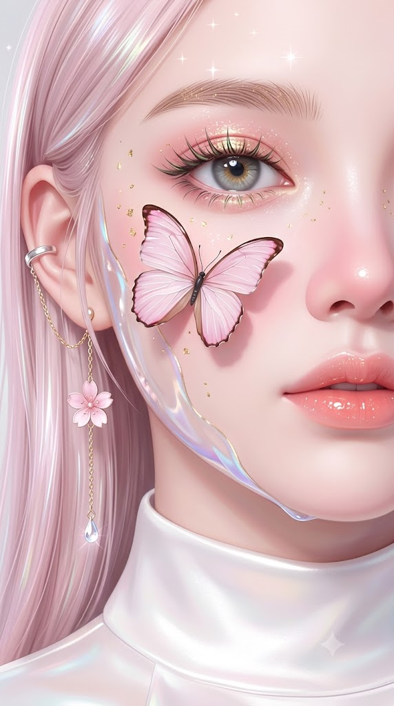
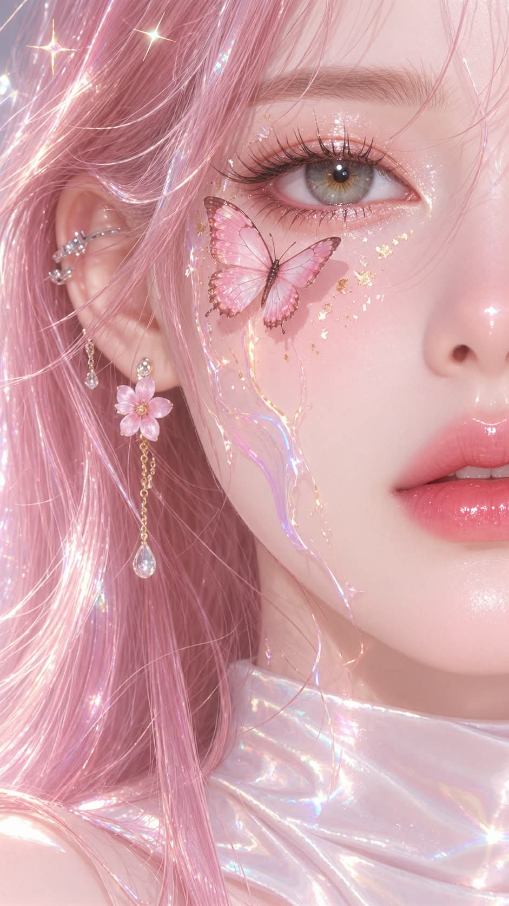

# 나비 하프 페이스, 얼굴 반쪽 매크로 구도의 3D CG 뷰티 클로즈업 프롬프트

## 1. 개요 및 아트 디렉팅 가이드

- **컨셉**: 얼굴의 한쪽 절반만 화면을 가득 채우는 매크로 뷰티 클로즈업. 볼 위에 앉은 파스텔 핑크 나비, 금박과 홀로그램 젤 막 장식, 벚꽃 귀걸이가 어우러진 스타일화된 3D CG 초상화 (세로 9:16)
- **얼굴 합성 규칙 (최우선)**:
  - 업로드 사진을 편집하지 않고 완전히 새로 그림. 사진은 눈·코·입 생김새와 안경 착용 여부·안경테 모양 참고용으로만 사용
  - 피부톤과 질감, 얼굴형, 헤어, 표정, 고개 각도와 시선, 눈동자 색, 메이크업, 렌즈의 굴절과 반사, 조명과 색감, 배경은 가져오지 않음
- **렌더링 방식 (최우선)**:
  - 형태는 입체적이고 선명하지만 피부에는 모공, 잔털, 미세 요철이 없음. 넓은 색면과 진주빛 반사면으로 표현
  - 글리터·금박·홀로그램 막은 피부 위에 얹힌 별개의 장식으로만 존재
- **구도 (핵심)**:
  - 얼굴 중심선 근처에서 잘려 한쪽 절반만 보이는 거의 정면 클로즈업
  - 위쪽 중앙에 눈과 눈썹, 오른쪽 가장자리에 코 측면, 오른쪽 아래에 입술 일부, 왼쪽에 귀와 귀걸이, 아래에 턱선과 하이칼라
- **안경 (조건부)**: 사진에 안경이 있을 때만 사진 속 안경테를 따라 그림. 렌즈는 굴절·왜곡·반사가 없는 평평한 투명 렌즈로, 렌즈 안팎의 눈과 얼굴선이 끊김 없이 이어짐
- **피부**: 맑고 밝은 포슬린 핑크 화이트, 볼과 코끝에 넓고 연한 핑크 홍조, 주근깨와 잡티 없음. 눈 아래부터 광대까지 이어지는 진주빛 반사면
- **조명**: 밝게 확산된 하이키 스튜디오 조명, 밝은 파스텔 톤이지만 눈두덩·코 옆·턱선 아래 음영은 분명하게
- **장식**:
  - 눈 바로 아래 볼에 날개를 펼친 실물 크기의 연핑크 나비, 아래로 부드러운 그림자
  - 관자놀이·눈 아래·볼에 흩어진 금박과 골드 글리터, 관자놀이에서 턱선까지 물결치며 흘러내리는 오팔빛 홀로그램 젤 막과 눈물 자국 같은 골드 라인
  - 화면 위쪽의 네 갈래 별빛 반짝임
- **메이크업**: 그레이 헤이즐 홍채, 연핑크와 골드 글리터 아이섀도, 골드·그린 이리데센트 빛이 도는 스파이키 속눈썹, 골드 글리터가 묻은 라이트 브라운 결 눈썹, 골드 글리터가 섞인 피치 코랄 글로스 입술
- **헤어 & 의상**: 연한 파스텔 핑크의 가는 생머리와 은빛 이리데센트 하이라이트, 은색 이어커프에서 늘어진 골드 체인 벚꽃·물방울 크리스털 귀걸이, 진주빛 오팔 광택의 화이트 새틴 하이칼라
- **배경**: 초점이 날아간 밝은 화이트·연그레이에 은은한 파스텔 오팔빛
- **금지**: 실사 피부 텍스처, 오일 광택, 주근깨, 얼굴 전체가 다 보이는 구도, 얼굴을 덮는 잔머리, 갈색 눈동자, 붉은 립, 사진에 없는 안경, 렌즈 굴절로 달라진 눈, 글자와 워터마크

---

## 2. 프롬프트 전문

```text
[얼굴 합성 규칙 — 최우선]
이 작업은 업로드 사진을 편집하는 것이 아니라, 아래 서술대로 완전히 새로 그리는 3D CG 초상화다. 업로드 사진은 눈·코·입의 생김새와 안경 착용 여부·안경테 모양을 확인하는 참고용으로만 쓴다.
사진에서 절대 가져오지 않는 것: 피부·피부 질감·피부톤, 주근깨·잡티, 얼굴형, 헤어·잔머리·앞머리, 이마·헤어라인, 표정, 고개 각도·기울기·방향·시선, 눈동자 색, 메이크업, 안경 렌즈의 굴절·왜곡·반사, 조명·그림자, 색감·노출, 배경, 사진 특유의 실사 질감.
가져온 눈·코·입의 생김새는 아래 렌더링 방식으로 다시 그린다. 닮음은 이목구비 생김새로만 표현한다.
얼굴 외 구도·헤어·장식·조명·배경은 아래 서술에서 전혀 바뀌면 안 된다.

[렌더링 방식 — 최우선]
사진이 아닌 스타일화된 3D CG 초상화로 생성한다.
얼굴의 형태는 입체적이고 선명하지만, 피부 표면에는 미세 질감이 없다.
피부는 넓은 색면, 매끈한 명암 그라데이션, 부드럽게 이어지는 진주빛 반사면으로 표현한다.
피부를 확대해도 모공, 잔털, 미세한 요철, 입자성 반짝임이 보이지 않는다.
글리터·금박·홀로그램 막은 피부 위에 얹힌 별개의 장식으로만 존재하며, 피부 자체의 질감으로 번지지 않는다.
눈·속눈썹·눈썹·장식의 정교함이 피부의 사진식 세부 질감으로 번지지 않게 한다.
업로드 사진은 눈·코·입의 형태만 참고하며, 피부 렌더링에는 사용하지 않는다.

[구도]
세로 9:16 비율의 극단적인 매크로 뷰티 클로즈업. 얼굴은 거의 정면이며, 화면이 얼굴 중심선 근처에서 잘려 얼굴의 한쪽 절반만 화면을 가득 채운다. 화면 위쪽 중앙에 한쪽 눈과 눈썹이 크게 들어오고, 오른쪽 가장자리에 코의 측면과 콧방울, 오른쪽 아래에 입술 일부가 잘려 보인다. 왼쪽 가장자리에는 귀와 귀걸이, 머리카락이 보이고, 아래쪽에는 턱선과 목의 하이칼라가 보인다. 이마 윗부분은 눈썹 위에서 잘린다. 시선은 카메라 쪽을 차분하게 바라본다.

[안경 — 조건부]
업로드 사진 속 인물이 안경을 쓰고 있을 때만 안경을 그린다. 사진에 안경이 없으면 안경을 절대 그리지 않는다.
안경을 그릴 때는 사진 속 안경테의 모양·색·두께를 따르되, 아래 렌더링 방식에 맞춰 매끈한 CG로 다시 그린다. 렌즈 하나가 보이는 눈을 감싸고, 브리지는 오른쪽 가장자리 콧등 위, 안경다리는 관자놀이를 지나 머리카락 아래로 귀까지 이어진다. 안경테 아래쪽은 볼의 나비와 겹치지 않는다.
렌즈는 완전히 평평한 투명 렌즈로 굴절·굴곡·왜곡이 전혀 없다. 렌즈 안쪽의 눈 크기, 눈매, 속눈썹, 피부, 얼굴 윤곽선이 렌즈 바깥과 정확히 같은 크기와 위치로 끊김 없이 이어진다. 렌즈 반사광과 눈부심 없이 눈이 또렷하게 보인다.

[피부]
피부색은 맑고 밝은 포슬린 핑크 화이트. 흐릿하게 뭉개지지 않고 깨끗하고 선명한 면.
홍조는 연한 핑크 색면으로 볼과 코끝에 넓고 부드럽게 번진다.
주근깨와 잡티는 없다.

[피부 광택]
광택은 미세한 반짝임이 아니라 넓게 연결된 진주빛 반사면으로 표현한다. 눈 아래부터 광대 윗부분까지 부드러운 밝은 면이 이어지고, 광대 하이라이트는 중심이 밝고 가장자리로 갈수록 천천히 사라진다. 코끝에는 작고 응집된 하이라이트, 콧등에는 짧고 부드러운 반사광. 하이라이트 사이에는 광택이 적은 차분한 중간톤을 충분히 남긴다.

[조명·명암]
실내 스튜디오의 밝고 넓게 확산된 하이키 조명. 직사광선, 햇빛, 역광, 얼굴 위 머리카락 그림자 무늬는 없다.
전체적으로 밝은 파스텔 톤이지만 과노출은 아니며, 눈두덩·코 옆·턱선 아래의 음영은 부드럽지만 분명하게 남긴다. 노란색·세피아·햇빛 색감 없음.

[나비]
광대 위, 눈 바로 아래 볼에 실물 크기의 파스텔 핑크 나비 한 마리가 날개를 펼치고 앉아 있다. 날개는 연핑크에 흰 날개맥, 가장자리는 진한 핑크·갈색 테두리. 몸통은 짙은 색, 가는 더듬이 두 개. 나비 아래 볼에 부드러운 그림자가 진다.

[금박·글리터·홀로그램 장식]
관자놀이, 눈 아래, 볼에 작은 금박 조각과 골드 글리터가 드문드문 흩어져 있다.
관자놀이에서 볼을 지나 턱선까지, 투명한 젤 막 같은 홀로그램 층이 물결치듯 흘러내린다. 이 막은 투명하며 가장자리에 블루·라벤더·핑크 오팔빛이 은은하게 돌고, 가느다란 골드 라인이 눈물 자국처럼 볼을 따라 흘러내린다.
화면 위쪽에 작은 네 갈래 별빛 반짝임 몇 개.

[눈]
눈 모양은 사진을 따른다. 홍채 색은 사진과 관계없이 반드시 맑은 그레이 헤이즐, 동공 주변은 골드빛으로 밝고 홍채 무늬가 정교하며 촉촉한 캐치라이트. 눈두덩에 연핑크 베이스와 골드 글리터 아이섀도우를 촉촉하고 글로시하게. 길고 뾰족하게 뭉친 위 속눈썹, 끝에 골드·그린 이리데센트 빛이 돈다. 아래 속눈썹도 골드빛이 도는 뾰족한 스파이키 래쉬.

[눈썹]
위로 빗어 올린 결이 살아 있는 라이트 브라운·블론드 눈썹, 결 사이에 골드 글리터가 살짝 묻어 있다.

[입술]
입술 모양은 사진을 따른다. 피치 코랄 핑크에 유리처럼 반짝이는 글로스, 글로스 안에 미세한 골드 글리터. 입술이 아주 살짝 벌어져 있다. 몽환적이고 무표정에 가까운 차분한 표정.

[헤어]
아주 연한 파스텔 핑크의 가늘고 곧은 생머리가 얼굴 옆선을 따라 귀 앞뒤로 내려온다. 머리카락에 흰빛·은빛 이리데센트 하이라이트. 얼굴을 덮는 잔머리와 앞머리는 없다.

[귀걸이]
귀에 은색 이어커프, 그 아래로 얇은 골드 체인이 늘어지고, 중간에 다섯 장 꽃잎의 연핑크 벚꽃 장식, 그 아래 다시 체인이 이어져 끝에 작은 물방울 크리스털이 달려 있다.

[의상]
목을 감싸는 화이트 하이칼라. 새틴처럼 매끈하고 진주빛 오팔 광택이 돈다.

[배경]
초점이 완전히 날아간 밝은 화이트·연그레이 톤, 은은한 파스텔 오팔빛.

[피해야 할 표현]
실사 인물 사진, 사진 피부 텍스처, 모공·잔털·미세 요철, 피부 자체의 입자성 반짝임, 번들거리는 오일 광택, 주근깨, 얼룩진 홍조, 샤프닝, 흐릿하게 뭉개진 피부, 평면 조명, 과노출, 햇빛·역광·그림자 무늬, 얼굴 전체가 다 보이는 구도, 얼굴을 덮는 잔머리·앞머리, 갈색 눈동자, 붉은 립, 진한 메이크업, 사진에 없는 안경 추가, 렌즈 굴절로 커지거나 작아진 눈, 렌즈 경계에서 어긋난 얼굴선, 렌즈 반사광, 인형·마네킹 같은 얼굴, 업로드 사진의 피부·각도·표정·헤어·조명·색감이 그대로 들어간 얼굴.

텍스트, 서명, 워터마크는 넣지 않음.
```

---

## 3. 결과물 비교 갤러리

| 생성 모델 | 생성 결과 이미지 |
| :--- | :--- |
| **제미나이 (Gemini)** |  |
| **ChatGPT (DALL-E 3)** |  |
