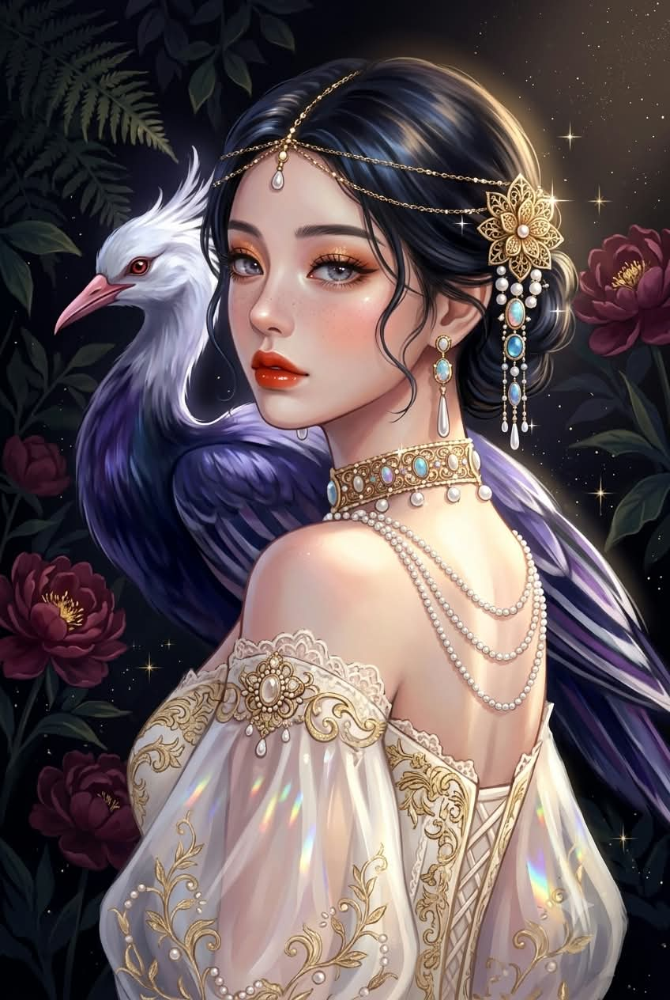
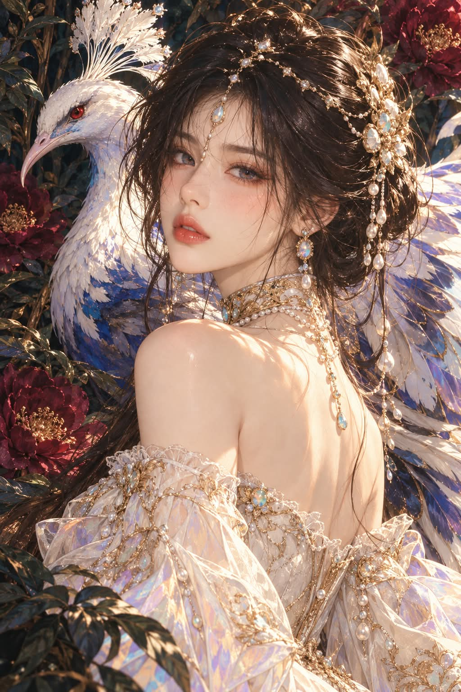

# 귀족 영애, 어깨 너머로 돌아보는 로맨스 판타지 표지 일러스트 프롬프트

## 1. 개요 및 아트 디렉팅 가이드

- **컨셉**: 밤의 정글 정원에서 거대한 흰 볏 새를 등지고 어깨 너머로 돌아보는 귀족 영애. 로맨스 판타지 웹소설 표지 같은 애니메이션 일러스트 (세로 2:3)
- **모델별 버전**: 같은 장면을 모델마다 다른 그림체로 지시한 두 가지 버전
  - **GPT 버전**: 깔끔한 선화와 2~3단계 셀 채색의 웹소설 표지 그림체. 머리·눈·턱·어깨·새의 위치를 화면 비율 좌표로 하나하나 고정
  - **Gemini 버전**: 평면 셀 채색과 검정 외곽선을 금지한 페인터리 디지털 페인팅. 금빛 스포트 조명과 깊은 청보라 그림자의 로우키 명암을 가장 중요한 규칙으로 두고, 새 몸통 색과 진한 메이크업을 따로 못 박음
- **업로드 사진 규칙**: 눈·코·입의 형태·크기·간격·인상만 그림체로 번역. 눈동자 색, 화장, 피부, 얼굴형, 헤어, 안경, 각도, 시선, 표정, 자세는 가져오지 않음. 얼굴은 크게 완성한 뒤 축소
- **몸 회전 & 어깨 (핵심)**:
  - 몸은 45도만 비스듬히 돌아 화면 왼쪽 어깨 뒤와 견갑골 한쪽만 보임. 정뒷모습과 척추가 드러난 등은 금지
  - 가장 가까운 화면 왼쪽 어깨는 힘을 빼고 25~30도로 툭 떨어지고, 긴 목과 금 초커가 온전히 드러남. 어깨 올림·움츠림·턱을 어깨에 붙이기 금지
  - 퍼프 소매에 덮인 왼팔이 화면 왼쪽 아래를 채우고 손은 보이지 않음
- **고개 & 표정**: 화면 왼쪽을 향한 3/4 각도로 15도만 기울여 돌아보고, 눈동자만 돌려 정면 응시. 반쯤 뜬 눈의 차분하고 나른한 도도함
- **헤어 & 메이크업**: 칠흑 흑발 로우 업스타일에 나선형 컬 잔머리 몇 가닥. 은회색 눈동자, 구릿빛 오렌지에서 브론즈로 이어지는 아이섀도, 장밋빛 블러셔와 옅은 주근깨, 벽돌빛 레드 립
- **장신구 & 의상**: 이마로 진주가 떨어지는 금 필리그리 헤어 체인과 뒷머리 꽃 장식, 오팔 카보숑 진주 드롭 귀걸이, 여러 겹 진주 체인이 늘어진 넓은 금 초커. 금 자수와 레이스의 아이보리 시스루 오프숄더 코르셋 드레스와 무지갯빛 시폰 퍼프 소매
- **새**: 인물보다 큰 신비로운 새. 흰 머리와 부채형 볏, 붉은 눈, 연분홍 부리, 청보라·남색 몸통, 화면 오른쪽까지 펼친 줄무늬 날개
- **배경 & 조명**: 고사리와 금빛 꽃술의 버건디 작약이 있는 검정에 가까운 청록빛 밤 정원. 화면 오른쪽 위의 따뜻한 금빛 빛, 차가운 청보라 그림자, 보석의 십자 별 반짝임, 소매의 무지개 빛 조각
- **워터마크**: 오른쪽 아래에 작은 반투명 흰 글씨 "@darkjl81"
- **금지**: 사진·실사·3D, 보케, 정뒷모습, 움츠린 어깨, 짧은 목, 가슴골, 흘러내린 드레스, 풀린 머리, 갈색 머리와 갈색 눈동자, 워터마크 외의 글자

---

## 2. 프롬프트 전문

### GPT 버전

```text
2D anime-style digital painting, Korean romance fantasy webnovel cover illustration, clean lineart, soft cel shading, NOT a photo, NOT realistic, NOT 3D. Relaxed lowered shoulder, long neck, body turned only 45 degrees away, NOT a full back view, NOT hunched.

[절대 규칙]
1. 그림이다. 사진·실사·3D 금지.
2. 좌우는 모두 "화면 기준"이다.
3. 몸은 등을 정면으로 다 보여주지 않는다. 비스듬히 45도만 돌아 있다.
4. 어깨는 낮게 떨어져 있고 절대 올라가거나 움츠러들지 않는다.
5. 가슴골·정면 가슴 노출 금지. 드레스 흘러내림 금지.
6. 칠흑 흑발 단정한 로우 업스타일. 눈동자는 밝은 은회색·청회색.

[업로드 사진 규칙]
- 업로드 사진은 얼굴 참고용이다. 다른 레퍼런스 이미지는 없다.
- 사진에서는 눈·코·입의 생김새(형태, 크기, 간격, 인상)만 가져와 애니메이션 그림체로 번역한다.
- 눈동자 색, 화장, 눈썹, 입술 색, 피부, 얼굴형, 헤어, 안경, 고개 각도, 시선, 표정, 몸 자세는 사진에서 절대 가져오지 않는다.
- 얼굴은 먼저 크게 정밀하게 완성한 뒤 비율 그대로 축소해 배치한다.

[몸 회전 — 가장 중요]
- 몸통은 보는 사람에게서 약 45도만 비스듬히 돌아 있다. 완전히 등을 돌린 180도 뒷모습이 아니다.
- 등은 비스듬히 보인다: 화면 왼쪽 어깨 뒤쪽과 견갑골 한쪽만 보이고, 척추는 화면에 거의 드러나지 않는다.
- 몸의 화면 오른쪽은 등에서 옆구리 옆면으로 자연스럽게 넘어가며, 그 끝 옆선에 가슴 옆 실루엣이 아주 살짝 보인다. 진주 목걸이가 그 옆선 안쪽으로 늘어진다.
- 등이 화면 가로 중앙을 넓게 차지하는 정뒷모습 금지.

[어깨 — 가장 중요]
- 화면 왼쪽 어깨가 보는 사람과 가장 가깝다. 둥글고 맨살이며 완전히 힘을 뺀 상태.
- 어깨는 아래로 툭 떨어져 있다. 어깨 꼭대기는 턱 끝보다 얼굴 길이의 절반 이상 아래에 있다.
- 어깨선 경사: 목 밑동에서 어깨 바깥 끝까지 화면 왼쪽 아래로 약 25~30도 흘러내린다. 어깨 바깥 끝이 목 밑동보다 낮다.
- 어깨를 귀 쪽으로 올리기, 어깨를 앞으로 말기, 턱을 어깨에 붙이기, 웅크리기 전부 금지.
- 어깨 위로 긴 목이 드러나고, 금 초커 칼라가 가려지지 않고 온전히 보인다.
- 화면 왼쪽 팔 윗부분은 몸에 붙여 힘없이 곧게 내려오고 시스루 퍼프 소매로 덮여 화면 왼쪽 아래 모서리를 채운다. 손은 안 보인다.
- 허리는 곧게 펴고 가슴을 연 우아한 자세.

[고개]
- 고개는 화면 왼쪽 어깨 쪽으로 돌려 돌아본다. 얼굴은 화면 왼쪽을 향한 3/4 각도(정면에서 약 40도).
- 머리 축은 약 15도만 기울어 있다: 정수리는 화면 오른쪽 위, 턱은 화면 왼쪽 아래.
- 턱은 어깨 위 공중에 떠 있다. 눈동자만 돌려 보는 사람을 정면으로 응시.

[자세 좌표 — 화면 가로(x)·세로(y) 비율, 왼쪽 위가 0%]
- 머리 꼭대기(장신구 포함): x 55%, y 3%
- 눈 높이: y 26~29%
- 턱 끝: x 42%, y 39%
- 얼굴 세로 크기: 화면 세로의 약 22%
- 초커(목): x 52~72%, y 43~48%
- 목 밑동(어깨선 시작): x 50%, y 48%
- 화면 왼쪽 어깨 꼭대기: x 38%, y 53%
- 화면 왼쪽 어깨 바깥 끝: x 29%, y 57%
- 견갑골: x 50~65%, y 58~66%
- 몸의 화면 오른쪽 옆선: x 80~82%, y 50~72%
- 드레스 윗선: y 68~73%
- 퍼프 소매: x 0~45%, y 63~100%
- 새 머리: x 25%, y 15% / 새 볏 꼭대기 y 3%
- 새 날개: x 70~100%, y 35~70%

[체형]
가녀리고 마른 체형, 좁고 둥근 어깨, 길고 가는 목, 작고 갸름한 머리.

[표정]
차분하고 나른한 도도함. 살짝 내리깐 반쯤 뜬 눈, 입은 다물고 웃지 않음.

[그림체]
- 가늘고 깔끔한 짙은 갈색 선화.
- 큰 애니메이션 눈: 굵은 위 속눈썹 라인, 평평한 홍채 색면에 큰 흰 하이라이트 점.
- 코는 코끝 그림자와 짧은 선만. 입술은 색면과 하이라이트 한 줄. 치아 안 보임.
- 피부는 평평한 바탕색 + 셀 그라데이션 2~3단계. 모공·피부결·기름광 금지.
- 머리카락은 큰 덩어리 면 + 굵은 곡선 광택 띠. 이마 옆·귀 앞에 나선형 컬 잔머리 몇 가닥. 부스스한 잔머리 금지.
- 반짝임은 작은 십자 별로. 보케·흐림 금지.

[메이크업]
구릿빛 오렌지→브론즈 아이섀도를 눈두덩 넓게, 눈꼬리 살짝 올려 뺌. 아래 속눈썹 바깥쪽에 구릿빛 얇게. 짧고 날렵한 흑갈색 아이라인. 가는 아치형 흑갈색 눈썹. 볼과 콧등에 장밋빛 블러셔, 콧등에 옅은 주근깨 몇 점. 붉은 벽돌빛 레드 립, 윤곽 또렷, 가운데만 살짝 광택.

[피부 색]
하얀 도자기빛에 따뜻한 살구빛. 그림자는 연한 장밋빛·연보라. 어깨와 견갑골에 크림색 하이라이트 면.

[장신구]
- 금 필리그리 헤어 체인이 정수리를 가로지르고 이마로 작은 진주 드롭. 화면 오른쪽 뒷머리에 큰 금 필리그리 꽃 장식과 진주 클러스터, 아래로 진주·오팔 펜던트.
- 금 세공 오팔 카보숑 귀걸이 + 긴 진주 드롭.
- 넓은 금 필리그리 초커 칼라에 진주와 오팔. 초커에서 여러 겹 진주 체인이 늘어지고 끝에 오팔·진주 드롭.

[의상]
아이보리 시스루 오프숄더 코르셋 드레스. 금 자수 패널, 레이스 테두리, 오팔 브로치. 시폰 퍼프 소매에 금 덩굴 자수, 진주 비즈, 무지갯빛 색면.

[새]
흰 머리에 부채형 흰 볏, 붉은 눈, 연분홍 부리, 청보라·남색 몸통. 몸통은 화면 왼쪽 어깨 뒤, 날개는 인물 뒤로 화면 오른쪽까지. 흰색·연보라·남색 줄무늬 깃털. 인물보다 큰 새.

[배경]
어두운 밤 정글 정원. 화면 왼쪽 위 고사리, 짙은 잎, 화면 왼쪽 중단·오른쪽 위·오른쪽 아래에 금빛 꽃술의 버건디 작약. 배경은 검정에 가까운 청록. 꽃과 잎도 흐리지 않게.

[조명·명암]
화면 오른쪽 위에서 따뜻한 금빛 빛이 얼굴·어깨·등·장신구를 비춤. 그림자는 차가운 청보라 색면. 진주·보석에 흰 하이라이트 점과 십자 별 반짝임. 새 볏 가장자리에 차가운 밝은 테두리. 화면 왼쪽 아래 소매에 무지개색 빛 조각. 로우키, 높은 명암 대비.

[워터마크]
- 화면 오른쪽 아래 구석에 작은 흰색 글씨(얇은 검정 그림자)로 "@darkjl81" 한 줄만 넣는다.
- 글자 높이는 화면 세로의 약 2%, 가장자리에서 살짝 안쪽. 반투명하게, 그림을 가리지 않게.
- 철자를 정확히: @ d a r k j l 8 1

[금지]
사진, 실사, 3D, 보케, 렌즈 플레어, 피부결, 정뒷모습, 등 전체 노출, 척추가 보이는 등, 어깨 올림, 움츠린 어깨, 턱을 어깨에 붙임, 짧은 목, 가려진 초커, 고개를 어깨에 기댐, 몸을 정면으로 돌림, 가슴골, 흘러내린 드레스, 풀린 머리, 갈색 머리, 갈색 눈동자, "@darkjl81" 외의 모든 글자.
```

### Gemini 버전

```text
세로 2:3 비율의 고급 판타지 일러스트를 그려줘.
Richly painted anime illustration, luxurious romance fantasy cover art, painterly rendering with soft blended gradients, glowing dramatic lighting, deep low-key shadows. NOT flat webtoon coloring, NOT thick black outlines, NOT a photo, NOT 3D.

[화풍 — 제미나이 전용]
- 그림이지만 평면 셀 채색이 아니다. 여러 겹의 부드러운 그라데이션을 덧칠한 페인터리 디지털 페인팅.
- 선화는 가늘고 색이 섞인 갈색 선으로 거의 드러나지 않게. 검정 외곽선·만화식 굵은 선 금지.
- 피부, 머리, 천, 깃털, 꽃잎 모두 빛을 받아 은은하게 빛나는 광택과 깊은 음영이 있어야 한다.
- 화면 전체에 작은 금빛 반짝임 입자와 십자 별 반짝임이 흩어져 있다.
- 실사 사진 질감(모공, 피부결, 카메라 보케)은 금지.

[업로드 사진 규칙]
- 업로드 사진은 얼굴 참고용이다. 다른 레퍼런스 이미지는 없다.
- 사진에서는 눈·코·입의 생김새(형태, 크기, 간격, 인상)만 가져와 이 그림체로 번역한다.
- 눈동자 색, 화장, 눈썹, 입술 색, 피부, 얼굴형, 헤어, 안경, 고개 각도, 시선, 표정, 몸 자세는 사진에서 절대 가져오지 않는다.
- 얼굴은 먼저 크게 정밀하게 완성한 뒤 비율 그대로 축소해 배치한다.

[몸 회전·어깨·고개]
- 좌우는 모두 화면 기준.
- 몸통은 보는 사람에게서 약 45도만 비스듬히 돌아 있다. 정뒷모습 아님. 화면 왼쪽 어깨 뒤쪽과 견갑골 한쪽만 보이고 척추는 거의 안 보인다.
- 화면 왼쪽 어깨가 가장 가깝고, 힘을 빼고 아래로 툭 떨어져 있다. 어깨 꼭대기는 턱보다 얼굴 길이의 절반 이상 아래. 어깨선은 목에서 바깥으로 약 25~30도 흘러내린다.
- 어깨 올림·움츠림·턱을 어깨에 붙임 금지. 긴 목과 금 초커가 온전히 보인다.
- 화면 왼쪽 팔 윗부분은 힘없이 내려오고 시스루 퍼프 소매가 화면 왼쪽 아래를 채운다. 손은 안 보인다.
- 고개는 화면 왼쪽 어깨 쪽으로 돌려 돌아본다. 얼굴은 화면 왼쪽을 향한 3/4 각도, 머리 축은 약 15도만 기울어짐(정수리 화면 오른쪽 위, 턱 화면 왼쪽 아래).
- 눈동자만 돌려 보는 사람을 응시.
- 미디엄 클로즈업: 정수리 장신구가 화면 위 가장자리에 거의 닿고, 아래는 드레스 몸판 위쪽까지. 얼굴은 화면 위쪽 중앙 약간 왼쪽, 세로의 약 1/4 크기.

[체형·표정]
가녀린 체형, 좁고 둥근 어깨, 길고 가는 목, 작고 갸름한 머리. 차분하고 나른한 도도함, 살짝 내리깐 반쯤 뜬 눈, 입은 다물고 웃지 않음.

[조명·명암 — 가장 중요]
- 화면 오른쪽 위 앞쪽에서 따뜻한 금빛 스포트 조명 하나가 얼굴, 목, 어깨, 견갑골, 장신구를 집중적으로 비춘다. 빛 받은 피부는 크림·금빛으로 환하게 빛난다.
- 빛이 닿지 않는 곳은 차갑고 깊은 청보라 그림자. 얼굴의 화면 왼쪽 볼, 목 아래, 등의 화면 오른쪽, 머리카락 안쪽이 어둡다.
- 배경은 거의 검정에 가까울 만큼 어둡게 눌러서 인물이 어둠 속에서 빛나 보이게. 화면 가장자리로 갈수록 더 어두운 비네팅.
- 진주·금·오팔에 강한 흰 광택과 십자 별 반짝임.
- 새의 흰 볏과 날개 가장자리에 차가운 은빛 테두리 빛.
- 화면 왼쪽 아래 시스루 소매에 프리즘처럼 무지개색 빛 조각이 크게 번진다.
- 높은 명암 대비. 균일하게 밝은 조명 금지.

[피부]
하얀 도자기빛에 따뜻한 살구빛, 부드러운 페인터리 그라데이션. 그림자 쪽은 장밋빛·연보라로 녹아듦. 어깨·견갑골·콧등·아랫입술에 촉촉한 광택 하이라이트. 볼과 콧등에 장밋빛 블러셔, 콧등에 옅은 주근깨 몇 점.

[눈·메이크업 — 선명하게]
- 눈동자: 밝은 은회색에 연한 라벤더가 비치는 투명한 홍채, 위쪽은 살짝 어둡고 아래쪽이 밝게 빛남, 큰 흰 반사광. 갈색 금지.
- 아이섀도: 눈두덩 전체에 진한 구릿빛 오렌지 → 바깥쪽 브론즈 그라데이션, 금빛 펄. 멀리서도 확실히 보일 만큼 진하게. 눈꼬리 살짝 올려 뺌.
- 아래 속눈썹 바깥쪽에 구릿빛 섀도 얇게. 짙은 흑갈색 아이라인을 날렵하게. 속눈썹 길고 짙게.
- 눈썹: 가는 아치형 흑갈색.
- 입술: 선명한 벽돌빛 오렌지 레드, 윤곽 또렷, 가운데 촉촉한 광택. 핑크·누드 립 금지.

[헤어]
윤기 나는 칠흑 흑발을 뒤로 낮게 틀어 올린 단정한 업스타일, 볼륨감. 머리 위쪽에 굵고 밝은 광택 띠와 차가운 푸른빛 반사. 이마 옆·귀 앞에 나선형 컬 잔머리 몇 가닥.

[장신구]
- 금 필리그리 헤어 체인이 정수리를 가로지르고 이마로 작은 진주 드롭. 화면 오른쪽 뒷머리에 큰 금 필리그리 꽃 장식, 진주 클러스터, 청회색 문스톤·오팔 카보숑, 아래로 진주·오팔 펜던트.
- 금 세공 오팔 카보숑 귀걸이 + 긴 진주 드롭.
- 넓은 금 필리그리 초커 칼라에 진주와 오팔. 초커에서 여러 겹 진주 체인이 등 위로 늘어지고 끝에 오팔·진주 드롭.

[의상]
아이보리 시스루 오프숄더 코르셋 드레스. 금 자수, 레이스 테두리, 보석 브로치. 시폰 퍼프 소매는 반투명하게 빛을 머금고, 금 덩굴 자수와 진주 비즈, 무지갯빛 광택이 일렁인다.

[새 — 색 고정]
인물보다 큰 신비로운 새. 머리와 부채형 볏만 흰색, 붉은 눈, 연분홍 부리. 목 아래 몸통은 짙고 윤기 나는 청보라·남색. 날개는 인물 뒤로 화면 오른쪽까지 펼쳐지고, 남색·연보라·흰색 줄무늬 깃털이 겹겹이 층을 이루며 빛을 받아 반짝인다. 몸통을 흰색으로 그리기 금지.

[배경]
어두운 밤 정글 정원. 화면 왼쪽 위 고사리, 윤기 나는 짙은 잎, 화면 왼쪽 중단·오른쪽 위·오른쪽 아래에 금빛 꽃술의 깊은 버건디 작약. 꽃과 잎은 대부분 그림자 속에 잠겨 있고 빛 받는 가장자리만 은은하게 드러난다. 배경 깊은 곳은 검정에 가까운 청록.

[워터마크]
- 화면 오른쪽 아래 구석에 작은 흰색 글씨(얇은 검정 그림자)로 "@darkjl81" 한 줄만 넣는다.
- 글자 높이는 화면 세로의 약 2%, 가장자리에서 살짝 안쪽. 반투명하게, 그림을 가리지 않게.
- 철자를 정확히: @ d a r k j l 8 1

[금지]
평면 웹툰 채색, 굵은 검정 외곽선, 균일한 밝은 조명, 사진·실사·3D, 보케, 정뒷모습, 어깨 올림·움츠림, 짧은 목, 흰 새 몸통, 옅은 화장, 핑크 립, 갈색 눈동자, 풀린 머리, 가슴골, 흘러내린 드레스, "@darkjl81" 외의 모든 글자.
```

---

## 3. 결과물 비교 갤러리

| 생성 모델 | 생성 결과 이미지 |
| :--- | :--- |
| **제미나이 (Gemini)** |  |
| **ChatGPT (DALL-E 3)** |  |
