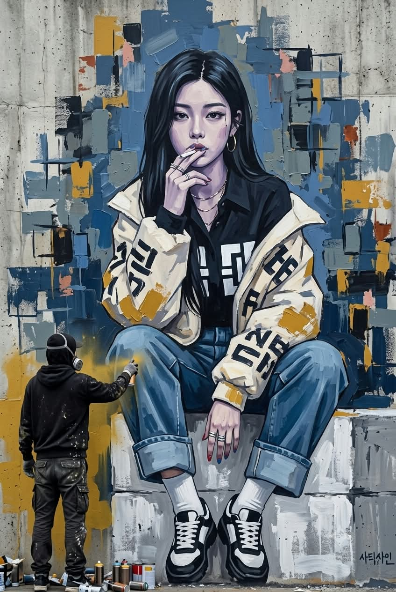
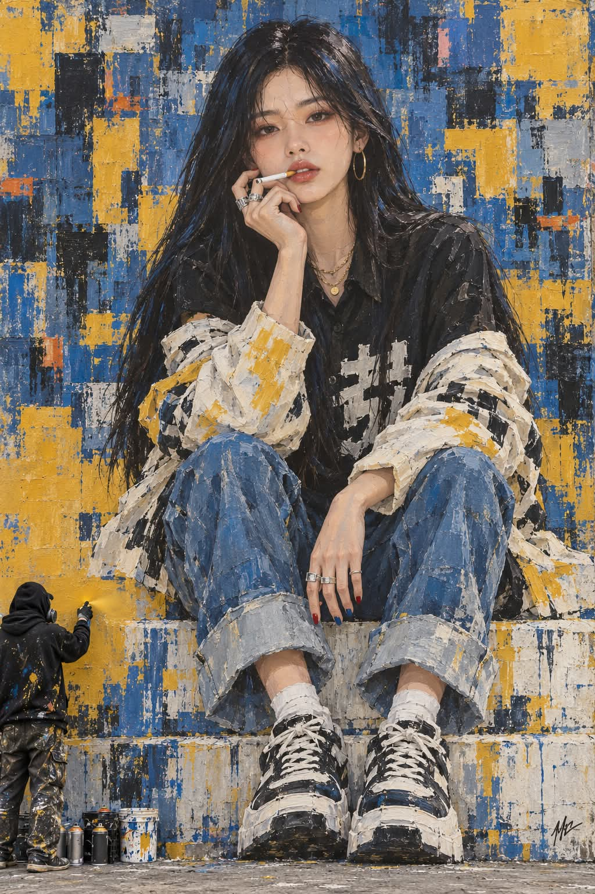

# 그라피티 벽화, 아크릴 벽화 속 주인공과 그라피티 아티스트 프롬프트

## 1. 개요 및 아트 디렉팅 가이드

- **컨셉**: 거대한 아크릴 벽화 속 주인공이 된 나와, 그 벽화를 지금 칠하고 있는 작은 그라피티 아티스트를 함께 담은 장면. 코발트블루와 머스터드 옐로의 사각 붓질 콜라주 속에 인물이 녹아든 한 장의 회화가 핵심 (세로 2:3)
- **모델별 버전**: 내용은 같고 쓰는 방식만 다른 두 가지 버전
  - **GPT 버전**: 항목별 소제목과 불릿으로 정리
  - **Gemini 버전**: 같은 내용을 문단으로 풀어 쓰고, 사진을 편집하지 말고 새로 그리라는 지시와 끝의 "다시 강조" 요약으로 핵심을 한 번 더 못 박음
- **사진 사용 규칙**: 눈·코·입 생김새만 가져오고 얼굴형·피부·헤어·표정·각도·시선·옷·배경·포즈는 가져오지 않음. 안경은 썼다면 유지
- **한 장의 회화 (최우선)**:
  - 인물과 배경을 같은 아크릴 물감과 팔레트 나이프로 한 번에 칠한 그림
  - 깨끗한 디지털 일러스트를 벽에 붙인 느낌 금지. 옷자락·머리끝·블록 경계는 외곽선 없이 배경 붓질 속으로 부서지듯 녹아듦
- **구도**: 눈높이 정면, 벽화가 화면을 거의 다 채우고 하늘·벽 윗모서리·거리 풍경은 보이지 않음. 맨 아래에 얇은 바닥만
- **주인공 포즈**:
  - 2단 흰 블록 윗단에 걸터앉고, 아랫단에 놓인 두 발의 신발이 화면 아래 가운데에 크게 보임
  - 무릎을 가슴 높이로 세워 벌린 마름모 다리, 살짝 숙여 웅크린 어깨
  - 오른손 검지와 중지로 입에 문 가는 흰 담배를 받치고, 왼손은 무릎 사이로 힘없이 늘어뜨림
  - 턱을 살짝 내리고 치켜뜨듯 정면을 응시하는 무표정한 시크함
- **헤어**: 가운데 가르마의 칠흑 같은 검은 생머리, 가슴 아래까지 매끈하게. 앞머리·잔머리 없이 굵은 덩어리와 흐린 청회색 광택 붓질
- **의상 입는 방식 (핵심)**:
  - 목까지 채운 긴소매 검은 칼라 셔츠, 가슴에 큰 흰 블록 기호 프린트
  - 아이보리 오버사이즈 재킷이 양 어깨에서 팔꿈치까지 흘러내리고 소매만 팔에 걸린 채, 칼라와 몸판은 등 뒤로 처지고 아랫자락은 블록 위에 펼쳐짐. 어깨 맨살 없음
- **의상 디자인 & 액세서리**: 읽히지 않는 검은 블록 기호가 가득한 재킷과 소매의 머스터드 물감 패치, 밑단을 접은 와이드 블루 데님, 흰 양말과 흑백 청키 스니커즈, 골드 후프 귀걸이와 체인 목걸이, 실버 반지, 빨강·파랑 네일
- **얼굴 & 피부**: 크게 완성한 얼굴을 축소해 닮음 유지. 에어브러시가 아닌 아크릴 색면 피부에 회보라·청보라 음영과 옅은 붓 자국, 흰 반짝임 없는 레드 입술, 또렷하고 날카로운 눈매
- **벽화 배경**: 가로세로 직사각형 붓질 조각이 겹겹이 쌓인 글리치 같은 추상 콜라주. 탁한 코발트블루·회청색 위에 머스터드·오커 조각, 검정·남색 그림자, 나이프 긁힘과 마른 붓 자국. 삼각형·번개·사선 도형과 흘러내리는 물감은 거의 없음
- **색감 & 빛**: 블루와 머스터드 옐로의 차분한 보색 대비, 흐린 날처럼 고르고 부드러운 빛
- **그라피티 아티스트**: 화면 왼쪽 아래, 화면 높이 1/4 크기의 뒷모습. 후드와 방독 마스크로 얼굴이 안 보이는 다른 사람으로, 스프레이로 머스터드 노랑을 뿌림. 아티스트와 스프레이 캔·페인트 통만 사진 질감
- **워터마크**: 오른쪽 아래에 흰색 산세리프체 "@darkjl81"을 작고 반투명하게. 그 밖의 글자·사인·로고는 금지

---

## 2. 프롬프트 전문

### GPT 버전

```text
업로드한 얼굴 사진의 인물을 거대한 벽화 속 주인공으로 그리고, 그 벽화를 지금 칠하고 있는 그라피티 아티스트를 화면 왼쪽 아래에 작게 함께 그린 장면을 만들어줘.

[사진 사용 규칙]
- 업로드 사진에서는 눈·코·입의 생김새만 가져온다.
- 얼굴형, 피부, 헤어, 이마와 헤어라인, 표정은 사진에서 가져오지 않는다.
- 사진 속 고개 기울기, 얼굴 방향, 시선 방향도 절대 가져오지 않는다.
- 사진 속 옷, 배경, 포즈는 전혀 사용하지 않는다.
- 사진 속 인물이 안경을 썼다면 안경만 그대로 그린다.
- 얼굴 외의 구도, 각도, 포즈, 헤어, 의상은 아래 서술 그대로 고정한다.

[가장 중요한 원칙 — 한 장의 회화]
- 벽화는 인물과 배경을 같은 아크릴 물감과 같은 붓·팔레트 나이프로 한 번에 칠한 하나의 회화로 보여야 한다.
- 인물은 깨끗한 디지털 일러스트를 벽에 붙인 것처럼 보이면 안 된다.
- 인물의 옷자락, 재킷 가장자리, 머리카락 끝, 앉은 블록의 경계는 배경의 사각 붓질 조각 속으로 부서지듯 녹아든다.
- 인물의 외곽선은 깔끔한 선으로 따지 않고, 붓질의 끝으로 형태가 끝나게 한다.

[카메라와 구도]
- 눈높이에서 벽을 정면으로 바라본다. 로우 앵글은 쓰지 않는다.
- 벽화가 화면의 거의 전부를 채운다. 하늘, 벽의 윗모서리, 벽 옆의 거리 풍경은 보이지 않는다.
- 화면 맨 아래에 바닥이 아주 얇게만 보인다.
- 세로 2:3 비율이다. 주인공은 화면 중앙에 정면으로 앉아 있고, 머리 위로 약간의 배경이 남는다.

[벽화 속 주인공 - 포즈]
- 2단으로 된 흰 블록의 윗단 가장자리에 엉덩이를 붙이고 걸터앉아 있다. 엉덩이를 띄운 스쿼트나 쭈그린 자세가 아니다.
- 두 발은 아랫단에 놓여 엉덩이보다 낮고, 보는 사람 쪽으로 더 가깝다. 그래서 신발이 화면 맨 아래 가운데에 크게 보인다.
- 두 발은 거의 붙어 있고 신발 앞코가 정면을 향한다. 한쪽 발이 다른 발보다 조금 앞에 있다.
- 양 무릎은 가슴 높이까지 높이 세우고 바깥으로 벌려, 두 다리가 마름모 모양을 만든다.
- 상체는 정면을 향한 채 살짝 앞으로 숙이고, 어깨는 약간 웅크린다.
- 오른쪽 팔꿈치를 오른쪽 무릎 위에 올리고, 오른손은 턱 바로 아래로 올려 손등이 보는 사람을 향하게 한다. 검지와 중지 끝으로 입 정중앙에 문 가는 흰 담배를 받친다.
- 왼팔은 왼쪽 무릎 위에 걸쳐 아래로 늘어뜨린다. 왼손은 무릎 사이, 무릎보다 조금 낮은 높이에서 힘을 빼고 손가락이 아래를 향한다. 반지 낀 손등이 정면으로 보인다.
- 머리는 기울지 않고 정면이며, 턱만 살짝 내렸다.
- 눈은 위로 치켜뜨듯 보는 사람을 똑바로 응시한다.
- 표정은 입꼬리를 올리지 않은 무표정한 시크함이다.

[벽화 속 주인공 - 헤어]
- 칠흑 같은 검은 생머리 롱헤어로, 가슴 아래까지 곧게 내려온다.
- 정가운데 가르마를 타고 이마를 드러낸다. 앞머리는 없다.
- 머리는 매끈하게 정리되어 있다. 잔머리, 부스스하게 뻗친 머리카락, 바람에 날리는 머리는 없다.
- 머릿결은 굵은 덩어리 몇 개로 칠하고, 광택은 넓고 흐린 청회색 붓질 한두 줄로만 표현한다.

[벽화 속 주인공 - 의상 입는 방식]
- 안에는 긴소매 검은 칼라 셔츠 한 벌을 입는다. 단추를 목까지 채워 목을 덮고, 가슴에 굵은 흰 블록 기호 문양이 크게 프린트되어 있다.
- 그 위에 아이보리 바탕의 오버사이즈 재킷을 입는데, 입는 방식이 이 그림의 핵심이다.
- 재킷은 양쪽 어깨에서 완전히 흘러내려 위팔을 지나 팔꿈치 부근까지 내려가 있다.
- 두 팔은 여전히 소매에 들어가 있다. 소매는 손목까지 덮고 팔꿈치 부근에 두툼하게 뭉쳐 있다.
- 양 어깨와 가슴에는 검은 셔츠만 보이고, 재킷의 칼라와 몸판은 등 뒤로 처져 내려간다.
- 재킷 아랫자락은 주인공의 엉덩이 양옆 블록 위로 넓게 펼쳐져 깔린다.
- 어깨에 맨살은 전혀 드러나지 않는다. 민소매가 아니다.

[벽화 속 주인공 - 의상 디자인과 액세서리]
- 재킷에는 굵은 붓으로 찍은 듯한, 글자처럼 보이지만 읽히지 않는 검은 블록 기호가 불규칙하게 가득하다. 지그재그나 기하학 반복 무늬는 쓰지 않는다.
- 재킷 소매와 팔꿈치에 머스터드 옐로 물감이 패치처럼 두껍게 문질러져 있다.
- 하의는 밑단을 크게 접어 올린 와이드 블루 데님이다. 회청색 붓질 색면으로 칠한다.
- 흰 양말에 검정·흰색 투톤의 두꺼운 청키 솔 레이스업 스니커즈를 신는다.
- 얇은 골드 후프 귀걸이, 가는 체인 목걸이 여러 줄을 착용한다. 양손에 실버 반지를 여러 개 낀다.
- 손톱에는 빨강과 파랑이 섞인 네일을 칠한다.

[벽화 속 주인공 - 얼굴과 피부]
- 얼굴은 크게 완성한 뒤 전신 비율에 맞게 그대로 축소한다. 축소해도 눈·코·입의 생김새가 사진과 똑같이 닮아 보여야 한다.
- 닮음은 이목구비의 형태와 비율로 유지하고, 사진의 세부 질감으로 유지하지 않는다.
- 얼굴·목·손을 같은 피부로 칠한다. 넓은 기본색, 옅은 음영, 부드러운 밝은 면으로 큰 볼륨만 표현한다.
- 피부는 매끈한 색면이지만 디지털 에어브러시가 아니라 아크릴 물감으로 칠한 면이다. 볼과 턱선 가장자리에 아주 옅은 붓 자국이 남는다.
- 피부 음영은 낮은 채도의 회보라·청보라 톤을 쓴다.
- 코끝과 입술의 작은 흰 반짝임은 넣지 않는다.
- 입술은 작은 레드 색면에 약한 새틴 광택으로 표현한다.
- 눈매는 또렷하고 날카롭게, 눈 화장은 옅게 한다.

[벽화 배경]
- 작은 조각과 중간 크기의 직사각형 붓질이 수없이 겹쳐 쌓인 추상 콜라주다. 멀리서 보면 무너진 도시의 건물 창문들이나 글리치처럼 보인다.
- 큰 삼각형, 번개, 사선 줄무늬 같은 그래픽 도형은 쓰지 않는다. 모든 조각은 가로세로 방향의 직사각형 붓질이다.
- 주색은 약간 탁한 코발트블루와 회청색이다. 머스터드·오커 옐로 조각이 군데군데 뭉쳐 있고, 검정과 짙은 남색 조각이 그림자처럼 섞인다. 아주 작은 녹슨 주황과 흐린 분홍 조각이 한두 군데 들어간다.
- 팔레트 나이프로 긁어 아래 색이 비치는 부분, 마른 붓으로 쓸어낸 부분이 많다.
- 흘러내리는 물감 줄기는 거의 쓰지 않는다. 바닥 블록 아래쪽에만 약간 둔다.
- 블록은 흰색·회색 직사각형 붓질로 칠하고, 표면에 파랑과 노랑 물감이 납작하게 문질러져 있다.

[색감과 빛]
- 전체 색감은 약간 탁하고 차분하다. 채도를 너무 올리지 않는다.
- 블루와 옐로의 보색 대비가 중심이다. 노랑은 쨍한 형광 노랑이 아니라 머스터드·오커 노랑이다.
- 빛은 흐린 날처럼 부드럽고 고르게 퍼진다. 강한 햇빛과 진한 그림자는 없다.

[앞쪽의 그라피티 아티스트]
- 화면 왼쪽 아래 구석에, 카메라를 등진 뒷모습으로 선 아티스트 한 명을 작게 그린다. 키는 화면 높이의 1/4 정도다.
- 후드를 깊게 쓰고 방독 마스크를 써서 얼굴이 전혀 보이지 않는다.
- 아티스트는 벽화 속 주인공과 전혀 다른 사람이다. 업로드 사진의 얼굴을 절대 가져오지 않는다.
- 물감 묻은 검은 후드티, 작업용 장갑, 물감 튄 카고 바지 차림이다.
- 한 손을 뻗어 스프레이 캔으로 벽화 왼쪽 아래 배경에 머스터드 노랑 페인트를 뿌리고 있다. 옅은 노랑 분사 안개가 벽에 닿는다.
- 아티스트와 분사 안개는 주인공의 몸과 얼굴을 절대 가리지 않는다.
- 아티스트와 발밑의 스프레이 캔, 페인트 통은 사실적인 사진 질감으로 그린다. 피부 표현 규칙은 벽화 속 주인공에만 적용한다.

[워터마크]
- 이미지 오른쪽 아래 구석에 "@darkjl81" 텍스트를 작게 넣는다.
- 흰색의 깔끔한 산세리프체로, 이미지 폭의 약 1/10 크기다. 반투명하게 은은히 보이게 한다.
- 벽화에 칠한 글씨가 아니라 이미지 위에 얹힌 워터마크다.
- 철자는 정확히 @darkjl81이다.

[금지 사항]
- 벽화 속 인물을 배경과 따로 노는 깨끗한 디지털 일러스트로 그리지 않는다.
- 로우 앵글, 하늘, 벽 윗모서리를 넣지 않는다.
- 큰 삼각형·번개·사선 그래픽, 많이 흘러내리는 물감 줄기를 넣지 않는다.
- 스쿼트처럼 엉덩이를 띄운 자세로 그리지 않는다.
- 재킷을 어깨에 정상적으로 걸쳐 입은 모습으로 그리지 않는다.
- 민소매, 어깨 맨살 노출, 부스스한 머리를 그리지 않는다.
- 업로드 사진의 고개 각도, 시선, 표정, 헤어, 의상, 포즈를 반영하지 않는다.
- 오른쪽 아래 워터마크 외에는 벽화 사인을 포함해 어떤 글자나 로고도 넣지 않는다.
```

### Gemini 버전

```text
업로드한 사진을 편집하지 말고, 완전히 새로운 그림을 처음부터 그려줘. 업로드 사진은 주인공의 눈·코·입 생김새를 참고하는 용도로만 쓴다. 사진의 얼굴형, 피부, 머리, 표정, 고개 각도, 시선, 옷, 배경, 포즈는 하나도 가져오지 않는다. 사진 속 인물이 안경을 썼다면 안경만 그대로 씌운다.

주인공의 포즈는 업로드 사진과 무관하게 아래 그대로 고정한다. 주인공은 벽화 중앙에서 2단으로 된 흰 블록의 윗단 가장자리에 엉덩이를 붙이고 앉아 있다. 엉덩이를 띄운 스쿼트나 쭈그린 자세가 아니라 걸터앉은 자세다. 두 발은 아랫단에 놓여 엉덩이보다 낮고 보는 사람 쪽으로 더 가까워서, 신발이 화면 맨 아래 가운데에 크게 보인다. 두 발은 거의 붙어 있고 신발 앞코가 정면을 향하며, 한쪽 발이 다른 발보다 조금 앞에 있다. 양 무릎은 가슴 높이까지 높이 세우고 바깥으로 벌려, 두 다리가 마름모 모양을 만든다. 상체는 정면을 향한 채 살짝 앞으로 숙이고 어깨는 약간 웅크린다. 오른쪽 팔꿈치는 오른쪽 무릎 위에 올리고, 오른손은 턱 바로 아래로 올려 손등이 보는 사람을 향하게 한다. 그 손의 검지와 중지 끝으로 입 정중앙에 문 가는 흰 담배를 받친다. 왼팔은 왼쪽 무릎 위에 걸쳐 아래로 늘어뜨린다. 왼손은 무릎 사이, 무릎보다 조금 낮은 높이에서 힘을 빼고 손가락이 아래를 향하며, 반지 낀 손등이 정면으로 보인다. 머리는 기울지 않고 정면이며 턱만 살짝 내렸다. 눈은 위로 치켜뜨듯 보는 사람을 똑바로 응시하고, 입꼬리를 올리지 않은 무표정한 시크한 얼굴이다.

주인공의 옷 입는 방식도 이 그림의 핵심이다. 안에는 긴소매 검은 칼라 셔츠 한 벌을 입는다. 단추를 목까지 채워 목을 덮고, 가슴에 굵은 흰 블록 기호 문양이 크게 프린트되어 있다. 그 위에 아이보리 바탕의 오버사이즈 재킷을 입는다. 재킷은 양쪽 어깨에서 완전히 흘러내려 위팔을 지나 팔꿈치 부근까지 내려가 있다. 두 팔은 여전히 소매에 들어가 있어서, 소매는 손목까지 덮고 팔꿈치 부근에 두툼하게 뭉쳐 있다. 그래서 양 어깨와 가슴에는 검은 셔츠만 보이고, 재킷의 칼라와 몸판은 등 뒤로 처져 내려간다. 재킷 아랫자락은 주인공의 엉덩이 양옆 블록 위로 넓게 펼쳐져 깔린다. 어깨에 맨살은 전혀 드러나지 않는다. 재킷에는 굵은 붓으로 찍은 듯한, 글자처럼 보이지만 읽히지 않는 검은 블록 기호가 가득하다. 소매와 팔꿈치에는 머스터드 옐로 물감이 두껍게 문질러져 있다. 하의는 밑단을 크게 접은 와이드 블루 데님이다. 흰 양말과 검정·흰색 투톤 청키 솔 스니커즈를 신는다. 얇은 골드 후프 귀걸이, 가는 체인 목걸이 여러 줄, 양손의 실버 반지 여러 개, 빨강·파랑 네일을 한다.

주인공의 머리는 가운데 가르마를 탄 칠흑 같은 검은 생머리다. 앞머리 없이 가슴 아래까지 매끈하게 곧게 떨어지고, 잔머리나 부스스함은 없다. 머릿결은 굵은 덩어리 몇 개로 칠하고, 광택은 넓고 흐린 청회색 붓질 한두 줄로만 표현한다.

세로 2:3 비율의 이미지다. 눈높이에서 거대한 벽화를 정면으로 바라보고, 벽화가 화면을 거의 꽉 채운다. 하늘, 벽 윗모서리, 주변 거리는 보이지 않고 맨 아래에 바닥만 얇게 보인다.

벽화는 인물과 배경을 같은 아크릴 물감과 팔레트 나이프로 한 번에 칠한 하나의 표현주의 스트리트 아트 회화다. 배경은 작고 중간 크기의 직사각형 붓질 조각이 수없이 겹쳐 쌓인 추상 콜라주다. 멀리서 보면 무너진 도시의 창문들이나 글리치처럼 보인다. 색은 약간 탁한 코발트블루와 회청색이 주를 이룬다. 머스터드·오커 옐로 조각이 군데군데 뭉쳐 있고, 검정과 짙은 남색 조각이 그림자처럼 섞인다. 나이프로 긁어 아래 색이 비치는 부분과 마른 붓으로 쓸어낸 부분이 많다. 흘러내리는 물감 줄기는 거의 없고, 큰 삼각형이나 사선 같은 그래픽 도형도 없다. 블록은 흰색·회색 붓질로 칠하고 파랑과 노랑 물감이 납작하게 문질러져 있다.

주인공의 얼굴은 사진처럼 보이면 안 되고 반드시 물감으로 칠한 얼굴이어야 한다. 얼굴을 크게 완성한 뒤 전신 비율에 맞게 축소하되, 눈·코·입의 형태와 비율은 사진과 똑같이 닮게 한다. 피부는 모공이나 잔주름 없이 넓은 기본색, 옅은 회보라·청보라 음영, 부드러운 밝은 면으로 큰 볼륨만 칠한 매끈한 아크릴 색면이다. 볼과 턱선 가장자리에 옅은 붓 자국이 남는다. 코끝과 입술에 흰 반짝임은 없고, 입술은 작은 레드 색면에 약한 새틴 광택이다. 눈매는 또렷하고 날카롭게, 눈 화장은 옅게 한다. 옷자락, 재킷 끝, 머리카락 끝, 블록 경계는 깔끔한 외곽선 없이 배경의 사각 붓질 속으로 부서지듯 녹아든다.

화면 왼쪽 아래 구석에는 화면 높이의 1/4 정도 되는 작은 그라피티 아티스트가 카메라를 등지고 서 있다. 후드를 깊게 쓰고 방독 마스크를 써서 얼굴이 전혀 보이지 않고, 벽화 속 주인공과는 전혀 다른 사람이다. 물감 묻은 검은 후드티, 작업용 장갑, 물감 튄 카고 바지 차림이다. 한 손을 뻗어 스프레이 캔으로 벽화 왼쪽 아래 배경에 머스터드 노랑 페인트를 뿌리고, 옅은 노랑 안개가 벽에 닿는다. 발밑에는 스프레이 캔과 페인트 통이 놓여 있다. 아티스트와 소품만 실제 사진 질감이다. 아티스트와 분사 안개는 주인공을 가리지 않는다.

전체 빛은 흐린 날처럼 부드럽고 고르며, 색감은 차분하고 약간 탁하다. 노랑은 형광 노랑이 아니라 머스터드·오커 노랑이다.

이미지 오른쪽 아래 구석에는 "@darkjl81"이라는 워터마크를 흰색의 깔끔한 산세리프체로 작게 반투명하게 넣는다. 이미지 폭의 약 1/10 크기이고, 벽화에 칠한 글씨가 아니라 이미지 위에 얹힌 워터마크다. 철자는 정확히 @darkjl81이다. 그 외에는 벽화 사인을 포함해 어떤 글자나 로고도 없다.

다시 강조:
- 업로드 사진을 편집한 결과가 아니라 새로 그린 벽화 장면이어야 한다.
- 사진에서는 눈·코·입 생김새만 가져온다. 포즈와 옷은 사진이 아니라 위 서술 그대로다.
- 주인공은 블록 윗단에 걸터앉아 무릎을 높이 세우고, 오른손으로 입의 담배를 받친다.
- 재킷은 정상적으로 어깨에 걸쳐 입은 것이 아니다. 양 어깨에서 팔꿈치까지 흘러내려 소매만 팔에 걸린 채 등 뒤로 처진 상태이고, 어깨는 검은 셔츠로 덮여 있다.
- 주인공은 얼굴까지 전부 물감으로 칠한 회화로 보여야 한다.
- 오른쪽 아래에 작은 흰색 워터마크 "@darkjl81"을 정확한 철자로 넣는다.
```

---

## 3. 결과물 비교 갤러리

| 생성 모델 | 생성 결과 이미지 |
| :--- | :--- |
| **제미나이 (Gemini)** |  |
| **ChatGPT (DALL-E 3)** |  |
