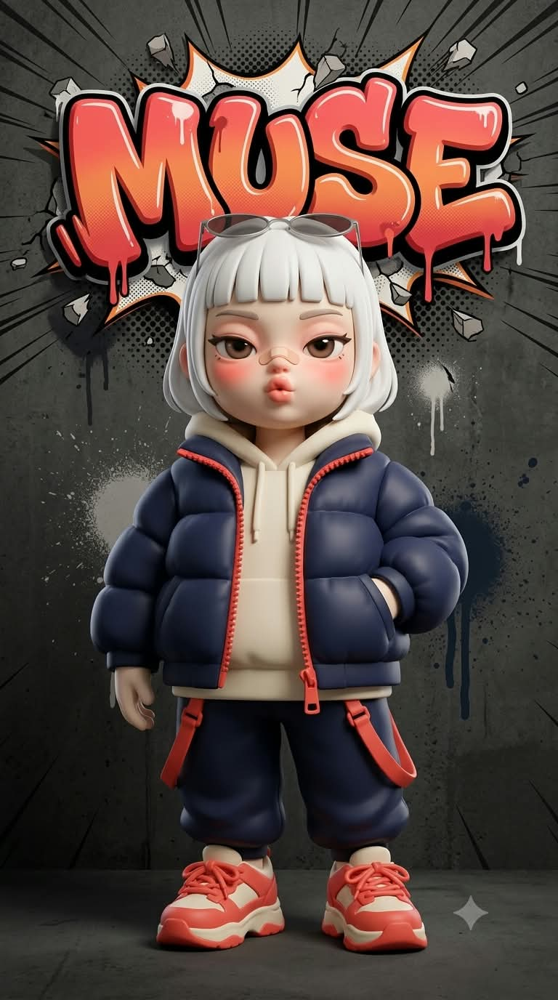
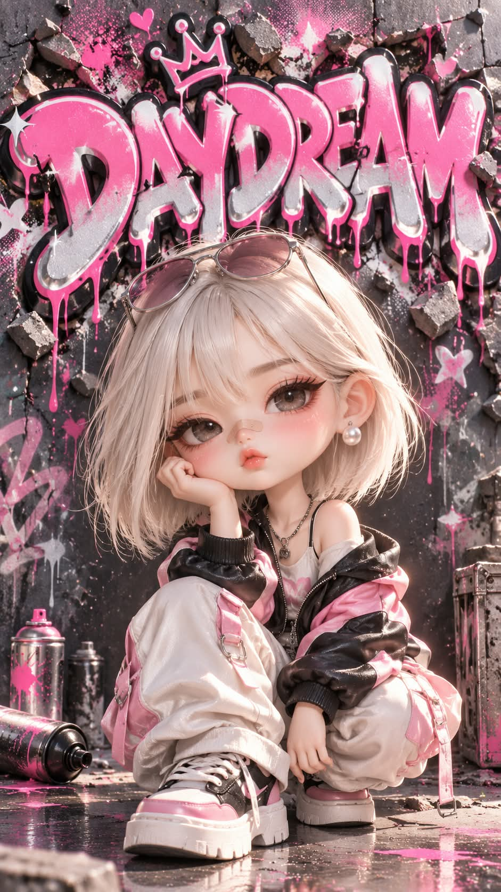

# 그라피티 치비, 벽을 뚫고 나온 그라피티 문구와 아트토이 미니미 프롬프트

## 1. 개요 및 아트 디렉팅 가이드

- **컨셉**: AI가 나를 분석해 정한 영어 그라피티 문구가 벽을 뚫고 튀어나온 콘크리트 벽 앞에, 나를 닮은 3등신 아트토이 미니미가 서 있는 블라인드박스 피규어 렌더 (세로 9:16)
- **모델별 버전**: 같은 컨셉을 모델마다 다르게 다듬은 두 가지 버전
  - **GPT 버전**: 문구·복장·포즈·벽과 글자 색을 단계별로 정하고, 아트토이 얼굴 생김새(거대한 눈, 버튼 코, 반창고, 뽀뽀 입)를 자세히 고정
  - **Gemini 버전**: 사진에서 눈·코·입의 가장 눈에 띄는 특징 3가지를 먼저 찾아 캐리커처처럼 과장하는 닮음 전략과, 다리를 늘리지 않는 짧고 통통한 비율을 가장 중요한 규칙으로 둠
- **작업 순서**:
  - 대화·기억·성격·취미와 사진 인상을 분석해 영어 1~2단어(10글자 이하) 문구, 복장(메인 2색 + 포인트 1색), 포즈를 각각 후보 5개 중에서 고름. 흔한 단어·옷·포즈는 피함
  - 대화창에 문구·복장·포즈·근거(Gemini는 얼굴 특징 3가지 포함)를 먼저 보여 주고 바로 생성
- **화풍**: C4D·옥테인 느낌의 블라인드박스 아트토이. 모공 없는 매트한 소프트 비닐 피부, 사진에 필터를 씌운 느낌이면 실패
- **아트토이 얼굴**:
  - 머리가 매우 큰 3등신, 통통한 볼과 작고 둥근 턱
  - 반쯤 내리깐 거대한 눈, 두꺼운 아이라인과 굵은 속눈썹, 유리처럼 맑은 홍채
  - 아주 작은 버튼 코와 콧등의 살구색 반창고, 진한 코랄 핑크 블러셔
  - 입술을 쭉 내민 뾰로통한 뽀뽀 입과 귀찮은 듯 시크한 눈빛
- **사진 사용 규칙**: 사진을 3D로 옮기지 않고 눈 모양·눈꼬리·쌍꺼풀, 코 모양, 입술 두께와 입꼬리만 토이 얼굴에 번역해서 반영. 얼굴형·피부·헤어·표정·각도·옷은 가져오지 않음. 안경은 얇은 금속 테로 단순화
- **헤어**: 플래티넘 화이트 조형 헤어. 여성은 일자 앞머리 턱선 보브, 남성은 옆은 짧고 윗머리를 넘긴 형태. 안경이 없으면 머리 위에 금속 테 선글라스
- **구도**: 위쪽 약 40%는 문구, 아래쪽 약 60%는 미니미. 미니미 머리가 글자 아래쪽을 살짝 가려 앞뒤 깊이를 만들고, 차렷 금지
- **배경 & 문구**: 어두운 콘크리트 벽의 스프레이 얼룩과 페인트 드립. 복장 포인트 색 그라데이션의 굵은 버블체 레터링이 벽을 깨고 3D로 튀어나오고, 뒤로 만화식 집중선·폭발 테두리·하프톤 망점. 외곽선은 글자에만
- **워터마크**: 오른쪽 아래에 평평한 반투명 흰색 산세리프체 "@darkjl81"
- **금지**: 실사 얼굴, 사진 얼굴을 그대로 3D로 만든 것, 피규어 외곽선과 2D 일러스트, 문구와 워터마크 외의 글자와 로고, 노출 많은 옷, 다른 인물

---

## 2. 프롬프트 전문

### GPT 버전

```text
[작업 순서]
1. 지금까지 나눈 대화, 저장된 기억, 나에 대해 알고 있는 모든 정보(성격, 직업, 취미, 관심사, 말투, 가치관, 생활 패턴)와 업로드한 사진의 인상을 종합해서 분석한다.
2. 분석 결과로 그라피티 문구를 정한다. 짧은 영어 1~2단어, 전체 10글자 이하. 흔한 단어나 가장 먼저 떠오르는 단어를 기본값으로 고르지 말고, 서로 다른 성격·취미·관심사에서 출발한 후보 5개를 속으로 떠올린 뒤 이 사람에게 가장 구체적으로 맞는 하나를 고른다.
3. 같은 방식으로 복장을 정한다. 상의, 하의, 신발, 액세서리, 메인 2색 + 포인트 1색을 이 사람에게만 맞게 정한다. 후보 5개를 떠올린 뒤 가장 구체적으로 맞는 하나를 고른다.
4. 같은 방식으로 포즈를 정한다. 이 사람의 성격이 실루엣만으로 드러나는 포즈를 고른다.
5. 복장 색에 맞춰 벽 색과 그라피티 글자 색을 정한다. 글자는 복장 포인트 색을 중심으로, 벽은 글자와 피규어가 둘 다 잘 보이는 어두운 톤으로.
6. 대화창에 문구 / 복장 / 포즈 / 정해진 근거 2~3줄을 짧게 보여준다.
7. 질문하지 말고 바로 이미지를 생성한다.

[화풍 – 최우선]
블라인드박스 수집용 고급 디자이너 아트토이 3D 렌더, C4D·옥테인 느낌.
- 사람 얼굴이 아니라 아트토이 얼굴이다. 실제 사람의 얼굴 비율, 입체, 피부결을 쓰지 않는다.
- 피부: 모공·잔털 없는 매트한 도자기/소프트 비닐 질감, 창백한 크림빛에 은은한 핑크 그라데이션.
- 결과물이 사진에 필터를 씌운 것처럼 보이면 실패다.

[아트토이 얼굴 – 고정, 사진보다 우선]
- 전체 3등신(머리 1 : 몸 2), 머리가 매우 크다.
- 매끈한 달걀형 토이 헤드, 통통한 볼, 작고 둥근 턱.
- 한쪽 눈이 얼굴 폭의 약 1/3인 거대한 눈. 반쯤 내리깐 눈꺼풀, 두꺼운 아이라인, 길고 굵은 속눈썹, 유리처럼 맑은 큰 홍채에 하이라이트 하나.
- 눈 아래와 눈두덩에 진한 코랄 핑크 블러셔와 섀도.
- 짧고 굵게 조각된 눈썹.
- 아주 작은 버튼 코, 핑크빛 코끝, 콧등에 작은 살구색 반창고.
- 작고 둥근 귀가 머리 옆으로 살짝 튀어나옴.
- 표정(사진 표정 무시): 입술을 앞으로 쭉 내민 뾰로통한 뽀뽀 입, 반쯤 감긴 시크하고 귀찮은 눈빛, 시선은 정면 카메라.

[업로드 사진 사용 규칙]
- 사진은 3D로 옮기는 것이 아니다. 위 아트토이 얼굴 위에 눈·코·입의 특징만 번역해서 반영한다.
- 눈: 쌍꺼풀 유무, 눈꼬리 방향, 눈 모양을 거대한 토이 눈의 윤곽에만 반영. 크기는 토이 규칙대로.
- 코: 콧등·코끝 모양을 작은 버튼 코의 실루엣에만 반영.
- 입: 입술 두께 비율과 입꼬리 모양만 반영. 표정은 위 규칙대로 새로 그린다.
- 반영하지 않는 것: 얼굴형, 얼굴 비율, 피부, 헤어, 이마/헤어라인, 표정, 고개 기울기, 얼굴 방향, 시선, 옷, 배경.
- 사진 속 인물이 안경을 쓰고 있으면 같은 테 모양을 얇은 금속 테로 단순화해 씌운다.
- 사진을 보고 성별을 판단한다.

[헤어 – 고정, 사진 헤어 무시]
- 여성: 플래티넘 화이트, 이마를 덮는 일자 앞머리의 턱선 보브컷.
- 남성: 플래티넘 화이트, 옆은 짧고 윗머리는 볼륨 있게 넘긴 형태.
- 매끈한 머리결이 한 덩어리로 정돈된 조형 헤어, 은은한 광택.
- 안경을 쓰지 않았다면 머리 위에 얇은 금속 테 선글라스를 걸쳐 올린다(렌즈 색은 복장 색에 맞춤).

[복장 – 작업 순서에서 정한 대로]
- 아트토이 비율에 맞게 옷의 볼륨과 재질감을 과장해서 표현한다.
- 옷과 소품에는 브랜드 로고·상표·글자를 넣지 않는다.
- 노출이 많은 옷 금지.

[포즈·구도 – 포즈는 작업 순서에서 정한 대로]
- 세로 9:16, 머리끝부터 발끝까지 전신.
- 화면 위쪽 약 40%는 그라피티 문구, 아래쪽 약 60%는 미니미가 채운다. 미니미 발끝은 화면 아래 가장자리에서 조금 떨어지게 여백을 둔다.
- 정면 차렷 금지. 얼굴은 정면에 가깝게, 손이나 소품이 얼굴을 가리지 않게.
- 미니미는 문구 바로 아래 중앙에 선다. 머리 윗부분이 글자 아래쪽을 살짝 가려서, 글자는 뒤·미니미는 앞이라는 깊이가 분명하게 보인다.
- 세로 화면이 좁으므로 문구는 필요하면 두 줄로 쌓아 배치하고, 전체 철자가 잘리지 않고 읽히게 한다.

[배경 – 그라피티 벽]
- 작업 순서에서 정한 색의 콘크리트 벽. 스프레이 얼룩, 흘러내린 페인트 자국, 읽히지 않는 추상 낙서가 은은하게 깔려 있다.
- 화면 위쪽에 정한 문구를 크고 굵은 버블체 그라피티 레터링으로 쓴다. 정한 글자 색 그라데이션, 굵은 검정 외곽선, 흰 하이라이트, 아래로 흘러내린 페인트 드립.
- 철자는 정한 그대로 정확히 쓰고, 글자를 추가하거나 빼지 않는다.

[만화적 팝아웃 효과]
- 글자가 벽을 뚫고 카메라 쪽으로 튀어나온 것처럼 두꺼운 3D 입체로 돌출. 글자 가장자리 주변 벽은 갈라지고 콘크리트 조각이 튀어나간다.
- 글자 뒤로 만화식 방사형 집중선, 폭발 버스트 테두리, 하프톤 망점, 작은 별·반짝이.
- 굵은 외곽선은 글자에만 들어가고, 피규어는 외곽선 없이 3D 렌더 그대로.

[워터마크]
화면 오른쪽 아래 구석에 "@darkjl81"을 작게 넣는다. 깔끔한 산세리프체, 반투명 흰색, 화면 가로 폭의 약 1/5 크기. 그라피티 효과·입체·외곽선 없이 평평하게 넣고, 피규어 발이나 그림자와 겹치지 않게 가장자리에 붙인다. 철자는 @darkjl81 그대로 정확히.

[렌더링]
위쪽에서 오는 부드러운 스튜디오 조명, 약한 림라이트, 피규어 발밑에 얕은 바닥 그림자. 그라피티 글자에도 같은 조명이 닿아 입체감이 산다.

[금지]
- 실사 사람 얼굴, 사진 같은 피부·코·입술
- 사진 얼굴을 그대로 3D로 만든 것
- 사진의 각도·표정·헤어 유지
- 피규어에 외곽선, 2D 일러스트
- 문구와 워터마크 이외의 읽히는 글자, 로고, 철자 오류
- 화면 안에 다른 인물

이미지 비율: 9:16 세로
```

### Gemini 버전

```text
[작업 순서]
1. 업로드한 사진에서 눈·코·입을 자세히 관찰해, 이 사람을 다른 사람과 구별해 주는 가장 눈에 띄는 특징 3가지를 찾는다(눈 모양·크기·눈꼬리·쌍꺼풀·눈 사이 거리, 콧등·코끝·콧볼 모양, 입술 두께·윗입술 모양·입 너비·입꼬리, 점·보조개 같은 표시).
2. 나에 대해 알고 있는 모든 정보(대화, 기억, 성격, 직업, 취미, 관심사, 말투)와 사진 인상을 분석해 그라피티 문구(영어 1~2단어, 10글자 이하), 복장(메인 2색+포인트 1색), 포즈를 정한다. 각각 서로 다른 관점의 후보 5개를 속으로 떠올린 뒤 가장 구체적으로 맞는 것을 고른다. 흔한 단어·흔한 옷·흔한 포즈를 기본값으로 쓰지 않는다.
3. 대화창에 얼굴 특징 3가지 / 문구 / 복장 / 포즈 / 근거 2줄을 보여주고, 질문 없이 바로 그린다.

[가장 중요 1 – 아트토이 비율]
블라인드박스 디자이너 아트토이 3D 렌더. 사람이 아니라 짧고 통통한 장난감 피규어다.
- 다리 길이는 머리 높이보다 짧다. 팔다리는 짧고 뭉툭하다.
- 키는 머리 3개 높이. 머리가 몸통보다 크다.
- 세로 화면에 공간이 남으면 다리를 늘리지 말고 피규어 전체를 크게 키운다.

[가장 중요 2 – 닮게 만드는 방법]
- 1번에서 찾은 특징 3가지를 캐리커처처럼 과장해서 아트토이 얼굴에 넣는다. 이 특징 때문에 보는 사람이 사진 속 인물을 바로 알아봐야 한다.
- 눈은 아트토이답게 매우 크게 키우되, 사진 속 눈의 모양·눈꼬리 각도·쌍꺼풀은 그대로 유지한 채 키운다.
- 코는 작게 줄이되 사진 속 코의 모양을 유지한 채 줄인다.
- 입은 아래 표정대로 내밀되, 사진 속 입술의 두께와 윗입술 모양을 유지한다.
- 얼굴형, 피부, 헤어, 표정, 고개 각도, 시선, 옷은 사진에서 가져오지 않는다.
- 안경을 썼으면 같은 모양의 얇은 금속 테를 씌운다. 성별은 사진으로 판단한다.

[아트토이 얼굴 마감]
- 반쯤 내리깐 눈꺼풀, 두꺼운 아이라인, 굵은 속눈썹, 유리처럼 맑은 홍채.
- 입술을 동그랗게 모아 앞으로 쭉 내민 뽀뽀 입.
- 콧등에 살구색 반창고, 눈 아래 진한 코랄 핑크 블러셔.
- 피부는 모공 없는 매트한 소프트 비닐, 창백한 크림빛.

[헤어]
플래티넘 화이트 조형 헤어. 여성은 일자 앞머리 턱선 보브, 남성은 옆은 짧고 윗머리를 넘긴 형태. 안경이 없으면 머리 위에 얇은 금속 테 선글라스.

[복장·포즈]
정한 복장을 아트토이답게 볼륨을 과장해서 입힌다. 로고·글자 없음. 정한 포즈로 서 있고 정면 차렷 금지, 얼굴은 정면에 가깝게, 손이 얼굴 특징을 가리지 않게.

[배경과 문구]
- 어두운 콘크리트 벽에 스프레이 얼룩과 페인트 드립만 있다. 벽의 다른 낙서는 글자 모양이 아니다.
- 화면 위쪽에 정한 문구를 굵은 버블체 그라피티로 크게 쓴다. 복장 포인트 색 그라데이션, 굵은 검정 외곽선, 흰 하이라이트, 페인트 드립.
- 글자가 벽을 뚫고 튀어나온 두꺼운 3D 입체. 글자 주변 벽이 갈라지고 콘크리트 조각이 튄다. 뒤로 만화식 집중선, 폭발 테두리, 하프톤 망점.
- 미니미는 글자 바로 아래 중앙에 서고, 머리가 글자 아래쪽을 살짝 가린다.
- 철자는 정한 그대로 정확히. 화면에 읽히는 글자는 이 문구와 워터마크 두 개뿐.

[워터마크]
화면 오른쪽 아래 구석에 "@darkjl81"을 작게 넣는다. 깔끔한 산세리프체, 반투명 흰색, 화면 가로 폭의 약 1/5 크기. 그라피티 효과·입체·외곽선 없이 평평하게 넣고, 피규어 발이나 그림자와 겹치지 않게 가장자리에 붙인다. 철자는 @darkjl81 그대로 정확히.

[렌더]
부드러운 스튜디오 조명, 약한 림라이트, 발밑 그림자. 세로 9:16 전신, 발끝 아래 여백.
```

---

## 3. 결과물 비교 갤러리

| 생성 모델 | 생성 결과 이미지 |
| :--- | :--- |
| **제미나이 (Gemini)** |  |
| **ChatGPT (DALL-E 3)** |  |
