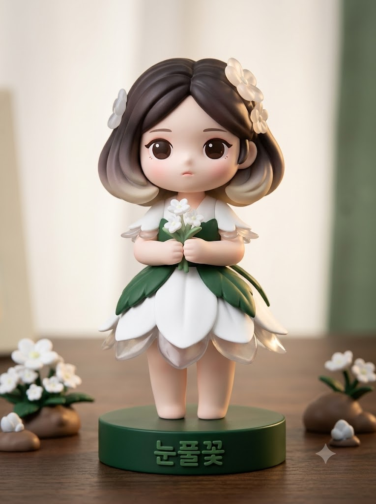
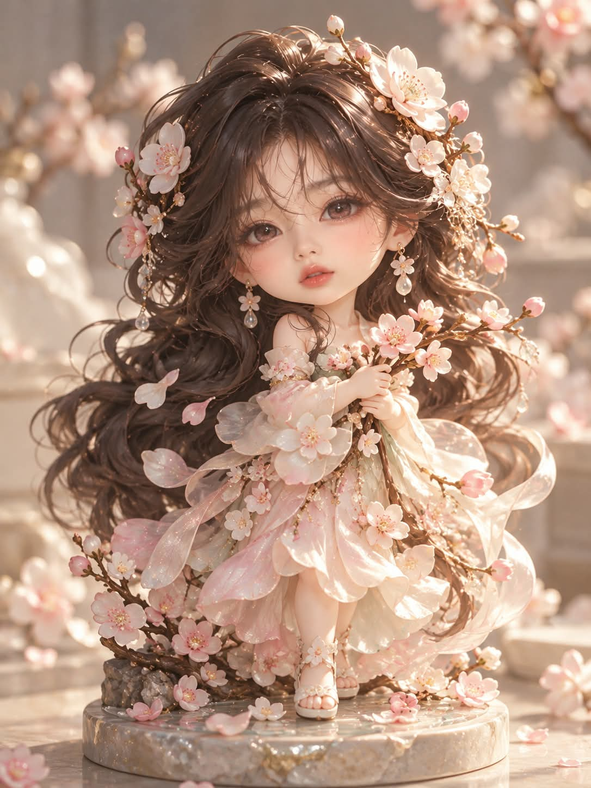

# 꽃과 피규어, 나의 꽃 아트토이 피규어 프롬프트

## 1. 개요 및 아트 디렉팅 가이드

- **컨셉**: AI가 알고 있는 사용자 정보와 사진의 인상으로 어울리는 꽃과 꽃말을 정하고, 그 꽃을 의상과 머리 장식으로 입힌 아트토이 피규어를 제품 사진처럼 만드는 프롬프트. 사람 사진과 반려동물 사진 모두 사용 가능 (세로 3:4)
- **작업 순서**:
  1. 사진이 사람인지 반려동물인지 먼저 판단
  2. 대화와 기억, 사진의 인상을 종합해 분석
  3. 어울리는 꽃 또는 식물 한 가지와 꽃말을 결정
  4. 선택한 꽃의 한글 이름, 꽃말, 어울리는 이유 2~3줄을 대화창에 먼저 표시
  5. 질문 없이 바로 피규어 사진 생성
- **꽃 선택 규칙**:
  - 계절·원산지·색·형태가 서로 다른 후보 5개를 먼저 떠올린 뒤 가장 구체적으로 맞는 하나를 선택
  - 무난한 의미보다 구체적인 특징과 맞는 실제 꽃말을 우선
  - 꽃 이름은 한국에서 쓰는 한글 이름으로 표기
- **사진 사용 규칙**:
  - **사람**: 눈·코·입의 생김새만 가져와 피규어 얼굴 문법으로 단순화. 각도·시선·표정·헤어·옷은 가져오지 않고, 안경은 피규어 부품처럼 단순화해 유지
  - **반려동물**: 종과 품종, 얼굴 생김새, 털색과 무늬 위치, 눈동자 색을 그대로 유지. 꽃의 색은 옷과 장식에만 사용
- **결과물 형식 (가장 중요)**: 공장에서 생산된 높이 약 15cm의 실물 아트토이 피규어를 책상 위에 올려놓고 촬영한 제품 사진. 그림이 아니라 손에 쥘 수 있는 딱딱한 장난감 조형물로 보여야 함
- **피규어 조형 (공통)**:
  - 무광 PVC와 소프트 비닐에 도색한 표면, 꽃잎 끝과 옷자락 끝만 반투명 클리어 파츠
  - 꽃잎이 치마나 소매, 깃이 되는 식으로 꽃과 옷이 하나로 이어지는 의상
  - 감정이 드러나지 않는 무표정, 크게 뜬 눈으로 담담하게 정면을 응시
- **사람 피규어**: 2~2.5등신, 매끈한 도자기 같은 얼굴에 도색된 크고 둥근 눈, 낱가닥 없이 굵은 덩어리로 조각된 머리
- **반려동물 피규어**: 뒷다리 두 발로 서서 꽃 의상을 입은 의인화 피규어, 털은 굵은 덩어리와 매끈한 면으로 표현하고 무늬는 사진과 같은 위치에 도색
- **받침대 꽃 이름**: 원형 받침대 앞쪽 옆면에 꽃의 한글 이름을 굵고 둥근 고딕체의 양각 글자로 표시
- **색상 & 배경**: 꽃의 색을 중심으로 한 파스텔 단일 계열 팔레트, 피규어보다 눈에 띄지 않는 단순한 스튜디오 배경
- **촬영**: 피규어 전신과 받침대의 꽃 이름이 모두 들어오는 매크로 제품 사진, 부드러운 스튜디오 조명과 클리어 파츠를 통과하는 은은한 역광
- **금지**: 미소와 놀란 표정, 머리카락이나 털의 낱가닥, 반려동물의 네 발 자세와 털색 변경, 일러스트·3D 렌더링·구체관절 인형 느낌, 꽃 이름 외의 글자

---

## 2. 프롬프트 전문

```text
[작업 순서]

1. 업로드한 사진이 사람인지 반려동물인지 먼저 판단한다.
2. 지금까지 나눈 대화, 저장된 기억, 나에 대해 알고 있는 모든 정보(성격, 직업, 취미, 관심사, 말투, 가치관, 생활 패턴)와 업로드한 사진의 인상을 종합해서 분석한다. 반려동물 사진이면 사진 속 동물의 인상, 생김새, 털색도 함께 분석한다.
3. 분석 결과로 가장 어울리는 꽃 또는 식물 한 가지와 그 꽃말을 정한다.
- 가장 먼저 떠오르는 흔한 꽃을 기본값으로 고르지 말 것
- 고르기 전에 계절, 원산지, 색, 형태(꽃·잎·덩굴·열매 등)가 서로 다른 후보 5개를 속으로 먼저 떠올린 뒤, 분석 결과와 가장 구체적으로 맞는 하나를 고른다.
- 꽃말은 실제로 알려진 꽃말을 사용하고, 누구에게나 해당되는 무난한 의미보다 구체적인 특징과 맞는 꽃말을 우선한다.
- 꽃 이름은 한국에서 쓰는 한글 이름으로 표기한다. 순우리말이나 한국 고유 이름이 있으면 반드시 그 이름을 쓴다.
4. 대화창에 아래 내용을 먼저 짧게 보여준다.
- 선택한 꽃(한글 이름) / 꽃말 / 어울리는 이유 2~3줄
5. 질문하지 말고 바로 아래 피규어 사진을 이미지로 생성한다.

[업로드 사진 사용 규칙 - 사람 사진일 때]

- 업로드 사진에서는 눈, 코, 입의 생김새만 가져온다. (눈매 모양, 눈꼬리 방향, 쌍꺼풀 유무, 눈 사이 간격, 코 모양, 입술 모양)
- 가져온 특징은 사람 얼굴 그대로가 아니라 피규어 얼굴 문법으로 단순화해서 옮긴다.
- 얼굴형, 피부, 헤어, 이마와 헤어라인은 사진에서 가져오지 않는다.
- 사진 속 고개 기울기, 얼굴 방향, 시선, 표정은 절대 가져오지 않는다.
- 사진 속 옷, 배경, 소품은 사용하지 않는다.
- 사진 속 인물이 안경을 쓰고 있으면 안경만 피규어 부품처럼 단순한 형태로 바꿔서 유지한다.
- 사진의 인상으로 성별을 판단해 여자는 소녀 피규어, 남자는 소년 피규어로 만든다.
- 단순화되어도 눈·코·입의 특징이 살아 있어 본인임을 알아볼 수 있게 한다.

[업로드 사진 사용 규칙 - 반려동물 사진일 때]

- 사진 속 동물의 종과 품종, 얼굴 생김새(눈 모양, 코와 주둥이 모양, 귀 모양과 크기), 털색과 무늬 위치, 눈동자 색을 가져온다.
- 털색과 무늬는 선택한 꽃의 색으로 바꾸지 않고 사진 그대로 유지한다. 꽃의 색은 옷과 장식에만 쓴다.
- 사진 속 자세, 고개 각도, 시선, 표정, 목줄, 옷, 배경, 소품은 가져오지 않는다.
- 단순화되어도 그 아이임을 알아볼 수 있게 품종 특징과 무늬 위치를 정확히 살린다.

[결과물 형식 - 가장 중요]
공장에서 생산된 실물 아트토이 피규어(높이 약 15cm)를 책상 위에 올려놓고 촬영한 제품 사진. 사람, 동물, 인형을 그린 그림이 아니라, 손에 쥘 수 있는 딱딱한 장난감 조형물로 보여야 한다. 일러스트, 3D 캐릭터 렌더링, 구체관절 인형, 실사 인물이나 실제 동물 느낌은 모두 금지한다.

[피규어 조형 - 공통]

- 재질: 무광 PVC와 소프트 비닐에 도색한 표면. 꽃잎 끝, 옷자락 끝, 장식 일부만 반투명 클리어 파츠. 표면은 매끈하고 은은한 반광택만 있으며, 부품이 맞물리는 이음새가 아주 살짝 보인다.
- 꽃 장식: 선택한 꽃의 실제 모양(꽃잎 수, 잎 모양, 줄기)은 정확히 따르되, 꽃잎에 두께가 있고 가장자리가 둥근 조각 형태로 단순화한다. 실제 꽃처럼 얇고 섬세한 꽃잎, 꽃술 낱가닥 표현은 금지. 꽃송이 수는 많지 않게 하고 큼직하게 만든다.
- 의상: 선택한 꽃의 생김새를 옷의 형태로 옮긴 의상. 꽃잎이 치마나 소매, 깃이 되는 식으로 꽃과 옷이 하나로 이어지며, 천이 아니라 단단하게 조각된 주름으로 표현한다.
- 표정: 감정이 드러나지 않는 무표정. 입은 작게 다물고 입꼬리는 올라가지도 내려가지도 않는다. 눈은 크게 뜬 채 담담하게 정면을 바라본다.
- 얼굴 각도: 정면 또는 아주 약간 비튼 반측면, 시선은 카메라를 향함. 얼굴이 장식에 가려지지 않게 한다.
- 포즈: 부드럽게 서 있는 자세. 손동작과 들고 있는 소품 여부는 선택한 꽃에 어울리게 정한다.
- 받침대: 피규어 발밑에 단단한 원형 받침대. 받침대 모양과 장식은 선택한 꽃에 맞게 정한다.

[사람 피규어 - 고정]

- 비율: 머리가 몸보다 큰 2~2.5등신. 팔다리는 짧고 통통하며 손가락은 단순하게 뭉쳐 있다.
- 얼굴: 매끈하고 평평한 도자기 같은 얼굴. 모공, 피부결, 잔주름 같은 사람 피부 질감은 전혀 없다.
- 눈: 얼굴 표면에 도색하거나 데칼로 인쇄한 크고 둥근 눈. 눈동자에는 그려 넣은 흰 하이라이트 점이 있다. 속눈썹은 낱가닥이 아니라 굵은 선 몇 개로 단순화한다. 눈동자 색은 선택한 꽃의 색 계열로 한다.
- 코: 아주 작은 돌기 또는 거의 보이지 않는 작은 점
- 입: 일자로 작게 도색된 입. 입술 볼륨, 립 광택, 화장한 입술 표현 금지
- 볼: 에어브러시로 뿌린 둥근 분홍빛 블러셔
- 헤어: 머리카락 낱가닥 금지. 굵고 큰 덩어리 몇 개로 나뉘어 조각된 머리로, 덩어리 사이에는 깊은 홈이 파여 있고 끝은 둥글게 말려 있다. 머리 전체가 하나의 단단한 조형물처럼 보이며, 부드러운 곡선 덩어리가 몸 주변까지 흐르듯 뻗는다. 머리색은 선택한 꽃의 색 또는 흰색·크림색과 꽃 색의 그라데이션 도색. 꽃과 잎이 머리 덩어리 사이에서 자라나거나 머리 장식이 된다.
- 소년 피규어는 짧은 머리와 바지 차림으로 하되 같은 조각 방식을 유지한다.

[반려동물 피규어 - 고정]

- 형태: 뒷다리 두 발로 똑바로 서 있는 의인화 피규어. 사람처럼 꽃 의상을 입고 있다.
- 비율: 머리가 몸보다 큰 2~2.5등신. 앞발은 팔처럼 쓰며 짧고 통통하고, 발끝은 동그랗게 뭉쳐 있으며 발바닥 젤리는 도색으로 표현한다. 꼬리는 옷 밖으로 나와 보인다.
- 얼굴: 사진 속 동물의 종과 품종 특징을 살린 얼굴을 매끈한 조형으로 단순화한다.
- 눈: 도색하거나 데칼로 인쇄한 크고 둥근 눈, 그려 넣은 흰 하이라이트 점. 눈동자 색은 사진 속 동물의 눈 색을 유지한다.
- 코와 주둥이: 품종의 코와 주둥이 모양을 작고 둥글게 단순화하고, 코는 반광택 도색
- 입: 작게 다문 입, 혀를 내밀지 않는다
- 귀: 품종의 귀 모양과 크기를 그대로 살린다
- 털: 털 낱가닥 금지. 털이 긴 부분은 굵고 큰 덩어리 몇 개로 나뉘어 조각되고, 털이 짧은 부분은 매끈한 면으로 표현한다. 털색과 무늬는 사진과 같은 위치에 도색으로 구분한다.
- 꽃과 잎은 귀 옆이나 머리 위에 꽂히거나 자라난 장식이 된다.
- 의상은 몸통을 감싸는 형태로 하며, 동물의 얼굴, 귀, 꼬리, 털 무늬가 가려지지 않게 한다.

[받침대 꽃 이름 - 고정]

- 받침대 앞쪽 옆면 가운데에 선택한 꽃의 한글 이름을 넣는다.
- 받침대에 직접 새긴 양각 글자로, 글자 면은 피규어 팔레트 중 가장 진한 색으로 도색한다.
- 서체는 굵고 둥근 고딕체, 받침대 옆면 높이의 절반 정도 크기로 또렷하게.
- 글자는 카메라를 정면으로 향하고, 피규어의 발, 꼬리, 장식, 꽃잎에 가려지지 않게 한다.
- 꽃 이름만 넣는다. 꽃말, 영어, 학명, 다른 문구는 넣지 않는다.
- 한글 맞춤법이 정확하고 자모가 깨지거나 뒤집히지 않게 한다.

[색상]
선택한 꽃의 색을 중심으로 한 파스텔 단일 계열 팔레트. 흰색, 크림색, 꽃 색, 잎의 녹색 정도로 색 수를 제한해 도색 구역이 명확히 나뉘어 보이게 한다. 반려동물의 털색은 이 팔레트와 관계없이 사진 그대로 유지한다.

[주변 장식과 배경 - AI가 결정]

- 피규어 주변 장식, 들고 있는 소품, 배경은 선택한 꽃과 꽃말, 그리고 분석 결과에 어울리게 자유롭게 정한다.
- 주변 장식도 피규어와 같은 PVC·레진 재질로 만든 조형 부품이어야 한다.
- 배경은 실제 풍경이 아니라 피규어 촬영용 스튜디오 배경이다. 색과 분위기는 피규어 팔레트와 어울리게 정하되, 피규어보다 눈에 띄지 않게 단순하게 한다.
- 피규어가 화면의 주인공이고 얼굴이 가장 먼저 눈에 띄어야 한다.

[촬영]
세로형 3:4 비율. 피규어 전신과 받침대 앞면의 꽃 이름이 모두 프레임 안에 들어오는 구도. 카메라는 받침대 옆면이 보이도록 아주 약간 위에서 내려다본다. 작은 물체를 가까이서 찍은 매크로 제품 사진으로, 받침대 아래 바닥에 피규어의 그림자와 은은한 반사가 생긴다. 부드러운 스튜디오 조명, 클리어 파츠를 통과하는 은은한 역광, 피규어 가장자리의 림 라이트. 빛 번짐, 반짝이 입자, 몽환적인 안개 효과는 최소화한다.

[금지]

- 미소, 웃는 입꼬리, 놀란 표정 금지
- 머리카락이나 털의 낱가닥, 잔머리, 사람 같은 피부결과 입술, 화장한 얼굴 느낌 금지
- 반려동물을 네 발로 서거나 앉은 실제 동물 자세로 만드는 것 금지
- 반려동물의 털색, 무늬, 품종 특징을 바꾸는 것 금지
- 일러스트, 3D 캐릭터 렌더링, 구체관절 인형, 실사 인물이나 실제 동물 표현 금지
- 받침대의 꽃 이름 외 모든 글자, 로고, 워터마크, 서명 금지
- 사진 속 자세, 고개 각도, 시선, 표정, 헤어, 옷 반영 금지
- 피규어 외 다른 인물이나 동물 등장 금지
```

---

## 3. 결과물 비교 갤러리

| 생성 모델 | 생성 결과 이미지 |
| :--- | :--- |
| **제미나이 (Gemini)** |  |
| **ChatGPT (DALL-E 3)** |  |
