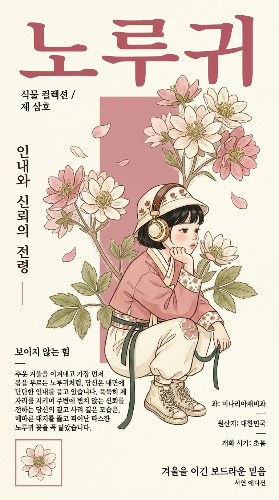
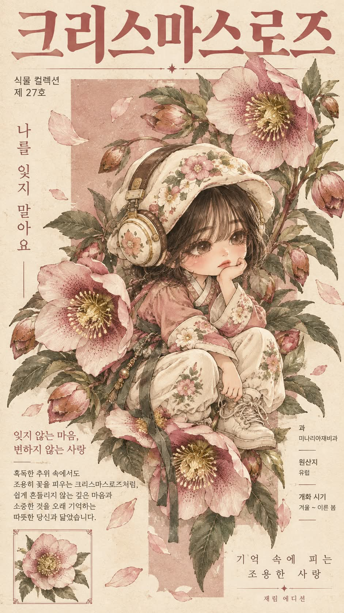

# 나의 꽃 요정, 꽃말 식물 도감풍 한복 미니미 포스터 프롬프트

## 1. 개요 및 아트 디렉팅 가이드

- **컨셉**: AI가 알고 있는 사용자의 성격·직업·취미·가치관과 사진의 인상을 종합해 가장 어울리는 꽃과 꽃말을 정하고, 큰 꽃송이 사이에 쪼그려 앉은 한복 차림 미니미를 식물 도감풍 포스터로 그리는 프롬프트 (세로 9:16)
- **작업 순서**:
  1. 대화와 기억, 사진의 인상을 종합해 분석
  2. 어울리는 꽃 한 가지와 꽃말을 결정
  3. 선택한 꽃의 한글 이름, 꽃말, 어울리는 이유 2~3줄을 대화창에 먼저 표시
  4. 질문 없이 바로 포스터 이미지 생성
- **꽃 선택 규칙**:
  - 한복 차림이나 동양풍 화풍에 끌려가지 않고 전 세계 모든 꽃 중에서 선택
  - 계절·원산지·색이 서로 다른 후보 5개를 먼저 떠올린 뒤 가장 구체적으로 맞는 하나를 선택
  - 성실함·인내처럼 누구에게나 해당하는 무난한 꽃말보다 그 사람만의 특징과 맞는 실제 꽃말을 우선
  - 꽃 이름과 과 이름은 한국에서 쓰는 한글 이름으로 표기하고, 한글 이름이 없을 때만 외래어 표기 허용
- **업로드 사진 사용 규칙**: 눈·코·입의 생김새만 가져와 미니미로 바뀌어도 본인임을 알아볼 수 있게 하고, 각도·시선·표정·헤어·옷은 가져오지 않음. 안경은 유지
- **화풍**: 가늘고 섬세한 갈색 먹선 위에 채도를 낮춘 바랜 수채 물감을 얇게 입힌 현대 한국 일러스트, 빈티지 종이 질감과 평면적이고 부드러운 음영
- **미니미 인물 (고정)**:
  - 2.5등신의 아담한 체형, 일자 앞머리의 검은 단발
  - 꽃 문양 자수의 둥근 천 모자와 그 위에 쓴 크림색 레트로 헤드폰
  - 꽃의 색을 바랜 톤으로 낮춘 짧은 저고리, 통이 넓은 크림색 한복 바지, 낡은 크림색 하이탑 운동화
  - 쪼그려 앉아 손등에 턱을 괸 자세, 무심하고 차분하게 생각에 잠긴 표정
- **포스터 레이아웃 (위치 고정)**:
  - 상단에 포스터 폭을 가득 채우는 굵은 한글 명조체의 꽃 이름, 그 아래 "식물 컬렉션 / 제 ○호"
  - 중앙의 연한 포인트 컬러 사각 블록과 그 밖으로 넘쳐 흐르는 꽃줄기, 꽃 사이에 앉은 미니미
  - 왼쪽의 세로 꽃말과 설명 블록, 오른쪽의 과·원산지·개화 시기 정보 블록
  - 왼쪽 맨 아래의 작은 꽃 액자, 오른쪽 맨 아래의 "○○ 에디션" 표기
- **색상 & 글자**: 포인트 컬러는 꽃의 색을 깊고 차분하게 낮춘 색으로 통일, 포스터 안의 모든 글자는 한글로만 작성
- **금지**: 영어·알파벳·학명, 한글 이름이 있는 꽃의 외래어 표기, 실사·3D·반실사, 미니미 외 다른 인물

---

## 2. 프롬프트 전문

```text
[작업 순서]

1. 지금까지 나눈 대화, 저장된 기억, 나에 대해 알고 있는 모든 정보(성격, 직업, 취미, 관심사, 말투, 가치관, 생활 패턴)와 업로드한 사진의 인상을 종합해서 분석한다.
2. 분석 결과로 나와 가장 어울리는 꽃 한 가지와 그 꽃의 꽃말을 정한다.
- 한복 차림, 동양풍 화풍, 한글 이름 표기 규칙은 꽃 선택에 전혀 영향을 주지 않는다. 한글 이름 규칙은 표기 방법일 뿐이며, 꽃은 전 세계 모든 꽃 중에서 고른다.
- 가장 먼저 떠오르는 흔한 꽃을 기본값으로 고르지 말 것
- 동양 전통 그림에 자주 등장하는 꽃으로 쏠리지 말 것
- 꽃을 고르기 전에 계절, 원산지, 색이 서로 다른 후보 5개를 속으로 먼저 떠올린 뒤, 분석 결과와 가장 구체적으로 맞는 하나를 고른다.
- 꽃말은 실제로 알려진 꽃말을 사용하고, 성실함, 인내, 고결함처럼 누구에게나 해당되는 무난한 의미보다 이 사람만의 구체적인 특징과 맞는 꽃말을 우선한다.
- 꽃 이름은 반드시 한국에서 쓰는 한글 이름으로 표기한다. 외국어 이름을 소리 나는 대로 옮긴 표기(외래어 표기)는 사용하지 않는다.
- 순우리말 이름이나 한국 고유 이름이 있는 꽃은 반드시 그 이름을 쓰고, 한글 이름이 전혀 없는 꽃일 때만 외래어 표기를 허용한다. 과 이름도 같은 규칙으로 한글 이름을 쓴다.
3. 대화창에 아래 내용을 먼저 짧게 보여준다.
- 선택한 꽃(한글 이름) / 꽃말 / 나와 어울리는 이유 2~3줄
4. 질문하지 말고 바로 아래 포스터를 이미지로 생성한다.

[업로드 사진 사용 규칙 - 매우 중요]

- 업로드 사진에서는 눈, 코, 입의 생김새만 가져온다.
- 얼굴형, 피부, 헤어, 이마와 헤어라인은 사진에서 가져오지 않는다.
- 사진 속 고개 기울기, 얼굴 방향, 시선, 표정은 절대 가져오지 않는다. 각도와 표정은 아래 서술대로 새로 그린다.
- 사진 속 인물이 안경을 쓰고 있으면 안경만 유지한다.
- 사진 속 옷, 배경, 소품은 사용하지 않는다.
- 미니미로 바뀌어도 눈·코·입의 특징이 살아 있어 본인임을 알아볼 수 있게 한다.

[화풍]
현대 한국 일러스트 화풍. 가늘고 섬세한 갈색 먹선으로 윤곽과 꽃잎 결, 옷 주름을 그리고, 그 위에 채도를 낮춘 바랜 수채 물감을 얇게 입힌 그림. 빈티지 종이 위에 그린 듯한 은은한 색 바램과 종이 질감. 강한 명암 없이 평면적이고 부드러운 음영. 옷의 문양과 꽃잎 결은 가는 선으로 촘촘하게 묘사. 3D, 실사, 반실사 금지.

[미니미 인물 - 고정]

- 2.5등신 정도의 아담한 어린아이 체형 미니미, 성별과 관계없이 같은 차림
- 헤어: 검은색 짧은 단발, 앞머리가 이마를 가린 일자 뱅, 모자 아래로 살짝 보임
- 머리: 둥근 바가지형 천 모자, 크림색 바탕에 선택한 꽃 문양 자수
- 모자 위로 둥근 레트로 헤드폰을 쓰고 있음, 크림색과 금빛 이어컵, 갈색 가죽 밴드
- 저고리: 넉넉한 품의 짧은 저고리, 색은 선택한 꽃의 색을 바랜 수채 톤으로 낮춘 색, 크림색 동정과 깃, 소매 끝은 꽃 문양 천으로 덧댐
- 바지: 통이 넓은 크림색 한복 바지, 발목에서 오므려짐, 무릎에 꽃 문양 덧댐
- 허리: 꽃 문양 천 허리띠, 짙은 녹회색 긴 끈이 늘어짐
- 신발: 낡은 크림색 하이탑 운동화, 끈 묶음, 밑창에 살짝 때 탄 느낌
- 포즈: 몸은 오른쪽을 향해 쪼그려 앉아 있고, 한쪽 팔꿈치를 무릎에 올려 손등에 턱을 괸 자세. 다른 손은 아래로 내려 운동화 끈 또는 늘어진 끈을 가볍게 쥠
- 얼굴 각도: 얼굴이 잘 보이도록 오른쪽을 향한 3/4 측면, 시선은 살짝 아래로
- 표정: 무심하고 차분하게 생각에 잠긴 표정, 입은 다물고 볼에 옅은 홍조

[포스터 전체 구성]
세로형 포스터(9:16 비율). 따뜻한 아이보리 크림색 종이 배경. 포스터 안의 모든 글자는 한글로만 작성한다. 영어, 알파벳, 학명, 라틴어는 절대 넣지 않는다.

[색상]
포인트 컬러는 선택한 꽃의 색을 깊고 차분하게 낮춘 색. 제목 글자, 중앙 사각 블록, 장식선, 액자 테두리, 저고리 색을 모두 이 계열로 통일. 꽃잎은 바랜 수채 톤, 잎은 탁한 녹회색.

[레이아웃 - 위치 고정]

1. 상단: 포스터 폭을 가득 채우는 큰 굵은 한글 명조체 제목, 선택한 꽃의 한글 이름(외래어 표기 금지). 길면 두 줄. 포인트 컬러.
2. 제목 아래 왼쪽: 작은 고딕체 두 줄 — "식물 컬렉션" / "제 ○호"
3. 중앙: 포인트 컬러를 연하게 한 단색 사각형 블록이 세로로 길게 놓임.
4. 꽃과 미니미: 선택한 꽃이 핀 줄기(또는 가지)가 왼쪽 아래에서 오른쪽 위로 뻗고, 크게 핀 꽃 여러 송이와 봉오리, 잎이 사각 블록 밖까지 넘쳐 흐르듯 배치. 꽃의 모양, 꽃잎 수, 잎 모양, 줄기 형태는 선택한 꽃의 실제 생김새를 정확히 따른다. 미니미는 화면 중앙의 줄기 위(또는 꽃 사이)에 쪼그려 앉아 있고, 미니미 주변과 발밑을 큰 꽃송이들이 감싼다. 꽃은 미니미보다 크게 그려 꽃 속의 작은 아이처럼 보이게 하되, 미니미의 얼굴이 포스터에서 가장 먼저 눈에 띄게 한다. 꽃잎 몇 장이 공중에 흩날림.
5. 왼쪽 세로 문구: 왼쪽 가장자리에 세로로 회전된 기울임 명조체로 꽃말 한 줄, 아래 짧은 가로선.
6. 왼쪽 아래 설명 블록:
- 작은 고딕체 두 줄: 꽃말을 압축한 짧은 문구
- 짧은 가로선
- 명조체 본문 4~5줄: 꽃말의 의미와 그것이 나와 닮은 점을 한글로 짧게
7. 오른쪽 정보 블록 (작은 고딕체, 항목 사이 짧은 가로선):
- 과: (한글 이름) / 원산지: (한글) / 개화 시기: (한글 계절)
8. 왼쪽 맨 아래: 포인트 컬러 얇은 테두리의 작은 정사각형 액자 안에 같은 화풍으로 그린 꽃 한 송이.
9. 오른쪽 맨 아래: 자간을 넓힌 작은 명조체 두 줄 — 꽃말을 시처럼 줄인 문구 / 더 작은 글씨로 "○○ 에디션" (○○에는 내 이름)

[글자 품질]

- 모든 한글은 맞춤법이 정확하고 자모가 깨지지 않게 또렷하게
- 문구는 짧게 유지
- 글자가 미니미 얼굴이나 꽃과 겹치지 않게 배치

[금지]

- 영어, 알파벳, 학명 금지
- 한글 이름이 있는 꽃을 외래어 표기로 쓰는 것 금지
- 사진 속 고개 각도, 시선, 표정, 헤어, 옷 반영 금지
- 실사, 3D, 반실사 금지
- 미니미 외 다른 인물 등장 금지
```

---

## 3. 결과물 비교 갤러리

| 생성 모델 | 생성 결과 이미지 |
| :--- | :--- |
| **제미나이 (Gemini)** |  |
| **ChatGPT (DALL-E 3)** |  |
