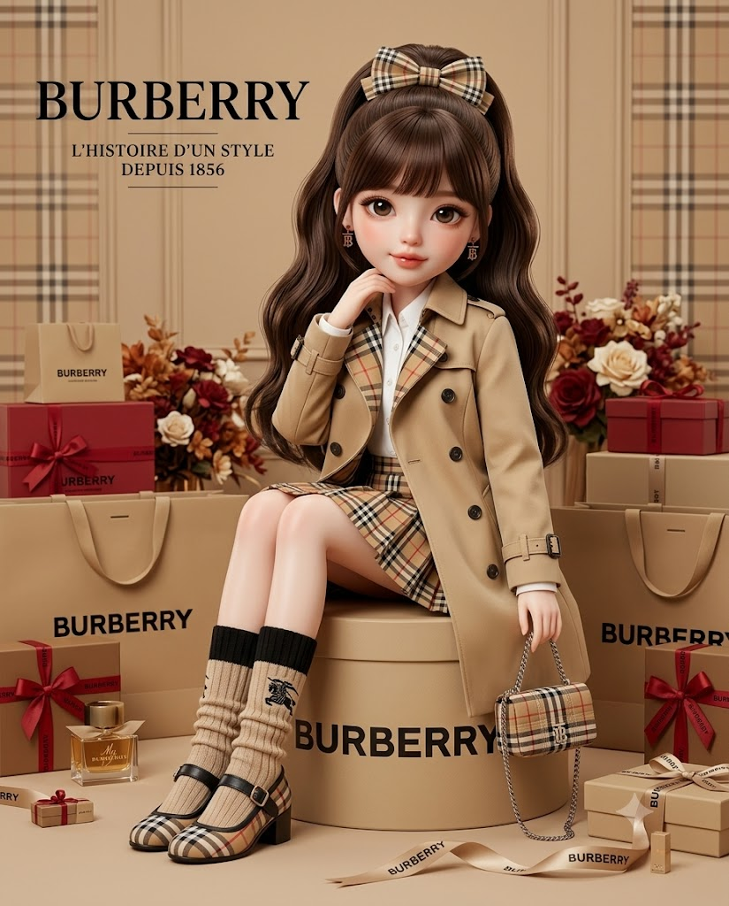
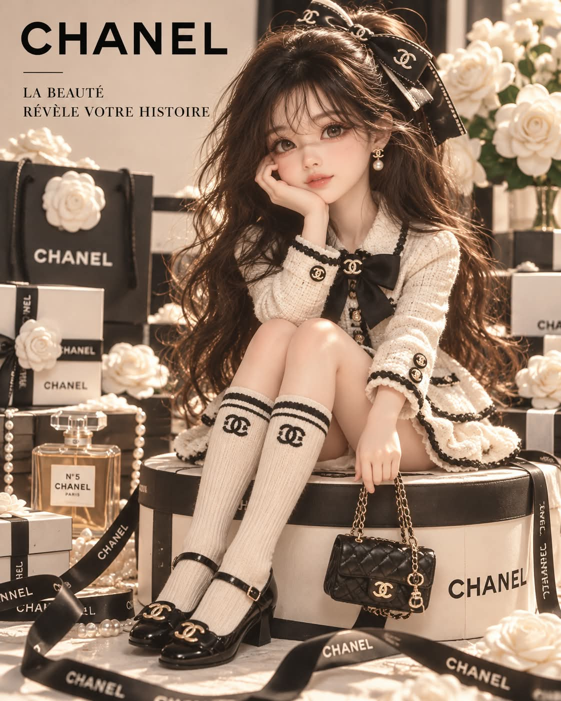

# 나의 명품, 숫자로 정하는 명품 브랜드 아트돌 광고 포스터 프롬프트

## 1. 개요 및 아트 디렉팅 가이드

- **컨셉**: 좋아하는 숫자의 끝자리로 명품 브랜드 하나를 정하고, 사진 속 인물을 닮은 컬렉터 아트돌이 그 브랜드의 룩을 입고 둥근 모자 상자 위에 앉은 럭셔리 광고 포스터를 만드는 영어 프롬프트 (세로 4:5)
- **대화 진행 (필수)**:
  - **1단계**: 이미지를 만들지 않고 "좋아하는 숫자를 하나 알려주세요! 🎀" 한 줄만 답하고 대기
  - **2단계**: 숫자의 끝자리만 보고 표에서 브랜드를 결정 (계산 없음)
  - **3단계**: 브랜드 카드(팔레트, 의상, 패턴·소재, 가방, 신발, 소품)를 한국어로 먼저 쓰고 곧바로 이미지 생성
- **끝자리별 브랜드**: 1 구찌, 2 에르메스, 3 프라다, 4 버버리, 5 셀린느, 6 펜디, 7 샤넬, 8 티파니, 9 루이 비통, 0 디올
- **브랜드 고정 규칙**:
  - 선택된 브랜드의 이름·로고·패턴·가방·신발·포장만 사용하고, 다른 브랜드의 요소는 금지
  - 의상·헤어·배경·소품·블러셔의 색은 브랜드 카드의 팔레트에서만 선택
- **얼굴**: 사진에서는 눈꼬리 방향, 쌍꺼풀 유무, 눈 사이 간격, 코 모양, 입술 두께 등 눈·코·입의 형태만 인형 비율로 옮기고, 각도·시선·표정은 가져오지 않음. 안경은 같은 테 모양으로 팔레트 색에 맞춰 추가
- **인형 스타일**: 스튜디오에서 촬영한 컬렉터 아트돌 같은 하이엔드 3D 렌더, 큰 머리와 가늘고 긴 몸의 약 3등신, 매끈한 레진 피부와 아주 크고 둥근 눈
- **헤어 & 의상**:
  - 여성은 일자 앞머리에 허리까지 오는 하이 포니테일과 브랜드 패턴의 큰 리본, 남성은 앞머리가 있는 짧은 컷에 베레모나 버킷햇
  - 브랜드 카드의 의상을 인형 크기로 표현하고, 로고 자수가 들어간 두꺼운 니트 레그워머와 브랜드의 신발을 착용
- **포즈 (고정)**: 브랜드명이 인쇄된 둥근 모자 상자 위에 무릎을 모아 앉아 한 손으로 볼을 가볍게 감싸고, 다른 손은 미니 백의 손잡이를 잡은 자세. 카메라를 정면으로 바라봄
- **배경 & 소품**: 팔레트 색의 단색 벽, 높이를 달리해 놓인 쇼핑백과 선물 상자, 향수병과 브랜드의 상징 꽃, 바닥을 가로지르는 로고 새틴 리본
- **텍스트**: 왼쪽 위에 큰 브랜드 워드마크와 새로 지은 짧은 프랑스어 슬로건 두 줄
- **카메라**: 눈높이 정면의 전신 구도, 부드러운 소프트박스 조명과 얕은 심도의 깔끔한 광고 캠페인 느낌

---

## 2. 프롬프트 전문

```text
[CONVERSATION FLOW – MANDATORY]
Step 1 (this reply): Do NOT generate any image. Reply with ONLY this one line, in Korean:
"좋아하는 숫자를 하나 알려주세요! 🎀"
Then stop and wait for my answer.

Step 2 (after I send a number):
Look ONLY at the LAST DIGIT of my number. No calculation.
Find that digit in the table below. That is the brand.
If my answer is not a number, ask the Step 1 question again.

[LAST DIGIT → BRAND]
1 = Gucci
2 = Hermès
3 = Prada
4 = Burberry
5 = Celine
6 = Fendi
7 = Chanel
8 = Tiffany & Co.
9 = Louis Vuitton
0 = Dior

Step 3: Before generating the image, write this BRAND CARD in the chat, in Korean, using your own knowledge of the selected brand:
끝자리 (digit) → 브랜드: (brand)
팔레트: (3–4 signature colors of this brand)
의상: (this brand's signature outfit at doll scale)
패턴·소재: (this brand's signature pattern or material)
가방: (this brand's iconic bag as a mini bag)
신발: (this brand's signature shoes)
소품: (this brand's signature boxes, packaging, perfume, flowers)
Then immediately generate the image using ONLY this brand card. Do not ask further questions.

[BRAND LOCK – STRICT]

- The image must show ONLY the selected brand. Its name, logo, pattern, bag, shoes, and packaging only.
- Use ONLY the colors in the brand card's palette for the outfit, hair, background, props, and blush.
- Any color, pattern, logo, or item from any other luxury brand is forbidden.
- The doll style below does not imply any color. Color comes only from the brand card.

[IMAGE]
A vertical luxury brand advertising poster: a collector art doll that resembles the person in the attached photo, wearing the selected brand's look, sitting on the brand's round hatbox.

[FACE]
From the photo, take ONLY the shapes of the eyes, nose, and mouth, translated into doll proportions: eye-tail direction, presence of double eyelids, spacing between the eyes, nose shape, lip thickness and shape.
Do NOT take the face outline, skin, hair, forehead, or hairline. Do NOT take the head angle, tilt, gaze direction, expression, clothing, or background from the photo.
Expression: a closed-mouth, subtle, slightly coy smile — drawn fresh, not copied from the photo.
Judge male or female from the photo. If the person wears glasses, add glasses with the same frame shape in a palette color.

[DOLL STYLE]
High-end 3D render that looks like a collector art doll (BJD) figure photographed in a studio.
Large head with a slim, long body, about 3 heads tall. Smooth resin skin with soft natural blush in a palette-matching tone.
Very large round eyes, thick dark upper lashes, clear irises with big highlights, a small nose, small glossy full lips. Small brand-logo drop earrings.

[HAIR]
Hair color chosen from the brand palette, not taken from the photo.
Female: full blunt bangs + high ponytail + long glossy fine waves reaching the waist, with a large bow made of the brand's signature pattern or material.
Male: soft short cut with bangs, with a beret or bucket hat in the brand's material.

[OUTFIT]
The brand card's outfit at doll scale with crisp fabric texture.
Legs: thick knit leg-warmer socks in a palette color with embroidered brand logo, plus the brand card's shoes.
Male: the same brand's menswear version (jacket + shorts, etc.).

[POSE – FIXED]
Sitting on top of a round hatbox printed with the brand name. Body turned three-quarters toward the right side of the frame, both knees drawn up together.
One elbow rests on the knees, and that hand lightly cups the cheek.
The other hand hangs down holding the brand card's mini bag by the handle; the bag rests against the side of the hatbox.
Face turned toward the camera with direct eye contact, head tilted slightly toward the hand on the cheek.

[BACKGROUND & PROPS]
Background wall in a solid palette color or the brand's own subtle pattern.
The brand's shopping bags, gift boxes, and packaging on the left and right at varied heights. The brand's perfume bottle on one side, the brand's signature flowers behind.
A satin ribbon printed with the brand logo flowing across the floor, with small props scattered around.

[TEXT]
Top-left: large brand wordmark. Below it, a newly written short French slogan in 2 lines in small serif capitals, with a thin divider line. Text must not cover the face.

[CAMERA]
Vertical 4:5, eye-level front shot with the doll's full body centered. Soft softbox lighting, subtle gloss, shallow depth of field.
Clean, elegant luxury brand advertising campaign look.
```

---

## 3. 결과물 비교 갤러리

| 생성 모델 | 생성 결과 이미지 |
| :--- | :--- |
| **제미나이 (Gemini)** |  |
| **ChatGPT (DALL-E 3)** |  |
