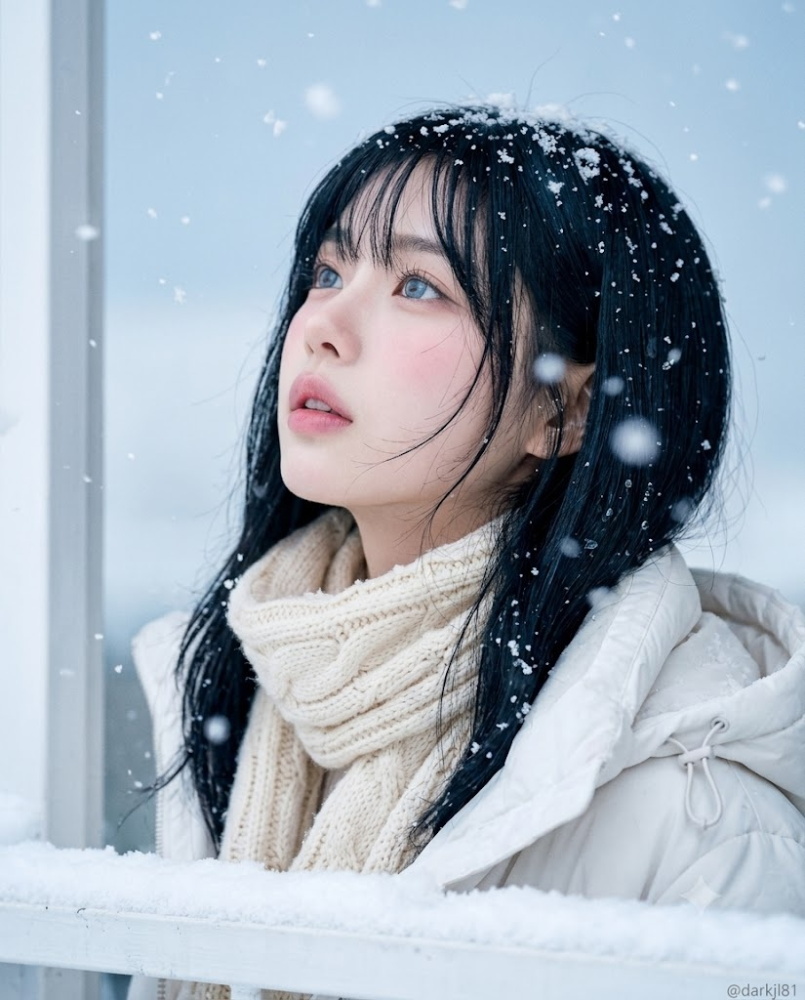
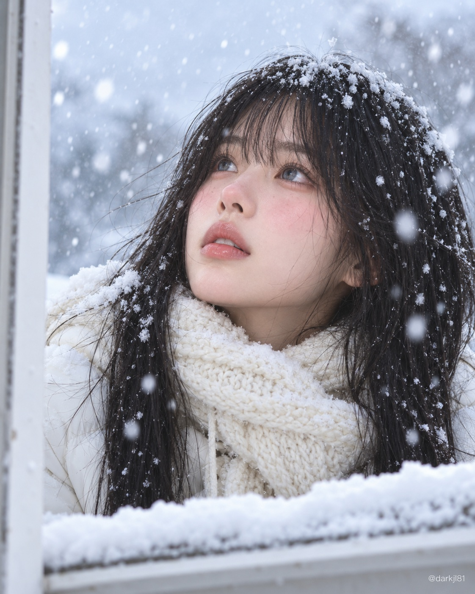

# 눈 내리는 날, 눈 쌓인 창가에서 하늘을 올려다보는 겨울 실사 인물 프롬프트

## 1. 개요 및 아트 디렉팅 가이드

- **컨셉**: 눈 내리는 겨울날, 눈 쌓인 창가 너머로 고개를 젖혀 하늘을 올려다보는 실사 인물 사진. 아이스 블루와 화이트 톤 속에 칠흑 같은 검은 머리가 가장 진하게 대비됨 (세로 4:5)
- **얼굴 합성 규칙 (가장 중요)**:
  - 눈 모양, 눈매, 코, 입술 모양만 정확히 가져와 닮게 표현
  - 얼굴형, 피부색과 상태, 헤어, 헤어라인, 의상, 배경, 조명, 고개 각도와 시선, 표정은 가져오지 않음
- **구도**:
  - 화면 중앙에서 약간 오른쪽, 얼굴 클로즈업 바스트샷
  - 고개를 뒤로 젖히고 얼굴은 살짝 오른쪽, 시선은 화면 왼쪽 위의 내리는 눈
  - 화면 왼쪽 끝의 흰 창틀 기둥, 아래쪽을 가로지르며 가슴 아래를 가리는 눈 쌓인 창턱
  - 약간 아래에서 올려 찍는 카메라 각도
- **인물**: 앳되고 순한 인상, 추위로 볼·코끝·눈가가 분홍빛으로 상기된 맑은 피부, 연한 핑크 입술, 사실적인 홍채의 맑은 하늘색 눈동자. 입을 살짝 벌리고 넋을 놓은 멍한 표정
- **헤어**: 확실한 블랙에 하이라이트만 은은한 푸른빛. 눈썹을 덮는 일자 앞머리와 어깨를 조금 넘는 생머리, 눈에 젖어 가닥가닥 뭉친 머리와 흩날리는 잔머리, 정수리와 앞머리에 소복이 쌓인 눈과 물방울
- **의상**: 턱 바로 아래까지 두툼하게 감은 크림색 케이블 니트 머플러, 스트링이 보이는 흰 겨울 점퍼, 어깨와 머플러 위의 눈
- **배경 & 날씨**: 옅은 하늘색의 흐린 겨울 하늘, 화면 전체에 내리는 눈송이. 렌즈 가까운 눈송이는 아웃포커스로 번지고 인물 주변은 선명
- **조명 & 색감**: 흐린 날의 고르게 퍼지는 자연광, 차가운 아이스 블루·화이트에 피부의 분홍빛과 머플러의 크림색만 따뜻한 포인트. 파스텔처럼 밝고 몽환적이지만 사실적인 색감
- **촬영 스타일**: 85mm 인물 렌즈, 얕은 심도에 얼굴과 눈 초점. 미세한 모공과 솜털, 녹는 눈, 니트 섬유 질감까지
- **워터마크**: 오른쪽 아래에 반투명 흰색 산세리프체 "@darkjl81"
- **금지**: 애니메이션·일러스트 그림체, 과장된 큰 눈, 3D 렌더와 플라스틱 피부, 인형 같은 얼굴, 은발·회색·파란 염색 머리, 사진 속 각도·표정·헤어·의상, 워터마크 외의 글자

---

## 2. 프롬프트 전문

```text
첨부한 얼굴 사진의 인물을 주인공으로, 눈 내리는 겨울날 눈 쌓인 창가 너머로 하늘을 올려다보는 실사 인물 사진을 만들어줘.

일러스트·애니메이션·3D CG·인형 느낌이 전혀 없이, 실제 카메라로 찍은 사진처럼 보여야 함.

[얼굴 합성 규칙 - 가장 중요]

첨부 사진에서는 눈·코·입의 생김새만 가져올 것.

  닮아 보이도록 눈 모양, 눈매, 코 모양, 입술 모양의 특징을 정확히 살릴 것.

사진에서 가져오지 말아야 할 것:

  얼굴형, 피부색과 피부 상태, 헤어, 이마와 헤어라인, 의상, 배경, 조명.

사진 속 머리와 얼굴의 각도(고개 기울기, 얼굴 방향, 시선)는 절대 가져오지 말 것.

  각도와 시선은 아래 [구도] 설명대로만 새로 그릴 것.

표정도 사진의 표정이 아니라 아래 [인물]에 적은 표정으로 새로 그릴 것.

얼굴 외의 구도·각도·헤어·의상·배경은 아래 설명에서 전혀 바뀌면 안 됨.

[구도]

세로 4:5 비율의 얼굴 클로즈업 바스트샷.

인물은 화면 중앙에서 약간 오른쪽에 위치.

고개를 뒤로 젖혀 위쪽 하늘을 올려다봄.

  얼굴은 정면에서 살짝 오른쪽을 향하고, 시선은 화면 위쪽 왼편의 내리는 눈을 바라봄.

화면 왼쪽 끝에 흰색 창틀 기둥이 세로로 걸쳐 있음.

화면 아래쪽에는 눈이 수북이 쌓인 흰 창턱(난간)이 가로로 지나가며, 인물의 가슴 아래를 가림.

카메라는 인물보다 약간 아래쪽 눈높이에서 살짝 올려 찍는 각도.

[인물]

앳되고 순한 인상, 맑고 투명한 하얀 피부.

추위로 양 볼, 코끝, 눈가가 자연스럽게 분홍빛으로 상기됨.

입술은 연한 핑크빛.

표정: 입이 아주 살짝 벌어진 채, 넋을 놓고 하늘을 바라보는 멍한 표정.

눈동자는 맑고 밝은 하늘색이며, 사실적인 홍채 결과 촉촉한 반사광이 있음.

  만화처럼 과하게 큰 눈은 금지.

속눈썹은 가늘고 자연스러움.

[헤어]

칠흑 같은 검은색 머리이며, 탈색되거나 밝게 보이면 안 됨.

차가운 눈빛 반사로 머리결 하이라이트에만 아주 은은하게 푸른빛이 돌고, 머리색 자체는 확실한 블랙.

눈썹을 덮는 일자 앞머리에 어깨를 조금 넘는 생머리.

눈에 젖어 머리카락이 가닥가닥 뭉치고, 잔머리 몇 가닥이 바람에 흩날림.

정수리와 앞머리 위에 하얀 눈이 소복이 쌓여 있음.

검은 머리카락 곳곳에 작은 눈송이와 녹은 물방울이 맺혀 또렷하게 대비됨.

[의상]

굵게 짠 크림색 케이블 니트 머플러를 목에 두툼하게 감아, 턱 바로 아래까지 올림.

머플러 위에도 눈송이가 얹혀 있음.

안에는 흰색 계열의 겨울 점퍼를 입었고, 가는 끈(스트링)이 살짝 보임.

어깨 위에도 눈이 쌓여 있음.

[배경·날씨]

옅은 하늘색의 흐린 겨울 하늘.

크고 작은 눈송이가 화면 전체에 내리고 있음.

렌즈 가까이 있는 눈송이는 아웃포커스로 부드럽게 번지고, 인물 주변의 눈송이는 선명함.

[조명·색감]

흐린 날의 부드럽게 퍼지는 자연광.

  강한 그림자 없이 얼굴 전체가 밝고 고르게 보임.

전체 톤은 차가운 아이스 블루와 화이트이며, 검은 머리가 화면에서 가장 진한 색으로 또렷하게 대비됨.

피부의 분홍빛과 머플러의 크림색만 따뜻한 포인트로 들어감.

파스텔처럼 밝고 깨끗하며 몽환적이지만, 사실적인 색감.

[촬영 스타일]

85mm 인물 렌즈, 얕은 심도, 초점은 얼굴과 눈.

질감 표현:

  사실적인 피부 질감(미세한 모공·솜털), 실제로 녹고 있는 눈의 질감, 니트 실의 섬유 질감까지 표현.

고해상도의 감성적인 겨울 인물 사진.

[워터마크]

우측 하단 모서리에 "@darkjl81"을 작게 넣을 것.

반투명한 흰색의 깔끔한 산세리프 폰트를 사용하고, 그림을 가리지 않는 크기로 할 것.

[금지]

애니메이션·일러스트·만화 그림체, 과장된 큰 눈, 3D 렌더링, 플라스틱 피부, 인형 같은 얼굴.

은발, 회색 머리, 파란 염색 머리.

사진 속 얼굴 각도·시선·표정·헤어·의상을 그대로 가져오는 것.

"@darkjl81" 외의 서명, 글자, 다른 워터마크.
```

---

## 3. 결과물 비교 갤러리

| 생성 모델 | 생성 결과 이미지 |
| :--- | :--- |
| **제미나이 (Gemini)** |  |
| **ChatGPT (DALL-E 3)** |  |
