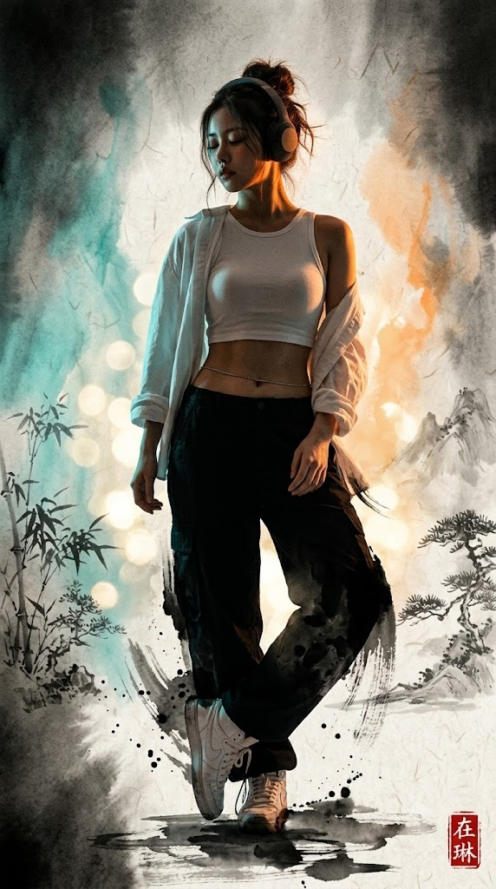
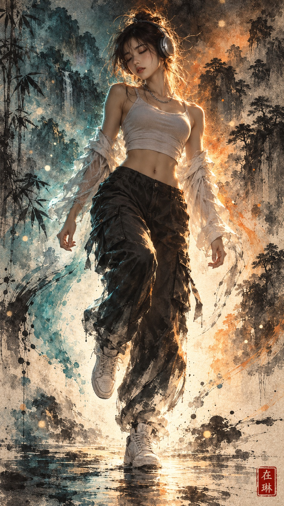

# 댄싱 수묵화, 수묵담채에 녹아드는 힙합 댄서 프롬프트

## 1. 개요 및 아트 디렉팅 가이드

- **컨셉**: 헤드폰을 쓰고 음악에 빠져 스텝을 밟는 힙합 댄서가 수묵담채화 속에 녹아든 그림. 얼굴과 상체는 실사처럼 사실적이고, 아래로 내려갈수록 먹과 담채로 풀어지며 한지 위 배경과 하나가 됨 (세로 9:16)
- **성별 판단 & 의상**:
  - **남자**: 흰 민소매 티셔츠 위에 단추를 풀어 걸친 흰 오버사이즈 셔츠, 검은 와이드 카고 팬츠, 흰 하이탑 스니커즈, 짧고 살짝 헝클어진 머리
  - **여자**: 흰 크롭 탱크톱 위에 한쪽 어깨로 흘러내린 흰 오버사이즈 셔츠, 검은 와이드 카고 팬츠, 흰 하이탑 스니커즈, 느슨한 번 헤어와 흘러내린 잔머리
  - 남녀 모두 성인으로 그리며, 큰 오버이어 헤드폰과 가는 은색 체인 착용
  - 사진에 안경이 있으면 같은 안경을 씌우고, 없으면 그리지 않음
- **포즈**:
  - 한쪽 다리에 체중을 싣고 다른 다리를 낮게 들어 올린, 다음 스텝 직전의 가벼운 동작
  - 고개를 살짝 숙이고 기울인 4분의 3 각도, 두 눈을 감고 음악에 몰입한 평온한 표정
  - 무릎 높이에서 살짝 올려다보는 낮은 앵글의 전신 구도
- **신체 구조 규칙**: 몸통·팔·다리·손가락 개수와 연결을 명시해 신체 왜곡을 방지
- **실사에서 수묵으로의 전환**:
  - 얼굴·목·어깨·팔·상체는 영화 조명으로 촬영한 듯 사실적이고 그림에서 가장 정밀한 부분
  - 허리와 허벅지부터 주름의 그늘이 먹 붓질로 바뀌기 시작
  - 무릎 아래와 바짓단은 굵은 먹 붓획과 갈필로 풀어지며 배경의 번짐과 이어짐
  - 신발은 한지 여백과 가는 먹선 몇 획으로 간결하게 표현
- **조명 (가장 중요)**:
  - 정면광 없이 인물 뒤에서만 오는 강한 역광. 왼쪽 뒤는 차가운 청록빛, 오른쪽 뒤는 뜨거운 주황빛
  - 몸의 앞면은 거의 실루엣에 가까운 그늘, 외곽선에만 청록과 주황의 빛 테두리가 강하게 맺힘
  - 얼굴은 그늘 속에 있지만 광대·콧날·입술·턱선을 따라 맺힌 주황빛 테두리로 이목구비가 또렷함
- **배경 (수묵담채)**: 가장자리는 진한 먹으로 어둡고 인물 뒤에서 빛 무리가 터져 나오는 구성, 양옆으로 번지는 청록·주황 담채, 흐릿한 대나무와 소나무와 먼 산, 흩날리는 빛가루
- **질감 & 낙관**: 한지의 섬유 결과 먹의 번짐·농담 변화, 오른쪽 아래 구석에 한자 "在琳" 두 글자를 음각으로 새긴 작은 정사각형 붉은 낙관
- **얼굴 사진 사용 규칙**: 성별 판단과 눈·코·입의 생김새, 안경 모양만 가져오고 각도·시선·조명·표정은 새로 그림

---

## 2. 프롬프트 전문

```text
수묵담채화 속에 실사 인물이 녹아든 한 장의 그림. 인물의 얼굴과 상체는 실제 사람처럼 사실적으로 그리고, 아래로 내려갈수록 인물이 먹과 담채로 풀어지며 한지 위 수묵담채화 배경과 하나가 된다. 영화 같은 강한 역광으로 인물의 앞면은 어둡고 윤곽만 빛나는 드라마틱한 분위기다.

[성별 판단]
업로드한 얼굴 사진을 보고 남자인지 여자인지 판단해서, 그 성별의 성인 힙합 댄서로 그린다.
- 남자일 경우: 흰 민소매 티셔츠 위에 흰 오버사이즈 셔츠를 단추를 풀고 걸쳤다. 상의는 바지 허리선까지 덮어 배가 드러나지 않는다. 검은 와이드 카고 팬츠는 발목에서 고무 밴드로 조였다. 흰 하이탑 스니커즈, 목에 가는 은색 체인. 짧고 살짝 헝클어진 머리. 날렵한 턱선과 깊은 눈매의 미남.
- 여자일 경우: 몸에 붙는 흰 크롭 탱크톱 위에 흰 오버사이즈 셔츠를 한쪽 어깨까지 흘러내리게 걸쳐 어깨와 쇄골이 드러난다. 크롭 탱크톱 아래로 잘록한 허리와 매끈한 복부가 드러난다. 검은 와이드 카고 팬츠는 골반에 걸쳐 입었고 발목에서 고무 밴드로 조였다. 흰 하이탑 스니커즈, 목에 가는 은색 체인. 머리는 정수리 뒤로 느슨하게 틀어 올린 번 헤어이고, 잔머리가 얼굴과 목선을 따라 흘러내린다. 탄탄하고 글래머러스한 성인 여성 체형의 섹시한 미녀.
남녀 모두 머리에 큰 오버이어 헤드폰을 쓰고 있다. 바지는 넉넉하지만 무릎 위치가 옷 위로 분명히 드러난다.
업로드한 사진 속 인물이 안경을 쓰고 있다면, 그림 속 인물도 같은 안경을 쓴다. 안경테의 모양, 두께, 색상은 사진과 똑같이 그린다. 안경은 헤드폰과 겹치지 않게 자연스럽게 걸쳐 있고, 렌즈는 투명해서 감은 눈과 속눈썹이 렌즈 너머로 또렷하게 보인다. 역광을 받아 안경테 가장자리에는 주황빛과 청록빛 테두리가 얇게 맺히고, 렌즈에는 희미한 빛 반사만 살짝 비친다. 사진 속 인물이 안경을 쓰지 않았다면 안경을 그리지 않는다.

[포즈]
댄서가 음악에 맞춰 가볍게 스텝을 밟는 순간이다. 화면 오른쪽 다리로 서서 체중을 싣는다. 화면 왼쪽 다리는 무릎을 살짝만 굽혀 들어 올린다. 들어 올린 무릎은 서 있는 다리의 무릎보다 조금 높은 정도로 낮게 머물고, 골반 높이까지 올라가지 않는다. 허벅지는 아래쪽으로 비스듬히 기울어 있다. 들어 올린 발은 발끝을 아래로 향한 채 서 있는 다리의 발목 옆, 바닥에서 한 뼘 정도 떠 있으며 서 있는 다리 앞쪽으로 살짝 교차한다. 막 다음 스텝을 내딛기 직전의 가볍고 리듬감 있는 동작이다.
양팔은 몸 옆으로 자연스럽게 내려 힘을 빼고, 한 손은 가볍게 주먹을 쥐었다. 어깨와 골반은 리듬을 타듯 살짝 반대 방향으로 비틀려 있다.
고개는 살짝 숙이고 옆으로 기울였지만, 얼굴은 4분의 3 각도로 보는 사람 쪽을 향해 이목구비가 보인다. 두 눈은 감고 음악에 깊이 빠져든 평온하고 몽환적인 표정, 입술은 살짝 다문다.
카메라는 무릎 높이에서 살짝 올려다보는 낮은 앵글이라 인물이 길고 당당해 보인다. 머리부터 신발 끝까지 전신이 화면 안에 들어오고, 인물이 화면 세로를 거의 꽉 채운다.

[신체 구조 규칙]
몸통은 하나뿐이다. 가슴 하나, 배 하나, 배꼽 하나가 어깨에서 골반까지 끊김 없이 이어진다. 드러난 복부는 상의 아래부터 바지 허리선까지 한 구간만 존재한다. 팔 두 개, 다리 두 개, 손 두 개, 발 두 개, 손가락은 각 손에 다섯 개. 두 다리는 모두 골반에서 시작하며 길이가 같다. 양쪽 신발은 같은 크기다.

[인물 — 실사에서 수묵으로]
인물은 위에서 아래로 갈수록 실사에서 수묵화로 자연스럽게 변한다.
- 얼굴, 목, 어깨, 팔, 상체: 실제 사람을 영화 조명으로 촬영한 것처럼 사실적이다. 피부결, 잔머리 한 올, 셔츠의 얇은 면 질감까지 사실적이며 그림체나 만화 느낌이 없다. 얼굴은 로맨스판타지 표지 주인공처럼 아름답고, 그림에서 가장 정밀한 부분이다. 헤드폰, 안경, 잔머리, 팔이 얼굴을 가리지 않는다.
- 허리와 허벅지: 카고 팬츠의 원단 질감이 남아 있지만 주름의 그늘이 점점 촉촉한 먹 붓질로 바뀌기 시작한다.
- 무릎 아래와 바짓단: 바지는 굵은 먹 붓획 몇 개로 풀어지고, 먹이 한지에 번지며 아래로 흘러내린다. 바짓단 가장자리는 갈필로 갈라지며 배경의 먹 번짐과 이어진다.
- 신발: 형태는 유지하되 흰 스니커즈는 한지 여백과 가는 먹선 몇 획으로 간결하게 표현되고, 발밑의 먹 번짐 속에 반쯤 잠긴다.
- 흰 셔츠 자락 끝, 소맷단, 흩날리는 잔머리 끝도 먹선과 담채 번짐으로 풀어지며 배경 속으로 스며든다.
인물의 윤곽 군데군데에서 배경의 먹 번짐과 청록·주황 담채가 인물 쪽으로 번져 들어와, 인물과 그림 사이에 경계선이 없다. 단, 얼굴과 상체의 형태는 번지지 않고 또렷하게 유지한다.

[조명 — 가장 중요]
정면에서 비추는 빛은 전혀 없다. 빛은 오직 인물 뒤쪽에서만 오는 강한 역광이다.
- 화면 왼쪽 뒤에서 차가운 청록빛이 비춘다.
- 화면 오른쪽 뒤에서 뜨거운 주황빛이 비춘다.
인물의 앞면, 즉 가슴, 배, 바지 앞쪽, 셔츠 안쪽, 얼굴 정면의 대부분은 깊은 그늘에 잠겨 어둡다. 몸의 앞면은 거의 실루엣에 가까운 어두운 톤이고, 청록과 주황이 아주 희미하게 섞인 반사광만 남는다.
빛은 인물의 외곽선에만 강하게 맺힌다. 왼쪽 팔, 셔츠 왼쪽 자락, 바지 왼쪽 옆선에는 청록빛 테두리가, 얼굴 오른쪽 윤곽, 목선, 어깨, 허리 오른쪽 라인, 바지 오른쪽 옆선에는 주황빛 테두리가 강하게 빛난다. 잔머리는 역광을 받아 주황빛 실처럼 반짝인다. 흰 셔츠 가장자리는 빛이 투과되어 반투명하게 빛난다. 먹으로 풀어진 하반신의 붓획 가장자리에도 청록과 주황 빛 테두리가 번지듯 맺힌다.
얼굴은 그늘 속에 있지만 주황빛 테두리가 이마 옆, 광대, 콧날, 입술, 턱선을 따라 맺혀 이목구비가 또렷하다. 감은 눈의 속눈썹 끝에도 빛이 걸린다.
명암 대비가 매우 강하다. 가장 밝은 곳은 윤곽의 빛 테두리와 인물 뒤 빛 무리이고, 가장 어두운 곳은 인물 앞면과 화면 모서리다.

[배경 — 수묵담채]
배경은 한지 위 수묵담채화다. 화면 위쪽 모서리와 가장자리는 진한 먹으로 깊고 어둡게 가라앉는다. 중심으로 올수록 밝아지며, 인물 허리 뒤부터 발밑까지 한지 바탕을 남긴 밝은 빛 무리가 퍼져 빛이 인물 뒤에서 터져 나오는 것처럼 보인다.
빛 무리 주변으로 왼쪽은 청록 담채, 오른쪽은 주황 담채가 물에 번지듯 넓게 퍼지며 연기나 안개처럼 피어오른다. 양옆 가장자리에는 대나무와 소나무, 먼 산이 진한 먹과 옅은 먹으로 흐릿하게 그려져 있다.
공중에는 빛가루가 흩날린다. 한지 바탕을 동그랗게 남긴 밝은 점, 또는 옅은 황금빛 담채 점으로 빛나는 보케처럼 표현한다. 발밑은 먹이 넓게 번져 고인 물처럼 퍼지고, 그 위에 희미한 빛 반사가 비친다.

[질감과 낙관]
배경과 인물 하반신에는 한지의 섬유 결, 먹과 담채의 번짐, 물 자국, 농담 변화가 살아 있다. 실사 상체와 수묵 하반신, 수묵 배경이 하나의 그림으로 자연스럽게 어우러진다.
오른쪽 아래 구석에 작은 정사각형 붉은 낙관 하나를 찍는다. 낙관에는 한자 "在琳" 두 글자만 새긴다. 글자는 또렷한 해서체(楷書)로, 위에 "在", 아래에 "琳"을 세로로 배치한다. 붉은 인주 바탕에 글자가 흰색으로 파인 음각 도장이며, 실제 도장 자국처럼 가장자리가 살짝 거칠다. 낙관 안에 다른 글자나 문양은 넣지 않는다. 세로형 9:16 비율.

[얼굴 사진 사용 규칙]
업로드한 얼굴 사진에서는 성별 판단과 눈·코·입의 생김새, 그리고 안경을 썼다면 안경의 모양만 가져온다. 얼굴형, 피부, 헤어, 이마와 헤어라인은 가져오지 않는다. 사진 속 고개 기울기, 얼굴 방향, 시선 각도, 조명은 절대 따라 하지 않고, 위에 서술한 각도와 역광 조명으로 새로 그린다. 표정도 사진이 아니라 위에 서술한 눈 감고 몰입한 표정으로 새로 그린다. 얼굴 외의 구도, 포즈, 헤어, 의상, 화풍은 위 서술 그대로 유지한다.
```

---

## 3. 결과물 비교 갤러리

| 생성 모델 | 생성 결과 이미지 |
| :--- | :--- |
| **제미나이 (Gemini)** |  |
| **ChatGPT (DALL-E 3)** |  |
