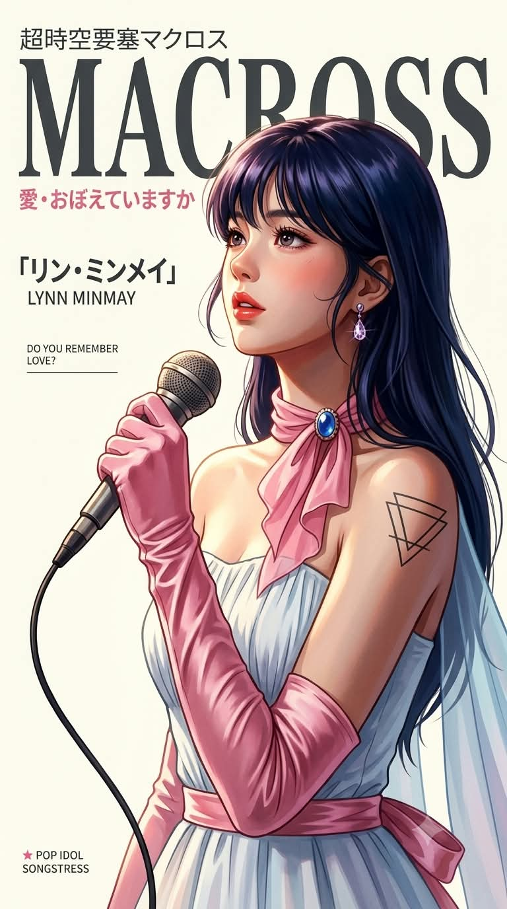
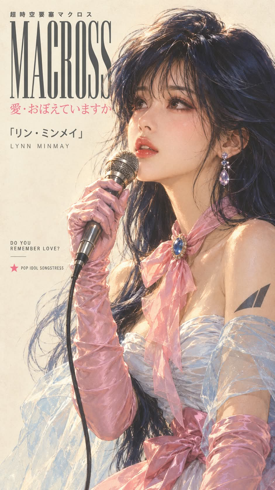

# 린 민메이, 80년대 애니 아이돌 반실사 시네마틱 포스터 프롬프트

## 1. 개요 및 아트 디렉팅 가이드

- **컨셉**: 마이크를 들고 노래를 막 시작하는 80년대 애니메이션 아이돌 가수 린 민메이를 반실사로 옮긴 시네마틱 디지털 페인팅 포스터 (세로 9:16). 오프화이트 배경에 왼쪽 여백의 타이포그래피를 더한 미니멀한 잡지 화보 레이아웃
- **업로드 사진 사용 규칙**:
  - 사진에서는 눈·코·입의 생김새만 가져와 화풍에 맞게 재해석하되 본인임을 알아볼 수 있게 유지
  - 얼굴형·피부·헤어·각도·시선·표정은 가져오지 않음
  - 사진에 안경이나 선글라스가 있어도 가져오지 않고 맨얼굴로 표현
- **화풍**:
  - 얼굴 비율과 인상은 80년대 애니 캐릭터(작고 오똑한 코, 크고 또렷한 눈, 진한 속눈썹)를 유지하고 표현은 실사에 가깝게
  - 외곽선은 거의 없이 빛과 그림자로 형태를 만들고, 머리카락·시폰·새틴의 질감을 실제처럼 표현
  - 붓 터치가 아주 살짝 남은 반실사 페인팅, 채도를 낮춘 시네마틱 톤
- **조명**:
  - 화면 왼쪽 위 앞쪽에서 들어오는 따뜻한 무대 키라이트 하나
  - 빛 받는 쪽은 밝고 따뜻하게, 반대쪽은 진한 갈색~보라 그림자로 확실하게 어둡게 표현한 강한 대비
  - 머리 뒤쪽과 어깨 윤곽선의 가는 백라이트 림라이트
- **구도**: 허리 위 상반신을 화면 오른쪽에 배치, 왼쪽을 향한 약 45도 반측면 얼굴, 턱을 살짝 들고 화면 왼쪽 위 먼 곳을 보는 시선, 왼쪽은 텍스트를 위한 넓은 여백
- **포즈 & 표정**: 오른손으로 마이크를 쥐고 턱 아래에 든 자세, 입술이 살짝 벌어지고 눈이 촉촉한 애틋하고 꿈꾸는 듯한 표정
- **헤어**: 앞머리가 이마를 덮는 진한 남색의 긴 머리, 큰 흐름으로 정돈되고 끝부분 몇 가닥만 가볍게 날림
- **의상**:
  - 화이트~옅은 하늘색 스트랩리스 미니 원피스와 분홍 시폰 스카프, 파란 보석 브로치
  - 분홍 새틴 리본 띠와 롱 글러브, 반투명한 하늘색 시스루 날개 모양 망토, 연보라색 크리스털 귀걸이
  - 맨 어깨 위의 검은 선 삼각형 기하학 무늬
- **텍스트 배치 (왼쪽 여백)**: `超時空要塞マクロス`, 좁고 세로로 긴 대문자 `MACROSS`, 분홍색 `愛・おぼえていますか`, `「リン・ミンメイ」`와 `LYNN MINMAY`, 하단의 `DO YOU REMEMBER LOVE?`, 분홍 별 아이콘과 `POP IDOL SONGSTRESS`
- **금지**: 완전 정면과 완전 옆모습, 평면적인 무명암 채색, 굵은 외곽선의 만화 채색, 완전한 실사 사진, 배경 장식 추가

---

## 2. 프롬프트 전문

```text
[업로드 사진 사용 규칙]

- 업로드한 사진은 얼굴 참고용으로만 사용한다.
- 사진에서는 눈, 코, 입의 생김새만 가져온다. 얼굴형, 피부, 헤어, 이마와 헤어라인은 가져오지 않는다.
- 사진 속 고개 기울기, 얼굴 방향, 시선 같은 각도 정보는 절대 가져오지 않는다. 각도와 구도는 아래 서술대로만 그린다.
- 표정은 사진을 따르지 않고 아래 서술대로 새로 그린다.
- 가져온 눈·코·입은 아래 화풍으로 재해석하되 본인이라는 걸 알아볼 수 있게 유지한다.
- 사진 속 인물이 안경이나 선글라스를 쓰고 있어도 안경은 가져오지 않는다. 안경 없는 맨얼굴로, 안경 자국이나 테 그림자도 없이 그린다.
- 얼굴 외의 구도, 헤어, 의상, 배경, 텍스트 배치는 아래 서술에서 바뀌면 안 된다.

[화풍]
1980년대 애니메이션 캐릭터를 반실사로 옮긴 시네마틱 디지털 페인팅 포스터. 얼굴 비율과 인상은 80년대 애니 캐릭터(작고 오똑한 코, 크고 또렷한 눈, 진하고 긴 위 속눈썹, 선명한 입술 윤곽)를 유지하되, 표현은 실사에 가깝게 한다: 피부는 매끈하지만 얇은 피부결과 은은한 혈색, 볼과 코끝의 자연스러운 홍조, 입술에 실제 립스틱 같은 촉촉한 광택과 주름결, 눈동자에 홍채 결과 젖은 반사. 외곽선은 거의 없고 형태는 빛과 그림자로 만든다. 머리카락은 가닥 결이 보이는 실제 머리카락 질감, 천은 시폰의 비침과 새틴의 광택이 실제처럼 보인다. 완전한 사진이 아니라 고급 일러스트레이터가 그린 반실사 페인팅 느낌. 붓 터치가 아주 살짝 남아 있고 옅은 필름 그레인. 색은 채도를 낮춘 시네마틱 톤: 깊은 남색 머리, 탁한 분홍과 연보라 포인트, 따뜻한 베이지 피부, 산호빛 붉은 입술. 배경은 아무것도 없는 따뜻한 오프화이트, 아주 옅은 종이 결. 세로형 9:16, 미니멀한 잡지 화보 레이아웃.

[조명]
화면 왼쪽 위 앞쪽에서 들어오는 따뜻한 무대 키라이트 하나. 얼굴의 빛 받는 쪽(이마, 콧날, 볼 앞면, 입술 위)은 밝고 따뜻하게, 반대쪽 볼과 귀 앞쪽, 턱 아래는 진한 갈색~보라 그림자로 확실하게 어둡다. 빛과 그림자 경계는 실사 조명처럼 부드럽게 이어지되 대비는 강하다. 코 아래, 아랫입술 아래, 턱 아래 목에 짙은 캐스트 섀도우. 목과 쇄골, 어깨, 팔 위쪽에도 빛과 그림자가 크게 나뉜다. 머리 뒤쪽과 어깨 윤곽선을 따라 가는 백라이트 림라이트가 빛나 실루엣을 배경에서 분리한다. 앞머리가 이마와 눈 위에 그림자를 드리운다. 머리카락은 남색 바탕에 깊은 그림자와 정수리·머리결 위쪽의 윤기 하이라이트 띠. 눈동자에 키라이트 반사, 입술에 작은 광택, 피부 빛 받는 면에 은은한 윤기. 마이크 금속 부분과 크리스털 귀걸이에 반짝이는 반사광.

[구도]
허리 위 상반신. 인물은 화면 오른쪽에 배치하고 몸은 왼쪽을 향해 거의 옆으로 선다. 얼굴은 정면이 아니라 왼쪽을 향한 약 45도 반측면 — 옆모습에서 카메라 쪽으로 조금만 돌린 각도. 가까운 쪽 눈은 온전히 보이고 먼 쪽 눈도 콧날 너머로 일부가 보여, 두 눈과 코, 입의 형태가 모두 읽힌다. 턱을 살짝 들고 시선은 화면 왼쪽 위 먼 곳(키라이트 방향). 카메라는 눈높이보다 약간 아래, 85mm 인물 렌즈 느낌. 왼쪽은 텍스트를 위한 넓은 여백.

[포즈와 표정]
오른손으로 마이크를 쥐고 가슴 앞 턱 아래쯤에 든다. 노래를 막 시작하는 순간, 입술이 살짝 벌어져 있고 눈은 촉촉하며 애틋하고 꿈꾸는 듯한 표정. 마이크 아래로 가는 코드가 곡선을 그리며 화면 아래로 흘러내린다.

[헤어]
진한 남색의 긴 머리, 이마를 덮는 앞머리, 얼굴 옆으로 내려오는 옆머리. 귀 뒤로 넘긴 부분과 가늘게 말린 컬 한 가닥. 머리는 큰 흐름으로 정돈되어 있고 끝부분 몇 가닥만 가볍게 날린다. 산발처럼 흩날리지 않는다.

[의상]

- 어깨가 드러나는 화이트~옅은 하늘색 스트랩리스 미니 원피스, 가슴 부분은 잔주름
- 목에 두른 분홍 시폰 스카프, 앞에서 리본처럼 묶고 매듭 중앙에 둥근 파란 보석 브로치
- 허리에 큰 분홍 새틴 리본 띠 (화면 하단에 일부만 보임)
- 팔꿈치 위까지 오는 분홍 새틴 롱 글러브, 손가락 마디에 자연스러운 주름
- 어깨 뒤로 반투명한 하늘색 시스루 날개 모양 망토
- 귀에 연보라색 크리스털 드롭 귀걸이
- 맨 어깨 위로 검은 선의 삼각형 기하학 무늬 (피부에 그린 바디페인팅처럼)
- 모든 천에도 키라이트 방향에 맞춘 밝은 면과 그림자가 분명하게 들어간다

[텍스트 배치 — 왼쪽 여백]

- 상단 작은 고딕 글씨: 超時空要塞マクロス
- 그 아래 크고 매우 좁고 세로로 긴 진회색 콘덴스드 세리프체 대문자: MACROSS
- 그 아래 분홍색 작은 고딕 글씨: 愛・おぼえていますか
- 그 아래 중간 크기 고딕 글씨: 「リン・ミンメイ」 / 작은 영문 산세리프: LYNN MINMAY
- 하단 왼쪽 작은 산세리프: DO YOU REMEMBER LOVE? 와 짧은 가로선
- 맨 아래 왼쪽: 분홍 별 아이콘과 작은 산세리프 POP IDOL SONGSTRESS
- 모든 글자는 철자 그대로 정확하게, 다른 글자 추가 금지

[금지]
사진 속 얼굴 각도·표정·헤어 반영 금지, 안경·선글라스 금지, 완전 정면 금지, 완전 옆모습 금지, 평면적인 무명암 채색 금지, 수채 번짐 채색 금지, 굵은 외곽선의 만화 채색 금지, 완전한 실사 사진 금지, 배경 장식 추가 금지.
```

---

## 3. 결과물 비교 갤러리

| 생성 모델 | 생성 결과 이미지 |
| :--- | :--- |
| **제미나이 (Gemini)** |  |
| **ChatGPT (DALL-E 3)** |  |
