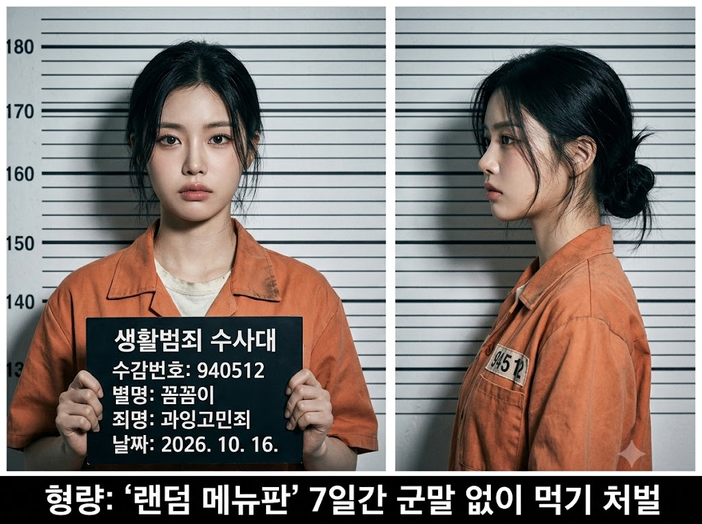
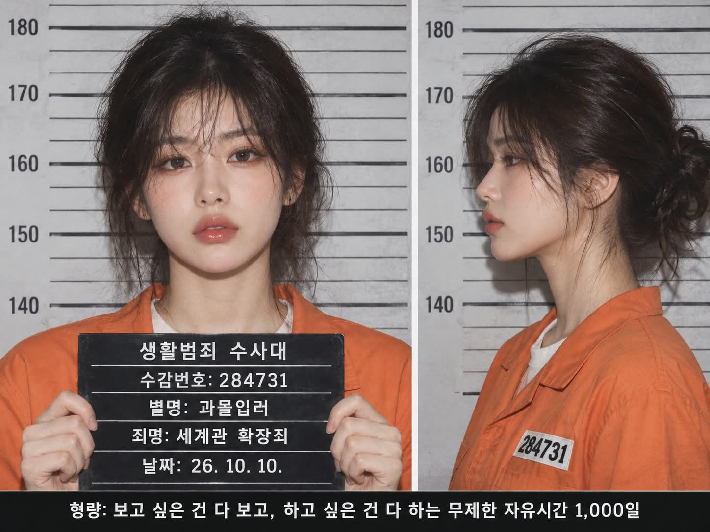

# 머그샷, 나를 분석한 가상의 죄명으로 만드는 실사 머그샷 프롬프트

## 1. 개요 및 아트 디렉팅 가이드

- **컨셉**: AI가 대화와 기억으로 나를 분석해 성격·습관을 과장한 웃긴 가상의 죄명, 별명, 형량을 정하고, 정면·측면 두 컷이 나란히 붙은 실사 머그샷으로 만드는 놀이형 프롬프트 (가로 4:3)
- **작업 순서**:
  - 대화, 저장된 기억, 성격·직업·취미·말투·생활 패턴과 사진의 인상을 종합 분석
  - 서로 다른 특징에서 출발한 후보 5개를 떠올린 뒤 가장 구체적으로 맞는 "○○죄" 하나를 고름. 늦잠·과식처럼 누구에게나 맞는 무난한 죄명은 피함
  - 죄명과 연결된 웃긴 형량, 2~5글자 별명도 함께 정함. 실제 이름·SNS 계정명은 넣지 않음
  - 대화창에 별명·죄명·형량·근거 2~3줄을 먼저 보여 주고 질문 없이 바로 이미지 생성
- **업로드 사진 사용 규칙**: 눈·코·입 생김새만 가져와 본인임을 알아볼 수 있게 하고, 얼굴형·피부·헤어·각도·시선·표정·옷·배경은 가져오지 않음. 안경은 쓰고 있으면 유지. 성별은 헤어 규칙 적용에만 사용
- **화풍**: 경찰서 머그샷 특유의 정면 직광 플래시, 벽에 얕게 떨어지는 그림자, 차갑고 평평한 색감과 디지털 노이즈의 실사 사진. 일러스트·3D·반실사 금지
- **인물**:
  - 남자는 짧은 검은 머리에 이마로 내려온 몇 가닥, 여자는 어깨 길이 검은 머리를 대충 묶고 잔머리가 흘러내림
  - 흰 반팔 티가 살짝 보이는 주황색 죄수복, 왼쪽 가슴의 번호 패치
  - 입을 다문 무표정에 눈빛만 살짝 억울하고 당당하게
- **구성**:
  - 왼쪽 60%는 이름판을 든 정면 컷, 오른쪽 40%는 이름판 없는 완전한 오른쪽 옆모습 컷, 사이는 얇은 흰 테두리
  - 배경은 밝은 회색 키 측정 차트, 머리 높이가 175~180 눈금 사이
- **글자**:
  - 검은 이름판 5줄: "생활범죄 수사대", 6자리 수감번호, 별명, 죄명, 생성 날짜
  - 하단 검은 띠에 "형량: …" 한 줄
  - 한글과 숫자만, 맞춤법 정확하게, 손가락에 가려지지 않게
- **금지**: 실제 범죄명·법 조항·경찰 기관명, 실제 이름 표기, 상처·피·수갑 같은 폭력 요소, 다른 사람 등장, 두 컷의 얼굴이 달라 보이는 것

---

## 2. 프롬프트 전문

```text
[작업 순서]

1. 지금까지 나눈 대화, 저장된 기억, 나에 대해 알고 있는 모든 정보(성격, 직업, 취미, 관심사, 말투, 가치관, 생활 패턴)와 업로드한 사진의 인상을 종합해서 분석한다.
2. 분석 결과로 나에게 가장 어울리는 가상의 죄명 하나를 정한다.
- 죄명은 실제 범죄가 아니라, 나의 성격·습관·말투·생활 패턴 중 하나를 과장해 법률 용어처럼 꾸민 무해하고 웃긴 가상의 죄명이다.
- 폭력, 마약, 성범죄, 사기, 절도 등 실제 범죄와 실제 법 조항 이름은 절대 사용하지 않는다.
- 가장 먼저 떠오르는 흔한 죄명을 기본값으로 고르지 말 것
- 누구에게나 해당되는 무난한 죄명(늦잠, 과식 등 일반적인 습관)으로 쏠리지 말 것
- 죄명을 고르기 전에 서로 다른 성격·습관·관심사에서 출발한 후보 5개를 속으로 먼저 떠올린 뒤, 분석 결과와 가장 구체적으로 맞는 하나를 고른다.
- 죄명은 한글로 짧게, "○○죄" 형식으로 끝낸다.
- 죄명에 맞는 가상의 형량도 같은 방식으로 정한다. 실제 징역·벌금 표현 대신 죄명과 연결된 웃긴 처벌로 쓴다.
- 죄명과 어울리는 한글 별명도 같은 방식으로 정한다. 별명은 범죄 기록에 붙는 별칭처럼 짧게(2~5글자) 짓고, 나의 실제 이름·성·SNS 계정명은 절대 넣지 않는다.
3. 대화창에 아래 내용을 먼저 짧게 보여준다.
- 별명 / 죄명 / 형량 / 이 죄명이 나에게 내려진 근거 2~3줄
4. 질문하지 말고 바로 아래 머그샷을 이미지로 생성한다.

[업로드 사진 사용 규칙 - 매우 중요]

- 업로드 사진에서는 눈, 코, 입의 생김새만 가져온다.
- 얼굴형, 피부, 헤어, 이마와 헤어라인은 사진에서 가져오지 않는다.
- 사진 속 고개 기울기, 얼굴 방향, 시선, 표정은 절대 가져오지 않는다. 각도와 표정은 아래 서술대로 새로 그린다.
- 사진 속 인물이 안경을 쓰고 있으면 안경만 유지한다.
- 사진 속 옷, 배경, 소품은 사용하지 않는다.
- 사진으로 성별만 판단해 아래 헤어 규칙을 적용한다.
- 눈·코·입의 특징이 살아 있어 본인임을 바로 알아볼 수 있게 한다.

[화풍]
실사 사진. 경찰서 머그샷 특유의 정면 직광 플래시 조명, 그림자가 뒤 벽에 얕게 떨어짐, 약간 차갑고 평평한 색감, 살짝 거친 디지털 사진 노이즈. 보정되지 않은 자연스러운 피부 질감. 일러스트, 3D, 반실사 금지.

[인물 - 고정]

- 헤어
- 남자: 짧게 다듬은 검은 머리, 앞머리가 살짝 헝클어져 이마에 몇 가닥 내려옴
- 여자: 어깨 길이 검은 머리를 뒤로 대충 묶었고, 잔머리가 얼굴 옆으로 흘러내림
- 의상: 주황색 죄수복 상의, 목 부분에 흰색 반팔 티셔츠가 살짝 보임, 왼쪽 가슴에 검은 글씨 번호 패치
- 표정: 입을 다문 무표정, 눈빛만 살짝 억울하고 당당함, 눈썹은 아주 미세하게 올라감
- 손: 정면 컷에서 두 손으로 가슴 앞에 검은 이름판을 들고 있음

[구성 - 위치 고정]
가로형 이미지(4:3 비율). 두 장의 머그샷이 나란히 붙은 형식.

1. 왼쪽 컷(화면 폭의 약 60%): 정면 머그샷. 얼굴이 정면을 향하고 시선은 카메라 렌즈를 똑바로 봄. 가슴 위 상반신, 얼굴이 크게 보이도록 화면 위쪽 중앙에 배치. 가슴 앞에 이름판.
2. 오른쪽 컷(화면 폭의 약 40%): 같은 인물의 완전한 오른쪽 옆모습 측면 머그샷. 같은 헤어, 같은 의상, 같은 무표정. 이름판 없음.
3. 두 컷 모두 배경은 밝은 회색 벽에 검은 가로 눈금선이 있는 키 측정 차트. 왼쪽 끝에 숫자 눈금, 인물 머리 높이가 약 175~180 사이에 오게 배치.
4. 두 컷 사이는 얇은 흰 테두리로 구분.

[이름판 문구 - 검은 판에 흰 글씨, 5줄]

1. "생활범죄 수사대"
2. 수감번호: 6자리 숫자
3. 별명: 분석으로 정한 별명 (실제 이름 표기 금지)
4. 죄명: 분석으로 정한 죄명
5. 날짜: 이미지를 생성하는 날의 날짜를 "연. 월. 일." 숫자 형식으로

[이미지 하단 띠]
두 컷 아래 얇은 검은 띠에 흰 고딕체 한 줄: "형량: (분석으로 정한 형량)"

[글자 품질]

- 모든 글자는 한글과 숫자로만 작성한다. 영어, 알파벳 금지.
- 맞춤법이 정확하고 자모가 깨지지 않게 또렷하게
- 이름판 글자는 손가락에 가려지지 않게 배치
- 문구는 짧게 유지

[금지]

- 실제 범죄명, 실제 법 조항, 실제 경찰 기관명 금지
- 이름판과 이미지 어디에도 실제 이름, 성, SNS 계정명 표기 금지
- 사진 속 고개 각도, 시선, 표정, 헤어, 옷 반영 금지
- 일러스트, 3D, 반실사 금지
- 상처, 피, 수갑 등 폭력적인 요소 금지
- 인물 외 다른 사람 등장 금지
- 두 컷의 얼굴이 서로 다른 사람처럼 보이는 것 금지
```

---

## 3. 결과물 비교 갤러리

| 생성 모델 | 생성 결과 이미지 |
| :--- | :--- |
| **제미나이 (Gemini)** |  |
| **ChatGPT (DALL-E 3)** |  |
