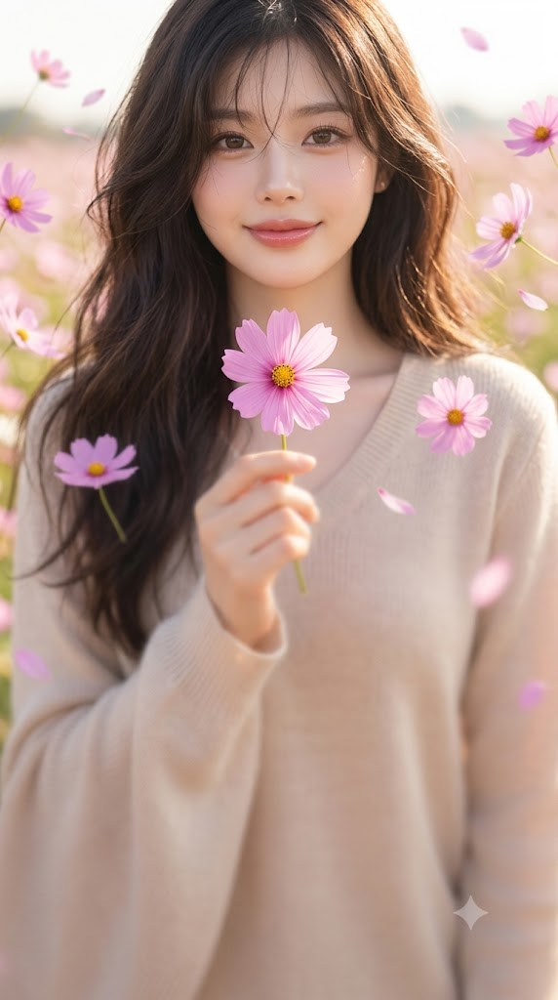
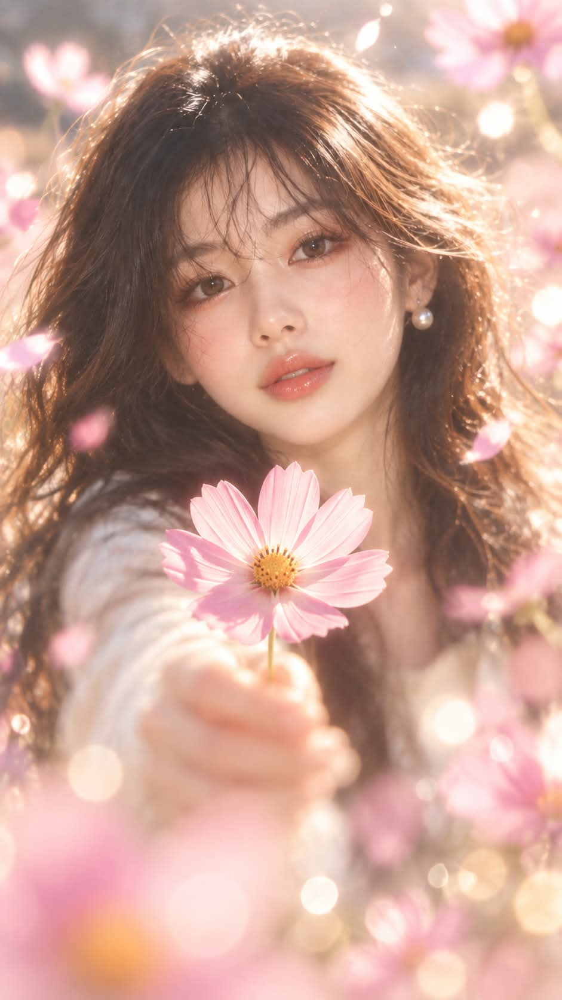

# 멀티 포커싱 2, 얼굴과 코스모스 한 송이만 선명한 반실사 포트레이트 프롬프트

## 1. 개요 및 아트 디렉팅 가이드

- **컨셉**: 가을 코스모스 꽃밭에서 코스모스 한 송이를 내민 반실사 바스트샷. 얼굴과 손에 든 꽃송이, 딱 두 곳만 선명하고 나머지는 모두 강한 렌즈 블러로 흐려지는 극단적으로 얕은 심도가 핵심 (세로 9:16)
- **멀티 포커싱 1과의 차이**: 1번은 손에 든 꽃을 흐리게 하고 얼굴 주변의 떠 있는 꽃에 선명함을 섞었다면, 이번에는 손에 든 꽃을 칼같이 선명하게 하고 떠 있는 꽃은 전부 보케로 처리. 꽃은 코스모스로 고정
- **초점 (최우선 규칙)**:
  - 조리개 f/0.95, 피사계 심도가 몇 센티미터밖에 되지 않는 인물 사진
  - 선명한 곳은 인물의 얼굴과 목 윗부분, 그리고 손에 든 코스모스 꽃송이 하나뿐
  - 머리카락 덩어리, 어깨와 옷, 손과 손가락, 떠 있는 꽃과 배경은 얼굴에서 멀어질수록 점점 더 흐려짐
  - 머리카락이나 옷, 손이 선명하게 보이면 실패
- **업로드 사진 사용 규칙**: 눈·코·입의 생김새만 가져오고, 얼굴형·피부·헤어·표정·머리 각도·조명·배경·의상은 가져오지 않음
- **장르 & 질감**:
  - 실사 40% + 인형 같은 질감 60%의 반실사. 실제 카메라로 찍은 듯한 렌즈 블러와 보케에, 얼굴만 고급 구체관절 인형처럼 다듬어진 느낌
  - 모공 없이 도자기처럼 매끈하고 뽀얀 피부, 유리구슬처럼 맑은 눈동자, 젤리 같은 입술
  - 밝고 뽀얀 파스텔의 가을 오후 색감
- **꽃 (코스모스 고정)**:
  - 끝이 톱니처럼 들쭉날쭉한 얇은 꽃잎 8장이 한 겹으로 펼쳐지고 가운데에 작고 둥근 노란 꽃술
  - 모란·작약·장미처럼 겹꽃잎이 풍성해 보이면 실패. 화면 전체의 꽃 색 톤은 하나로 통일
- **인물 & 포즈**:
  - 얼굴이 화면 위쪽 3분의 1 지점에 크게 오는 바스트샷, 렌즈를 정면으로 바라보는 수줍고 따뜻한 미소
  - 가슴 높이에서 카메라 쪽으로 팔을 편안하게 내밀어 코스모스 한 송이를 쥠
  - 꽃송이는 얼굴 폭의 절반 정도 크기로 화면 가로 정중앙, 얼굴 바로 아래에 위치
- **손에 든 꽃의 선명도**: 매크로 렌즈로 찍은 듯 꽃잎의 가는 결과 노란 꽃술 알갱이까지 또렷하고, 바로 뒤의 흐린 손과 뚜렷하게 대비
- **공중에 떠 있는 꽃**: 얼굴 주변 8~12개, 화면 앞쪽 3~4개, 인물 뒤의 작은 꽃잎. 하나도 빠짐없이 전부 흐릿한 보케이며 흐림 정도만 거리에 따라 다름
- **배경 & 조명**: 색 덩어리 보케와 둥근 빛망울로 녹아드는 가을 코스모스 꽃밭, 흐릿한 머리카락 가장자리가 하얗게 번지는 부드러운 하이키 역광
- **금지**: 9:16 외의 비율, 화면 전체가 고르게 선명한 사진, 선명한 머리카락 결과 옷 무늬와 손, 흐려진 손의 꽃송이, 코스모스가 아닌 꽃, 꽃다발, 2D 만화·애니메이션 그림체, 글자나 워터마크

---

## 2. 프롬프트 전문

```text
[비율]
9:16 세로형 이미지로 생성한다. 정사각형·3:4·가로형 금지.

[초점 — 최우선 규칙, 다른 모든 지시보다 먼저 지킨다]
조리개 f/0.95로 촬영한 극단적으로 얕은 심도의 인물 사진이다. 피사계 심도가 몇 센티미터밖에 되지 않는다.
선명한 곳은 딱 두 곳뿐이다.
① 인물의 얼굴(눈·코·입·볼·턱)과 턱 바로 아래 목 윗부분.
② 손에 들고 내민 코스모스 꽃송이 하나.
이 두 곳을 뺀 나머지는 화면 전체가 강한 렌즈 블러로 뿌옇게 흐려진다.

- 머리카락: 얼굴에 닿은 잔머리만 보이고, 나머지 머리카락 덩어리는 결이 보이지 않을 만큼 부드럽게 뭉개진다.
- 목 아래·어깨·가슴·옷: 무늬·레이스·주름이 알아볼 수 없을 만큼 흐리게 녹아든다.
- 손·손가락·팔: 손가락 윤곽과 손톱이 보이지 않는 살구빛 덩어리로 흐리게 뭉개진다.
- 떠 있는 꽃·꽃밭·배경: 전부 둥근 보케.
얼굴에서 멀어질수록 점점 더 흐려진다. 머리카락이나 옷, 손이 선명하게 보이면 실패다.

업로드한 얼굴 사진은 얼굴 인상 참고용으로만 사용한다. 사진에서는 눈·코·입의 생김새만 가져오고, 얼굴형·피부·헤어·이마/헤어라인·표정·머리 각도(고개 기울기, 방향, 시선)·조명·배경·의상은 절대 가져오지 않는다. 표정, 구도, 각도, 헤어, 의상, 배경은 아래 서술대로만 새로 그린다.

[장르]
실사 40% + 인형 같은 질감 60%의 몽환적인 반실사 인물 사진. 실제 카메라로 찍은 사진처럼 렌즈 블러와 보케가 살아 있고, 얼굴만 고급 구체관절 인형처럼 다듬어진 느낌이다. 이목구비는 업로드 사진의 눈·코·입 생김새를 유지하되, 인형처럼 살짝 정돈한다. 눈은 실제보다 아주 조금 크고 또렷하게, 코와 입은 작고 단정하게.

- 피부: 모공 없이 도자기처럼 매끈하고 뽀얀 피부, 은은한 반광택. 볼과 코끝에 핑크빛 홍조.
- 눈: 유리구슬처럼 맑고 투명한 눈동자, 반사광이 또렷하다. 속눈썹은 가늘고 길게.
- 입술: 촉촉한 광택이 도는 젤리 같은 입술.
전체 톤은 밝고 뽀얀 파스텔, 하이키 조명, 살짝 바랜 듯 부드럽고 몽환적인 가을 오후 색감.

[꽃 — 코스모스 고정]
이 이미지의 모든 꽃은 코스모스 한 종류뿐이다. 끝이 톱니처럼 살짝 들쭉날쭉한 얇은 꽃잎 8장이 한 겹으로 납작하게 펼쳐지고, 가운데에 작고 둥근 노란 꽃술이 있다. 꽃잎은 얇아서 빛이 비치면 반투명하다. 줄기는 가늘다.
겹꽃잎이 풍성한 모란·작약·장미·국화·벚꽃처럼 보이면 실패다.
꽃 색은 AI가 인물 인상에 맞게 정하되, 화면 전체의 코스모스 색 톤을 하나로 통일한다.

[인물]
사진 속 인물의 성별을 판단해 그대로 그린다. 가슴 위 상반신이 들어오는 바스트샷으로, 얼굴은 세로 화면의 위쪽 3분의 1 지점에 크게 위치한다. 몸은 정면을 향해 서 있고, 고개는 똑바로 세운 채 카메라 렌즈를 정면으로 바라본다. 표정은 입꼬리가 살짝 올라간 수줍고 따뜻한 미소, 눈매도 함께 부드럽게 웃는다.
헤어는 바람에 날리는 자연스러운 스타일, 의상은 밝은 톤의 가벼운 가을 옷으로 AI가 인물 인상에 맞게 정한다.

[포즈]
손에 든 코스모스는 딱 한 송이. 꽃다발 금지.
팔을 가슴 높이에서 카메라 쪽으로 편안하게 내밀어, 꽃송이 바로 아래 짧은 줄기를 손가락으로 가볍게 쥔다. 꽃은 인물과 카메라 사이 중간쯤에 있다. 꽃송이가 손보다 살짝 앞에 있어 손의 윗부분을 살짝 가리고, 꽃잎 아래로 흐릿한 손가락 일부가 보인다.
꽃송이 지름은 얼굴 폭의 절반 정도로 작다. 꽃의 머리는 화면 가로 정중앙, 얼굴 바로 아래 가슴 위쪽에 오고, 눈·코·입은 절대 가리지 않는다.

[손에 든 꽃의 선명도]
매크로 렌즈로 찍은 듯 칼같이 선명하다. 꽃잎 윤곽과 톱니 같은 끝이 날카롭고, 꽃잎의 가는 결과 노란 꽃술 알갱이까지 또렷하다. 바로 뒤의 손은 흐려서, 선명한 꽃과 흐린 손의 대비가 뚜렷하다.

[공중에 떠 있는 꽃]
인물 주변 공중에 코스모스 꽃송이와 꽃잎이 중력 없이 떠 있다. 얼굴 주변에 8~12개를 화관처럼 고르게 띄우고, 화면 앞쪽 가장자리와 아래쪽에 3~4개, 인물 뒤로 작은 꽃잎들을 흩날린다. 떠 있는 꽃은 하나도 빠짐없이 전부 흐릿한 보케이며, 흐림 정도만 거리에 따라 다르다. 눈·코·입은 가리지 않는다.

[배경]
인물 뒤로 가을 코스모스 꽃밭이 넓게 펼쳐지고, 크게 흐려져 색 덩어리 보케와 크고 둥근 빛망울로 녹아든다.

[조명]
밝고 부드러운 가을 오후의 하이키 역광. 흐릿한 머리카락 가장자리가 하얗게 번지며 빛나고, 얼굴은 그림자 없이 뽀얗게 밝다. 손에 든 코스모스는 역광에 꽃잎이 반투명하게 빛나되 윤곽은 날카롭게 유지한다.

[금지]
정사각형·3:4·가로형 비율, 화면 전체가 고르게 선명한 사진, 선명한 머리카락 결, 선명한 옷 무늬·레이스, 선명한 손·손가락·손톱, 선명한 떠 있는 꽃, 뿌옇게 흐려진 손에 든 꽃송이, 코스모스가 아닌 꽃, 꽃다발, 얼굴보다 큰 꽃, 얼굴을 가리는 꽃, 사진 원본의 고개 각도·표정 복사, 2D 만화·애니메이션 그림체, 거친 모공·잡티, 어둡거나 대비가 강한 조명, 화면 속 글자나 워터마크.
```

---

## 3. 결과물 비교 갤러리

| 생성 모델 | 생성 결과 이미지 |
| :--- | :--- |
| **제미나이 (Gemini)** |  |
| **ChatGPT (DALL-E 3)** |  |
