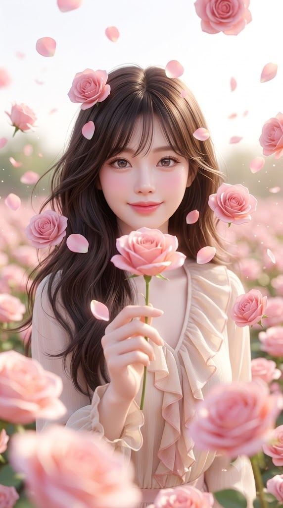
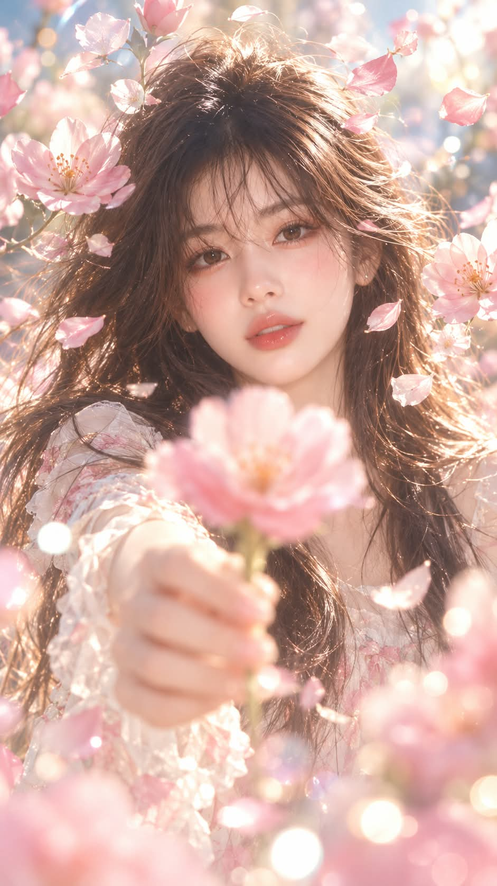

# 멀티 포커싱 1, 떠 있는 꽃과 꽃 한 송이 반실사 포트레이트 프롬프트

## 1. 개요 및 아트 디렉팅 가이드

- **컨셉**: 꽃밭에서 카메라를 향해 꽃 한 송이를 내밀고, 얼굴 둘레의 공중에는 초점이 제각각인 꽃송이들이 떠 있는 몽환적인 반실사 바스트샷. 앞·중간·뒤의 거리마다 선명함이 다른 얕은 심도가 핵심 (세로 9:16)
- **업로드 사진 사용 규칙**: 눈·코·입의 생김새만 가져오고, 얼굴형·피부·헤어·표정·머리 각도·조명·배경·의상은 가져오지 않음
- **장르 & 질감**:
  - 실사 40% + 3D 인형 렌더링 60%의 반실사. 고급 3D 구체관절 인형을 정교하게 렌더링한 느낌에 사람의 생기를 섞음
  - 모공 없이 도자기처럼 매끈하고 뽀얀 피부, 유리구슬처럼 맑은 눈동자, 젤리 같은 입술, 빛에 반투명하게 비치는 머리카락
  - 밝고 뽀얀 파스텔의 하이키 톤, 85mm 렌즈 f/1.4의 아주 얕은 심도
- **인물**: 사진 속 성별 그대로, 얼굴이 화면 위쪽 3분의 1 지점에 크게 오는 바스트샷. 고개를 똑바로 세우고 렌즈를 정면으로 바라보며 수줍고 따뜻하게 미소
- **포즈 (가장 중요)**:
  - 손에 든 꽃은 반드시 딱 한 송이
  - 엄지와 검지로 줄기를 가볍게 집고 가슴 높이에서 렌즈를 향해 팔을 수평으로 곧게 뻗음
  - 꽃의 머리가 화면 정중앙에 크게 오고, 그 바로 위로 얼굴이 보임. 눈·코·입은 가리지 않음
- **공중에 떠 있는 꽃 (핵심)**:
  - **얼굴 주변**: 꽃송이와 꽃잎 8~12개가 얼굴을 화관처럼 둥글게 감쌈. 카메라와의 거리를 서로 다르게 두어 선명한 꽃과 흐린 꽃이 번갈아 섞임
  - **화면 앞쪽**: 가장자리와 아래쪽에 크게 걸친 꽃송이 3~4개, 초점이 완전히 나간 색 번짐
  - **화면 뒤쪽**: 작게 흩날리며 배경과 함께 흐려지는 꽃잎
- **초점 (핵심)**:
  - 가장 선명한 곳은 인물의 눈과 얼굴, 그리고 얼굴과 같은 거리에 떠 있는 일부 꽃뿐
  - 손에 든 정중앙의 꽃과 손은 렌즈에 가까워 형태와 색만 알아볼 정도의 전경 보케로 표현
  - 얼굴 주변 꽃이 전부 선명하거나 전부 흐리면 실패
- **배경 & 조명**: 크게 흐려져 색 덩어리와 둥근 빛망울로 녹아드는 꽃밭. 손에 든 꽃, 떠 있는 꽃, 꽃밭의 꽃은 모두 같은 종류. 머리카락 가장자리를 하얗게 빛내는 부드러운 하이키 역광
- **금지**: 9:16 외의 비율, 꽃다발이나 여러 송이, 선명하게 초점이 맞은 손의 꽃, 얼굴을 가리는 꽃, 2D 만화·애니메이션 그림체, 어둡거나 대비가 강한 조명, 글자나 워터마크

---

## 2. 프롬프트 전문

```text
[비율]
9:16 세로형 이미지로 생성한다. 정사각형·3:4·가로형 금지. 세로로 길어진 화면 아래쪽은 흐릿하게 떠 있는 꽃송이와 둥근 빛망울로 채운다.

업로드한 얼굴 사진은 얼굴 인상 참고용으로만 사용한다. 사진에서는 눈·코·입의 생김새만 가져오고, 얼굴형·피부·헤어·이마/헤어라인·표정·머리 각도(고개 기울기, 방향, 시선)·조명·배경·의상은 절대 가져오지 않는다. 표정, 구도, 각도, 헤어, 의상, 배경은 아래 서술대로만 새로 그린다.

[장르]
실사 40% + 3D 인형 렌더링 60%의 몽환적인 반실사 인물 이미지. 고급 3D 구체관절 인형을 정교하게 렌더링한 듯한 느낌을 중심으로, 실제 사람의 자연스러운 생기를 40% 섞는다. 이목구비는 업로드 사진의 눈·코·입 생김새를 유지하되, 인형처럼 살짝 정돈한다. 눈은 실제보다 아주 조금 크고 또렷하게, 코와 입은 작고 단정하게.

- 피부: 모공 없이 도자기처럼 매끈하고 뽀얀 피부, 은은한 반광택. 볼과 코끝에 핑크빛 홍조.
- 눈: 유리구슬처럼 맑고 투명한 눈동자, 홍채 결이 섬세하게 보이고 반사광이 또렷하다. 속눈썹은 가늘고 길게.
- 입술: 촉촉한 광택이 도는 젤리 같은 입술.
- 머리카락: 한 올 한 올 가늘고 부드럽게, 빛을 받아 반투명하게 비친다.
전체 톤은 밝고 뽀얀 파스텔, 하이키 조명, 살짝 바랜 듯 부드럽고 몽환적인 색감. 85mm 렌즈, 조리개 f/1.4의 아주 얕은 심도.

[인물]
사진 속 인물의 성별을 판단해 그대로 그린다. 가슴 위 상반신이 들어오는 바스트샷으로, 얼굴은 세로 화면의 위쪽 3분의 1 지점에 크게 위치한다. 몸은 정면을 향해 서 있고, 고개는 똑바로 세운 채 카메라 렌즈를 정면으로 바라본다. 표정은 입꼬리가 살짝 올라간 수줍고 따뜻한 미소, 눈매도 함께 부드럽게 웃는다.
헤어는 바람에 몇 가닥이 가볍게 날리는 자연스러운 스타일, 의상은 꽃밭과 어울리는 밝은 톤의 가벼운 옷으로 AI가 인물 인상에 맞게 정한다.

[포즈 — 가장 중요]
손에 든 꽃은 반드시 딱 한 송이. 꽃다발이나 여러 송이를 손에 쥐는 것 금지.
한 손 엄지와 검지로 꽃 줄기 하나를 가볍게 집고, 팔을 아래로 늘어뜨리지 않고 가슴 높이에서 카메라 렌즈를 향해 수평으로 곧게 뻗는다. 꽃송이를 위로 들어 올려, 꽃의 머리가 화면 가로·세로 정중앙에 오게 한다. 꽃은 렌즈 바로 앞에 있어 화면에서 크게 보이고, 꽃송이 바로 위로 인물의 얼굴이 보인다.
꽃은 얼굴의 턱 아래 지점에 걸치며, 눈·코·입은 절대 가리지 않는다. 꽃이 화면 아래쪽이나 구석에 있는 구도, 팔을 사선 아래로 내민 구도는 금지.

[공중에 떠 있는 꽃 — 핵심]
인물 주변 공중에 꽃송이와 꽃잎들이 중력 없이 둥둥 떠 있다. 크기와 방향이 제각각이고, 일부는 천천히 회전하는 듯 기울어져 있다. 꽃은 매끈하고 살짝 광택이 도는 3D 오브젝트 질감으로 표현한다.

1. 얼굴 주변(가장 중요): 이마 위, 관자놀이 옆, 볼 옆, 턱선 옆, 머리카락 사이 공중에 꽃송이와 꽃잎을 넉넉하게 8~12개 띄워 얼굴을 화관처럼 둥글게 감싼다. 크기는 작은 꽃잎부터 손바닥만 한 꽃송이까지 섞는다.
이 꽃들은 카메라와의 거리가 서로 다르게 배치해 초점이 제각각이어야 한다.

- 일부는 얼굴과 같은 거리에 있어 꽃잎 결과 수술까지 선명하다.
- 일부는 얼굴보다 카메라 쪽으로 살짝 앞에 있어 부드럽게 흐릿하다.
- 일부는 얼굴보다 뒤쪽 머리카락 너머에 있어 은은하게 흐려진다.
선명한 꽃과 흐린 꽃이 얼굴 둘레에 번갈아 섞여 있어야 하며, 한쪽에 몰리지 않게 고르게 흩어진다. 눈·코·입은 절대 가리지 않는다.

2. 화면 앞쪽(렌즈 가까이): 화면 가장자리와 아래쪽에 크게 걸친 꽃송이 3~4개. 초점이 완전히 나가 흐릿한 색 번짐으로 보인다.

3. 화면 뒤쪽(인물 뒤): 작게 흩날리는 꽃잎들. 배경과 함께 부드럽게 흐려진다.

얼굴 주변은 풍성하게, 화면 나머지는 여백을 남겨 답답하지 않게 한다.

[초점 — 핵심]
가장 선명한 곳은 인물의 눈과 얼굴, 그리고 얼굴과 같은 거리에 떠 있는 일부 꽃들뿐이다.
손에 든 정중앙 꽃과 손은 렌즈에 아주 가까워 초점이 확실히 나간다. 꽃잎 결이나 수술은 보이지 않고, 형태와 색만 알아볼 정도로 부드럽게 뭉개진 전경 보케로 표현한다. 손에 든 꽃이 얼굴만큼 선명하면 실패다.
얼굴 주변 꽃은 선명한 것과 흐린 것이 반드시 섞여야 한다. 전부 선명하거나 전부 흐리면 실패다.
화면 앞쪽 꽃은 크게 흐리게, 뒤쪽 꽃잎과 배경은 멀어서 흐릿한 배경 보케로 표현한다. 얼굴이 흐린 결과는 금지.

[배경]
인물 뒤로 꽃밭이 넓게 펼쳐지고, 배경은 크게 흐려져 색 덩어리 보케와 크고 둥근 빛망울로 녹아든다. 꽃의 종류와 색은 AI가 인물 인상에 맞게 하나로 정하고, 손에 든 꽃·공중에 떠 있는 꽃·꽃밭의 꽃을 모두 같은 종류로 맞춘다.

[조명]
밝고 부드러운 하이키 역광이 머리카락 가장자리를 하얗게 빛나게 하고, 얼굴은 정면에서 퍼지는 부드러운 빛으로 그림자 없이 뽀얗게 밝다. 공중의 꽃잎 일부는 빛을 받아 가장자리가 반투명하게 빛난다.

[금지]
정사각형·3:4·가로형 비율, 손에 든 꽃 여러 송이·꽃다발, 선명하게 초점이 맞은 손에 든 꽃, 화면 아래나 구석에 있는 손에 든 꽃, 얼굴을 가리는 꽃, 얼굴 주변 꽃이 모두 같은 초점인 결과, 한쪽에만 몰린 꽃, 사진 원본의 고개 각도·표정 복사, 2D 만화·애니메이션 그림체, 만화처럼 얼굴의 절반을 차지하는 거대한 눈, 거친 모공·잡티가 보이는 실사 피부, 어둡거나 대비가 강한 조명, 화면 속 글자나 워터마크.
```

---

## 3. 결과물 비교 갤러리

| 생성 모델 | 생성 결과 이미지 |
| :--- | :--- |
| **제미나이 (Gemini)** |  |
| **ChatGPT (DALL-E 3)** |  |
