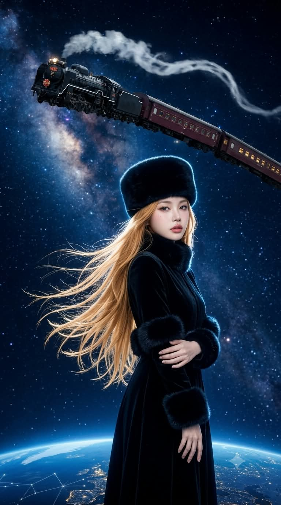
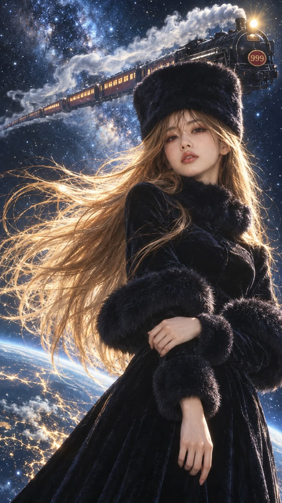

# 은하철도의 여인, 고전 SF 애니메이션풍 시네마틱 실사 프롬프트

## 1. 개요 및 아트 디렉팅 가이드

- **컨셉**: 고전 SF 애니메이션의 신비로운 여행자 여인을 실사 영화로 옮긴 듯한 시네마틱 실사 사진. 별이 가득한 우주를 배경으로 검은 퍼 모자와 벨벳 코트 드레스의 금발 여인이 서 있고, 뒤로 '999' 엠블럼의 증기기관차가 하늘을 날아감 (세로 9:16)
- **얼굴 규칙**: 사진에서는 눈·코·입의 생김새만 가져오고, 얼굴형·피부·헤어·표정·각도·시선은 프롬프트 서술대로 새로 그림
- **스타일**: 70~80년대 SF 영화 스틸컷 질감, 35mm 필름 그레인과 부드러운 소프트 포커스, 차갑고 깊은 블루 톤과 금빛 머리카락의 강한 대비, 극사실 피부 질감
- **인물**: 창백한 도자기 같은 피부와 갸름한 계란형 얼굴, 무겁게 반쯤 내리깐 눈꺼풀, 카메라를 살짝 내려다보는 차분하고 쓸쓸한 눈빛, 미소 없이 담담한 표정
- **헤어**: 허리 아래까지 내려오는 매우 긴 허니 골드 스트레이트 금발, 바람에 날려 화면 왼쪽으로 크게 흩날림
- **의상**:
  - 이마를 살짝 덮게 깊이 쓴 높고 둥근 원통형 블랙 퍼 모자
  - 몸에 붙는 발목 길이 블랙 벨벳 롱 코트 드레스
  - 턱 아래까지 감싸는 풍성한 블랙 퍼 하이넥 칼라, 팔꿈치 높이의 두꺼운 퍼 트리밍, 손목의 퍼 커프스
- **포즈 & 구도**: 머리 위부터 무릎 위까지의 3/4 샷, 약간 낮은 앵글, 화면 오른쪽을 향해 살짝 비스듬히 선 자세
- **배경**:
  - 별들이 보케처럼 빛나며 은하수처럼 흩뿌려진 깊은 남색 우주
  - 화면 오른쪽 아래에서 왼쪽 위로 솟구쳐 날아가는 검은색 구형 증기기관차. 앞면의 밝은 헤드라이트와 둥근 빨간 엠블럼 판의 금색 숫자 '999'
  - 석탄차와 창문마다 노란 불빛이 켜진 버건디 레드 객차 3~4량, 리본처럼 뒤로 흘러가는 흰 증기
  - 화면 하단에 살짝 보이는 푸른 행성의 둥근 지평선
- **조명**: 퍼와 머리카락 윤곽을 비추는 차가운 블루 림라이트, 얼굴을 창백하게 밝히는 부드러운 키라이트, 헤드라이트와 객차 불빛의 따뜻한 포인트
- **금지**: 애니메이션·일러스트·만화풍, 기관차 엠블럼의 999 외의 텍스트와 워터마크, 장난감이나 미니어처처럼 보이는 기차

---

## 2. 프롬프트 전문

```text
업로드한 사진은 얼굴 참고용으로만 사용하세요. 사진에서는 눈·코·입의 생김새만 가져오고, 얼굴형·피부·헤어·이마/헤어라인·표정·머리 각도·고개 기울기·시선 방향은 절대 가져오지 마세요. 그 외 모든 구도·포즈·의상·헤어·배경은 아래 서술대로만 그립니다.

[스타일]
고전 SF 애니메이션의 신비로운 여행자 여인을 실사 영화로 옮긴 듯한 시네마틱 실사 사진. 70~80년대 SF 영화 스틸컷 질감, 35mm 필름 그레인, 부드러운 소프트 포커스, 차갑고 깊은 블루 톤과 금빛 머리카락의 강한 대비. 극사실 피부 질감, 고급 패션 화보 수준의 조명.

[인물]
20대 후반 여성. 창백할 정도로 하얀 도자기 같은 피부, 가늘고 갸름한 계란형 얼굴, 길고 곧은 목선. 짙고 긴 속눈썹, 무겁게 반쯤 내리깐 눈꺼풀, 차분하고 쓸쓸한 눈빛으로 카메라를 살짝 내려다보는 표정. 입은 다문 채 미소 없이 담담함. 내추럴하지만 우아한 메이크업, 은은한 누드 로즈 립. 살짝 미화된 아름다운 얼굴.

[헤어]
허리 아래까지 내려오는 매우 긴 스트레이트 금발(따뜻한 허니 골드). 정수리는 모자 아래로 가지런히 내려오고, 머리카락 대부분이 바람에 날려 화면 왼쪽으로 크게 흩날림. 가닥가닥 빛을 받아 반짝이는 잔머리.

[의상]

- 모자: 높고 둥근 원통형 블랙 퍼 모자(러시아풍 코삭 햇), 이마를 살짝 덮게 깊이 씀
- 드레스: 몸에 붙는 발목 길이 블랙 벨벳 롱 코트 드레스, 긴 소매
- 목 부분: 턱 바로 아래까지 감싸는 풍성한 블랙 퍼 하이넥 칼라
- 팔꿈치 높이에 몸통을 두르는 두꺼운 블랙 퍼 트리밍(케이프 끝단처럼 양팔에 걸쳐짐)
- 소매 끝 손목에 블랙 퍼 커프스
- 벨벳에 은은한 광택, 퍼는 짙은 남색 기운이 도는 블랙

[포즈·구도]
세로 구도, 머리 위부터 무릎 위까지 나오는 3/4 샷. 카메라는 약간 낮은 앵글에서 올려다봄. 몸은 화면 오른쪽을 향해 살짝 비스듬히 서 있고, 고개는 오른쪽으로 아주 살짝 기울임. 한 손은 허벅지 옆에 가볍게 걸치듯 내림, 다른 팔은 몸 앞쪽으로 자연스럽게 감쌈. 인물은 화면 중앙에서 약간 오른쪽.

[배경·조명]
깊은 남색 밤하늘 우주, 크고 작은 별들이 보케처럼 빛나며 은하수처럼 흩뿌려진 배경.
인물 뒤쪽 하늘에 증기기관차가 하늘을 날아가고 있음:

- 화면 오른쪽 아래에서 왼쪽 위로 대각선을 그리며 위로 솟구쳐 날아가는 방향
- 맨 앞은 크고 묵직한 검은색 구형 증기기관차(D51형 스타일), 앞면 중앙에 둥근 헤드라이트가 밝게 켜져 있고, 그 아래 둥근 빨간 엠블럼 판에 금색 숫자 '999'
- 기관차 뒤로 석탄차, 이어서 진한 버건디 레드 객차 3~4량이 길게 연결, 객차 창문마다 따뜻한 노란 불빛
- 굴뚝에서 뿜어진 흰 증기가 기차 위를 따라 길고 구불구불한 리본처럼 뒤로 흘러감
- 기차는 인물보다 멀리 있어 작게 보이고, 인물의 머리·얼굴을 가리지 않게 어깨 뒤 하늘 공간을 가로지름
- 기차 아래쪽 화면 하단에는 푸른 행성의 둥근 지평선이 살짝 보이고, 행성 표면에 빛나는 선들이 별자리처럼 퍼져 있음
차가운 블루 림라이트가 퍼와 머리카락 윤곽을 비추고, 얼굴은 부드러운 키라이트로 창백하게 밝힘. 기관차 헤드라이트와 객차 창문 불빛이 배경의 따뜻한 포인트. 금발이 별빛을 받아 반짝임. 신비롭고 쓸쓸한 분위기.

[금지]
애니메이션·일러스트·만화풍 금지. 텍스트·사인·워터마크·제목 글자 금지(기관차 엠블럼의 999만 허용). 기차는 실제 크기의 금속 기관차 질감으로, 장난감·미니어처·만화풍 금지. 업로드 사진의 헤어·배경·의상·얼굴 각도 반영 금지. 얼굴 외 구도·각도·헤어·의상은 절대 바뀌지 않음.

비율 9:16 세로, 고해상도.
```

---

## 3. 결과물 비교 갤러리

| 생성 모델 | 생성 결과 이미지 |
| :--- | :--- |
| **제미나이 (Gemini)** |  |
| **ChatGPT (DALL-E 3)** |  |
