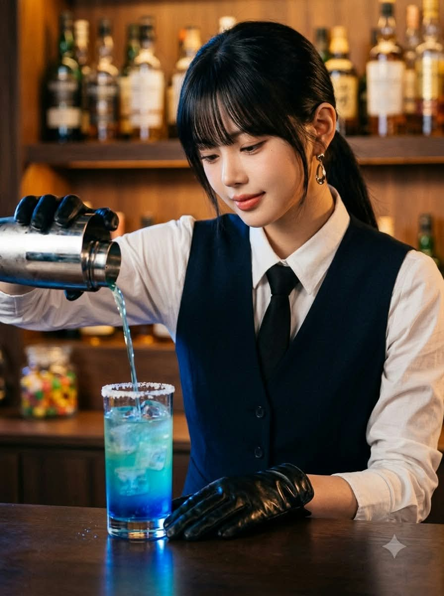
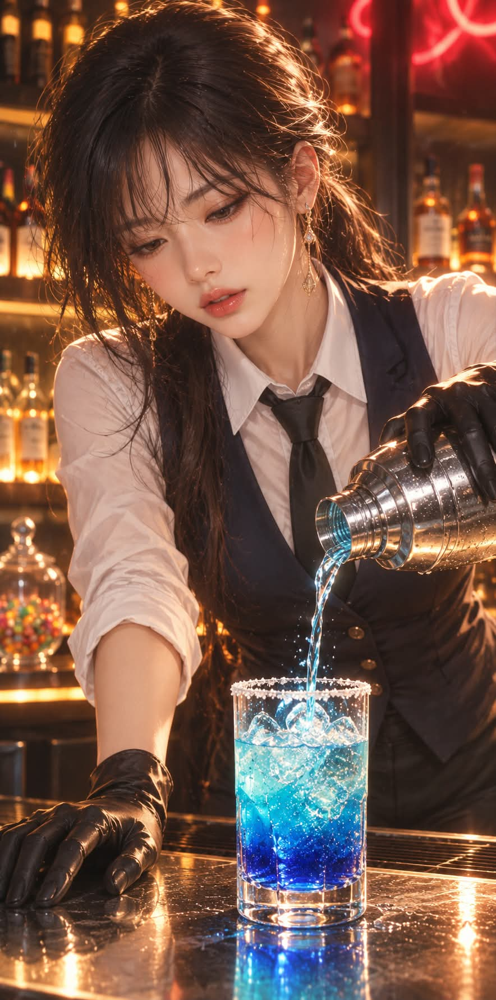

# 바텐더, 푸른 칵테일을 따르는 늦은 밤 칵테일 바 프롬프트

## 1. 개요 및 아트 디렉팅 가이드

- **컨셉**: 늦은 밤 칵테일 바의 카운터 뒤에서, 은색 셰이커를 기울여 푸른 그라데이션 칵테일을 하이볼 잔에 따르는 바텐더의 모습 (세로 1:2). GPT용과 Gemini용 두 버전으로 작성
- **버전별 차이**:
  - **GPT 버전**: 일본 애니메이션 일러스트의 선명한 윤곽선과 실사에 가까운 음영을 결합한 고퀄리티 반실사 일러스트. 로맨스 판타지 표지 주인공처럼 아름답게 다듬음
  - **Gemini 버전**: 85mm f/1.8로 실제 촬영한 듯한 시네마틱 실사 사진. 모공과 피부 결이 보이는 실제 피부, 일러스트·3D 느낌은 금지
- **얼굴 규칙**: 사진에서는 눈·코·입의 생김새와 전체 인상만 가져오고, 얼굴형·헤어·표정·각도·시선은 프롬프트 서술대로 새로 만듦. 성별에 따라 남자 또는 여자 버전 적용
- **구도 & 포즈**:
  - 카운터 뒤에서 상체를 앞으로 살짝 숙인 자세, 한 손은 카운터 가장자리를 짚고 다른 손은 셰이커를 기울임
  - 얼굴은 화면 위쪽 3분의 1 지점의 4분의 3 측면, 고개를 살짝 숙여 잔을 내려다봄
  - 잔은 실제 칵테일 잔 크기로 화면 아래쪽 중앙에 배치
- **체형 & 표정**: 8.5등신의 늘씬한 모델 비율, 따르는 술줄기에 집중하는 차분한 표정과 입꼬리만 살짝 올라간 은은한 미소
- **인물**:
  - **여자**: 일자 앞머리의 윤기 나는 흑발을 낮게 묶어 늘어뜨린 헤어, 화려한 금색 드롭 귀걸이, 자연스러운 코랄 립
  - **남자**: 앞머리를 내린 단정한 미디엄 컷 흑발, 한쪽 귀의 작은 금색 귀걸이
- **의상 (공통)**: 빳빳한 흰색 드레스 셔츠, 가는 검은 넥타이, 몸에 꼭 맞는 짙은 네이비 조끼, 광택 있는 검은 가죽 장갑
- **칵테일 (만드는 중)**:
  - 테두리에 하얀 소금 가루가 묻은 투명한 하이볼 잔, 잔 높이의 4분의 3까지 쌓인 투명한 각얼음
  - 아래쪽 짙은 코발트블루에서 위로 갈수록 청록색·하늘색·투명한 물빛으로 옅어지는 그라데이션
  - 셰이커에서 가는 줄기로 떨어지는 하늘색 술과 튀는 물방울, 잔 바깥에 맺힌 차가운 물방울
  - 가니시·라임·빨대는 넣지 않음
- **배경 & 조명**: 술병이 늘어선 선반의 따뜻한 호박색 빛, 카운터에 비친 잔과 장갑 낀 손, 따뜻한 앰버 빛과 칵테일의 푸른빛의 대비
- **금지**: 화면을 가득 채우는 거대한 잔, 읽을 수 있는 글자·로고·술병 라벨·워터마크, 사진의 각도·시선·표정 반영

---

## 2. 프롬프트 전문

### GPT 버전

```text
[작업 개요]
업로드된 인물 사진 1장을 사용해 아래 장면의 반실사 일러스트를 새로 그린다. 사진은 얼굴 인상 참고용으로만 쓰고, 장면·구도·포즈·의상·헤어·화풍은 모두 이 프롬프트에 적힌 대로 그린다. 인물은 판타지 요소가 없는 평범한 인간이다.

[사진에서 가져올 것 / 가져오지 말 것]

- 가져올 것: 눈, 코, 입의 생김새와 전체적인 얼굴 인상만.
- 가져오지 말 것: 얼굴형, 피부 질감, 헤어스타일, 이마·헤어라인, 표정, 고개 기울기, 얼굴 방향, 시선, 조명, 배경, 의상, 액세서리.
- 사진의 머리·얼굴 각도는 절대 따라 하지 말고, 아래에 적힌 각도로 새로 그린다.
- 표정은 사진과 상관없이 아래 서술대로 새로 그린다.
- 눈·코·입은 사진처럼 붙여 넣지 말고 반실사 일러스트 화풍에 맞게 다시 그려서 그림 속 인물로 자연스럽게 녹인다. 본인임을 알아볼 수 있는 인상은 남기되, 로맨스 판타지 표지 주인공처럼 아름답게 다듬는다.
- 사진 속 인물의 성별을 판단해 남자 버전 또는 여자 버전으로 그린다.

[화풍]
고퀄리티 반실사 일러스트. 일본 애니메이션 일러스트의 선명한 윤곽선과 실사에 가까운 입체적인 피부 음영·재질 표현을 결합한다. 피부는 매끈하고 맑으며 볼과 콧등에 은은한 홍조, 눈은 투명한 하이라이트가 있는 맑은 홍채. 금속·유리·얼음·액체는 반사와 굴절이 정밀하게 표현된 극사실 질감. 시원한 청색과 따뜻한 앰버 조명의 대비, 선명하고 깨끗한 마감. 완전한 실사 사진이나 단순한 만화체 금지.

[신체 비율]
8.5등신의 늘씬하고 우아한 모델 비율. 머리는 몸에 비해 작고, 목은 길고 가늘며, 어깨선과 팔이 길고 매끈하다. 상반신만 보이는 구도여도 이 비율이 느껴지게 그린다.

[구도]
세로로 긴 1:2 비율. 인물은 바 카운터 뒤에서 상체를 앞으로 살짝 숙이고, 인물이 화면의 주인공으로 크게 보인다. 카운터 위 인물 바로 앞에 평범한 크기의 하이볼 잔이 하나 놓여 있으며, 잔의 높이는 인물의 손 길이보다 조금 긴 실제 칵테일 잔 크기이고 화면 높이의 4분의 1을 넘지 않는다. 잔은 화면 아래쪽 중앙, 인물의 가슴 앞 높이에 위치한다. 인물의 왼팔(화면 오른쪽)은 잔 위에서 은색 셰이커를 기울여 잔에 붓고, 오른손(화면 왼쪽)은 카운터 가장자리를 짚고 있다. 얼굴은 화면 위쪽 3분의 1 지점에서 4분의 3 측면으로, 고개를 살짝 숙여 잔을 내려다본다. 얼굴이 셰이커나 잔에 가려지지 않게 한다.

[표정]
눈을 살짝 내리깔고 따르는 술줄기를 집중해서 바라보는 차분한 표정, 입꼬리가 아주 살짝 올라간 은은한 미소. 시크하고 여유로운 프로 바텐더의 분위기.

[인물 – 여자 버전]
윤기 나는 흑발, 눈썹 바로 아래 길이의 일자 앞머리, 옆머리는 귀 뒤로 넘기고 뒷머리는 낮게 묶어 등 뒤로 늘어뜨림. 귀에 화려한 금색 장식 드롭 귀걸이. 결 좋은 맑은 피부, 자연스러운 코랄 립.

[인물 – 남자 버전]
윤기 나는 흑발, 눈썹에 살짝 닿는 앞머리를 내린 단정한 미디엄 컷, 옆머리는 귀 뒤로 정리. 한쪽 귀에 작은 금색 장식 귀걸이. 수염 없는 깨끗한 피부, 선이 고운 턱선.

[의상 – 공통]

- 빳빳한 흰색 드레스 셔츠, 칼라를 세워 단정하게 여밈.
- 가는 검은색 넥타이.
- 몸에 꼭 맞는 짙은 네이비 조끼, 허리 뒤쪽에 조임 벨트.
- 손목까지 오는 광택 있는 검은 가죽 장갑을 양손에 착용.

[칵테일 – 만드는 중]

- 투명하고 두꺼운 바닥의 원통형 하이볼 잔, 실제 칵테일 잔 크기.
- 잔 테두리에는 하얀 소금·설탕 가루가 고르게 묻어 반짝인다.
- 잔 안에는 크고 투명한 각얼음이 잔 높이의 4분의 3까지 쌓여 있다.
- 술은 아직 따르는 중이라 잔의 3분의 2 정도만 차 있다. 아래쪽은 짙은 코발트블루, 위로 갈수록 청록색·하늘색·투명한 물빛으로 옅어지는 그라데이션이고, 경계가 물감처럼 부드럽게 번져 섞인다.
- 액체 안에 작은 기포와 반짝이는 미세한 입자가 떠 있다.
- 셰이커에서 투명한 하늘색 액체가 가는 줄기로 얼음 사이로 떨어지며, 떨어지는 지점에서 작은 물보라와 기포가 튄다.
- 잔 바깥 표면에 차가운 물방울이 맺혀 있고, 카운터 위에 잔의 푸른빛이 그림자처럼 비친다.
- 가니시, 라임, 레몬, 과일 조각, 빨대는 넣지 않는다.

[소품]
은색 금속 셰이커, 표면에 반짝이는 반사와 물방울. 화면 왼쪽 뒤 카운터 위에 알록달록한 사탕이 담긴 작은 유리병.

[배경]
늦은 밤의 모던한 칵테일 바. 인물 뒤로 위스키·와인·리큐어 병이 늘어선 선반, 병들은 따뜻한 호박색으로 빛난다. 화면 위쪽 배경에 붉은색 네온 간판 불빛이 흐릿하게 보이되 글자는 읽을 수 없게 빛 번짐으로만 처리. 바 카운터 상판은 아래에서 따뜻한 주황빛 조명이 올라와 은은하게 빛나고, 잔과 장갑 낀 손이 카운터에 반사된다.

[조명]
배경과 카운터의 따뜻한 앰버 빛 속에서 칵테일 잔의 푸른 액체와 얼음이 빛을 받아 맑게 반짝인다. 얼굴에는 부드러운 정면 보조광을 넣어 이목구비가 또렷하고 아름답게 보이게 한다.

[금지]
라임·레몬 등 가니시, 빨대, 잔 안의 바다 풍경이나 생물, 화면을 가득 채우는 거대한 잔, 인물보다 큰 잔, 사진 얼굴을 그대로 붙인 듯한 이질감, 사진의 고개 각도·시선·표정 반영, 큰 머리·짧은 목의 아동 비율, 읽을 수 있는 글자·로고·워터마크.
```

### Gemini 버전

```text
실제 카메라로 촬영한 시네마틱 인물 사진을 만들어 주세요. 그림, 일러스트, 디지털 페인팅, 3D 캐릭터가 아니라 실제 사람을 찍은 사진이어야 합니다. (photorealistic, real photograph, cinematic film still)

[촬영 설정]
- 풀프레임 카메라, 85mm 인물 렌즈, 조리개 f/1.8, 얕은 피사계 심도.
- 세로 1:2 비율의 긴 화면.
- 고급 바에서 찍은 영화 스틸컷 같은 색감, 자연스러운 필름 그레인 약간.
- 피부는 실제 사람 피부: 미세한 모공과 피부 결, 자연스러운 혈색, 화장한 실제 피부의 질감. 매끈한 도자기 피부·에어브러시 피부 금지.
- 머리카락은 한 올 한 올 보이는 실제 머리카락, 잔머리와 빛을 받은 윤기.

[얼굴 합성 규칙]
업로드한 사진은 얼굴 인상 참고용으로만 쓴다.
- 가져올 것: 눈, 코, 입의 생김새와 전체적인 인상만.
- 가져오지 말 것: 얼굴형, 피부, 헤어스타일, 이마·헤어라인, 표정, 고개 기울기, 얼굴 방향, 시선, 조명, 배경, 의상, 액세서리.
- 고개 각도와 표정은 사진과 상관없이 아래 서술대로 새로 만든다.
- 본인임을 알아볼 수 있되, 배우나 모델처럼 이목구비를 또렷하고 아름답게 다듬는다. 얼굴은 실제 사람 비율 그대로이고, 눈을 키우거나 만화처럼 바꾸지 않는다.
- 사진 속 인물의 성별을 판단해 남자 또는 여자 버전으로 만든다.

[장면]
늦은 밤 고급 칵테일 바. 바텐더가 카운터 뒤에서 상체를 살짝 앞으로 숙이고, 오른손(화면 왼쪽)은 카운터 가장자리를 짚고, 왼손(화면 오른쪽)으로 은색 셰이커를 기울여 카운터 위 하이볼 잔에 술을 따른다. 얼굴은 화면 위쪽 3분의 1 지점에서 4분의 3 측면, 고개를 살짝 숙여 잔을 내려다본다. 얼굴은 셰이커나 잔에 가려지지 않는다.

[체형]
키가 크고 늘씬한 8.5등신 모델 체형. 작은 얼굴, 길고 가는 목, 긴 팔과 매끈한 어깨선.

[표정]
눈을 살짝 내리깔고 따르는 술줄기에 집중하는 차분한 표정, 입꼬리만 아주 살짝 올라간 은은한 미소.

[여자 버전]
윤기 나는 흑발, 눈썹 바로 아래 길이의 일자 앞머리, 옆머리는 귀 뒤로 넘기고 뒷머리는 낮게 하나로 묶어 등 뒤로 늘어뜨린 포니테일. 화려한 금색 장식 드롭 귀걸이. 자연스러운 코랄 립.

[남자 버전]
윤기 나는 흑발, 눈썹에 살짝 닿는 앞머리의 단정한 미디엄 컷, 옆머리는 귀 뒤로 정리. 한쪽 귀에 작은 금색 귀걸이. 수염 없는 깨끗한 피부, 선이 고운 턱선.

[의상]
빳빳한 흰색 면 드레스 셔츠(원단 주름이 실제처럼 보임), 가는 검은 실크 넥타이, 몸에 꼭 맞는 짙은 네이비 울 조끼, 손목까지 오는 광택 있는 검은 가죽 장갑(가죽 주름과 반사광).

[칵테일 – 만드는 중]
- 실제 크기의 투명하고 바닥이 두꺼운 하이볼 잔.
- 잔 테두리에 하얀 소금 가루.
- 투명한 각얼음이 잔 높이의 4분의 3까지 쌓여 있다.
- 술은 3분의 2 정도 차 있다. 아래는 짙은 코발트블루, 위로 갈수록 청록색·하늘색·투명한 물빛으로 옅어지는 그라데이션.
- 셰이커에서 투명한 하늘색 술이 가는 줄기로 얼음 위로 떨어지며 작은 물방울이 튄다.
- 잔 바깥에 차가운 물방울이 맺히고, 카운터에 푸른빛이 비친다.
- 가니시·라임·빨대 없음.

[배경]
인물 뒤 나무 선반에 술병들이 늘어서 따뜻한 호박색으로 빛나고, 렌즈 보케로 흐릿하게 날아간다. 술병 라벨은 초점이 나가서 어떤 글자나 브랜드도 읽을 수 없다. 화면 왼쪽 뒤 카운터에 알록달록한 사탕이 담긴 작은 유리병. 짙은 원목 카운터에 잔과 장갑 낀 손이 반사된다.

[조명]
뒤쪽 술병들의 따뜻한 앰버 역광이 머리카락과 어깨 윤곽을 비추고, 얼굴은 부드러운 소프트박스 보조광으로 자연스럽게 밝힌다. 잔의 푸른 액체가 얼음 사이로 빛을 굴절시킨다.

[금지]
그림, 일러스트, 애니메이션, 웹툰, 3D 캐릭터 렌더링, 매끈한 플라스틱 피부, 큰 눈, 윤곽선, 읽을 수 있는 술병 브랜드·라벨 글자, 로고, 워터마크, 사진 얼굴의 고개 각도·시선·표정 반영.
```

---

## 3. 결과물 비교 갤러리

| 생성 모델 | 생성 결과 이미지 |
| :--- | :--- |
| **제미나이 (Gemini)** |  |
| **ChatGPT (DALL-E 3)** |  |
