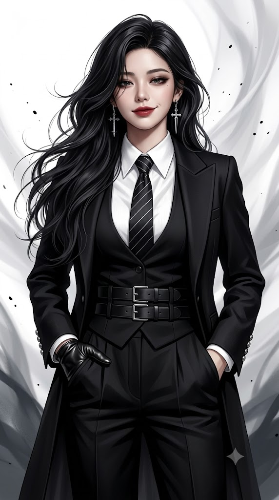
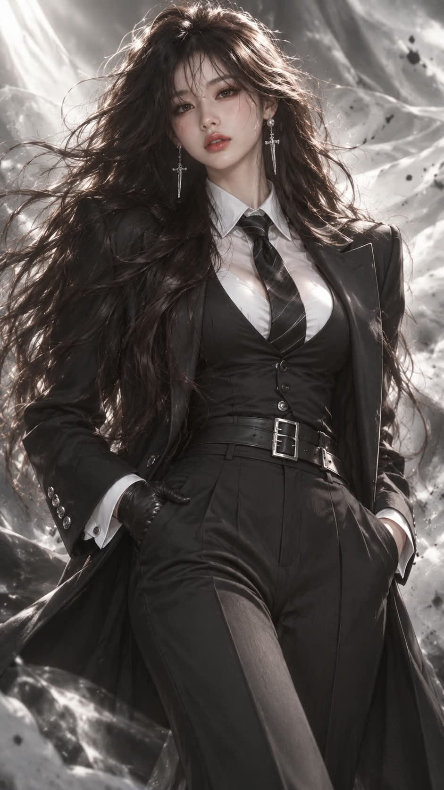

# 블랙 수트 롱헤어 모노톤 세미실사 포트레이트 프롬프트

## 1. 개요 및 아트 디렉팅 가이드

- **컨셉**: 바람에 크게 흩날리는 칠흑색 롱헤어와 블랙 스리피스 수트 차림으로 카메라를 똑바로 응시하는 여성의 3/4 샷. 흑·백·회색 모노톤에 피부톤과 탁한 레드 립만 색이 들어간 세미실사 패션 포트레이트 (세로 9:16)
- **업로드 사진 사용 규칙 (가장 중요)**:
  - 사진에서는 눈·코·입의 생김새만 가져오고, 얼굴형·피부·헤어·각도·시선·표정은 프롬프트 서술대로 새로 그림
  - 인물은 항상 여성으로 그림. 사진이 남성이어도 눈·코·입의 특징만 살려 여성으로 표현
  - 사진에 안경이나 선글라스가 있어도 그리지 않고 맨얼굴로 표현
- **화풍**:
  - 실사 90%, 디지털 페인팅 10%의 실사에 가까운 세미실사
  - 피부 모공과 결, 머리카락 한 올, 정장 원단의 직조감과 가죽 광택까지 실사 수준으로 묘사
  - 하이엔드 패션 화보 퀄리티, 85mm 렌즈의 얕은 심도 느낌
- **구도 & 체형**:
  - 머리끝부터 허벅지 중간까지의 3/4 샷, 8.5등신의 길고 늘씬한 모델 비율
  - 얼굴을 크고 정밀하게 완성한 뒤 비율 그대로 축소해 배치하여, 작게 나와도 이목구비가 또렷하게 유지
- **포즈 & 표정**:
  - 체중을 한쪽 다리에 실은 여유로운 자세, 양손을 바지 주머니에 반쯤 넣음
  - 눈꺼풀을 반쯤 내린 나른한 눈매와 한쪽 입꼬리만 살짝 올라간 자신감 있는 미소, 위험하고 카리스마 있는 분위기
  - 짙은 스모키 아이 메이크업과 탁한 레드 립
- **헤어 & 액세서리**: 허리까지 내려오는 칠흑색 웨이브 머리가 강한 바람에 양옆과 뒤로 크게 흩날림, 십자가·검 모양 펜던트가 달린 긴 은색 귀걸이
- **의상**:
  - 뾰족한 긴 칼라의 하얀 드레스 셔츠와 가는 사선 핀스트라이프의 검은 넥타이
  - 깊은 V라인의 검은 조끼, 앞을 연 긴 기장의 검은 테일러드 재킷과 은색 스터드 커프스
  - 사각 은색 버클이 두 개 겹친 넓은 가죽 벨트, 하이웨이스트 검은 슬랙스, 검은 가죽 장갑
- **배경 & 조명**: 연기나 실크 천이 휘날리는 듯한 흰색·밝은 회색의 추상적인 바람 소용돌이, 공중에 흩뿌려진 작은 검은 잉크 점, 좌상단의 부드러운 스튜디오 확산광과 은은한 림라이트
- **금지**: 안경과 선글라스, 컬러풀한 배경과 밝은 색 의상, 머리가 큰 비율, 애니메이션·만화 느낌, 텍스트·로고·워터마크

---

## 2. 프롬프트 전문

```text
[세미실사 아트 – 블랙 수트 롱헤어 포트레이트 / 얼굴 합성용 템플릿]

■ 업로드 사진 사용 규칙 (가장 중요)

- 업로드한 사진은 얼굴 참고용으로만 사용한다.
- 사진에서는 눈·코·입의 생김새만 가져온다.
- 얼굴형, 피부, 헤어, 이마, 헤어라인은 사진에서 가져오지 않는다. 모두 아래 서술대로 그린다.
- 사진 속 머리 각도, 고개 기울기, 얼굴 방향, 시선은 절대 가져오지 않는다. 각도와 시선은 아래 포즈 서술을 따른다.
- 표정은 사진을 따르지 않고, 아래 표정 서술대로 새로 그린다.
- 얼굴을 제외한 구도, 각도, 헤어, 의상, 배경, 조명은 아래 서술에서 하나도 바뀌면 안 된다.
- 인물은 항상 여성으로 그린다. 업로드 사진이 남자여도 눈·코·입의 특징만 살려 여성으로 그린다.
- 업로드 사진에 안경이나 선글라스가 있어도 절대 그리지 않는다. 안경을 벗은 맨얼굴로 그리고, 눈은 안경 렌즈 왜곡 없이 원래 크기와 모양으로 그린다.

■ 화풍

- 실사 90%, 디지털 페인팅 10%의 실사에 가까운 세미실사다.
- 얼굴, 피부, 머리카락, 원단은 실제 사진처럼 사실적으로 표현한다. 피부 모공과 결, 머리카락 한 올 한 올, 정장 원단의 직조감과 가죽 광택까지 실사 수준으로 묘사한다.
- 일러스트 느낌은 피부 표면의 아주 미세하게 매끈한 보정감과 배경의 회화적 흐름에만 살짝 남긴다.
- 하이엔드 패션 화보, 시네마틱 인물 사진 퀄리티로 표현한다. 85mm 렌즈, 얕은 심도 느낌이다.
- 전체 색감은 흑·백·회색 모노톤이다. 색이 들어가는 곳은 피부톤과 탁한 레드 립뿐이다.

■ 구도

- 세로 9:16 비율이다.
- 머리끝부터 허벅지 중간까지 보이는 3/4 샷이다. 인물이 화면 중앙에 크게 들어온다.
- 8.5등신 비율이다. 머리 하나 크기 대비 전신이 8.5배인 길고 늘씬한 모델 비율로 그린다.
- 얼굴이 작게 나오는 구도지만, 얼굴을 처음부터 작게 그리지 않는다. 얼굴을 크고 정밀하게 완성한 뒤 비율 그대로 축소해 8.5등신에 맞게 배치한다. 축소된 뒤에도 이목구비가 또렷해야 한다.

■ 체형

- 키가 크고 다리가 아주 긴 8.5등신 여성 체형이다.
- 볼륨 있는 글래머 몸매다. 풍만한 가슴, 잘록한 허리, 둥글게 이어지는 골반과 허벅지 곡선을 강조한다.
- 조끼와 셔츠가 가슴 볼륨을 따라 몸에 맞게 핏되고, 벨트가 허리를 조여 굴곡이 또렷하게 드러난다.
- 슬랙스는 골반과 허벅지 라인을 따라 매끈하게 떨어진다.
- 목은 길고 가늘며, 어깨와 팔은 가늘고 여성스럽다.

■ 포즈

- 정면에 가깝게 서 있다. 몸통은 아주 살짝 비스듬하고 체중은 한쪽 다리에 실린 여유로운 자세다.
- 양손을 바지 주머니에 반쯤 넣고 있다. 화면 왼쪽 손은 검은 가죽 장갑을 끼고, 주머니에 손끝만 걸친 모습이 보인다.
- 고개는 정면에서 살짝 숙이고 한쪽으로 아주 약간 기울인다.
- 시선은 카메라(보는 사람)를 똑바로 응시한다.

■ 표정

- 눈꺼풀을 반쯤 내린 나른하고 여유로운 눈매다.
- 한쪽 입꼬리만 살짝 올라간 자신감 있는 비웃음 같은 미소다.
- 위험하고 카리스마 있는 분위기다.

■ 메이크업

- 짙은 스모키 아이라인과 어두운 아이섀도
- 탁한 레드 립
- 은은한 컨투어로 날카로운 인상을 준다.

■ 헤어

- 허리까지 내려오는 아주 긴 칠흑색 머리다. 부드러운 웨이브가 있다.
- 강한 바람에 머리카락이 양옆과 뒤로 크게 흩날린다. 몇 가닥은 얼굴 옆과 어깨 앞으로 흘러내린다.
- 앞머리 없이 자연스럽게 넘긴 볼륨 있는 머리다.
- 머리카락은 실제 모발처럼 윤기와 잔머리가 살아 있다.

■ 액세서리

- 양쪽 귀에 길게 늘어지는 은색 귀걸이를 한다. 십자가·검 모양 펜던트가 달려 있고, 실제 금속처럼 반짝인다.
- 얼굴에는 안경 등 어떤 액세서리도 착용하지 않는다.

■ 의상

- 하얀 드레스 셔츠: 뾰족한 긴 칼라, 맨 위 단추까지 채움, 은은한 세로 결 텍스처
- 검은 넥타이: 가는 흰색 사선 핀스트라이프, 실크 광택
- 검은 조끼: 가슴 아래까지 깊게 파인 V라인
- 검은 테일러드 재킷: 앞을 연 채로 입음, 피크드 라펠, 엉덩이 아래까지 오는 긴 기장, 밑단이 살짝 퍼짐, 소매 커프스에 은색 스터드 단추가 여러 개 줄지어 있음
- 허리: 넓은 검은 가죽 벨트, 사각형 은색 버클 두 개가 위아래로 겹쳐 있음
- 하의: 하이웨이스트 검은 슬랙스, 앞 주름이 선명함
- 검은 가죽 장갑: 실제 가죽의 주름과 광택

■ 배경

- 흰색·밝은 회색의 추상적인 바람 소용돌이 배경이다. 연기나 실크 천이 휘날리는 듯한 곡선 결이 흐른다.
- 하단 좌우에는 짙은 회색 추상 형태가 흐릿하게 깔린다.
- 공중에 작은 검은 잉크 점이 몇 개 흩뿌려져 있다.
- 배경은 아웃포커스로 흐리게 처리해 인물이 돋보이게 한다.

■ 조명

- 좌상단에서 오는 부드러운 스튜디오 확산광이다.
- 얼굴과 셔츠는 밝게, 재킷과 머리카락은 깊은 블랙으로 표현한다.
- 머리카락과 어깨 윤곽에 은은한 림라이트를 준다.

■ 금지

- 안경, 선글라스, 안경 자국
- 컬러풀한 배경, 밝은 색 의상
- 사진 속 각도·표정·헤어 반영
- 얼굴을 처음부터 작고 뭉개지게 그리기
- 머리가 큰 비율, 짧은 다리
- 마르고 평평한 체형, 남성적인 어깨와 체형
- 애니메이션·만화 느낌, 플라스틱 같은 매끈한 피부, 과한 일러스트 붓 터치
- 텍스트, 로고, 워터마크
```

---

## 3. 결과물 비교 갤러리

| 생성 모델 | 생성 결과 이미지 |
| :--- | :--- |
| **제미나이 (Gemini)** |  |
| **ChatGPT (DALL-E 3)** |  |
