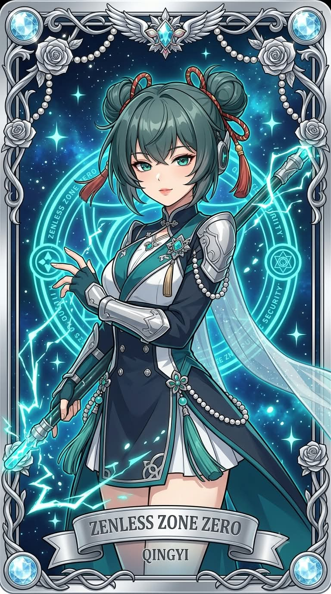
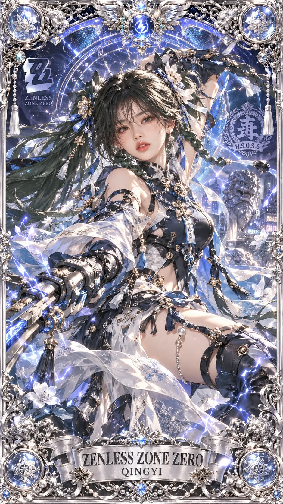

# 나랑 생일 비슷한 서브컬처 게임 캐릭터, 은빛 부조 수집용 카드 프롬프트

## 1. 개요 및 아트 디렉팅 가이드

- **컨셉**: 생일을 물어본 뒤 서브컬처 게임 7종에서 공식 생일이 같거나 가장 가까운 캐릭터를 웹 검색으로 찾아 검증하고, 그 캐릭터를 은빛 금속 부조 프레임의 화려한 수집용 카드로 그리는 프롬프트 (세로 9:16). 사진을 올리면 캐릭터 얼굴 대신 본인을 애니화한 얼굴이 들어감
- **대상 게임 7종**: 원신, 붕괴: 스타레일, 붕괴3rd, 젠레스 존 제로, 명조: 워더링 웨이브, 블루 아카이브, 승리의 여신: 니케
- **1단계 (생일 질문, 무조건)**:
  - 다른 작업보다 먼저 "생일을 알려 주세요 (예: 3월 21일)" 한 줄만 답하고 대기
  - 생일을 미리 알고 있어도 건너뛰지 않으며, 답을 받기 전에는 캐릭터를 고르거나 그리지 않음
- **2단계 (캐릭터 찾기, 검색 2번)**:
  - 일본어 검색어 두 개로 7개 게임의 생일 캐릭터 목록을 조회
  - 공식 생일이 정확히 같은 플레이어블 캐릭터를 우선하고, 없으면 가장 가까운 생일의 캐릭터를 선택
  - 사진이 있으면 성별이 같은 캐릭터를 우선하고, 캐릭터가 많은 게임이나 인기 캐릭터로 쏠리지 않게 무작위로 선택
  - 검색 결과에 이름·게임명·생일이 실제로 적힌 캐릭터만 사용하고, 생일 미공개나 팬 설정 생일은 제외
- **3단계 (검증, 검색 1번)**:
  - 7개 게임의 실제 등장인물인지, 공식 설정 생일인지, 날짜가 맞는지 세 가지를 확인
  - 확인되지 않으면 다음 후보로 바꿔 다시 검증하고, 확인되지 않은 캐릭터는 그리지 않음
- **카드 디자인 (고정)**:
  - 바로크풍 소용돌이 덩굴, 장미, 진주 줄, 날개 달린 보석 장식, 모서리의 크리스털 메달리온으로 조각된 은빛 금속 부조 프레임
  - 프레임 안쪽은 반짝이는 성운과 게임별 문양(원소, 운명의 길, 속성·소속, 학교 엠블럼과 헤일로, 제조사 엠블럼)이 새겨진 원형 마법진
  - 하단 리본형 은색 명판에 게임 영문 제목과 캐릭터 이름
- **캐릭터 표현**:
  - 원작의 헤어·대표 의상 구성·무기·상징 모티프·속성 이펙트는 유지하고, 의상은 훨씬 화려하게 재해석
  - 여성은 레이스·프릴·진주가 가득한 드레스 버전, 남성은 자수·견장·보석 브로치의 귀족 예복 버전. 노출은 원작보다 늘리지 않음
  - 가챠 게임 스플래시 아트 화풍의 전신, 대표 포즈를 카드 구도에 맞게 사용
- **얼굴 사진을 올린 경우 (본인 애니화)**:
  - 사진 속 인물을 게임 일러스트레이터가 직접 그린 공식 애니화 일러스트처럼 표현
  - 눈 윤곽·눈꼬리 각도·눈썹·이목구비 배치 비율을 그대로 살리고, 눈동자 색과 헤어는 원작 캐릭터를 따름
  - 완전한 2D 애니 셀 채색으로 얼굴과 몸의 그림체를 통일

---

## 2. 프롬프트 전문

```text
[1단계 — 생일 질문 (무조건)]
이 프롬프트를 받으면 다른 어떤 작업보다 먼저, 아무것도 그리거나 검색하지 말고 딱 이 한 줄만 답해:
"생일을 알려 주세요 (예: 3월 21일)"
그리고 사용자가 생일을 답할 때까지 기다려.

- 기억·대화 기록·프로필·사진 등으로 생일을 추측하거나 미리 알고 있어도 절대 건너뛰지 말고 반드시 물어봐.
- 사진이 함께 올라와 있어도 생일을 먼저 물어봐.
- 생일 답을 받기 전에는 캐릭터를 고르거나 이미지를 그리지 마.

[2단계 — 캐릭터 찾기 (검색 2번)]
대상 게임 7개: 원신(Genshin Impact), 붕괴: 스타레일(Honkai: Star Rail), 붕괴3rd(Honkai Impact 3rd), 젠레스 존 제로(Zenless Zone Zero), 명조(Wuthering Waves), 블루 아카이브(Blue Archive), 승리의 여신: 니케(GODDESS OF VICTORY: NIKKE).
생일을 받으면 웹 검색을 2번 해서 후보를 찾아.

- 검색 1: "○月○日 誕生日 原神 崩壊 ゼンレスゾーンゼロ キャラクター"
- 검색 2: "○月○日 誕生日 鳴潮 ブルーアーカイブ NIKKE キャラクター"
캐릭터 생일 목록 사이트(게임 위키, 캐릭터 생일 데이터베이스 등)의 결과를 우선 써.

고르는 순서:

1. 두 검색 결과를 합쳐서, 공식 생일이 그 생일과 정확히 같은 위 7개 게임의 플레이어블 캐릭터
2. 없으면, 검색 결과에 나온 위 7개 게임 캐릭터 중 공식 생일이 앞뒤로 가장 가까운 캐릭터

- 사진이 올라와 있으면 사진 속 인물과 성별이 같은 캐릭터를 우선해. 사진이 없으면 성별 상관없이 골라.
- 후보가 여러 게임에 걸쳐 있으면, 먼저 게임을 무작위로 하나 고른 뒤 그 게임 후보 중에서 골라. 캐릭터 수가 많은 게임으로 쏠리지 마.
- 같은 게임 안에 후보가 여러 명이면 그중 아무나 하나를 골라. 인기 캐릭터로 쏠리지 마.
- 후보는 반드시 검색 결과 글에 캐릭터 이름·게임명·생일이 실제로 적혀 있는 캐릭터만 써. 기억으로 이름을 떠올리거나 만들어 내지 마.
- 공식 생일이 없는 캐릭터(생일 미공개 캐릭터)는 빼. 팬 설정 생일도 쓰지 마.

[3단계 — 검증 (검색 1번)]
고른 캐릭터를 그리기 전에 검색을 1번 더 해서 확인해.
검색어: "[캐릭터 이름] [게임명] 誕生日"
아래 3가지가 검색 결과에서 모두 확인돼야 통과:

- 그 캐릭터가 위 7개 게임 중 하나에 실제로 나오는 등장인물인가
- 공식 생일이 게임 내 또는 공식 채널에서 설정된 것인가
- 그 공식 생일이 2단계에서 본 날짜와 같은가
하나라도 확인 안 되면 그 캐릭터는 버리고, 2단계 검색 결과의 다음 후보로 바꿔서 같은 방식으로 1번만 더 검증해. 그래도 실패하면 3단계에서 확인된 정보가 있는 캐릭터 중 가장 가까운 생일의 캐릭터를 써. 확인 안 된 캐릭터는 절대 그리지 마.

포즈는 그 캐릭터의 대표 포즈(가챠 스플래시 아트, 궁극기·필살기·EX 스킬·버스트 컷인 포즈)를 카드 구도에 맞게 쓰고, 등 장식은 캐릭터 분위기와 속성에 맞게 정해.
검증을 통과하면 결과를 한 줄만 보여주고 바로 그려.
같은 생일이면: "○월 ○일, 생일이 같은 캐릭터: [게임] - [캐릭터]"
가까운 생일이면: "○월 ○일, 생일이 가장 가까운 캐릭터: [게임] - [캐릭터] (공식 생일 ○월 ○일)"

[이미지 — 고정 사항]
세로 9:16 비율의 화려한 수집용 카드. 카드 전체가 은빛 금속 부조로 조각된 프레임: 바로크풍 소용돌이 덩굴, 장미, 진주 줄, 상단 중앙에 날개 달린 보석 장식, 네 모서리에 원형 크리스털 메달리온. 프레임 안쪽 배경은 반짝이는 성운과, 캐릭터의 게임 소속·속성 문양이 새겨진 원형 마법진.
마법진 문양:

- 원신: 원소 문양
- 붕괴: 스타레일: 운명의 길 문양
- 붕괴3rd·젠레스 존 제로: 속성·소속 문양
- 명조: 속성 문양
- 블루 아카이브: 소속 학교 엠블럼과 캐릭터 헤일로 모양
- 니케: 소속 제조사 엠블럼
하단 중앙에 리본형 은색 명판이 있고, 큰 세리프체로 게임 영문 제목, 그 아래 작은 글씨로 캐릭터 이름을 새김.
선택된 캐릭터는 원작의 상징 요소(헤어스타일과 머리색, 대표 의상 구성, 대표 무기, 상징 모티프, 속성 이펙트, 블루 아카이브는 머리 위 헤일로)를 유지하되, 의상은 원작보다 훨씬 화려하게 재해석:
- 여성 캐릭터: 레이스·프릴·진주·리본·작은 보석이 가득한 드레스 버전, 시스루 트레인이 길게 흩날림.
- 남성 캐릭터: 자수·견장·진주 체인·보석 브로치가 가득한 귀족 예복 버전, 시스루 망토가 길게 흩날림.
- 재해석할 때 노출은 원작보다 늘리지 말고, 우아하고 고급스러운 방향으로 디자인.
원작 의상의 대표 색을 메인으로 쓰고 펄화이트와 실버를 더해 카드 프레임과 어울리게 통일. 머리 장식·귀걸이·초커·프레임 문양에 캐릭터 상징 모티프를 반복.
캐릭터는 카드 중앙에 전신으로 크게 배치. 고퀄리티 가챠 게임 스플래시 아트 일러스트 화풍, 반짝이는 애니메이션 눈, 섬세한 선화, 셀 채색과 파스텔 하이라이트, 머리카락과 옷자락이 바람에 흩날림. 주변에 속성 색의 빛 입자·꽃잎·별 반짝이.
캐릭터와 프레임은 반 입체 부조처럼 빛을 받아 은빛 광택과 음영이 살아 있게 표현. 초고해상도, 정교한 디테일.

[얼굴 사진을 올린 경우에만 적용 — 본인 애니화]
이 얼굴은 "원작 캐릭터 얼굴에 특징을 조금 섞은 것"이 아니라, "사진 속 실제 인물을 게임 일러스트레이터가 직접 캐릭터로 그려 준 공식 애니화 일러스트"여야 해. 실존 인물 콜라보 일러스트처럼, 그림체는 완전한 2D 애니인데 보는 사람이 한눈에 "이 사람이다" 하고 알아봐야 해.

그리기 전에 사진 속 얼굴의 인상을 먼저 속으로 분석해: 이 사람을 처음 본 사람이 기억할 첫인상(눈매, 웃상인지 차가운 인상인지, 이목구비가 오밀조밀한지 시원한지)과 가장 눈에 띄는 특징 2~3개. 이 첫인상과 대표 특징이 그림에서 가장 먼저 보이게 그려.

애니화 규칙:

- 눈이 닮음의 핵심: 사진의 눈 윤곽 모양, 눈꼬리 방향과 각도, 눈과 눈썹 사이 거리, 쌍꺼풀 선을 그대로 따라 그려. 눈은 애니답게 반짝임과 홍채 하이라이트를 넣되, 크기는 사진보다 살짝만 키우고 원작 캐릭터의 눈 모양으로 바꾸지 마. 눈동자 색은 캐릭터 원작 색을 써.
- 눈썹: 사진의 굵기·각도·모양을 그대로 애니 선으로.
- 이목구비 배치: 눈 사이 간격, 눈-코-입 사이 거리 비율을 사진과 같게 유지. 이것이 인상을 결정하니 애니 표준 비율로 평준화하지 마.
- 코와 입: 애니풍으로 단순화하되, 코 길이 느낌과 입 크기·입술 두께 느낌은 사진과 같게.
- 얼굴형: 애니풍으로 다듬되 사진의 얼굴 윤곽 느낌(갸름함/둥긂/각짐)은 유지.
- 점·보조개 등 눈에 띄는 특징은 같은 위치에 작게 표시.
- 그림체: 완전한 2D 애니 셀 채색. 사실적인 피부 질감·사진 같은 음영·실사 코와 입술 묘사는 금지. 얼굴과 몸의 그림체가 같아야 해.
가져오지 말 것: 헤어, 이마와 헤어라인(헤어는 캐릭터 원작 유지), 사진의 고개 기울기·얼굴 방향·시선 각도.
표정은 캐릭터 포즈와 성격에 맞게 새로 그리되(밝은 캐릭터는 미소, 쿨한 캐릭터는 자신감 있는 옅은 미소), 표정이 바뀌어도 눈매 모양·눈꼬리 방향·첫인상이 그대로 남게 해.
얼굴 외의 구도·포즈·의상·카드 디자인은 위 설정에서 전혀 바뀌면 안 됨.
```

---

## 3. 결과물 비교 갤러리

| 생성 모델 | 생성 결과 이미지 |
| :--- | :--- |
| **제미나이 (Gemini)** |  |
| **ChatGPT (DALL-E 3)** |  |
