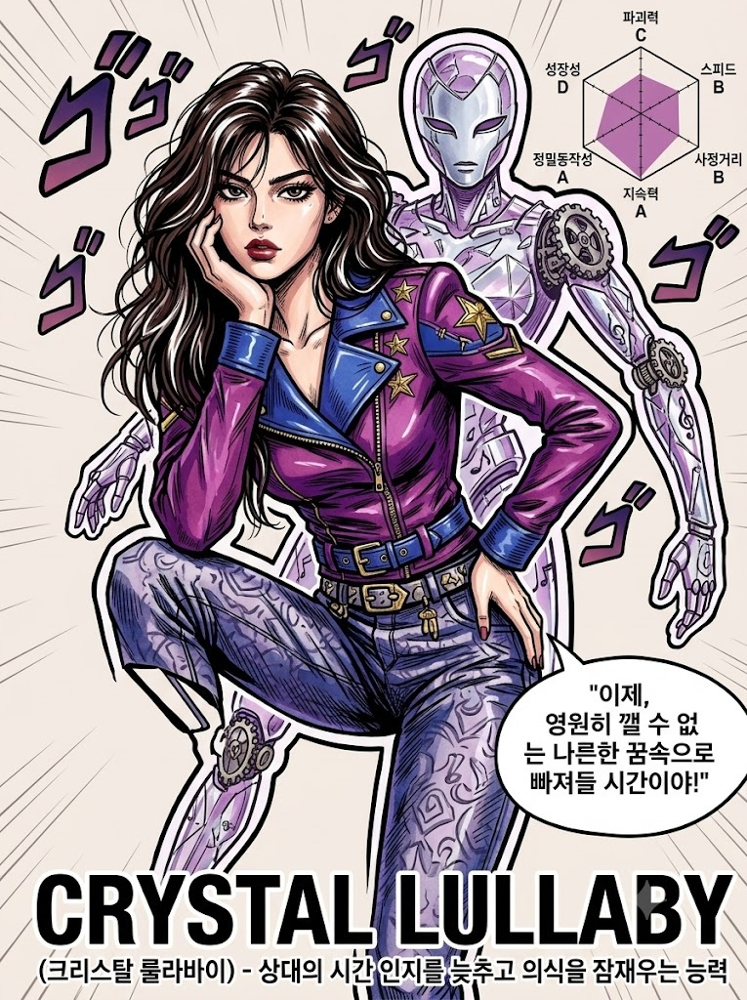
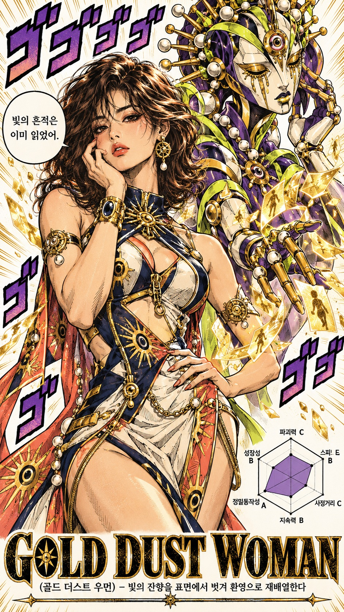

# 나의 스탠드 찾기, 죠죠풍 오리지널 스탠드 일러스트 프롬프트

## 1. 개요 및 아트 디렉팅 가이드

- **컨셉**: 얼굴 사진의 인상을 분석해 그 사람만의 오리지널 스탠드(이름, 외형, 능력, 대사, 능력치)를 디자인하고, 「죠죠의 기묘한 모험」 단행본 컬러 페이지 화풍으로 인물과 스탠드를 함께 그리는 프롬프트 (세로)
- **진행 순서**:
  - "분석을 시작합니다"로 시작해 화풍 검색, 얼굴 인상 확인, 스탠드 능력 결정, 외형 디자인 순으로 진행 문구를 한 줄씩 출력
  - 분석 결과(화풍 특징, 인상 분석, 스탠드 이름과 유래, 외형, 능력, 발동 대사, 능력치, 색 조합과 의상)를 정해진 형식으로 출력
  - 같은 응답에서 멈추지 않고 이어서 이미지까지 생성
- **스탠드 결정 규칙**:
  - 이름은 실제 존재하는 서양 록·팝 밴드명이나 곡 제목에서 가져옴
  - 시간 정지처럼 원작에서 유명한 능력은 피하고, 그 사람의 인상에서만 나올 법한 기묘하고 구체적인 능력으로 결정
  - 외형은 마스크 같은 얼굴, 상징 무늬, 관절의 이음매, 조각상 같은 분절 구조의 초현실적인 디자인
  - 기존 작품의 캐릭터나 스탠드를 그대로 쓰거나 닮게 그리지 않음
- **얼굴 반영 규칙**: 사진에서는 눈·코·입의 생김새만 가져와 성별별 얼굴 규칙으로 다시 그리고, 각도·시선·표정은 새로 그림. 안경은 유지
- **공통 화풍**:
  - 가는 검은 잉크 펜선과 조금 더 굵은 외곽선, 근육과 옷 주름의 짧은 평행 빗금과 크로스 해칭
  - 채도 높은 선명한 원색, 밝은 면과 그림자 면의 또렷한 경계, 옷·머리카락·금속의 굵고 긴 흰색 하이라이트
  - 몸에 딱 붙는 기묘한 하이패션 의상, 집중선만 가볍게 넣은 단색 배경, 굵은 일본어 의성어 "ゴゴゴゴ"
- **성별 규칙**:
  - **여성**: 턱선이 또렷한 성숙한 얼굴과 가로로 긴 아몬드형 눈, 길고 탄탄한 근육질 체형, 골반을 빼고 다리를 엇갈린 콘트라포스토 포즈, 무심하고 자신감 있는 표정
  - **남성**: 각지고 넓은 턱과 굵고 짙은 눈썹, 얼굴 절반에 드리운 해칭 그림자, 넓은 어깨의 근육질 체격, 한 손을 얼굴 옆에 대고 다른 손으로 가리키는 포즈, 차갑고 위압적인 표정
- **구도**: 무릎 위부터 머리까지 크게 배치한 인물, 3/4 방향 얼굴과 정면 시선, 바로 뒤에서 같은 방향으로 포즈를 겹쳐 떠 있는 스탠드
- **해부학 규칙**: 팔·손·다리·손가락 개수와 길이, 관절 연결을 명시하고 스탠드의 팔다리가 인물과 섞이지 않게 분리
- **텍스트 요소**: 하단의 굵은 영문 스탠드 이름과 한국어 능력 설명, 구석의 능력치 육각형 그래프(파괴력·스피드·사정거리·지속력·정밀동작성·성장성), 발동 대사 말풍선
- **금지**: 채도 낮은 색감과 TV 애니메이션식 셀 채색, 순정만화풍의 크고 반짝이는 눈, 실사·3D 질감, 분석 문구를 이미지 안에 넣는 것

---

## 2. 프롬프트 전문

```text
[진행 순서]
1. 이 프롬프트와 사진을 받으면, 첫 줄에 "분석을 시작합니다"를 출력해.
2. 다음 줄에 "분석중입니다..."를 출력하고, 아래 작업을 순서대로 하면서 단계마다 진행 문구를 한 줄씩 출력해.
   - "분석중입니다... 화풍 검색": 웹 검색으로 "죠죠의 기묘한 모험" 아라키 히로히코의 단행본 컬러 페이지와 공식 컬러 일러스트 화풍 특징을 찾아봐. 선, 채색, 하이라이트, 여성 캐릭터 얼굴과 몸, 남성 캐릭터 얼굴과 몸, 포즈의 특징을 확인해.
   - "분석중입니다... 얼굴 인상 확인": 사진을 분석해.
   - "분석중입니다... 스탠드 능력 결정"
   - "분석중입니다... 스탠드 외형 디자인"
   - "분석이 완료되었습니다"
3. 분석이 완료되면 결과를 다음 형식으로 대화에 출력해.
   - 확인한 화풍 특징: 검색으로 확인한 핵심 특징 3~5줄
   - 사진 인상 분석: 얼굴 인상, 분위기, 눈빛을 2~3줄로
   - 스탠드 이름: (영문) / (한국어 읽기)
   - 이름 유래: 어떤 밴드·곡에서 왔는지와 고른 이유 한 줄
   - 스탠드 외형: 2~3줄
   - 능력: 이름과 설명 2~3줄
   - 발동 대사: 한 줄
   - 능력치: 파괴력, 스피드, 사정거리, 지속력, 정밀동작성, 성장성 등급
   - 색 조합과 의상 디자인: 한 줄씩
4. 결과 출력이 끝나면, 같은 응답에서 이어서 그 내용 그대로 이미지를 그려. 중간에 멈추거나 나에게 질문하지 마.

[화풍 적용 원칙]
- 검색으로 확인한 화풍 특징과 아래 [공통 화풍], [여성 규칙], [남성 규칙]을 함께 반영해.
- 검색 내용과 아래 서술이 다르면 아래 서술을 우선해.
- 검색 결과 속 특정 캐릭터의 얼굴, 헤어, 의상, 포즈를 그대로 가져오지 마. 화풍 특징만 가져와.

[스탠드 결정 – 사진 분석]
- 사진 속 얼굴의 인상, 분위기, 눈빛, 성별, 나이대를 분석해서 이 사람만의 오리지널 스탠드를 디자인해.
- 결정할 것: 스탠드 이름, 외형, 능력 1가지, 능력 발동 대사 한 줄, 능력치 등급, 색 조합, 의상 디자인.
- 스탠드 이름은 실제 존재하는 서양 록·팝 밴드명이나 곡 제목에서 따와.
- 시간 정지, 시간 되감기처럼 원작에서 유명한 능력은 피하고, 이 사람의 인상에서만 나올 법한 기묘하고 구체적인 능력으로 정해.
- 스탠드 외형은 예쁜 사람 모습이 아니라 기묘하고 초현실적인 디자인으로 해. 마스크 같은 얼굴, 몸에 새겨진 상징 무늬, 관절의 이음매, 기계적이거나 조각상 같은 분절 구조, 비현실적인 신체 비율을 가져야 해.
- 위 항목은 전부 네가 사진만 보고 직접 정해. 기존 작품의 캐릭터나 스탠드를 그대로 쓰거나 닮게 그리지 마.

[얼굴 반영 규칙 (매우 중요)]
- 사진에서는 눈, 코, 입의 생김새만 가져와. 얼굴형, 피부, 헤어, 이마와 헤어라인은 가져오지 마.
- 사진 속 머리와 얼굴의 각도(고개 기울기, 방향, 시선)는 절대 가져오지 마. 얼굴 각도와 시선은 아래 구도 서술을 따라.
- 표정도 사진을 따르지 말고, 아래 서술대로 새로 그려.
- 눈, 코, 입은 반드시 아래 성별별 얼굴 규칙으로 다시 그려.
- 사진 속 인물이 안경을 쓰고 있으면 안경은 유지해.
- 성별은 사진대로 판단해서, 여성이면 [여성 규칙], 남성이면 [남성 규칙]을 적용해.

[공통 화풍]
- "죠죠의 기묘한 모험" 단행본 컬러 페이지와 공식 컬러 일러스트 화풍이야. 아라키 히로히코의 펜선 위에 채색한 만화 원고처럼 그려.
- 선은 가는 검은 잉크 펜선이고, 외곽선은 조금 더 굵어. 근육, 옷 주름, 얼굴 음영에 짧은 평행 빗금과 크로스 해칭을 넣어.
- 채색은 채도 높은 선명한 원색이야. 밝은 면과 그림자 면의 경계가 또렷하고, 그림자 면 안에 수채나 마커처럼 살짝 얼룩진 질감이 있어.
- 옷, 머리카락, 금속 장신구에는 굵고 긴 흰색 하이라이트 줄을 그어 반질반질한 광택을 표현해. 머리카락 덩어리마다 흰 하이라이트가 물결처럼 지나가.
- 피부는 따뜻한 살구색 바탕에 주황빛이나 붉은빛 그림자를 넣고, 근육과 뼈의 굴곡을 따라 그림자를 칠해.
- 입술은 남녀 모두 피부와 다른 색으로 칠해. 입술 색은 스탠드 색 조합에 맞게 네가 정해.
- 의상은 몸에 딱 붙는 기묘한 하이패션 디자인이야. 반복 무늬, 상징 장식, 구멍, 지퍼, 금속 장신구를 과감하게 넣어. 디자인과 색은 스탠드 컨셉에 맞게 네가 정해.
- 배경은 흰색 또는 연한 단색 바탕에 집중선만 가볍게 넣어. 인물과 스탠드가 또렷하게 떠 보여야 해.
- 인물 주변에 입체감 있는 굵은 일본어 의성어 "ゴゴゴゴ"를 넣어. 글자에는 두꺼운 검은 테두리를 둘러.

[여성 규칙]
- 얼굴: 갸름하지만 턱선이 또렷하고, 광대가 살짝 드러나는 성숙한 얼굴이야.
- 눈: 가로로 긴 아몬드형이고, 쌍꺼풀 선이 진하게 그어져 있어. 눈동자는 밝은 색에 작은 하이라이트가 있고, 속눈썹은 위아래로 굵고 또렷하게 몇 가닥 그려.
- 눈썹: 두껍고 또렷하며, 끝이 날카롭게 올라가.
- 코: 콧대가 곧게 내려오고 콧볼과 콧구멍이 짧은 선으로 또렷해. 코 한쪽 옆에 그림자를 넣어.
- 입: 크고 도톰하며, 윤곽선과 입술 가운데 선이 뚜렷해. 입술에는 진한 색을 칠해.
- 몸: 길고 탄탄한 근육질이야. 어깨, 팔, 복근, 허벅지에 근육 선과 음영이 보여. 키가 크고 다리가 길어.
- 포즈: 한쪽 골반을 크게 빼고, 반대쪽 무릎을 안쪽으로 굽혀 다리를 엇갈리게 세운 패션모델 같은 콘트라포스토 자세야. 한 손은 턱이나 뺨에 대고, 다른 손은 허리나 골반에 얹어.
- 표정: 무심하고 자신감 있는 표정이야. 눈을 살짝 내리깔고 입은 다물어.

[남성 규칙]
- 얼굴: 각지고 넓은 턱, 두꺼운 목, 뚜렷한 광대뼈를 가진 강인한 얼굴이야.
- 눈썹: 아주 굵고 짙으며, 눈 바로 위에 낮게 붙어 미간으로 강하게 모여.
- 눈: 가로로 길고 날카로워. 눈동자는 작고 선명한 색이며, 윗눈꺼풀이 무겁게 내려와 매서운 눈빛이야.
- 코: 크고 콧대가 높아. 콧날이 각지게 꺾이고, 코 옆면 전체에 짙은 그림자를 넣어.
- 입: 굳게 다물고, 입술 윤곽과 아랫입술 아래 그림자가 뚜렷해.
- 음영: 얼굴 한쪽 절반에 해칭이 들어간 짙은 그림자를 드리워 입체감을 강하게 줘.
- 몸: 넓은 어깨, 두꺼운 가슴과 팔, 굵은 목을 가진 근육질 체격이야.
- 포즈: 어깨를 비스듬히 틀고, 한 손은 손가락을 벌려 얼굴 옆에 대고, 다른 팔은 몸 옆으로 비스듬히 뻗어 검지로 화면 옆쪽을 가리켜.
- 표정: 차갑고 위압적인 표정이야. 턱을 살짝 당기고 눈썹 아래로 보는 사람을 노려봐.

[구도]
- 세로 비율. 인물은 무릎 위부터 머리까지 화면에 크게 배치해. 얼굴이 작아지지 않게 해.
- 얼굴은 3/4 방향으로 돌리고, 시선은 화면 정면의 보는 사람을 향해.
- 인물 바로 뒤에 스탠드가 인물과 같은 방향으로 포즈를 겹쳐 취하며 떠 있어. 스탠드도 같은 펜선과 채색 화풍으로 그리고, 몸 둘레에 굵은 윤곽 오라를 둘러.

[해부학 규칙 (매우 중요)]
- 인물은 팔 2개, 손 2개, 다리 2개만 있어. 팔과 다리는 몸에서 하나씩 자연스럽게 이어지고, 팔꿈치·손목·무릎은 하나씩이야.
- 손은 각각 손가락 5개야. 엄지 1개와 나머지 손가락 4개가 분명하게 구분되고, 손가락마다 관절 마디 수가 정상이야. 손가락이 서로 붙거나 녹아 합쳐지지 않아.
- 손가락 길이는 손바닥 길이보다 짧거나 비슷하고, 가운뎃손가락이 가장 길어. 손 크기는 얼굴 길이를 넘지 않아.
- 손톱은 손가락 끝에 짧게 붙어 있고, 길거나 뾰족하게 그리지 마.
- 손이나 팔이 카메라 쪽으로 튀어나오는 극단적인 원근 단축은 쓰지 마.
- 골반을 빼고 다리를 엇갈려도 몸무게를 받치는 다리와 골반이 자연스럽게 이어져야 해. 목, 어깨, 가슴, 허리가 하나의 몸으로 이어지고, 목이 지나치게 길거나 꺾이지 않아.
- 양쪽 눈은 같은 크기와 높이로 그려.
- 스탠드의 팔다리는 인물의 몸과 분리해서 그려. 인물의 팔다리와 섞이거나 이어지지 않아야 해.
- 머리카락이 팔이나 손가락과 뒤엉켜 형태가 무너지지 않게 해.

[텍스트 요소]
- 화면 하단에 스탠드의 실제 영문 이름을 굵은 대문자로 넣어.
- 그 아래에 한국어로 "(스탠드 한국어 이름) – (능력 한 줄 설명)"을 작게 넣어. 괄호 부분은 실제 이름과 설명으로 채우고, "스탠드명"이라는 글자를 그대로 쓰지 마.
- 화면 한쪽 구석에 능력치 육각형 그래프를 넣어. 그래프 안쪽에는 색칠한 도형만 넣고 글자는 넣지 마. 꼭짓점 바깥에만 항목명과 A~E 등급을 써. 항목은 파괴력, 스피드, 사정거리, 지속력, 정밀동작성, 성장성 6개야.
- 인물 옆 말풍선에 발동 대사를 한국어로 짧게 넣어.
- 모든 글자는 오탈자나 깨진 글자 없이 또렷하게 써.

[금지]
- 분석 결과 출력 후 멈추거나 나에게 질문하는 것 금지. 반드시 이미지까지 한 번에 그려.
- "분석중입니다" 진행 문구나 분석 결과 텍스트를 이미지 안에 넣는 것 금지.
- 팔·손·손가락·다리 개수 오류, 녹아 붙은 손가락, 지나치게 긴 손가락이나 손톱, 꺾인 관절, 카메라 쪽으로 튀어나온 거대한 손 금지.
- 사진 속 각도, 표정, 헤어, 의상, 배경 반영 금지.
- 탁하고 채도 낮은 색감, TV 애니메이션 셀 채색, 부드러운 그라데이션, 보석·크리스탈 반짝이 효과, 렌즈 플레어 금지.
- 순정만화풍, 미형 애니메이션풍, 크고 반짝이는 눈, 아기 같은 동안 얼굴 금지.
- 실사 질감, 3D 렌더링 느낌 금지.
- 기존 작품의 캐릭터나 스탠드 복제 금지.
```

---

## 3. 결과물 비교 갤러리

| 생성 모델 | 생성 결과 이미지 |
| :--- | :--- |
| **제미나이 (Gemini)** |  |
| **ChatGPT (DALL-E 3)** |  |
