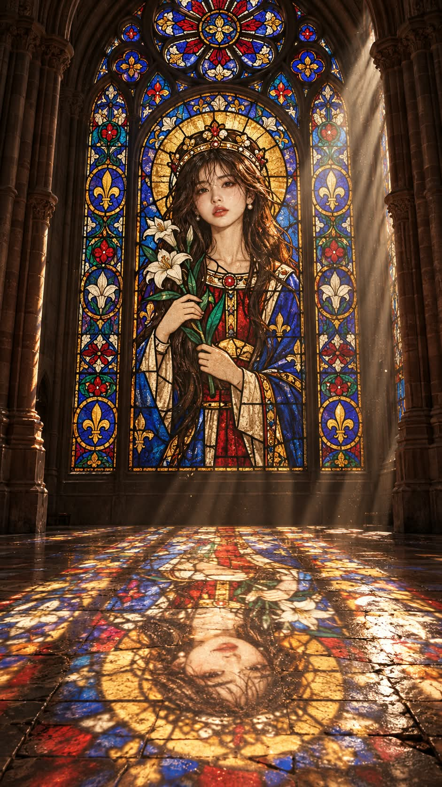

# 스테인드글라스, 고딕 대성당 중세 인물과 바닥의 빛 프롬프트

## 1. 개요 및 아트 디렉팅 가이드

- **컨셉**: 사진 속 인물(또는 동물)을 12~13세기 고딕 대성당 스테인드글라스에 그려진 중세 인물로 만들고, 그 창문을 통과한 색색의 빛이 성당 바닥에 떨어지는 장면 (세로 9:16)
- **결과물 참고**: GPT 결과만 실었음. Gemini 결과는 없음
- **사진에서 가져올 것**:
  - 눈·코·입의 생김새, 얼굴형, 머리색, 성별, 대략적인 나이, 안경 유무
  - 옷·배경·포즈·각도·시선·표정·조명은 가져오지 않고, 표정은 중세 성화 인물 특유의 고요하고 경건한 표정으로 새로 그림
- **닮음 (가장 중요)**:
  - 눈꼬리 방향, 쌍꺼풀, 눈 사이 간격, 눈썹, 콧대와 콧볼, 인중, 입술, 광대와 턱선을 먼저 분석해 그리자이유 선으로 그대로 옮김
  - 미화하거나 눈을 키우거나 얼굴을 갸름하게 바꾸지 않음
  - 얼굴을 크게 그려 완성한 뒤 비율을 유지한 채 축소하고, 얼굴에만 그리자이유를 더 세밀하게 사용
  - 안경을 쓴 인물이면 테 모양에 가까운 중세 리벳식 둥근 안경을 씌움
- **전체 장면**:
  - 화면 위쪽 약 3분의 2는 꼭대기에 둥근 장미창이 있는 거대한 고딕 아치형 스테인드글라스 창문
  - 창문 양옆의 붉은 사암 묶음 기둥과 뾰족 아치, 그늘 속에 묻힌 어두운 벽
  - 화면 아래쪽 약 3분의 1은 오래되어 금이 가고 닳은 큰 석판 바닥
- **창문 속 중세 인물**:
  - 인상과 분위기를 보고 중세 시대의 신분과 역할을 AI가 직접 결정
  - 그 신분에 맞는 복식, 머리 장식, 상징물을 갖추고 정면으로 선 무릎 위 입상, 머리 뒤의 둥근 금빛 후광
  - 모든 색 영역은 독립된 색유리 조각이고 굵고 일정한 검은 납선으로 연결. 납선은 이목구비를 가로지르지 않음
  - 손으로 만든 중세 유리의 기포와 물결, 깊은 코발트 블루와 루비 레드 중심의 색
- **빛줄기**: 창문 뒤에서 비스듬히 내려오는 강한 오후 햇살, 공기 중의 먼지 때문에 선명하게 보이는 유리 색을 머금은 굵은 빛줄기
- **바닥에 떨어진 빛**:
  - 바닥의 빛 그림은 창문 그림과 위아래가 뒤집혀, 후광과 얼굴이 카메라 가까운 화면 아래쪽에 떨어짐
  - 좌우는 뒤집히지 않고, 원근 때문에 카메라 쪽으로 갈수록 길게 늘어남
  - 석판의 금과 이음새를 따라 빛이 끊기고 번짐
- **분위기 & 화질**: 어두운 성당 내부에서 창문·빛줄기·바닥에만 빛이 집중되는 강한 명암 대비. 성당과 빛, 바닥은 고해상도 실사처럼, 창문 속 인물만 중세 스테인드글라스로 표현
- **금지**: 현대 옷과 헤어스타일, 바닥 빛 그림이 창문과 같은 방향으로 바로 서 있는 것, 성당 안의 사람, 글자·서명·워터마크

---

## 2. 프롬프트 전문

```text
첨부한 사진 속 인물(또는 동물)을 12~13세기 고딕 대성당 스테인드글라스에 그려진 중세 인물로 만들고, 그 창문을 통과한 빛이 성당 바닥에 떨어지는 장면을 그려줘.

[사진에서 가져올 것과 가져오지 않을 것]
- 가져오는 것: 눈·코·입의 생김새, 얼굴형, 머리색, 성별, 대략적인 나이, 안경 유무
- 가져오지 않는 것: 사진 속 옷, 배경, 포즈, 고개 기울기와 방향, 시선, 표정, 조명
- 표정은 사진을 따르지 않고, 중세 성화 인물 특유의 고요하고 경건한 표정으로 새로 그린다.

[닮음 – 가장 중요]
- 그리기 전에 사진 속 얼굴을 먼저 꼼꼼히 분석한다. 눈꼬리 방향, 쌍꺼풀 유무와 모양, 눈 크기와 두 눈 사이 간격, 눈썹 모양과 굵기, 콧대 높이와 코끝·콧볼 너비, 인중 길이, 입술 두께와 입 너비, 광대와 턱선, 얼굴 길이와 너비 비율을 파악한다.
- 분석한 특징을 그리자이유 선으로 그대로 옮긴다. 중세 화풍으로 단순화하더라도 이 특징들의 형태와 비율은 바꾸지 않는다.
- 사진 속 사람보다 예쁘게 다듬거나, 눈을 키우거나, 얼굴을 갸름하게 바꾸지 않는다. 흔한 미인 얼굴이나 애니메이션 얼굴로 만들지 않는다.
- 얼굴은 처음부터 작게 그리지 않는다. 얼굴을 크게 그려 이목구비를 정확히 완성한 뒤, 비율을 그대로 유지한 채 인물 크기에 맞게 축소한다.
- 그리자이유는 얼굴에만 더 세밀하게 쓴다. 눈두덩, 콧대 옆, 입꼬리, 턱 아래에 얇은 음영 붓터치를 넣어 입체와 특징이 드러나게 한다.
- 안경을 쓴 인물이면 사진 속 안경테 모양에 가까운 중세 리벳식 둥근 안경을 씌운다.

[전체 장면]
- 세로 9:16 구도로, 어두운 고딕 대성당 내부를 정면에서 바라본다.
- 화면 위쪽 약 3분의 2는 거대한 고딕 아치형 스테인드글라스 창문이다. 꼭대기에는 둥근 장미창이 있고, 그 아래로 가운데 넓은 창과 양옆의 좁은 창이 이어진다.
- 창문 양옆에는 붉은 사암으로 된 묶음 기둥과 뾰족 아치가 있다. 벽은 그늘 속에 묻혀 어둡다.
- 화면 아래쪽 약 3분의 1은 오래되어 금이 가고 닳은 큰 석판 바닥이다.

[창문 속 중세 인물]
- 사진 속 인물의 인상과 분위기를 보고, 중세 시대에 어떤 신분과 역할의 인물이었을지 AI가 직접 정한다.
- 그 신분에 맞는 중세 복식, 머리 장식, 손에 든 상징물을 갖춘 무릎 위 입상으로, 가운데 넓은 창을 가득 채운다. 얼굴이 창문 안에서 충분히 크게 보여야 한다.
- 인물은 정면을 향해 똑바로 서 있고, 자세는 경건하고 정적이다. 머리 뒤에는 둥근 금빛 후광이 있다.
- 피부는 연한 살구색·아이보리 유리이고, 눈, 눈썹, 코, 입, 얼굴 윤곽, 옷 주름은 갈색·검은 안료로 붓으로 그린 그리자이유 선으로 표현한다.
- 양옆 좁은 창은 중세 고딕 창의 원형·사엽형 메달리온 무늬와 덩굴무늬로 채운다.
- 모든 색 영역은 독립된 색유리 조각이고, 조각 사이는 굵고 일정한 검은 납선으로 연결된다. 납선은 얼굴의 이목구비를 가로지르지 않고 얼굴 윤곽선을 따라서만 지나간다.
- 한 조각 안에는 그라데이션이 없고, 손으로 만든 중세 유리의 기포, 물결, 고르지 않은 두께가 보인다.
- 색은 중세 유리의 깊은 코발트 블루와 루비 레드를 중심으로, 에메랄드 그린, 앰버 옐로, 자줏빛을 더한다.

[빛줄기]
- 창문 뒤 높은 곳에서 강한 오후 햇살이 비스듬히 내려와 유리가 안에서부터 타오르듯 빛난다.
- 성당 안 공기 중의 먼지 때문에 창문에서 카메라 쪽 바닥으로 내려오는 굵은 빛줄기가 선명하게 보이고, 빛줄기는 유리 색을 머금고 있다.

[바닥에 떨어진 빛]
- 바닥에 맺힌 빛 그림은 창문 그림과 위아래가 반대로 뒤집혀 있다. 창문 위쪽(장미창, 후광, 머리)의 빛은 창문에서 먼 곳, 즉 카메라 가까운 화면 아래쪽에 떨어진다. 창문 아래쪽(인물의 무릎, 옷자락)의 빛은 창문 바로 앞 바닥에 떨어진다.
- 카메라에서 보면 바닥 위 인물은 거꾸로 누워 있는 모습이다. 후광과 얼굴이 화면 맨 아래 가까이 있고, 옷자락이 창문 쪽을 향한다.
- 좌우는 뒤집히지 않는다. 창문 왼쪽의 빛은 바닥 왼쪽에, 오른쪽의 빛은 바닥 오른쪽에 떨어진다.
- 바닥 빛 그림은 원근 때문에 카메라 쪽으로 갈수록 길게 늘어나고 커진다. 가장자리는 살짝 부드럽게 번지지만, 후광과 인물 실루엣, 얼굴 위치는 알아볼 수 있다.
- 빛은 석판의 금과 이음새를 따라 끊기고 번진다. 가장 밝은 부분은 하얗게 날아갈 정도로 강하다.

[분위기와 화질]
- 성당 내부는 어둡고, 빛은 창문, 빛줄기, 바닥에만 집중된다. 명암 대비가 강하다.
- 성당, 빛, 바닥은 고해상도 실사 사진처럼 그리고, 창문 속 인물만 중세 스테인드글라스다.

[금지]
- 사진 속 얼굴과 다른 사람처럼 보이는 얼굴, 미화된 얼굴, 애니메이션풍 큰 눈 금지
- 현대 옷, 현대 헤어스타일 금지
- 창문 속 인물을 실사 사람이나 현대 일러스트처럼 그리는 것 금지
- 바닥 빛 그림이 창문 그림과 같은 방향으로 바로 서 있는 것 금지
- 성당 안에 사람 배치 금지
- 글자, 서명, 워터마크 금지
```

---

## 3. 결과물 비교 갤러리

| 생성 모델 | 생성 결과 이미지 |
| :--- | :--- |
| **ChatGPT (DALL-E 3)** |  |

Gemini 결과는 없습니다.
