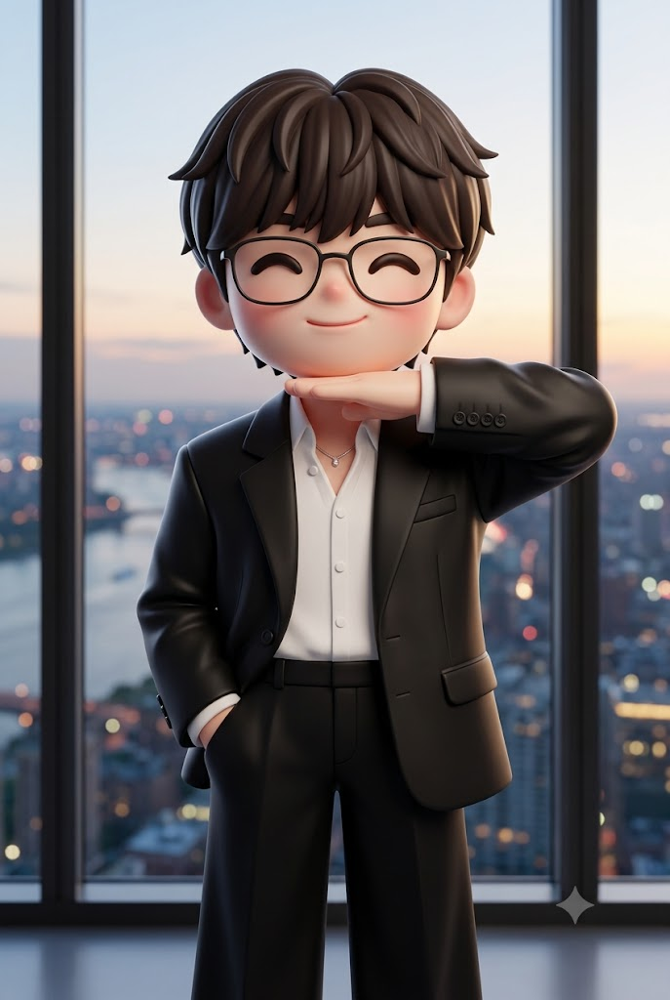

# 아궁빵, 턱 잡기 포즈 3D 미니미 아트토이 프롬프트

## 1. 개요 및 아트 디렉팅 가이드

- **컨셉**: 얼굴 사진 속 인물을, 옆에서 들어온 손으로 턱을 잡는 '턱 잡기(chin grab)' 포즈의 3D 미니미 아트토이 피규어로 만드는 영어 프롬프트 (세로 2:3). 수줍고 장난스러운 미소가 포인트
- **결과물 참고**: GPT 결과는 엄지가 턱 앞을 가로지르는 포즈가 재현됐고, Gemini 결과는 손바닥으로 턱을 받치는 모양이 되어 포즈 재현에 실패한 예시로 함께 실음
- **포즈 (최우선)**:
  - 턱을 괴거나 생각하는 포즈가 아니라, 손이 옆에서 수평으로 들어와 턱을 잡는 포즈
  - 한쪽 팔뚝은 바닥과 평행하게 어깨 바로 아래 높이, 팔꿈치는 옆으로 들어 올림
  - 네 손가락은 곧게 펴서 붙인 채 턱 아래를 수평으로 받치고, 손바닥은 위를 향함
  - 엄지는 벌려서 아랫입술 바로 아래 턱 앞면을 가로로 가로지르며 또렷하게 보임
  - 턱 끝을 엄지(앞)와 손가락(아래) 사이에 잡고, 볼이나 귀에는 닿지 않음
  - 고개는 기울이지 않고 똑바로, 반대쪽 손은 바지 주머니에 넣음
- **얼굴 참고 규칙**:
  - 사진에서는 눈·코·입의 형태와 전체 인상만 가져와 미니미 비율로 단순화하되 알아볼 수 있게 유지
  - 얼굴형·피부·헤어·각도·시선·표정은 가져오지 않고, 안경은 사진에 있을 때만 같은 스타일로 추가
  - 성별에 따라 남성은 앞머리가 이마를 덮는 볼륨 있는 짧은 머리, 여성은 시스루 뱅의 긴 웨이브 머리
- **표정**: 입을 다문 수줍고 장난스러운 미소, 초승달처럼 웃는 눈, 카메라를 정면으로 바라봄
- **미니미 스타일**: 머리가 몸통만큼 큰 2.5등신 프리미엄 3D 비닐 아트토이, 매트한 질감과 장밋빛 볼, 다섯 손가락이 또렷한 짧고 통통한 손
- **의상**: 넓은 피크드 라펠의 오버사이즈 블랙 수트 재킷, 단추 두 개를 푼 흰 셔츠, 작은 크리스털 펜던트의 가는 은 목걸이, 블랙 와이드 팬츠
- **배경 & 조명**: 해 질 녘 고층 건물의 통유리창 앞, 노을 진 하늘과 강이 흐르는 도시 스카이라인의 보케, 얼굴과 손을 밝히는 부드러운 정면광과 은은한 림라이트
- **네거티브**: 턱이나 볼을 손에 괴는 포즈, 주먹과 구부린 손가락, 아래에서 올라오는 팔, 기울인 고개, 가려진 엄지, 입을 가리는 손, 손가락 개수 오류

---

## 2. 프롬프트 전문

```text
[GOAL]
Turn the person in the uploaded face photo into a 3D mini-me art toy figure.
The figure is doing a "chin grab" pose with a shy, playful smile.
Use the uploaded photo ONLY as a face reference.
Draw everything else exactly as described below.

[POSE – TOP PRIORITY]
(chin grab pose:1.5). This is NOT a chin-resting / thinking pose.
The hand comes in horizontally from the side and grips the chin.

Arm:

- One forearm is horizontal, parallel to the floor, just below shoulder height.
- The elbow is raised out to the side, floating in the air.
- The forearm extends sideways toward the right edge of the frame.

Hand entry:

- The hand enters horizontally from the right side.
- It does NOT come up from below.

Hand shape:

- (Four fingers straight, flat and held together:1.3). NOT a fist, NOT curled fingers.
- (Open palm facing up toward the chin:1.3).
- The extended fingers support the underside of the jaw horizontally.
- The fingertips reach the opposite jawline.

Thumb:

- Spread away from the fingers.
- (Clearly visible, lying horizontally across the front of the chin just below the lower lip:1.3).

Grip:

- The chin tip is held between the thumb (front) and the flat fingers (underneath).
- The hand does NOT touch the cheeks, ears, or cheekbones.
- The lips are fully visible just above the thumb.

Head:

- Upright, not tilted.
- No weight resting on the hand.

Other arm:

- Relaxed down at the side, with the hand tucked into the trouser pocket.

[FACE REFERENCE RULES]
Take from the photo:

- ONLY the shape of the eyes, nose, and mouth, and the overall impression.

Do NOT take from the photo:

- Face shape, skin, hair, hairline, head angle, head tilt, gaze direction, or expression.

Likeness:

- Simplify the features into cute mini-me proportions.
- Keep the person clearly recognizable.

Glasses:

- If the photo has glasses, add the same style.
- If not, no glasses.

Gender (judge from the photo):

- Male: dark brown voluminous short hair with bangs covering the forehead.
- Female: long, softly wavy dark brown hair with thin see-through bangs.

[EXPRESSION & GAZE]

- Closed-lip shy, playful smile with raised mouth corners.
- Smiling crescent eyes.
- Looking straight at the camera.

[MINI-ME STYLE]

- Premium 3D vinyl art toy figure.
- 2.5-head chibi proportions:
- The head is as big as the torso.
- Short, chubby arms and legs.
- Matte vinyl texture, rosy cheeks, Pixar-quality 3D render.
- Short chubby hands with all five fingers clearly defined.

[OUTFIT]
Jacket:

- Oversized black suit jacket with broad shoulders and wide peaked lapels, worn open.
- Four black buttons on the cuff.
- Natural wrinkles on the raised sleeve.

Underneath:

- White shirt with the top two buttons undone.

Accessories:

- Thin silver necklace with a small crystal pendant.

Bottoms:

- Black wide-leg trousers.

[BACKGROUND & LIGHTING]
Background:

- In front of a high-rise floor-to-ceiling window at dusk.
- Sunset sky and a city skyline with a river.
- Soft bokeh city lights, out of focus.

Lighting:

- Soft frontal light brightly illuminating the face and hand.
- Subtle rim light.

[FRAMING]

- Vertical 2:3.
- The figure is large and centered, framed from the knees up.
- High resolution.

[NEGATIVE]

- Chin resting on hand, cheek resting on hand.
- Fist, curled fingers, knuckles under the chin.
- Thinking pose.
- Arm coming up from below.
- Tilted head.
- Thumb on the cheek, thumb pointing up, hidden thumb.
- Covering the mouth.
- Realistic human proportions.
- Wrong number of fingers.
```

---

## 3. 결과물 비교 갤러리

| 생성 모델 | 생성 결과 이미지 |
| :--- | :--- |
| **제미나이 (Gemini)**, 포즈 재현 실패 예시 |  |
| **ChatGPT (DALL-E 3)** |  |
