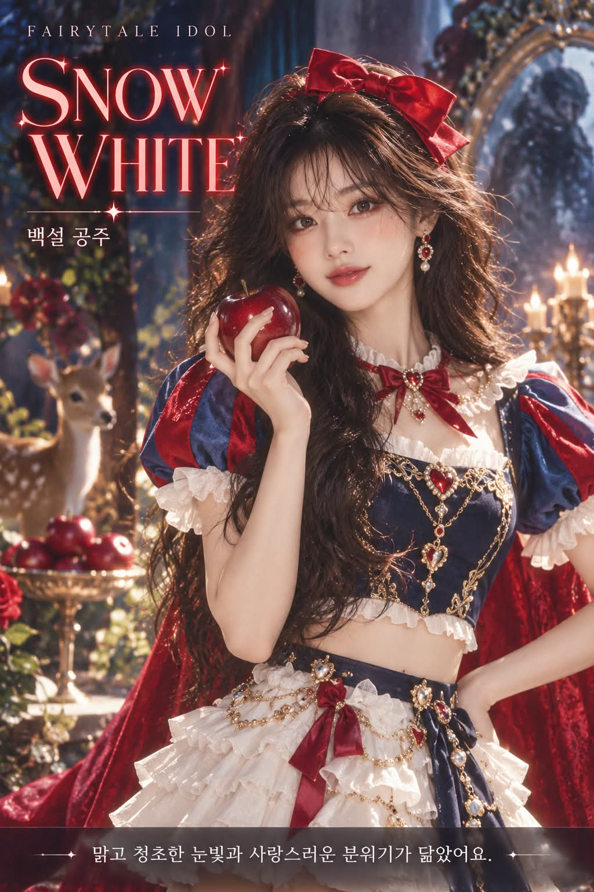

# 동화 주인공 아이돌, K-pop 앨범 콘셉트 포토 프롬프트

## 1. 개요 및 아트 디렉팅 가이드

- **컨셉**: 얼굴 사진의 인상에 맞는 동화 주인공을 고르고, 그 주인공을 K-pop 아이돌 무대 의상으로 재해석해 앨범 콘셉트 포토처럼 만드는 영어 프롬프트. 선택 결과와 이유는 이미지 안의 텍스트 레이아웃으로만 표시
- **결과물 참고**: GPT 결과만 실었음. Gemini는 이 프롬프트의 이미지 생성을 거부함
- **출력 규칙**: 채팅에 설명을 쓰지 않고 확인 없이 바로 이미지를 생성
- **1단계 (동화 주인공 선택)**:
  - 눈매, 눈썹 선, 코와 입 모양, 얼굴선, 전체 인상을 구체적으로 분석. 머리색과 피부톤은 선택 이유로 쓰지 않음
  - 같은 성별의 주인공 후보를 서로 다른 동화에서 10명 이상 떠올리고, 절반 이상은 그림·페로·안데르센 외 여러 나라의 동화에서 선택
  - 가장 유명하거나 무난해서가 아니라 인상과의 연결이 가장 구체적인 한 명을 선택
  - 백설공주와 빨간 모자는 후보에서 제외하고, 공주 캐릭터로 한정하지 않음
- **2단계 (알아볼 수 있게 만들기)**:
  - 제목 글자를 가려도 어떤 주인공인지 한눈에 알아볼 수 있어야 함
  - 대표 색 조합과 그 위치, 대표 헤어스타일과 머리색, 머리 장식, 대표 소품, 핵심 이야기 모티프를 모두 반영
  - 대표 소품은 가슴 높이에서 손에 들고, 배경 세트에는 이야기 모티프를 두 가지 이상 표현
- **3단계 (K-pop 아이돌 무대 의상)**:
  - 원작 의상을 그대로 입히지 않고, 대표 색과 모티프를 현대 아이돌 무대 의상의 구조로 재구성
  - 볼가운과 긴 공주 치마 대신 구조적인 크롭 재킷, 짧은 스커트나 테일러드 팬츠, 하네스와 벨트, 무대 부츠
  - 노출은 일반적인 음악 방송 무대 수준으로 절제
- **얼굴 처리 규칙**:
  - 눈·코·입의 형태만 가져오고 각도·시선·표정은 새로 그림
  - 사진에 안경이 있으면 완전히 지우고 맨얼굴로 표현
  - 얼굴을 크고 선명하게 완성한 뒤 9등신 몸에 맞게 비율대로 축소
- **구도 & 표정**: 무릎 위까지의 세로 3/4 샷, 인물은 중앙에서 약간 오른쪽에 똑바로 서서 텍스트 여백을 확보, 입을 다문 은은한 미소와 카메라를 똑바로 보는 시선
- **이미지 속 텍스트 (앨범 콘셉트 카드 스타일)**:
  - 왼쪽 위의 작은 라벨 `FAIRYTALE IDOL`
  - 왼쪽의 큰 주인공 영문 이름과 그 아래 작은 한국어 동화 제목
  - 하단의 반투명 띠에 25자 이내의 한국어 선택 이유 한 문장
- **스타일**: 실제 K-pop 앨범 재킷이나 티저 포스터처럼 보이는 고해상도 실사, 주인공의 대표 색을 쓴 컬러 조명과 깔끔한 뷰티 라이팅

---

## 2. 프롬프트 전문

```text
[Purpose]
Identify which fairytale protagonist the person in the uploaded face photo matches, then reinterpret that protagonist as a K-pop idol in stage costume and create one K-pop idol concept photo with a designed text layout that shows the result and the reason for the selection. Use the uploaded photo only as a face reference; everything else must be newly created exactly as described below.

[Output Rule]

- Do not write any explanation in the chat. Generate the image immediately without asking for confirmation.
- The selection result and reason must appear only inside the image, following the text layout section below.

[Step 1: Choose the Fairytale Protagonist]

- Analyze the person's eye shape, eye corners, eyebrow line, nose and mouth shape, facial lines, overall impression, vibe, gender, and age range in concrete detail.
- Do NOT use the person's hair color or skin tone as a reason for the choice. Hair and outfit will be completely redesigned anyway, so dark hair or fair skin must never lead to a specific protagonist.
- Based on the facial-feature analysis only, mentally list at least 10 candidate protagonists of the matching gender, each from a different fairytale. At least half of the candidates must come from fairytales outside the Grimm, Perrault, and Andersen collections, drawn from many different countries and regions.
- From the candidates, pick the one whose connection to the analyzed facial features and impression is the most specific. Do not choose because a character is "the most famous," "the safest choice," or "easy to turn into an idol outfit."
- Completely exclude Snow White and Little Red Riding Hood from the candidates.
- Do not limit the choice to princess characters.
- If the person is male, choose a male protagonist; if female, a female protagonist. Male subjects must be rendered in the same style (K-pop idol concept photo) with the same level of polish.

[Step 2: Recognizability - Critical]

- A viewer must recognize which protagonist this is at a glance, even with the title text covered.
- Before designing, identify the protagonist's most widely recognized visual signatures: (a) signature color combination and where each color sits on the outfit, (b) signature hairstyle, hair length, and hair color, (c) signature headwear or hair ornament, (d) signature prop, (e) key story motifs (objects, creatures, places).
- Apply every one of them:
- The outfit's color palette must follow the signature color combination, with each color in the same position (top, bottom, outer layer, accents) as in the widely known image. Do not replace it with a different palette.
- Keep the signature hairstyle shape, length, and hair color, restyled with an idol-level glossy finish. Do not change it into a different hairstyle.
- The signature headwear or hair ornament must be worn and clearly visible.
- The signature prop must be held in the hand, clearly visible near chest height.
- The background set must show at least two key story motifs clearly enough to be identified.
- Generic decorations unrelated to this protagonist must not dominate the image.

[Step 3: Costume Rules - K-pop Idol Stage Outfit]

- Do not dress the person in the original fairytale costume. Keep the signature colors, color placement, and motifs, and rebuild them with the structure of a modern K-pop idol stage outfit.
- No ball gowns, no full-length princess skirts, no lolita-style layered frill skirts. Use idol stage-costume construction: structured cropped jackets or corset tops, short skirts or tailored shorts or pants, harness or belt details, and stage boots.
- Polish level as if made by a real idol stylist: layering, structured silhouettes, intricate embroidery, metal hardware details, and materials that sparkle under stage lights.
- Women follow a girl-group stage outfit silhouette; men follow a boy-group stage outfit silhouette.
- Keep exposure modest, at the level of a typical TV music show stage. No garter straps, no lingerie-like elements, no deep necklines.

[Hair and Makeup]

- Hair follows the Recognizability rules above, with a neat, glossy idol styling finish.
- K-pop idol stage makeup: defined eyeliner, subtle glitter under the eyes, clear and luminous skin, glossy lips. Male subjects also get male idol stage makeup.

[Face Handling Rules - Critical]

- Take only the shapes of the eyes, nose, and mouth from the uploaded photo.
- Do not take the face shape, skin, hair, forehead, or hairline from the photo.
- Never copy the head or face angle from the photo (head tilt, face direction, gaze). Draw the angle and gaze fresh according to the composition section below.
- Do not copy the facial expression from the photo either; draw it fresh according to the expression section below.
- If the person wears glasses in the photo, remove the glasses completely and draw a bare face without glasses. Leave no glasses marks, nose-pad marks, or lens reflections, and draw the eyes in their true shape without any size distortion caused by lenses.
- Do not draw the face small from the start. Complete the face large and sharp first, then scale it down proportionally onto a 9-head-tall idol body. The features must remain crisp and not blurred after scaling.

[Composition and Pose]

- Vertical frame, three-quarter shot showing from above the knees up.
- The person stands upright, slightly right of center, leaving clean space on the left side and at the bottom for the text layout. Do not lean, crouch, or sit.
- The body is angled slightly from the front; the head is straight with no tilt, and the face and gaze look directly at the camera.
- One hand holds the signature prop at chest height; the other hand rests on the waist.
- Place the face so it is the first thing the eye is drawn to. No text may overlap the face, the upper body, or the prop.

[Expression]

- A confident idol concept-photo expression: lips closed with a subtle smile and slightly raised mouth corners, and a clear, direct gaze into the camera. No parted lips, no pouting.

[Background and Lighting]

- An idol album concept photo set built from the chosen fairytale's world and its key story motifs. It should look like a designed set, not a real location.
- Colored lighting using the protagonist's signature colors, light haze, and clean beauty lighting on the face.
- Keep the background slightly softer than the person, but keep the story motifs identifiable.

[Text Layout in Image - Album Concept Card Style]
Design the text like a K-pop album concept photo or teaser poster: clean, minimal, and stylish, with generous spacing. Use only the following four text elements, in these positions:

1. Top left, small: the label "FAIRYTALE IDOL" in thin, widely letter-spaced sans-serif capitals, white or the key color.
2. Left side, large: the chosen protagonist's name in English as the main title, in an elegant bold serif or modern display font, in the protagonist's signature color with a subtle glow. It may be stacked on two lines.
3. Directly under the title, small: the fairytale title in Korean, in a clean Korean sans-serif font.
4. Bottom, on a thin semi-transparent dark band spanning the width: the selection reason as one short Korean sentence of no more than 25 characters, in a clean Korean sans-serif font, white, centered. The sentence must mention a facial feature or impression, never hair color or skin tone.

- Add one thin decorative line or small star or sparkle mark near the title as a design accent, nothing more.
- All Korean text must be spelled correctly, with sharp, legible letters and no broken or invented characters.
- No other text, logos, barcodes, or watermarks.

[Style and Quality]

- A high-resolution photorealistic image that looks like a real K-pop idol album jacket or concept teaser poster.
- Smooth retouching, sharp focus, and color grading at the level of a high-end fashion editorial.
- The text layout must look like professional graphic design that blends with the photo's color mood.
```

---

## 3. 결과물 비교 갤러리

| 생성 모델 | 생성 결과 이미지 |
| :--- | :--- |
| **ChatGPT (DALL-E 3)** |  |

Gemini는 이 프롬프트의 이미지 생성을 거부해 결과가 없습니다.
