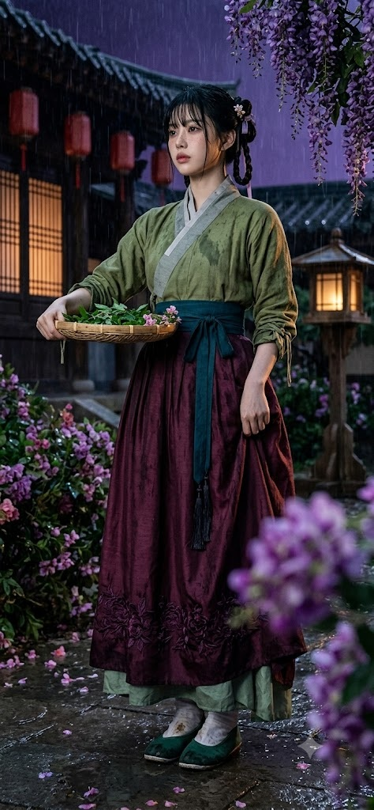
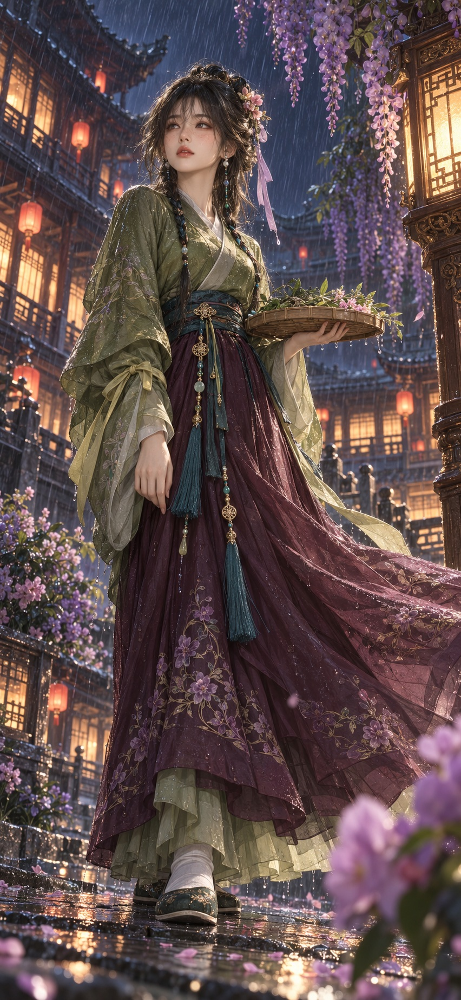

# 비 내리는 밤 등나무 궁궐 정원의 약초 채반 여인, 반실사 얼굴 합성 프롬프트

## 1. 개요 및 아트 디렉팅 가이드

- **컨셉**: 비 내리는 밤, 등나무 꽃이 늘어진 궁궐 정원에서 약초가 담긴 대나무 채반을 든 궁녀풍 인물을 그린 2.5D 반실사 전신 일러스트 (세로 9:19.5, 휴대폰 배경화면 형식). GPT용으로 작성한 프롬프트
- **사진 사용 규칙 (최우선)**:
  - 눈·코·입의 크기, 모양, 비율과 세 요소 사이의 배치를 아주 정확하게 옮김
  - 미화는 하되 고유한 특징은 바꾸지 않고, 같은 사람으로 알아볼 수 있는 범위에서 가장 잘 나온 모습으로 다듬음
  - 사진 속 인물의 실제 나이대를 그대로 유지. 어리게 만드는 보정은 금지
  - 얼굴형·피부·헤어·표정·각도·시선은 가져오지 않고, 안경은 얇은 금속테로 유지
- **화풍**:
  - 고급 게임 시네마틱 같은 2.5D 반실사. 실제 피부 질감과 머리카락, 직물감이 있으면서 색감은 회화적으로 정돈
  - 얼굴은 화보처럼 미화하되 안티에이징은 하지 않고, 나이대에 맞는 잔주름과 볼륨감은 자연스럽게 유지
- **구도**: 낮은 위치에서 약간 올려다보는 로우앵글 전신 샷, 몸은 약 3/4 돌아서고 얼굴은 정면에 가깝게 화면 왼쪽 위를 담담히 바라봄
- **표정 & 포즈**:
  - 입을 다문 무심하고 차분한 표정, 살짝 시큰둥하고 냉정한 눈빛
  - 한 손으로 가슴 높이에서 초록 약초 잎과 분홍 꽃이 담긴 둥근 대나무 채반을 받치고, 치마 자락은 바람에 넓게 흩날림
- **헤어**: 빗물에 살짝 젖은 짙은 흑록색 머리, 일자 앞머리와 작은 쪽진 번, 구슬 장식이 달린 가는 땋은 머리 두 가닥, 분홍 꽃 머리장식과 연보라색 리본
- **의상 (동양 고대 궁녀풍)**:
  - 올리브빛 녹색의 넓은 소매 상의와 짙은 청록색 허리띠, 금색 장식과 청록 술
  - 밑단에 보라색 꽃 자수가 있는 짙은 자주색 긴 치마, 흰 버선에 짙은 녹색 천 신발
- **주근깨 메이크업**: 콧등을 가로질러 양 볼 위쪽까지 흩뿌린 브라운 계열의 페이크 주근깨. 볼 터치와 홍조는 넣지 않음
- **배경**:
  - 남보라빛 밤하늘에 사선으로 떨어지는 빗줄기
  - 격자 창문에서 주황 불빛이 새어 나오는 여러 층의 궁궐 누각과 붉은 등롱, 금빛으로 빛나는 목조 등불 기둥
  - 프레임을 감싸는 보라색 등나무 꽃송이, 불빛이 반사되는 젖은 돌바닥과 흩어진 분홍 꽃잎
- **조명 & 색감**: 차가운 남보라·짙은 청색 밤 톤과 따뜻한 주황·금빛 등불의 대비, 보라와 녹색 중심의 촉촉하고 몽환적인 팔레트

---

## 2. 프롬프트 전문

```text
[GPT용 반실사 얼굴합성 프롬프트 – 비 내리는 밤, 등나무 궁궐 정원의 약초 채반 여인]

■ 사진 사용 규칙 (최우선)
- 업로드한 사진은 얼굴 참고용입니다. 사진에서는 눈·코·입의 생김새를 아주 정확하게 그대로 옮깁니다.
· 눈: 눈의 크기와 가로 길이, 눈꼬리 각도(올라감/처짐), 쌍꺼풀 유무와 두께, 눈두덩 볼륨, 애교살, 두 눈 사이 간격
· 코: 콧대 높이와 폭, 코끝 모양, 콧볼 크기, 코 길이
· 입: 입술 두께(윗입술·아랫입술 비율), 입 너비, 입꼬리 모양, 인중 길이
· 세 요소 사이의 거리와 배치 비율
- 미화는 하되, 눈·코·입의 고유한 특징(크기, 모양, 비율)은 바꾸지 않습니다. 같은 사람으로 알아볼 수 있는 범위 안에서 가장 잘 나온 모습으로 다듬습니다.
- 나이는 사진 속 인물의 실제 나이대를 그대로 유지합니다. 어리게 만들거나 나이 들게 바꾸지 마세요. 일자 앞머리, 땋은 머리, 주근깨가 있어도 얼굴 나이는 사진 속 인물 그대로입니다.
- 얼굴형, 피부, 헤어, 이마·헤어라인, 표정, 고개 각도·기울기·방향·시선은 사진에서 절대 가져오지 마세요. 이 부분은 모두 아래 서술대로 새로 그립니다.
- 얼굴을 제외한 구도, 카메라 각도, 포즈, 헤어, 의상, 배경, 조명은 아래 서술과 완전히 같아야 하며 사진 때문에 바뀌면 안 됩니다.
- 사진 속 인물이 안경을 썼다면 얇은 금속테 안경을 씌워 유지합니다.

■ 화풍
- 2.5D 반실사. 고급 게임 시네마틱처럼 실제 피부 질감, 모공이 살짝 보이는 결, 머리카락 한 올 단위 묘사, 천의 실제 직물감이 있으면서 색감과 분위기는 회화적으로 정돈된 느낌입니다.
- 완전한 실사 사진도 아니고 셀 애니메이션도 아닌 중간 지점. 부드러운 페인팅 터치, 영화 같은 색보정, 깊은 명암.
- 얼굴은 화보처럼 미화합니다. 정돈된 피부 결, 또렷한 눈매, 맑은 피부 톤, 얼굴을 예쁘게 살리는 조명과 메이크업으로 아름답게 표현합니다.
- 단, 안티에이징은 하지 않습니다. 사진 속 인물의 나이대에 맞는 눈가 잔주름, 팔자 라인, 피부 탄력, 얼굴 살의 볼륨감은 자연스럽게 유지합니다. 그 나이 그대로 예뻐 보이게 만드는 것이 목표입니다.

■ 구도
- 세로 9:19.5 비율, 휴대폰 배경화면 형식.
- 낮은 위치에서 약간 올려다보는 로우앵글 전신 샷. 인물은 화면 중앙에서 살짝 왼쪽, 머리부터 신발까지 전부 보입니다.
- 몸은 정면에서 화면 오른쪽으로 약 3/4 돌아섰고, 얼굴은 정면에 가깝게 화면 왼쪽 위 방향을 담담히 바라봅니다. 고개는 거의 똑바로, 아주 살짝 숙인 각도.

■ 인물 표정·포즈
- 표정: 입을 다문 무심하고 차분한 표정, 살짝 시큰둥하고 냉정한 눈빛. 웃지 않습니다.
- 인물의 오른손(화면 왼쪽)은 팔꿈치를 굽혀 가슴 높이에서 대나무로 엮은 납작하고 둥근 채반을 손바닥 위에 올려 받치고 있습니다. 채반 안에는 초록 약초 잎과 분홍색 작은 꽃이 담겨 있습니다.
- 왼손(화면 오른쪽)은 자연스럽게 아래로 내려 치마 옆에 둡니다.
- 바람에 치마 자락이 화면 오른쪽으로 넓게 퍼져 흩날립니다.

■ 헤어
- 짙은 흑록색(검정에 가까운 어두운 녹색) 머리, 빗물에 살짝 젖어 몇 가닥이 얼굴에 붙어 있습니다.
- 이마를 덮는 일자 앞머리, 옆머리는 턱선 길이로 내려옵니다.
- 뒤통수 위쪽에 작은 쪽진 번, 양쪽으로 가늘게 땋은 머리 두 가닥이 가슴까지 늘어지고 땋은 머리에 작은 구슬 장식.
- 번 옆에 분홍 꽃 머리장식과 연보라색 리본.

■ 의상 (동양 고대 궁녀풍 한푸)
- 상의: 올리브빛 풀색 녹색의 넓고 풍성한 소매 상의, 깃은 교차해서 여미는 형태, 안쪽에 연회색 깃이 살짝 보입니다. 소매 끝은 연한 연두빛 노란 리본으로 묶여 있습니다.
- 허리: 짙은 청록색 넓은 허리띠를 묶고, 긴 끈 자락이 아래로 늘어집니다. 끈에는 금색 장식과 청록 술(태슬)이 달려 있습니다.
- 하의: 발목까지 오는 길고 풍성한 짙은 자주색(버건디·플럼) 치마, 밑단 쪽에 보라색 꽃 자수. 치마 아래로 연한 세이지 그린 속치마 자락이 살짝 보입니다.
- 신발: 흰 버선 같은 양말에 짙은 녹색 천 신발.
- 비에 젖어 옷감 곳곳에 물방울과 젖은 얼룩이 보입니다.

■ 눈
- 홍채 색은 사진 속 인물의 눈동자 색을 그대로 유지하고, 촉촉한 반사광만 더합니다.

■ 주근깨 메이크업
- 양쪽 볼과 콧등에 걸쳐 주근깨가 있습니다. 타고난 주근깨가 아니라 화장으로 그려 넣은 페이크 주근깨입니다.
- 브라운 계열의 작고 둥근 점들이 콧등을 가로질러 양 볼 위쪽(광대 윗부분)까지 띠처럼 흩뿌려져 있고, 크기와 간격이 약간씩 불규칙합니다.
- 피부 위에 펜슬로 찍은 듯 경계가 살짝 부드러운 질감으로 표현합니다.
- 볼 터치, 홍조, 붉은 기는 전혀 없습니다. 볼과 코끝은 붉어지지 않은 맑고 균일한 피부 톤입니다.

■ 배경
- 비가 내리는 깊은 밤, 남보라빛 하늘에 사선으로 떨어지는 빗줄기.
- 화면 왼쪽: 여러 층으로 된 동양 궁궐 누각, 격자 창문 안에서 따뜻한 주황 불빛이 새어 나오고, 처마 아래 붉은 등롱들이 매달려 있습니다.
- 화면 오른쪽: 화려하게 조각된 목조 등불 기둥이 따뜻한 금빛으로 빛나며 인물 옆얼굴과 옷에 따뜻한 림라이트를 줍니다. 그 뒤로도 궁궐 건물과 붉은 등롱.
- 화면 오른쪽 위: 보라색 등나무 꽃송이가 길게 늘어져 프레임을 감쌉니다.
- 화면 아래 양쪽 전경: 보라색·분홍색 꽃이 핀 덤불, 오른쪽 아래 전경에는 크게 보이는 보라색 꽃이 살짝 흐리게(아웃포커스) 걸쳐 있습니다.
- 바닥: 비에 젖은 돌바닥, 등불과 창문 불빛이 물웅덩이에 반사되고, 분홍 꽃잎이 흩어져 있습니다.

■ 조명·색감
- 전체는 차가운 남보라·짙은 청색 밤 톤, 등불과 창문의 따뜻한 주황·금빛이 대비를 이룹니다.
- 녹색 상의와 자주색 치마, 보라 꽃이 어우러진 보라·녹색 중심 팔레트.
- 촉촉하고 몽환적이며 고요한 분위기.

■ 금지
- 사진의 고개 각도, 시선, 표정, 헤어, 배경을 가져오지 말 것.
- 사진 속 눈·코·입을 다른 사람처럼 바꾸는 것 금지.
- 주름 제거, 피부 탱탱하게 당기기, 동안 얼굴 만들기 등 나이를 줄이는 보정 금지.
- 인물을 10대나 실제보다 어린 나이로 바꾸는 것 금지.
- 볼·코끝 홍조, 블러셔, 붉게 상기된 피부 표현 금지.
- 글자, 워터마크, 서명 넣지 말 것.
- 손가락 개수 이상, 채반이 손을 관통하는 오류 없이 그릴 것.
```

---

## 3. 결과물 비교 갤러리

| 생성 모델 | 생성 결과 이미지 |
| :--- | :--- |
| **제미나이 (Gemini)** |  |
| **ChatGPT (DALL-E 3)** |  |
