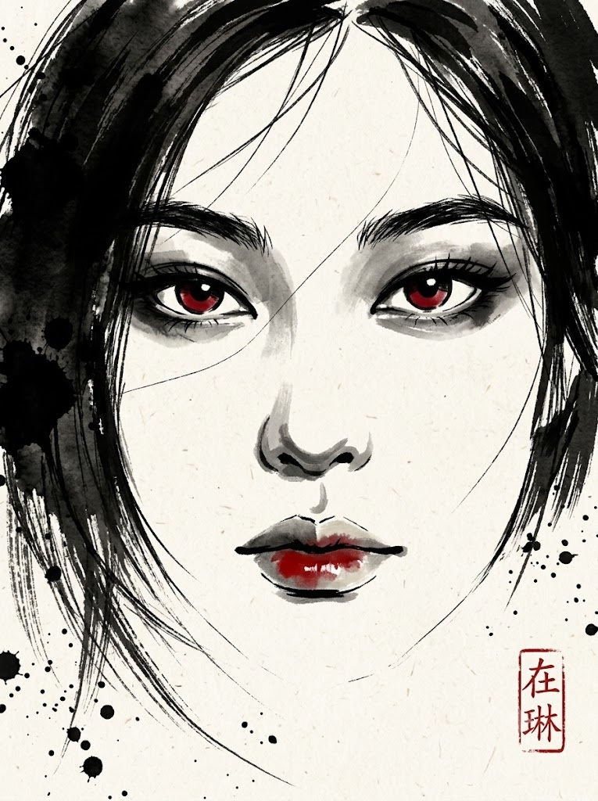
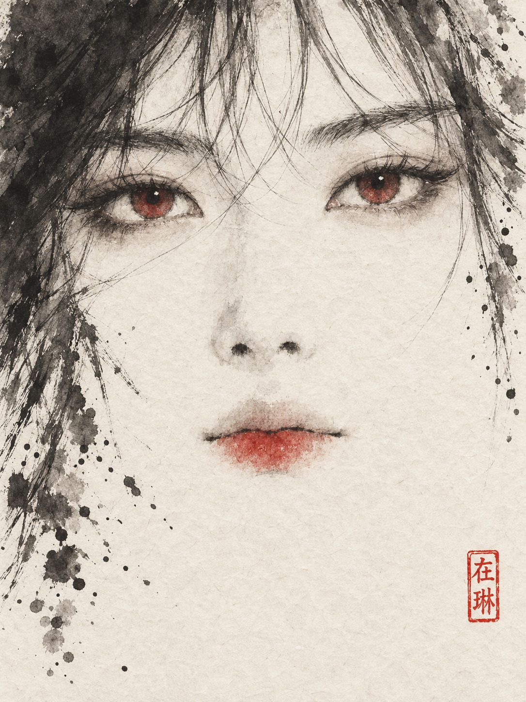

# 얼굴 이목구비 수묵담채화 클로즈업 초상 프롬프트

## 1. 개요 및 아트 디렉팅 가이드

- **컨셉**: 화선지 위에 붓과 먹으로 눈·눈썹·코 그림자·입술만 그리고 나머지는 여백으로 남긴, 극단적 클로즈업의 수묵담채 얼굴 초상 (세로 3:4). 먹 외의 색은 두 눈의 홍채와 아랫입술, 낙관에 들어가는 붉은 연지색 하나뿐
- **가장 중요한 규칙**:
  - 사실적인 채색 인물화나 수채 초상, 일러스트가 아니라 동양화 수묵담채화로 표현
  - 형태는 먹의 농담과 붓선으로만 잡고, 화면의 절반 이상은 칠하지 않은 여백
  - 얼굴 외곽선, 턱선, 피부 채색, 볼 홍조는 그리지 않음
- **사진 사용 범위**: 눈·눈썹·코·입술의 생김새, 머리카락 색과 앞머리 방향, 안경 착용 여부와 테 모양만 참고. 각도·시선·표정·눈동자 색·얼굴형은 가져오지 않음
- **구도 (고정)**:
  - 얼굴이 화면 가로폭을 넘칠 만큼 큰 완전한 정면, 턱은 보이지 않음
  - 눈은 화면 위에서 약 38%, 콧구멍은 약 60%, 입술은 약 72% 높이. 하단 약 25%는 여백
  - 보는 사람을 고요하게 응시하는 차분하고 서늘한 무표정
- **종이와 먹**: 닥나무 섬유 결이 보이는 미색 화선지, 농묵·중묵·담묵을 모두 사용하고 물기 많은 발묵과 마른 붓의 갈필을 함께 사용, 굵기 변화가 살아 있는 붓선
- **부위별 표현**:
  - **눈**: 한 번에 그은 듯한 먹 선의 윤곽, 붉은 연지색 홍채와 짙은 먹 점 하나의 동공, 종이 여백 한 점의 하이라이트
  - **눈썹**: 앞쪽은 짙고 끝은 흩어지는 갈필 붓 터치
  - **코**: 콧대 선 없이 콧구멍의 먹 점 두 개와 담묵 번짐만
  - **입술**: 맞닿는 선은 짙은 먹 붓선 하나, 윗입술은 비워 두고 아랫입술 가운데에만 불규칙한 붉은 얼룩
  - **머리카락**: 왼쪽 위의 큰 발묵 덩어리와 이마를 가로지르는 가는 먹 선 몇 가닥으로 일부만 표현
- **안경 판별**: 일반 안경, 선글라스, 착용 없음 셋 중 하나만 적용. 일반 안경은 렌즈를 여백으로 두고, 선글라스는 담묵을 한 번 칠해 반투명하게 표현
- **먹 방울 & 낙관**: 화면 왼쪽 아래와 오른쪽 가장자리에 흩뿌린 먹 방울, 오른쪽 아래 여백에 한자 '在琳'을 양각으로 새긴 세로로 긴 붉은 주인 도장
- **금지**: 피부 톤과 볼 홍조, 갈색·검은색 눈동자, 입술 전체 채색, 세피아 톤, 피나 흘러내리는 붉은 줄, 낙관 외의 텍스트와 워터마크

---

## 2. 프롬프트 전문

```text
[수묵담채화 클로즈업 초상 — 얼굴 사진 합성용]

★ 가장 중요한 규칙
- 이 그림은 화선지(한지) 위에 붓과 먹으로 그린 동양화 수묵담채화다.
- 사실적인 채색 인물화, 수채 초상화, 일러스트, 포스터가 아니다.
- 형태는 먹의 농담(짙은 먹·중간 먹·옅은 먹)과 붓선으로만 잡는다.
- 먹 외의 색은 붉은 연지색 하나뿐이다. 이 색은 두 눈의 홍채와 아랫입술, 낙관에만 들어간다.
- 화면의 절반 이상은 칠하지 않은 여백으로 남긴다.
- 얼굴은 눈·눈썹·코 그림자·입술만 붓으로 그리고, 나머지는 여백 속으로 사라지게 한다.
- 얼굴 외곽선, 턱선, 턱, 피부 채색, 볼 홍조는 그리지 않는다.

■ 사진 사용 범위
- 업로드한 사진은 눈·눈썹·코·입술의 생김새, 머리카락 색과 앞머리 방향, 안경 착용 여부와 안경테 모양만 참고한다.
- 사진의 얼굴 각도, 고개 기울기, 시선, 표정, 눈동자 색, 메이크업, 조명, 배경, 얼굴형, 머리 길이와 볼륨은 가져오지 않는다.

■ 구도 (고정)
- 세로 3:4 비율의 극단적 클로즈업 정면 구도다. 얼굴이 화면 가로폭을 넘칠 만큼 크다.
- 화면 위쪽은 이마 위 머리카락 붓선에서, 아래쪽은 입술 아래 여백에서 끝난다. 턱은 보이지 않는다.
- 눈은 화면 위에서 약 38% 높이에 놓고, 두 눈이 화면 좌우 끝 가까이까지 넓게 벌어지게 한다.
- 콧구멍은 화면 위에서 약 60% 높이, 입술은 약 72% 높이에 놓는다.
- 입술 아래 화면 하단 약 25%는 여백으로 남긴다.
- 완전한 정면 얼굴이다. 두 눈은 보는 사람을 정면으로 고요하게 응시한다.
- 표정은 차분하고 서늘한 무표정이고, 입은 다문다.

■ 종이와 먹
- 바탕은 은은한 미색 화선지다. 닥나무 섬유 결이 보이고, 먹과 물이 종이에 스며 번지는 질감이 있다.
- 먹은 짙은 먹(농묵), 중간 먹(중묵), 옅은 먹(담묵)을 모두 쓴다.
- 물기 많은 번짐(발묵)과 마른 붓으로 긁은 갈필을 함께 쓴다.
- 선은 일정한 굵기의 펜 선이 아니라 붓을 누르고 떼는 굵기 변화가 살아 있는 붓선이다.
- 붓선 가장자리는 칼같이 딱딱하지 않고 종이에 살짝 번진다.

■ 색 (담채)
- 먹 외의 색은 붉은 연지색 하나만 쓴다.
- 그림 속에서 붉은색은 오직 두 곳에만 들어간다. 두 눈의 홍채와 아랫입술이다.
- 그 외의 모든 곳(윗입술, 눈두덩, 눈 밑, 피부, 머리카락)에는 붉은색과 분홍색을 전혀 넣지 않는다.
- 붉은색은 물에 풀어 투명하게 스미되, 연한 분홍이 아니라 또렷한 붉은빛이 보이는 농도로 칠한다.
- 갈색, 세피아, 살구색, 분홍 피부색은 쓰지 않는다.

■ 눈
- 눈 윤곽은 붓으로 한 번에 그은 듯한 먹 선으로 그린다. 윗눈꺼풀 선은 짙고 굵게, 아랫눈꺼풀 선은 가늘고 끊기듯 그린다.
- 눈꼬리는 붓을 떼며 자연스럽게 가늘어진다.
- 눈두덩과 눈 아래는 옅은 회색 담묵만 물기 있게 스치듯 번지게 한다. 분홍·갈색 아이섀도 색은 넣지 않는다.
- 속눈썹은 짧은 붓 터치 몇 개로 간략하게 그린다.
- 홍채는 반드시 붉은 연지색으로 칠한다. 갈색, 검은색, 고동색 홍채로 그리지 않는다.
- 홍채 안쪽(동공 주변)은 붉은색을 조금 짙게 하고, 바깥 테두리는 가는 먹 선으로 감싼다.
- 동공은 짙은 먹 점 하나로 찍고, 하이라이트는 칠하지 않은 종이 여백 한 점으로 둔다.
- 유리알 같은 반사와 사실적인 홍채 무늬는 넣지 않는다.

■ 눈썹
- 눈썹은 마른 붓으로 쓸어 그린 갈필 붓 터치로 그린다. 앞쪽은 짙게, 끝은 흩어지며 옅어진다.

■ 코
- 콧대 선과 콧등은 그리지 않는다.
- 콧구멍은 짙은 먹 점 두 개로 찍고, 콧방울 아래는 담묵 번짐으로만 표현한다.

■ 입술
- 위아래 입술이 맞닿는 선은 짙은 먹 붓선 하나로 긋는다. 양 끝은 가늘게 사라진다.
- 윗입술은 색을 칠하지 않는다. 윗입술 윤곽만 옅은 담묵으로 살짝 스치듯 그리고, 안쪽은 종이색 여백으로 남긴다.
- 붉은 연지색은 아랫입술에만 넣는다.
- 아랫입술 가운데에 붓을 한 번 눌러 찍은 듯한 불규칙한 붉은 얼룩으로 칠한다.
- 색은 아랫입술 윤곽을 꽉 채우지 않는다. 가운데가 가장 짙고 양옆은 비워 둔다.
- 얼룩 가장자리는 종이에 번지며 살짝 퍼질 수 있지만, 흘러내리는 줄이나 튀김은 만들지 않는다.
- 광택, 립글로스, 입체 음영, 입술 전체를 칠한 립스틱 느낌은 넣지 않는다.

■ 머리카락 (일부만, 수묵 필법으로)
- 사진의 머리 색과 앞머리 방향만 반영한다. 형태는 아래 배치를 따른다.
- 화면 왼쪽 위 모서리에서 왼쪽 가장자리까지는 물기 많은 농묵을 크게 번지게 한 발묵 덩어리로 머리카락을 대신한다.
- 화면 오른쪽 가장자리는 중묵과 담묵을 겹친 붓 자국으로 머리카락을 둔다.
- 이마 위로는 붓끝으로 빠르게 그은 가는 먹 선 몇 가닥이 가로질러 흩날린다.
- 얼굴 왼쪽 아래로는 갈필 붓선이 갈라지며 여백 속으로 사라진다.
- 가는 담묵 선 한 가닥이 왼쪽 눈 아래에서 오른쪽 볼 쪽으로 얼굴을 가볍게 가로지른다.
- 얼굴 양옆을 덮는 커튼 같은 긴 머리, 머리카락 한 올 한 올의 사실 묘사, 정수리, 머리 윤곽은 그리지 않는다.

■ 안경 판별 (사진을 보고 셋 중 하나만 적용)
- 렌즈 너머로 눈이 또렷이 보이면 일반 안경, 렌즈에 색이 있어 눈이 어둡게 가려지면 선글라스, 아무것도 없으면 착용 없음으로 판별한다.
- 일반 안경과 선글라스를 서로 바꾸거나 섞지 않는다.

[1] 일반 안경
- 사진과 같은 형태의 안경테를 중묵 붓선으로 그린다. 선은 굵기 변화가 있고 군데군데 살짝 끊긴다.
- 렌즈는 칠하지 않은 여백으로 두고, 렌즈 너머 붉은 눈동자가 선명하게 보이게 한다.

[2] 선글라스
- 사진과 같은 형태의 테를 농묵 붓선으로 굵게 그린다.
- 렌즈는 담묵을 물기 있게 한 번 칠해 반투명하게 한다. 위쪽은 조금 짙고 아래쪽은 옅게 번진다.
- 렌즈 너머로 눈 윤곽과 붉은 홍채가 한 톤 어둡게 비쳐 보이게 한다.
- 렌즈 한쪽에 붓이 지나가지 않은 사선 여백 하나를 남겨 반사광으로 삼는다.

[3] 착용 없음
- 안경을 그리지 않는다.

■ 먹 방울
- 붓을 털어 떨어진 듯한 먹 방울을 화면 왼쪽 아래와 오른쪽 가장자리에 적당히 흩뿌린다.
- 큰 방울은 몇 개만 두고, 나머지는 작은 점이 종이에 번진 형태로 한다.
- 화면 전체를 덮는 과한 스플래터는 넣지 않는다.

■ 낙관
- 화면 오른쪽 아래 여백에 세로로 긴 직사각형 붉은 주인(朱印) 도장 하나를 작게 찍는다.
- 도장 안에는 한자 두 글자 '在琳'을 해서체로 새긴다. '在'를 위, '琳'을 아래로 세로 배치한다.
- 글자 획과 직사각형 테두리 선이 붉게 찍히는 양각(주문인) 형태다.
- 인주 색은 담채보다 진한 주홍빛 붉은색이다. 테두리와 획 끝은 종이 결에 따라 살짝 거칠게 찍힌다.
- '在琳' 외의 다른 글자나 획은 넣지 않는다.

■ 금지
- 사실적인 채색 인물화, 수채 초상화, 디지털 일러스트, 그래픽 포스터 느낌은 넣지 않는다.
- 피부 톤, 볼 홍조, 턱과 턱선, 얼굴 외곽선은 그리지 않는다.
- 입술 전체를 분홍이나 빨강으로 칠하지 않는다. 윗입술에 색을 넣지 않는다.
- 갈색이나 검은색 눈동자로 그리지 않는다.
- 분홍·갈색 아이섀도와 볼 색조는 넣지 않는다.
- 얼굴을 감싸는 긴 머리, 세피아·갈색 톤, 광택 있는 입술, 사실적인 메이크업은 넣지 않는다.
- 피, 상처, 흘러내리는 붉은 줄, 붉은 물감 튀김은 넣지 않는다.
- 낙관 '在琳' 외의 다른 텍스트, 워터마크, 그림 테두리는 넣지 않는다.
- 사진의 얼굴 각도나 표정을 반영하지 않는다.
```

---

## 3. 결과물 비교 갤러리

| 생성 모델 | 생성 결과 이미지 |
| :--- | :--- |
| **제미나이 (Gemini)** |  |
| **ChatGPT (DALL-E 3)** |  |
