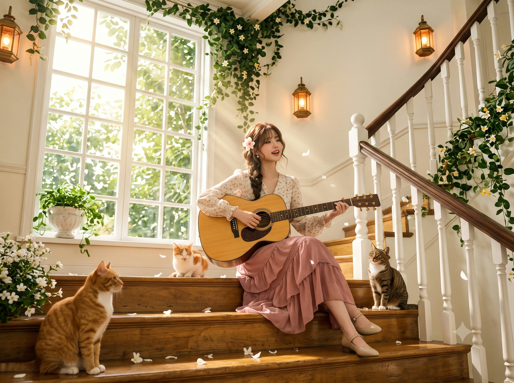
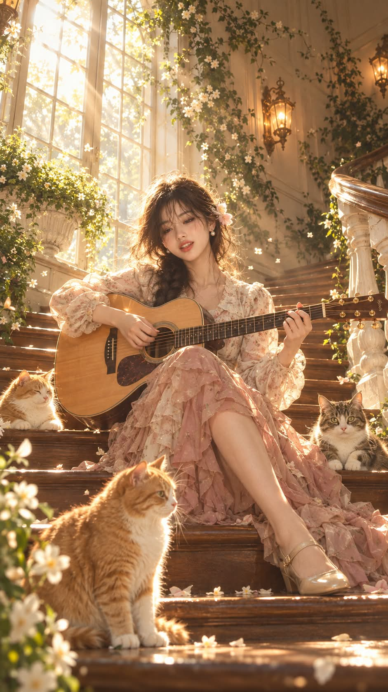

# 오후 계단의 버스킹, 황금빛 역광 저택 계단 실사 환경 인물사진 프롬프트

## 1. 개요 및 아트 디렉팅 가이드

- **컨셉**: 황금빛 오후 햇살이 쏟아지는 오래된 유럽 저택의 원목 계단에 앉아, 고양이 세 마리 곁에서 어쿠스틱 기타를 치며 노래하는 모습을 넓게 담은 실사 환경 인물사진 (세로 9:16)
- **얼굴 (닮음과 자연스러운 합성을 동시에)**:
  - 눈·코·입의 모양과 배치, 인중 길이, 눈썹, 광대와 턱의 관계, 얼굴 폭과 길이 비율을 유지해 동일인으로 알아볼 수 있게 표현
  - 미화 금지. 눈을 키우거나 턱을 갸름하게, 나이를 어리게 바꾸지 않음
  - 얼굴을 따로 붙여넣은 것처럼 보이면 실패. 조명·원근·피부 질감·색감이 몸과 배경에 완전히 일치해야 함
  - 안경은 사진에 있으면 같은 모양으로 씌우고 햇살 반사까지 표현
- **표정·고개·조명 (장면에 맞춰 새로 만듦)**:
  - 입술을 살짝 벌려 노래하는 자연스러운 표정과 행복한 미소. 증명사진 같은 표정은 금지
  - 몸이 틀어진 방향을 따라 고개도 살짝 돌리고 기타 쪽으로 숙임, 눈만 들어 카메라를 은은하게 바라봄
  - 로우 앵글에 맞춘 원근, 얼굴에도 똑같이 적용되는 역광과 림라이트
- **구도 (고정)**:
  - 35mm 광각으로 계단 아래에서 약간 올려다본 전신 환경 사진, 공간 60 : 인물 40
  - 화면 위쪽 약 35%는 창문·벽·덩굴·벽등만, 화면 맨 아래는 앞 계단과 전경 고양이
- **배경 (고정)**:
  - 천장까지 솟은 거대한 흰색 나무 격자 창문과 창밖의 초록 나무
  - 왼쪽 아래에서 오른쪽 위로 넓게 이어지는 꿀빛 원목 계단, 흰색 난간 기둥과 크림빛 벽
  - 천장과 창틀, 난간을 타고 늘어진 덩굴과 띄엄띄엄 핀 작은 흰 별 모양 꽃
  - 주황빛으로 켜진 황동 랜턴형 벽등 3개, 계단 위와 공중의 작은 흰 꽃잎
- **조명 (고정)**: 왼쪽 위 창문의 강한 황금빛 역광, 굵고 선명한 갓레이 여러 줄기, 벽과 계단의 나뭇잎 그림자와 빛 반점, 공중의 빛 입자와 보케
- **인물 (얼굴 외 고정)**:
  - 시스루 앞머리의 갈색 웨이브와 어깨 앞으로 늘어진 굵은 땋은 머리, 꽃 헤어핀
  - 아이보리 작은 꽃무늬 블라우스, 더스티 로즈 시폰 층층 러플 롱스커트, 메리제인
  - 한쪽 무릎을 세우고 꿀빛 스프루스 상판의 기타를 무릎 위에 안은 포즈
- **고양이 3마리 (고정)**: 전경의 큰 주황 태비, 인물 왼쪽 옆의 작은 주황·흰색 고양이, 오른쪽 옆에서 카메라를 보는 갈색 태비
- **금지**: 합성 느낌과 얼굴·몸의 조명 불일치, 인물 클로즈업과 공간 축소, 빛줄기 약화, 크고 빽빽한 꽃, 요소의 수와 위치 변경, 일러스트·동화풍

---

## 2. 프롬프트 전문

```text
[얼굴 – 닮음과 자연스러운 합성을 동시에]
업로드 사진 속 인물과 동일인으로 알아볼 수 있어야 한다. 단, 얼굴을 따로 붙여넣은 것처럼 보이면 실패다. 얼굴은 이 장면에서 처음부터 함께 촬영된 것처럼 조명·원근·피부 질감·색감이 몸과 배경에 완전히 일치해야 한다.

- 사진에서 유지할 것: 눈·코·입의 모양, 눈·코·입 사이의 상대적 거리와 배치, 얼굴 폭 대비 눈 크기, 코와 입의 크기 비율, 인중 길이, 눈썹 모양과 눈썹~눈 사이 거리, 광대와 턱의 관계, 얼굴 폭과 길이 비율.
- 미화 금지: 눈을 크게, 코를 작게, 턱을 갸름하게, 나이를 어리게 바꾸지 않는다.
- 안경: 사진 속 인물이 안경을 쓰고 있으면 같은 모양·크기·테 색의 안경을 씌운다. 렌즈와 테에도 장면의 황금빛 햇살 반사가 맺힌다. 안경을 쓰지 않았으면 그리지 않는다.
- 사진에서 가져오지 않는 것: 사진 속 표정, 머리·얼굴 각도, 시선, 사진 속 조명과 피부 밝기, 헤어, 옷, 배경.

[표정·고개·조명 – 사진 무시하고 장면에 맞춰 새로 만듦]

- 표정: 기타를 치며 노래하는 중의 자연스러운 표정. 입술을 살짝 벌려 노래하는 입 모양에 행복한 미소, 입꼬리와 볼이 살짝 올라간다. 사진 속 입술 폭과 두께는 유지한다. 눈은 뜨고 웃음에 맞춰 살짝 휘어진다. 카메라를 향해 포즈를 잡은 증명사진 같은 표정 금지.
- 고개: 몸이 틀어진 방향을 따라 고개도 화면 왼쪽으로 살짝 돌아가고, 기타 쪽으로 살짝 숙이며 화면 왼쪽으로 약간 기울어진다. 목과 어깨의 연결이 자연스럽게 이어진다. 몸은 틀어져 있는데 머리만 꼿꼿이 정면을 보는 자세 금지.
- 시선: 살짝 아래 기타 쪽을 보다가 눈만 들어 카메라 쪽을 은은하게 바라본다.
- 원근: 계단 아래에서 올려다보는 로우 앵글에 맞게 얼굴도 아래에서 올려다본 원근으로 그린다(턱 아래가 살짝 보이고 정수리 쪽은 좁아 보임). 눈높이 정면 원근 금지.
- 조명: 왼쪽 위 창문에서 오는 강한 황금빛 역광이 얼굴에도 똑같이 적용된다. 머리카락·볼·턱선·코끝 가장자리에 황금빛 림라이트, 화면 오른쪽 볼과 목에는 부드러운 그림자, 얼굴 정면은 계단과 블라우스에서 반사된 따뜻한 빛으로 은은하게 밝다. 잎 사이로 걸러진 빛 반점이 머리와 어깨에 살짝 걸린다. 얼굴만 고르게 밝은 플랫 조명 금지.
- 피부: 장면과 같은 따뜻한 필름톤 색감과 실제 피부 결. 얼굴만 하얗거나 매끈하게 보정된 느낌 금지.

[질감 – 실사]
실제 유럽 저택에서 촬영한 넓은 환경 인물사진. 포토리얼리스틱, 일러스트·동화풍·세트 느낌 금지. 자연스러운 피부 결, 실제 머리카락·원단·나무 결·고양이 털 질감. 따뜻한 필름톤, 하이라이트 블룸. 세로 9:16, 고해상도.

[구도 – 고정]
35mm 광각, 계단 아래에서 약간 올려다보는 로우 앵글, 멀리서 찍은 전신 환경 사진. 공간 60 : 인물 40. 화면 위쪽 약 35%는 인물 없이 창문·벽·덩굴·벽등만. 인물 머리는 화면 위에서 약 37% 지점, 가로는 중앙에서 살짝 왼쪽. 발끝 아래로 계단 2~3칸, 화면 맨 아래는 앞 계단과 전경 고양이.

[배경 – 고정]
높은 천장의 넓은 오래된 유럽 저택 실내 계단.

- 왼쪽 절반: 천장까지 솟은 거대한 흰색 나무 격자 창문(장면의 주역), 창밖 초록 나무와 눈부신 햇빛, 창턱에 초록 식물이 담긴 흰 석재 항아리 화분.
- 꿀빛·갈색 광택 원목 계단이 왼쪽 아래에서 오른쪽 위로 넓게 이어진다.
- 오른쪽: 흰색 둥근 난간 기둥과 짙은 원목 난간 손잡이, 오른쪽 위로 계단이 더 이어짐. 크림빛 흰 높은 벽.
- 덩굴: 천장 가장자리·창틀 위·오른쪽 벽과 난간을 자연스럽게 타고 늘어진다. 노란 꽃술의 작은 흰 별 모양 꽃이 띄엄띄엄 핀다(크고 빽빽한 꽃 장식 금지). 왼쪽 아래 전경에 흰 꽃 덤불 조금.
- 황동 랜턴형 벽등 3개(왼쪽 위 가장자리 1개 일부 잘림, 오른쪽 벽 가운데 1개, 그보다 오른쪽 위 1개), 모두 주황빛으로 켜짐.
- 계단 위에 작은 흰 꽃잎이 흩어지고 공중에도 몇 장 떠 있다.

[조명 – 고정]

- 왼쪽 위 창문에서 들어오는 강한 황금빛 오후 역광.
- 왼쪽 위에서 오른쪽 아래로 떨어지는 굵고 선명한 갓레이 여러 줄기, 옅은 빛 안개로 방향이 뚜렷함.
- 잎 사이로 걸러진 햇빛이 벽과 계단에 뚜렷한 나뭇잎 그림자와 빛 반점을 만든다.
- 공중의 반짝이는 빛 입자와 보케, 벽등의 주황빛 글로우.
- 인물·고양이 털 가장자리 황금빛 림라이트, 원목 계단 위 햇빛 반사.
- 색감: 황금빛, 크림, 꿀빛 갈색, 부드러운 초록, 더스티 핑크.

[인물 – 얼굴 외 고정]

- 계단에 앉아 어쿠스틱 기타를 치며 노래하는 여성.
- 헤어: 갈색 웨이브, 시스루 앞머리, 얼굴 옆 잔머리, 화면 왼쪽 어깨 앞으로 늘어진 굵은 땋은 머리, 화면 왼쪽 머리 옆에 연핑크빛 흰 꽃 헤어핀.
- 의상: 아이보리 작은 꽃무늬 블라우스(카라 있는 V넥, 부푼 긴 소매, 손목 주름), 더스티 로즈 시폰 층층 러플 롱스커트(계단 위로 흘러내리되 화면 중앙을 크게 차지하지 않게), 베이지·샴페인 골드 스트랩 메리제인.
- 포즈: 한쪽 무릎을 세우고 다른 다리는 아래 계단으로 길게 내려 발을 아래 칸에 둔다. 상체는 화면 왼쪽으로 살짝 틀어짐. 기타를 무릎 위에 가로로 안고 오른손은 사운드홀 근처에서 줄을 튕기고 왼손은 넥의 프렛을 잡는다.
- 기타: 꿀빛 스프루스 상판, 장식 로제트, 짙은 로즈우드 지판, 황동 페그, 넥은 화면 오른쪽으로.

[고양이 3마리 – 고정, 서로 떨어져 겹치지 않음]

1. 화면 맨 아래 왼쪽 전경: 가장 크게 보이는 주황 태비(가슴 흰색), 앉아서 화면 오른쪽을 봄.
2. 인물 왼쪽 옆 계단: 작은 주황·흰색 고양이, 눈을 반쯤 감고 인물 쪽을 향함.
3. 인물 오른쪽 옆 계단: 갈색 태비(가슴·발 흰색), 카메라를 정면으로 봄.

[금지]
얼굴만 붙여넣은 듯한 합성 느낌, 얼굴과 몸의 조명·원근·색감 불일치, 포즈 잡은 증명사진 표정, 얼굴 미화·일반 미인형 대체, 사진 속 안경 제거, 눈 감기, 입을 크게 벌려 입술 형태가 사라지는 것, 고개를 과하게 숙여 얼굴이 가려지는 것, 인물 클로즈업, 공간 축소, 빛줄기 약화·방향 변경, 크고 빽빽한 꽃, 배경·조명·벽등·창문·계단·의상·기타·고양이 수와 위치 변경, 새 요소 추가, 일러스트·동화풍.
```

---

## 3. 결과물 비교 갤러리

| 생성 모델 | 생성 결과 이미지 |
| :--- | :--- |
| **제미나이 (Gemini)** |  |
| **ChatGPT (DALL-E 3)** |  |
