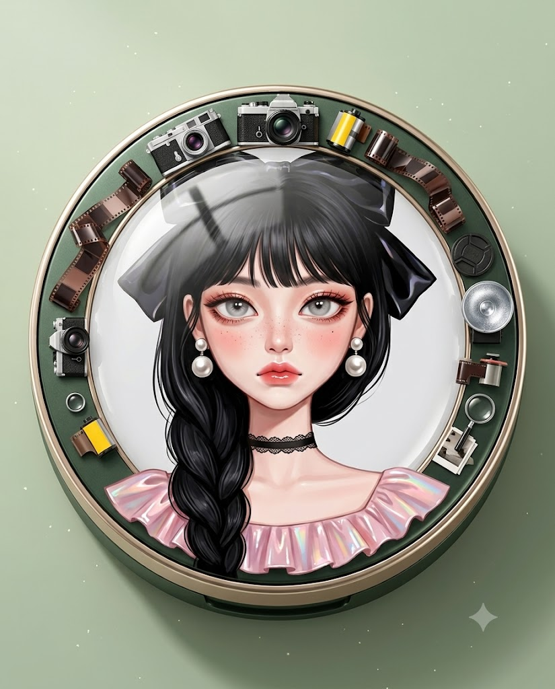
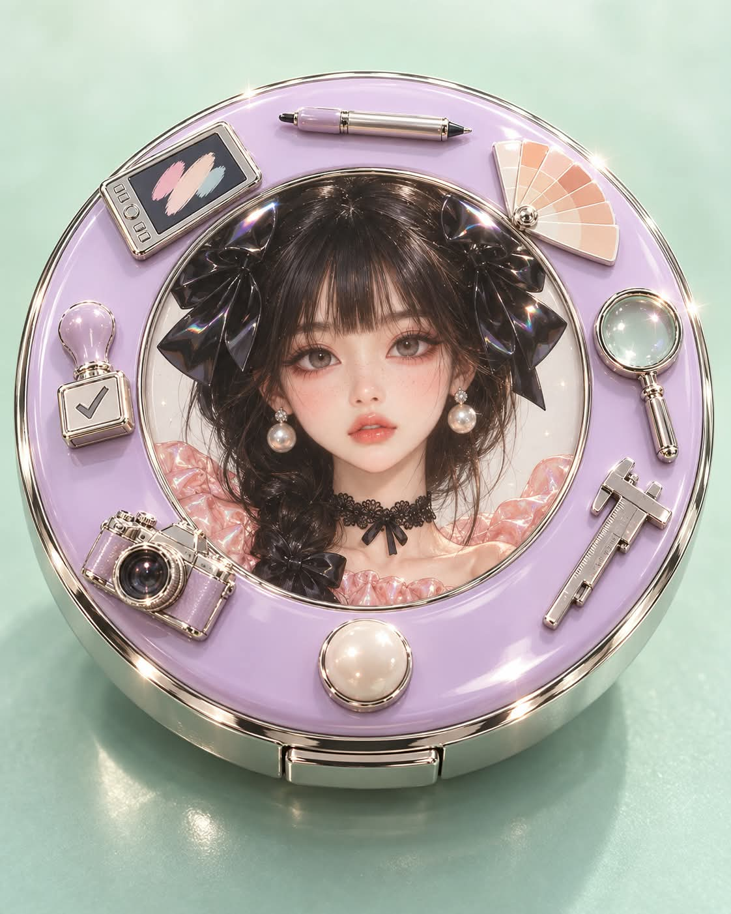

# 나만의 파운데이션 케이스, 분석한 테마와 인형 초상화로 꾸민 제품 사진 프롬프트

## 1. 개요 및 아트 디렉팅 가이드

- **컨셉**: AI가 나를 분석해 정한 테마로 꾸민 쿠션 파운데이션 케이스 제품 사진. 뚜껑 정중앙의 레진 돔 아래에 패션 인형풍 초상화가 들어가고, 둘레에 나만의 취미·관심사를 보여 주는 미니어처 소품이 붙음 (세로 4:5)
- **작업 순서**:
  - 대화, 저장된 기억, 성격·직업·취미·관심사·생활 패턴과 사진의 인상을 종합 분석
  - 서로 다른 특징에서 출발한 후보 5개를 떠올린 뒤 가장 구체적이고 나만의 테마 하나를 고름. 화장품 광고의 뻔한 장식과 무난한 테마는 피함
  - 테마에 맞춰 케이스 색과 재질, 장식 소품 6~8개, 파스텔 배경색을 정함
  - 대화창에 테마·케이스 색·소품 목록·근거 2~3줄을 먼저 보여 주고 질문 없이 바로 이미지 생성
- **업로드 사진 사용 규칙**: 눈·코·입의 고유한 모양만 참고하고, 얼굴 비율은 아래 인형형 비율로 재구성. 얼굴형·피부·헤어·각도·시선·표정·옷·배경은 가져오지 않음. 안경은 쓰고 있으면 유지. 성별은 헤어·의상 규칙 적용에만 사용
- **제품 구성**:
  - 위에서 약 30도로 내려다본 뚜껑 닫힌 원형 케이스가 화면 폭의 약 75%, 잘리지 않게
  - 초상화는 뚜껑 지름의 약 60%, 맑은 반사가 맺힌 볼록한 유광 레진 돔 아래
  - 초상화는 크게 완성한 뒤 비율 그대로 축소해 넣고, 장식 소품은 얼굴을 가리지 않음
  - 케이스와 소품은 제품 사진 질감, 위가 밝은 파스텔 그라데이션 배경
- **초상화 화풍 (최우선)**: 디지털 페인팅 75%, 실사 25%의 패션 인형 페인팅. 모공 없는 도자기 같은 피부에 옅은 주근깨와 복숭아빛 블러셔, 코럴브라운 눈 음영, 코럴핑크 글로스 입술, 에나멜처럼 반짝이는 리본과 옷
- **얼굴 비율 (핵심)**:
  - 작고 좁은 세로형 인형 얼굴, 확실히 짧은 하관과 아주 작은 턱
  - 실제보다 1.3~1.5배 큰 눈, 아주 밝은 연회색 홍채와 길고 촘촘한 검은 속눈썹
  - 매우 작게 단순화한 코와 작고 얇은 입, 가늘고 긴 목
- **인물**:
  - 정면 바스트샷, 입술을 살짝 내민 새침하고 도도한 무표정
  - 여자는 촘촘한 검은 일자 앞머리와 한쪽 어깨로 땋아 내린 긴 머리, 양쪽 위에 얼굴 폭만 한 큰 검은 에나멜 리본, 진주 드롭 귀걸이와 레이스 초커, 핑크 유광 러플 상의
  - 남자는 일자 앞머리의 짧은 검은 머리, 검은 에나멜 리본 타이와 핑크 유광 셔츠 칼라
- **금지**: 사진 같은 뷰티 포트레이트, 정상적인 눈 크기, 갈색 눈동자, 사진 같은 머리카락과 시스루 앞머리, 길고 현실적인 하관, 작은 리본, 실제 브랜드 로고, 얼굴을 가리는 장식, 성숙하거나 섹시한 분위기, 글자와 워터마크

---

## 2. 프롬프트 전문

```text
[작업 순서]

1. 지금까지 나눈 대화, 저장된 기억, 나에 대해 알고 있는 모든 정보(성격, 직업, 취미, 관심사, 말투, 가치관, 생활 패턴)와 업로드한 사진의 인상을 종합해서 분석한다.
2. 분석 결과로 파운데이션 케이스를 꾸밀 장식 테마 하나를 정한다.
- 테마는 나의 직업·취미·관심사·습관 중 가장 구체적이고 나만의 것에서 출발한다.
- 화장품 광고에서 흔히 쓰는 뻔한 장식으로 쏠리지 말 것
- 가장 먼저 떠오르는 무난한 테마를 기본값으로 고르지 말 것
- 테마를 고르기 전에 서로 다른 성격·취미·관심사에서 출발한 후보 5개를 속으로 먼저 떠올린 뒤, 분석 결과와 가장 구체적으로 맞는 하나를 고른다.
- 테마에 맞춰 아래 항목을 정한다.
· 케이스 색상과 재질감
· 초상화 둘레를 꾸밀 장식 소품 6~8개 (테마를 바로 알아볼 수 있는 구체적인 사물)
· 배경 색상 (파스텔 톤 안에서)
3. 대화창에 아래 내용을 먼저 짧게 보여준다.
- 테마 / 케이스 색 / 장식 소품 목록 / 이 테마가 나에게 정해진 근거 2~3줄
4. 질문하지 말고 바로 아래 이미지를 생성한다.

[업로드 사진 사용 규칙 - 매우 중요]

- 업로드 사진에서는 눈·코·입 각각의 고유한 모양과 특징만 참고한다.
- 사진의 얼굴 비율은 복사하지 않고, 아래 [얼굴 비율]의 인형형 비율로 재구성한다.
- 얼굴형, 피부, 헤어, 이마와 헤어라인은 사진에서 가져오지 않는다.
- 사진 속 고개 기울기, 얼굴 방향, 시선, 표정은 절대 가져오지 않는다. 각도와 표정은 아래 서술대로 새로 그린다.
- 사진 속 인물이 안경을 쓰고 있으면 안경만 유지한다.
- 사진 속 옷, 배경, 소품은 사용하지 않는다.
- 사진으로 성별만 판단해 아래 헤어·의상 규칙을 적용한다.

[전체 구성 - 위치 고정]
세로형 이미지(4:5 비율). 고급 화장품 제품 사진.

1. 화면 중앙에 뚜껑이 닫힌 원형 쿠션 파운데이션 케이스. 위에서 약 30도로 비스듬히 내려다보는 각도. 케이스가 화면 폭의 약 75%를 차지하고 잘리지 않음.
2. 뚜껑 정중앙에 둥근 초상화 장식. 초상화는 뚜껑 지름의 약 60% 크기이고, 투명하고 볼록한 유광 레진 돔 아래에 들어 있어 표면에 맑은 빛 반사가 맺힘.
3. 초상화를 처음부터 작게 그리지 말고, 큰 일러스트로 얼굴까지 완성한 뒤 비율 그대로 축소해 뚜껑에 넣는다. 축소해도 화풍과 얼굴 비율이 그대로 유지되어야 한다.
4. 초상화 둘레의 뚜껑 테두리 위에 분석으로 정한 장식 소품들이 입체 미니어처 장식으로 빙 둘러 붙어 있음. 장식은 초상화 얼굴을 절대 가리지 않음.
5. 케이스 아래 부드러운 그림자, 금속 테두리에 반짝이는 하이라이트.
6. 배경은 분석으로 정한 파스텔 단색, 위쪽은 밝고 아래쪽은 살짝 진한 그라데이션, 살짝 흐림.
7. 케이스와 장식 소품은 제품 사진 질감, 초상화만 아래 화풍으로 그린다.

[초상화 화풍 - 최우선]
고해상도 패션 인형 디지털 페인팅. 사진처럼 렌더링하지 않는다.
디지털 페인팅 75%, 실사 25%의 비율로 표현한다.

- 피부: 사진 같은 모공, 솜털, 미세 피부결, 피부 노이즈를 만들지 않는다. 넓고 매끈한 색면과 아주 부드러운 그라데이션으로 블렌딩한 도자기 인형 같은 페인팅 표면. 코 주변·볼·이마에도 미세 질감 없음. 아주 옅은 주근깨가 코와 볼에 점처럼 찍힘, 볼·코끝·눈 밑에 복숭아빛 핑크 블러셔, 매끈한 윤광.
- 명암: 사진 같은 복잡한 빛과 그림자 대신 넓고 부드러운 색면 위주의 단순화된 명암.
- 눈 화장: 눈두덩에 코럴브라운 음영, 아래 눈가와 눈 밑 점막 쪽에 붉은 기.
- 입술: 코럴핑크에 투명한 글로스 광택.
- 질감: 리본과 옷은 에나멜·비닐처럼 반짝이는 강한 광택과 은은한 무지개빛 반사.
- 조명: 정면 위쪽의 부드러운 확산광, 대비가 낮음.
- 색감: 밝고 부드러운 파스텔 톤, 작은 반짝이 입자가 살짝 떠 있음.

[얼굴 비율 - 매우 중요]
'실제 사람을 예쁘게 그린 초상화'가 아니라, 눈이 크게 과장되고 코·입·턱이 작게 축소된 고급 패션 인형 일러스트의 얼굴 구조가 명확하게 보여야 한다.

- 얼굴 전체는 작고 좁은 세로형 인형 얼굴
- 광대와 턱의 폭을 작게
- 하관은 실제 사람보다 확실히 짧게
- 턱은 매우 작고 섬세하게 좁아짐
- 눈은 실제 사람보다 약 1.3~1.5배 크게 과장, 눈의 세로 높이와 홍채 크기도 크게
- 눈꼬리는 바깥쪽으로 길게 뻗으며 아주 살짝 올라감
- 홍채는 아주 밝은 연회색으로 크고 매끈한 인형 눈, 위쪽에 또렷한 흰 하이라이트
- 검은 위 속눈썹과 아이라인은 길고 촘촘하며 선명하게
- 아래 속눈썹도 한 올씩 또렷하게
- 코는 매우 작고 가늘게 단순화, 콧방울과 코끝의 사실적인 굴곡 묘사는 최소화
- 입은 얼굴 폭에 비해 작고 얇으며 단정하게
- 목은 가늘고 길게

[초상화 인물 - 고정]

- 구도: 정면 바스트샷, 얼굴이 초상화 원 안에 크게 들어옴, 시선은 카메라를 똑바로 봄
- 표정: 입을 다물고 입술을 아주 살짝 내민 새침하고 뾰로통한 무표정, 눈빛은 도도하고 담담함 (귀엽지만 아무것도 통과시키지 않는 철벽 느낌)
- 헤어
- 공통: 머리카락을 사진처럼 수천 가닥으로 렌더링하지 않고, 큰 검은 머리 덩어리 안에 선택적인 가는 광택선을 넣는다.
- 여자: 눈썹 위를 따라 정돈된 촘촘한 검은 일자 앞머리(시스루뱅 아님), 긴 검은 머리를 한쪽 어깨로 느슨하게 땋아 내림. 머리 양쪽 위에 얼굴 폭에 가까울 만큼 큰 검은 유광 에나멜 리본을 대칭으로 배치
- 남자: 눈썹 위를 따라 정돈된 촘촘한 검은 일자 앞머리, 짧고 매끈한 검은 머리
- 장신구와 의상
- 여자: 큰 진주 드롭 귀걸이, 얇은 검은 레이스 초커, 어깨가 드러나는 핑크 유광 러플 상의
- 남자: 목에 검은 유광 에나멜 리본 타이, 핑크 유광 셔츠 칼라
- 초상화 배경은 연한 흰빛 회색 단색

[글자]
이미지 안에 글자, 로고, 브랜드명, 워터마크, 서명을 넣지 않는다.

[금지]

- 사진 같은 뷰티 포트레이트 금지
- 실제 사람에 가까운 정상적인 눈 크기 금지
- 갈색 눈동자 금지
- 현실적인 피부 모공과 미세 피부결 금지
- 사진 같은 머리카락 렌더링, 흐트러진 시스루 앞머리 금지
- 길고 현실적인 하관, 입체적인 실사 콧대 금지
- 작고 소심한 리본 금지
- 실제 화장품 브랜드 로고와 이름 금지
- 사진 속 고개 각도, 시선, 표정, 헤어, 옷 반영 금지
- 초상화 속 인물 외 다른 인물 금지
- 장식이 초상화 얼굴을 가리는 것 금지
- 성숙하거나 섹시한 분위기 금지
```

---

## 3. 결과물 비교 갤러리

| 생성 모델 | 생성 결과 이미지 |
| :--- | :--- |
| **제미나이 (Gemini)** |  |
| **ChatGPT (DALL-E 3)** |  |
