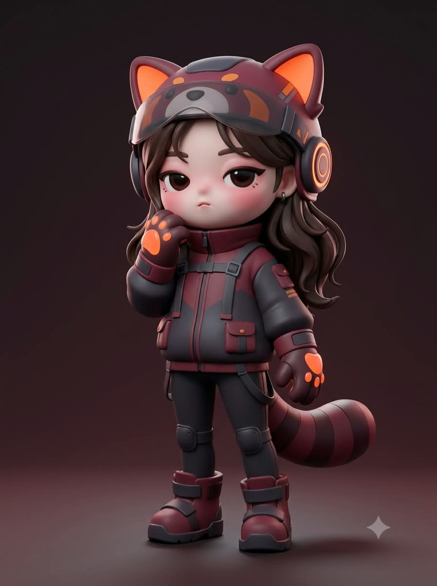
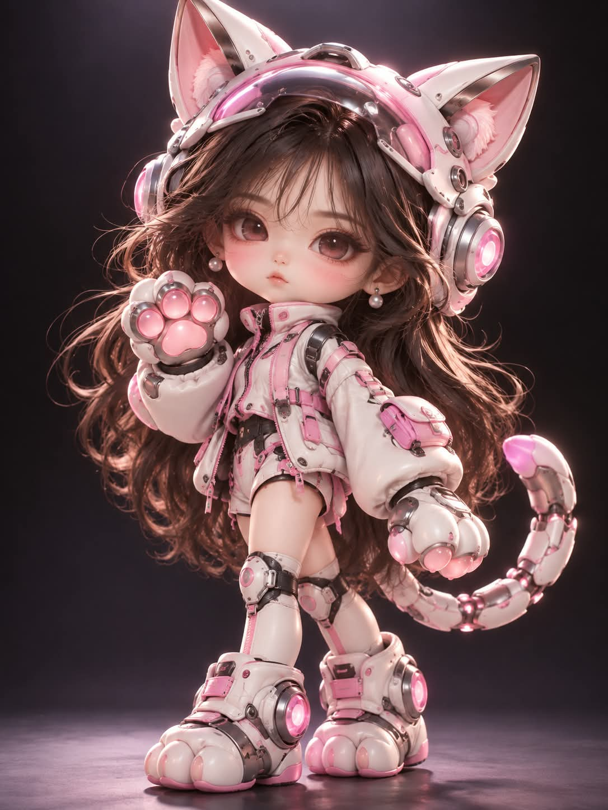
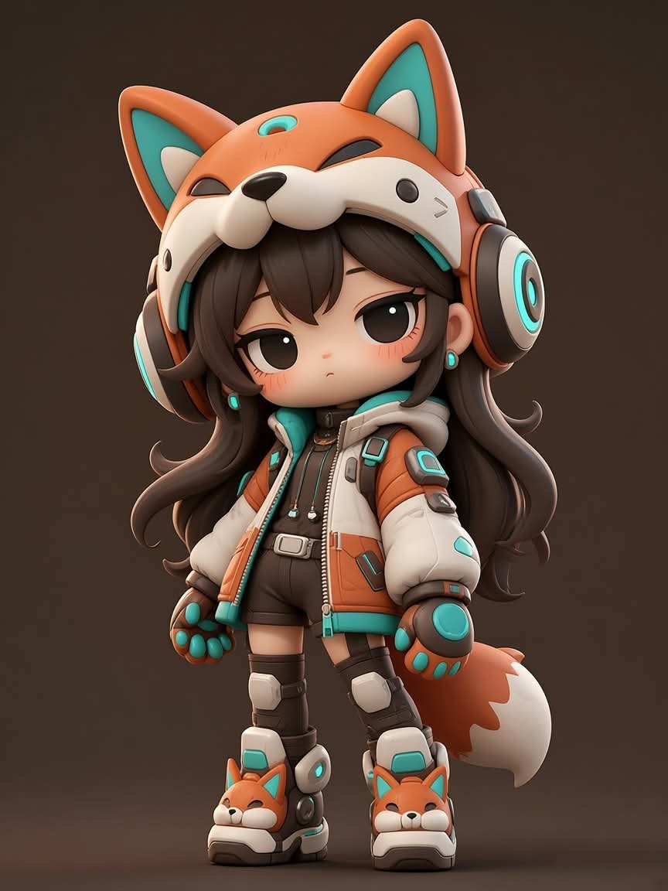

# 파워드 슈트 3D 버전, 나에게 맞는 동물 테마 슈트의 아트토이 피규어 프롬프트

## 1. 개요 및 아트 디렉팅 가이드

- **컨셉**: 160번 "파워드 슈트 애니 버전"을 3D로 옮긴 버전. AI가 나를 분석해 고른 동물 테마의 경량 파워드 슈트를 입은 3등신 디자이너 아트토이(블라인드박스 피규어) 렌더 (세로 3:4)
- **모델별 버전**: 같은 내용을 모델마다 다르게 배치한 세 가지 버전
  - **GPT 버전**: 작업 순서를 맨 앞에 두고 화풍·얼굴·사진 규칙으로 이어지는 순서
  - **Gemini 버전**: 화풍과 아트토이 얼굴을 맨 앞에 두고 영어 렌더 키워드를 덧붙임. 저해상도 게임 모델, 단순한 덩어리 모델링, 벡터 클립아트를 추가로 금지
  - **Grok 버전**: 같은 내용을 영어로 압축하고, 사진은 편집할 이미지가 아니라 힌트일 뿐이라고 강조
- **작업 순서**: 대화·기억·사진의 인상을 분석해 후보 5개 중 뻔하지 않은 동물 하나를 고르고, 헬멧·장갑·부츠·꼬리·슈트 색(메인 2색 + 포인트 1색)·홍채 색·헤어·포즈·배경색을 정한 뒤, 동물·슈트 색·포즈·근거를 먼저 보여 주고 바로 생성
- **화풍 (최우선)**: C4D·옥테인 렌더 느낌의 아트토이. 모공 없는 점토·소프트 PVC 같은 무광 피부, 끝이 뾰족하게 모인 굵은 조형 헤어, 위쪽 스튜디오 조명과 약한 림라이트
- **아트토이 얼굴 (사진보다 우선)**:
  - 크고 둥근 머리에 턱선이 거의 없는 짧은 얼굴 아래쪽
  - 홍채가 거의 꽉 찬 아주 큰 둥근 눈, 굵은 위 아이라인이 덮은 졸린 듯 시크한 눈매
  - 거의 안 보이는 코, 짧은 선 하나의 입, 눈 바로 아래의 진한 핑크 블러셔, 작은 링 귀걸이
  - 무심하고 살짝 뾰로통한 무표정
- **업로드 사진 사용 규칙**: 사진을 3D로 옮기지 않고, 눈꼬리 방향·쌍꺼풀 유무·입꼬리 방향 세 가지만 아트토이 얼굴에 살짝 반영. 안경은 같은 형태로 유지
- **인물 & 포즈**: 약 3등신, 가늘고 짧은 팔다리. 몸을 비스듬히 두고 한쪽 다리에 무게를 실은 자세, 카메라를 보는 정면에 가까운 얼굴
- **동물형 경량 파워드 슈트**: 얼굴이 드러나는 동물 귀 헬멧과 올린 바이저, 링 이어 모듈, 오버사이즈 테크웨어 상의, 작은 무릎 보호대, 동물 발바닥 장갑과 메카 부츠, 마디진 기계 꼬리. 무광과 유광이 섞인 소프트 PVC 재질, 장갑판은 헬멧·장갑·무릎·부츠·꼬리에만
- **배경**: 정한 색의 어두운 단색 스튜디오, 위가 살짝 밝고 바닥과 벽 경계 없음
- **금지**: 실사 사람 얼굴과 사진 같은 피부·코·입술, 사진 얼굴을 그대로 3D로 만든 것, 2D 일러스트와 외곽선, 얼굴을 가리는 바이저, 글자·로고·워터마크, 다른 인물

---

## 2. 프롬프트 전문

### GPT 버전

```text
[작업 순서]

1. 지금까지 나눈 대화, 저장된 기억, 나에 대해 알고 있는 모든 정보(성격, 직업, 취미, 관심사, 말투, 가치관, 생활 패턴)와 업로드한 사진의 인상을 종합해서 분석한다.
2. 분석 결과로 파워드 슈트 테마 동물 하나를 정한다. 흔한 동물이나 가장 먼저 떠오르는 동물을 기본값으로 고르지 말고, 서로 다른 성격·취미·관심사에서 출발한 후보 5개를 속으로 떠올린 뒤 가장 구체적으로 맞는 하나를 고른다.
3. 정한 동물과 분석으로 헬멧 형태, 장갑·부츠 형태, 꼬리, 슈트 색(메인 2색 + 포인트 1색), 홍채 색, 상의 실루엣, 헤어스타일과 머리색, 포즈, 배경 색을 이 사람에게만 맞게 정한다.
4. 대화창에 동물 / 슈트 색 / 포즈 / 정해진 근거 2~3줄을 짧게 보여준다.
5. 질문하지 말고 바로 이미지를 생성한다.

[화풍 – 최우선]
고급 디자이너 아트토이(블라인드박스 피규어) 스타일의 3D 캐릭터 렌더. C4D·옥테인 렌더 느낌.

- 사람 얼굴이 아니라 아트토이 얼굴이다. 실제 사람의 얼굴 비율, 입체, 피부결을 쓰지 않는다.
- 피부: 모공 없는 매끈한 무광 표면, 점토나 소프트 PVC처럼 부드럽고 은은한 반투명감.
- 머리카락: 끝이 뾰족하게 모인 굵은 조형 가닥으로 깎아 만든 듯한 3D 헤어, 무광에 부드러운 광택.
- 조명: 위쪽에서 오는 부드러운 스튜디오 조명, 약한 림라이트, 바닥에 부드러운 그림자.

[아트토이 얼굴 – 고정, 사진보다 우선]

- 머리는 크고 둥글며, 얼굴 아래쪽은 작고 짧다. 턱선이 거의 없다.
- 눈: 얼굴 중간 높이에 놓인 아주 큰 둥근 눈. 홍채가 눈 전체를 거의 채우고 흰자는 눈꼬리에만 조금 보인다. 홍채는 진하고 깊은 색에 가장자리로 갈수록 어두워지며, 위쪽에 작고 또렷한 흰 반사광과 아래쪽에 은은한 반사.
- 위 눈꺼풀: 굵고 진한 아이라인이 눈 위를 덮어 살짝 졸린 듯 시크한 눈매. 속눈썹은 짧고 최소한.
- 코: 거의 보이지 않는 아주 작은 둥근 돌기.
- 입: 아주 작은 짧은 선 하나.
- 볼: 눈 바로 아래부터 넓게 퍼진 진한 핑크 블러셔.
- 귀가 보이고 작은 링 귀걸이.
- 표정: 무심하고 살짝 뾰로통한 무표정.

[업로드 사진 사용 규칙]

- 사진은 3D로 옮기는 것이 아니다. 위 아트토이 얼굴 위에 사진의 특징 몇 가지만 살짝 반영한다.
- 반영하는 것: 눈꼬리가 올라갔는지 처졌는지, 쌍꺼풀 유무, 입꼬리 방향. 이 세 가지만.
- 반영하지 않는 것: 얼굴형, 얼굴 비율, 피부, 헤어, 이마/헤어라인, 표정, 고개 기울기, 얼굴 방향, 시선, 옷, 배경.
- 사진 속 인물이 안경을 쓰고 있으면 같은 형태의 안경을 아트토이 비율에 맞게 씌운다.
- 사진을 보고 성별을 판단한다.

[인물]

- 약 3등신, 큰 머리에 가늘고 짧은 팔다리.
- 포즈는 작업 순서에서 정한 대로, 정면 차렷 금지. 몸을 약간 비스듬히 두고 무게를 한쪽 다리에.
- 시선은 카메라, 얼굴은 정면에 가깝게.

[동물형 경량 파워드 슈트 – 크고 육중하게 만들지 말 것]

- 헬멧: 정한 동물 얼굴을 본뜬 둥근 헬멧, 크게 솟은 동물 귀와 포인트 색 귀 안쪽 패널. 앞은 얼굴이 완전히 드러나게 열려 있고 바이저는 이마 위로 올림. 헬멧 아래로 조형 앞머리가 이마와 눈 위에 흘러내림.
- 귀 옆: 동심원 링이 겹친 둥근 이어 모듈, 가운데 포인트 색 발광.
- 몸통: 볼륨감 있는 오버사이즈 테크웨어 상의, 하이넥 칼라, 지퍼, 스트랩, 포켓.
- 하체: 슬림한 하의, 작은 무릎 보호대.
- 손: 정한 동물 발바닥 모양의 큼직한 기계식 장갑, 포인트 색 젤리.
- 발: 정한 동물 발 모양의 큼직하고 귀여운 메카 부츠.
- 꼬리: 정한 동물에 꼬리가 있으면 마디가 이어진 기계 꼬리.
- 장갑판은 헬멧, 장갑, 무릎, 부츠, 꼬리에만. 어깨 갑옷, 흉갑, 등 추진기 금지.
- 슈트 재질은 무광과 유광이 섞인 매끈한 소프트 PVC.

[구도·배경]

- 세로 3:4, 머리끝부터 발끝까지 전신, 인물이 화면 중앙을 크게 채움.
- 배경은 정한 색의 어두운 톤 단색 스튜디오, 위가 살짝 밝은 그라데이션, 바닥과 벽 경계 없음.

[금지]

- 실사 사람 얼굴, 사진 같은 피부·코·입술
- 사진 얼굴을 그대로 3D로 만든 것
- 2D 일러스트, 외곽선
- 읽을 수 있는 글자, 로고, 워터마크
- 얼굴을 가리는 바이저나 마스크
- 화면 안에 다른 인물
```

### Gemini 버전

```text
[화풍 – 최우선]
고급 디자이너 아트토이(블라인드박스 피규어) 스타일의 3D 캐릭터 렌더.
(stylized 3D designer art toy, blind box figure, C4D, Octane render, soft studio lighting, clean smooth matte surfaces, high detail)
- 이것은 사람 얼굴이 아니라 아트토이 얼굴이다. 실제 사람의 얼굴 비율, 입체, 피부결, 코, 입술을 절대 쓰지 않는다.
- 피부: 모공 없는 매끈한 무광 표면, 점토나 소프트 PVC 같은 부드러운 반투명감.
- 머리카락: 끝이 뾰족하게 모인 굵은 조형 가닥으로 깎아 만든 3D 헤어, 무광에 부드러운 광택.
- 조명: 위쪽 부드러운 스튜디오 조명, 약한 림라이트, 바닥에 부드러운 그림자.

[아트토이 얼굴 – 고정, 사진보다 우선]
- 크고 둥근 머리, 작고 짧은 얼굴 아래쪽, 턱선 거의 없음.
- 아주 큰 둥근 눈. 홍채가 눈 전체를 거의 채우고 흰자는 눈꼬리에만 조금. 진하고 깊은 홍채, 위쪽에 작은 흰 반사광.
- 굵고 진한 위 아이라인이 눈 위를 덮어 살짝 졸린 듯 시크한 눈매, 속눈썹은 최소한.
- 코는 거의 안 보이는 작은 둥근 돌기, 입은 아주 작은 짧은 선 하나.
- 눈 바로 아래부터 넓게 퍼진 진한 핑크 블러셔.
- 귀가 보이고 작은 링 귀걸이.
- 무심하고 살짝 뾰로통한 무표정.

[작업 순서]
1. 지금까지 나눈 대화, 저장된 기억, 나에 대해 알고 있는 모든 정보와 업로드한 사진의 인상을 종합해 분석한다.
2. 파워드 슈트 테마 동물 하나를 정한다. 흔한 동물이나 가장 먼저 떠오르는 동물을 기본값으로 고르지 말고, 서로 다른 성격·취미·관심사에서 출발한 후보 5개를 속으로 떠올린 뒤 가장 구체적으로 맞는 하나를 고른다.
3. 정한 동물과 분석으로 헬멧 형태, 장갑·부츠 형태, 꼬리, 슈트 색(메인 2색 + 포인트 1색), 홍채 색, 상의 실루엣, 헤어스타일과 머리색, 포즈, 배경 색을 정한다.
4. 대화창에 동물 / 슈트 색 / 포즈 / 근거 2~3줄을 짧게 보여준다.
5. 질문하지 말고 바로 이미지를 생성한다.

[업로드 사진 사용 규칙]
- 사진을 편집하거나 3D로 옮기지 않는다. 위 아트토이 얼굴을 새로 만들고, 사진의 특징 세 가지만 살짝 반영한다: 눈꼬리 방향, 쌍꺼풀 유무, 입꼬리 방향.
- 얼굴형, 얼굴 비율, 피부, 헤어, 이마/헤어라인, 표정, 고개 기울기, 얼굴 방향, 시선, 옷, 배경은 가져오지 않는다.
- 안경을 쓰고 있으면 같은 형태의 안경을 아트토이 비율로 씌운다.
- 사진을 보고 성별을 판단한다.

[인물]
- 약 3등신, 큰 머리에 가늘고 짧은 팔다리. 다리가 길어지지 않게 한다.
- 정면 차렷 금지. 몸을 약간 비스듬히 두고 무게를 한쪽 다리에.
- 시선은 카메라, 얼굴은 정면에 가깝게.

[동물형 경량 파워드 슈트 – 크고 육중하게 만들지 말 것]
- 헬멧: 정한 동물 얼굴을 본뜬 둥근 헬멧, 크게 솟은 동물 귀와 포인트 색 귀 안쪽 패널. 앞은 얼굴이 완전히 드러나게 열려 있고 바이저는 이마 위로 올림. 헬멧 아래로 조형 앞머리가 흘러내림.
- 귀 옆: 동심원 링 이어 모듈, 가운데 포인트 색 발광.
- 몸통: 볼륨감 있는 오버사이즈 테크웨어 상의, 하이넥 칼라, 지퍼, 스트랩, 포켓.
- 하체: 슬림한 하의, 작은 무릎 보호대.
- 손: 정한 동물 발바닥 모양의 큼직한 기계식 장갑, 포인트 색 젤리.
- 발: 정한 동물 발 모양의 큼직하고 귀여운 메카 부츠.
- 꼬리: 정한 동물에 꼬리가 있으면 마디가 이어진 기계 꼬리.
- 장갑판은 헬멧, 장갑, 무릎, 부츠, 꼬리에만. 어깨 갑옷, 흉갑, 등 추진기 금지.
- 슈트 재질은 무광과 유광이 섞인 매끈한 소프트 PVC, 모서리에 부드러운 하이라이트.

[구도·배경]
- 세로 3:4, 머리끝부터 발끝까지 전신, 인물이 화면 중앙을 크게 채움.
- 정한 색의 어두운 톤 단색 스튜디오, 위가 살짝 밝은 그라데이션, 바닥과 벽 경계 없음.

[금지]
- 실사 사람 얼굴, 사진 같은 피부·코·입술, 사진 얼굴을 그대로 3D로 만든 것
- 저해상도 게임 모델, 단순한 덩어리 모델링
- 2D 일러스트, 외곽선, 벡터 클립아트
- 읽을 수 있는 글자, 로고, 워터마크
- 얼굴을 가리는 바이저나 마스크
- 화면 안에 다른 인물
```

### Grok 버전

```text
Analyze everything you know about me (our conversations, my personality, job, hobbies, interests, habits) plus the impression of the uploaded face photo. Silently brainstorm 5 different animals from different traits, avoid common default choices, and pick the one that fits me most specifically. In Korean, briefly tell me: the animal, suit colors, pose, and 2-3 lines of why. Then immediately generate the image without asking anything.

Create a brand-new stylized 3D designer art toy character, blind box figure style, C4D / Octane render, soft studio lighting, smooth matte clay-like surfaces, high detail. This is an ART TOY face, NOT a human face. Never use realistic human facial proportions, skin texture, nose or lips. Do NOT edit or convert the photo into 3D. Treat the photo only as a hint, never as an image to edit.

Fixed art toy face (this has priority over the photo): big round head, small short lower face, almost no jawline. Huge round eyes, the dark deep iris fills almost the whole eye with only a little white at the corners, one small crisp white catchlight on top. Thick dark upper eyelid line covering the top of the eye for a slightly sleepy, cool look, minimal lashes. Nose is a tiny barely visible bump. Mouth is one tiny short line. Strong pink blush spreading right under the eyes. Visible ears with small ring earrings. Blank, slightly pouty expression.

From the photo, apply ONLY these three hints onto the art toy face: whether the eye corners tilt up or down, double eyelid or not, mouth corner direction. Do NOT use the photo's face shape, proportions, skin, hair, hairline, expression, head tilt, face direction, gaze, clothes or background. If the person wears glasses, add the same glasses scaled to the toy. Decide gender from the photo.

Body: about 3 heads tall, big head, thin short limbs. Body slightly angled, weight on one leg, not standing stiffly. Looking at the viewer, face nearly frontal. Sculpted chunky hair strands with pointed tips, matte with soft sheen; bangs fall from under the helmet over the forehead. Hairstyle and hair color chosen to fit me.

Outfit: lightweight cute animal-themed powered suit in smooth soft PVC, mixed matte and glossy. Open-face round helmet shaped like the animal with large animal ears and accent-colored inner-ear panels, visor flipped up, face fully visible. Round ear modules with stacked rings and a glowing accent center. Oversized puffy techwear jacket with high collar, zipper, straps, pockets. Slim pants with small knee guards. Big mechanical gloves shaped like the animal's paws with accent paw pads. Chunky cute mecha boots shaped like the animal's feet. Segmented mechanical tail if the animal has one. Armor only on helmet, gloves, knees, boots and tail — no shoulder armor, no chest plate, no back thrusters. Colors: 2 main colors + 1 contrasting accent chosen for the animal.

Background: plain dark-toned seamless studio in a color chosen for the animal, slightly lighter at the top, soft shadow under the feet. Vertical 3:4, full body head to toe, character centered and filling the frame.

No realistic human face, no photo-like skin, nose or lips, no 2D illustration, no outlines, no text, no logos, no watermark, no mask or visor covering the face, no other people.
```

---

## 3. 결과물 비교 갤러리

| 생성 모델 | 생성 결과 이미지 |
| :--- | :--- |
| **제미나이 (Gemini)** |  |
| **ChatGPT (DALL-E 3)** |  |
| **그록 (Grok)** |  |
