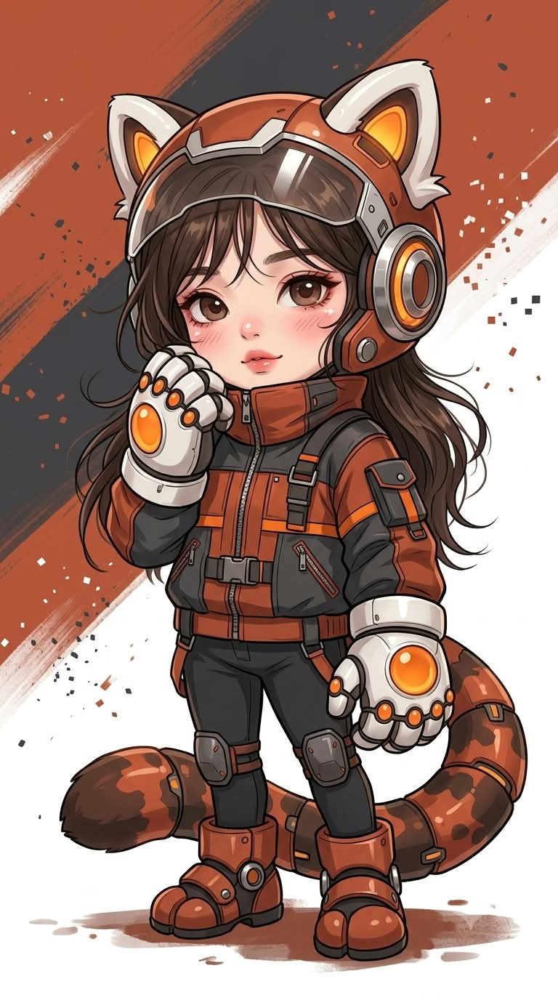
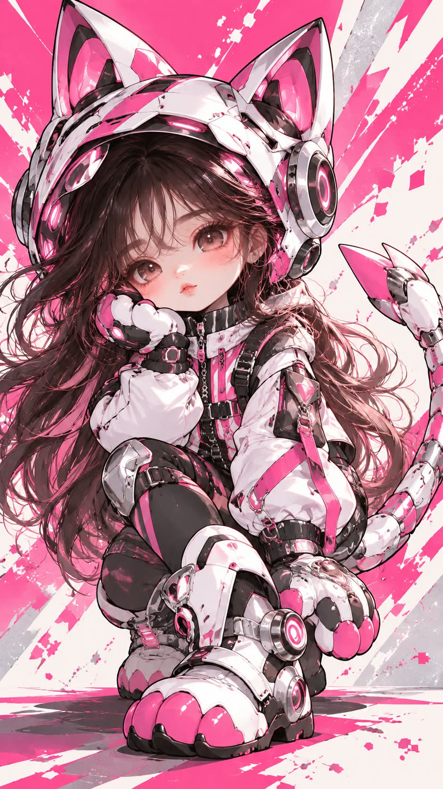
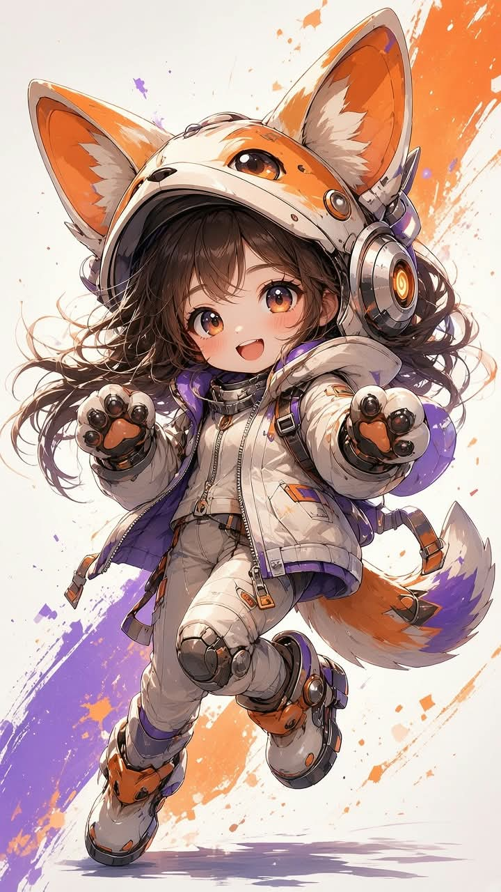

# 파워드 슈트 애니 버전, 나에게 맞는 동물 테마 슈트의 미니 캐릭터 프롬프트

## 1. 개요 및 아트 디렉팅 가이드

- **컨셉**: AI가 나를 분석해 고른 동물을 테마로 한 경량 파워드 슈트 차림의 3.5등신 미니 캐릭터 애니메이션 일러스트. 동물 귀 헬멧, 발바닥 장갑, 메카 부츠, 기계 꼬리를 달고 전신으로 등장 (세로 9:16)
- **모델별 버전**: 같은 컨셉을 모델마다 다르게 다듬은 세 가지 버전
  - **GPT 버전**: 굵기가 변하는 검은 외곽선과 2단 셀 채색의 스티커 같은 또렷한 그림체. 닮음을 살리는 눈꼬리·눈 비율·쌍꺼풀·입 모양 규칙을 따로 자세히 둠
  - **Gemini 버전**: 가는 필압 선과 브러시 블렌딩의 아트북급 고밀도 일러스트. 세라믹 장갑판, 크롬 링, 재킷 디테일까지 재질을 세세하게 지정하고 플랫·스티커 그림체를 금지
  - **Grok 버전**: Gemini 버전과 같은 방향의 내용을 영어 한 덩어리로 압축하고, 결과 설명만 한국어로 하도록 지시
- **작업 순서**:
  - 대화, 기억, 성격·취미·관심사·습관과 사진의 인상을 종합 분석
  - 서로 다른 특징에서 출발한 후보 5개를 떠올린 뒤 뻔하지 않고 가장 구체적으로 맞는 동물 하나를 고름
  - 헬멧·장갑·부츠·꼬리 형태, 메인 2색 + 포인트 1색, 홍채 색, 상의, 헤어, 표정, 포즈, 배경색을 이 사람에게 맞춰 정함
  - 대화창에 동물·슈트 색·포즈·근거 2~3줄을 먼저 보여 주고 질문 없이 바로 생성
- **얼굴 사용 규칙**: 눈·코·입 생김새만 가져와 그림체로 다시 그리고, 얼굴형·피부·헤어·각도·시선·표정·옷·배경은 가져오지 않음. 안경은 같은 형태로 유지. 모든 사람이 같은 템플릿 얼굴이 되지 않도록 눈꼬리와 입 모양 특징을 과장해서 살림
- **얼굴 그림체**: 턱선 없는 찹쌀떡 같은 아기 얼굴, 낮고 넓게 놓인 큰 눈과 위가 진한 그라데이션 홍채, 큰 하이라이트와 작은 점 하이라이트, 아주 작은 코와 입, 볼 블러셔, 이마로 흘러내린 가는 앞머리
- **동물형 경량 파워드 슈트**:
  - 얼굴이 완전히 드러나는 동물 얼굴 헬멧에 솟은 귀, 이마 위로 올린 바이저, 귀 옆의 둥근 기계식 이어 모듈
  - 갑옷 대신 하이넥·지퍼·스트랩·포켓이 달린 테크웨어 상의, 슬림한 하의에 작은 무릎 보호대
  - 동물 발 모양의 두툼한 장갑과 큼직한 메카 부츠, 동물에 꼬리가 있으면 마디진 기계 꼬리
  - 장갑판은 헬멧·장갑·무릎·부츠(·꼬리)에만. 어깨 갑옷, 흉갑, 추진기, 거대한 로봇 팔다리 금지
- **구도 & 배경**: 머리끝부터 부츠까지 전신, 카메라를 보는 정면에 가까운 얼굴, 차렷이 아닌 실루엣에 변화가 있는 포즈. 큰 사선 색 면과 물감 튄 자국, 작은 사각 픽셀 조각, 바닥의 짧은 그림자
- **금지**: 템플릿 얼굴, 차렷 포즈, 얼굴을 가리는 바이저나 마스크, 실사·3D 렌더 느낌, 부피 큰 로봇 수트, 사진 속 각도·헤어·옷 그대로 가져오기, 글자·로고·워터마크, 다른 인물

---

## 2. 프롬프트 전문

### GPT 버전

```text
[작업 순서]

1. 지금까지 나눈 대화, 저장된 기억, 나에 대해 알고 있는 모든 정보(성격, 직업, 취미, 관심사, 말투, 가치관, 생활 패턴)와 업로드한 사진의 인상(눈매, 코, 입, 전체 분위기)을 종합해서 분석한다.
2. 분석 결과로 파워드 슈트의 테마가 될 동물 하나를 정한다.
- 동물은 나의 성격·직업·취미·관심사·습관 중 가장 구체적이고 나만의 것에서 출발하고, 사진의 인상과도 맞아야 한다.
- 귀여운 캐릭터 일러스트에서 흔히 쓰는 뻔한 동물로 쏠리지 말 것
- 가장 먼저 떠오르는 무난한 동물을 기본값으로 고르지 말 것
- 동물을 고르기 전에 서로 다른 성격·취미·관심사에서 출발한 후보 5개를 속으로 먼저 떠올린 뒤, 분석 결과와 가장 구체적으로 맞는 하나를 고른다.
3. 정한 동물과 분석 결과로 아래 항목을 모두 정한다. 각 항목은 누구에게나 쓸 수 있는 무난한 기본값을 고르지 말고, 이 사람에게만 맞는 선택이어야 한다.
- 헬멧 형태 (그 동물의 귀·얼굴 특징을 어떻게 살릴지)
- 장갑·부츠 형태 (그 동물의 발 특징)
- 꼬리 유무와 형태
- 슈트 색: 메인 2색 + 대비되는 포인트 1색, 홍채 색
- 상의 종류와 실루엣 (테크웨어 범위 안에서)
- 헤어스타일: 길이, 형태, 색
- 표정
- 포즈: 정한 동물의 습성과 나의 성격이 드러나는 동작
- 배경 색
4. 대화창에 아래 내용을 먼저 짧게 보여준다.
- 동물 / 슈트 색 / 포즈 / 이 동물이 나에게 정해진 근거 2~3줄
5. 질문하지 말고 바로 아래 이미지를 생성한다.

[얼굴 사용 규칙 – 반드시 지킬 것]

- 첨부 사진에서는 눈·코·입의 생김새만 가져와 아래 [얼굴 그림체]로 다시 그린다.
- 얼굴형, 피부, 헤어, 이마/헤어라인은 사진에서 가져오지 않는다.
- 사진 속 고개 기울기, 얼굴 방향, 시선, 표정은 절대 가져오지 않는다.
- 사진 속 인물이 안경을 쓰고 있으면 같은 형태의 안경을 그림체에 맞게 씌운다.
- 사진 속 옷, 배경, 소품은 사용하지 않는다.
- 사진을 보고 성별을 판단한다.

[닮음 유지 – 획일화 금지]
그림체는 아래처럼 단순화하지만, 모든 사람이 같은 얼굴이 되면 안 된다. 사진의 아래 특징을 그림체 안에서 과장해서 살린다.

- 눈꼬리 방향: 올라감 / 처짐 / 수평을 사진과 같게
- 눈의 가로·세로 비율: 가늘고 긴 눈이면 덜 둥글게, 동그란 눈이면 더 둥글게
- 쌍꺼풀 유무: 있으면 위 속눈썹 라인 위에 가는 선 하나, 없으면 생략
- 두 눈 사이 간격: 사진과 같은 느낌으로
- 입 모양: 입 크기, 입꼬리가 올라갔는지 내려갔는지, 입술 두께를 작은 입 안에서 반영
- 코: 사진의 코끝 특징을 아주 작은 점이나 짧은 선의 위치·모양으로만 반영

[얼굴 그림체 – 고정]

- 얼굴 윤곽: 턱선이 거의 없는 둥글고 말랑한 아기 얼굴, 볼이 통통하게 아래로 살짝 처진 찹쌀떡 같은 형태.
- 눈: 얼굴 높이 중간보다 아래쪽에 배치된 큰 눈, 두 눈 사이가 넓다. 눈동자가 눈 안을 거의 다 채우고 흰자는 아주 조금만 보인다.
- 홍채: 위쪽은 진하고 아래로 갈수록 밝아지는 그라데이션, 동공 주변에 홍채 색보다 진한 고리, 아래쪽에 밝은 반사광 띠.
- 하이라이트: 홍채 위쪽에 큰 흰 하이라이트 하나, 반대쪽 아래에 작은 흰 점 하나.
- 속눈썹: 위 속눈썹 라인은 굵고 짧은 검은 선, 바깥 눈꼬리에만 짧은 속눈썹 2~3가닥. 아래 속눈썹은 거의 그리지 않는다.
- 눈썹: 짧고 가늘며 앞머리에 대부분 가려진다.
- 코: 거의 그리지 않거나 아주 작은 점 또는 짧은 선 하나.
- 입: 아주 작게, 짧은 선이나 작은 입 모양으로.
- 볼: 양 볼에 핑크 타원 블러셔와 그 위에 짧은 빗금 몇 개.
- 앞머리: 가늘고 끝이 뾰족한 머리 가닥 몇 개가 이마와 눈 위로 흘러내린다. 헬멧 챙 바로 아래로 얼굴이 들여다보이는 느낌.
- 얼굴은 헬멧에 비해 작고, 헬멧이 이마를 덮는다.

[그림체]

- 3.5등신 미니 캐릭터, 머리가 크고 몸은 짧고 귀엽다.
- 애니메이션 셀 채색, 굵기가 변하는 선명한 검은 외곽선, 2단 명암과 날카로운 하이라이트.
- 채도 높은 색, 깔끔한 일러스트 마감, 스티커 같은 또렷함.

[동물형 경량 파워드 슈트 – 크고 육중하게 그리지 말 것]

- 헬멧: 정한 동물 얼굴을 본뜬 둥근 헬멧, 머리 위로 그 동물의 귀(또는 귀에 해당하는 특징)가 솟아 있다. 헬멧 앞은 얼굴이 완전히 드러나게 열려 있고, 투명 바이저는 이마 위로 올려 놓았다. 얼굴을 가리는 것 없음.
- 귀 옆: 둥근 기계식 이어 모듈 양쪽에 하나씩.
- 몸통: 갑옷판이 아니라 작업 순서에서 정한 테크웨어 상의. 패치, 지퍼, 스트랩, 작은 포켓 장식. 목에는 하이넥 칼라나 넥워머.
- 하체: 슬림한 하의, 무릎에만 작은 기계식 무릎 보호대.
- 손: 정한 동물의 발 모양을 살짝 닮은 두툼한 기계식 장갑.
- 발: 정한 동물의 발 느낌을 살린 큼직하고 귀여운 메카 부츠, 관절 힌지와 작은 발광 라인.
- 꼬리: 정한 동물에 꼬리가 있으면 기계 이음매가 있는 꼬리를 단다.
- 장갑판은 헬멧, 장갑, 무릎, 부츠에만. 어깨 갑옷, 흉갑, 등 추진기, 거대한 로봇 팔다리 금지.
- 색은 작업 순서에서 정한 메인 2색 + 포인트 1색. 작은 발광 라인은 포인트 색.

[구도·배경]

- 세로 9:16, 머리끝부터 부츠까지 전신이 다 들어오게, 인물은 화면 중앙.
- 시선은 카메라. 얼굴이 정면에 가깝게 보여야 한다.
- 배경은 작업 순서에서 정한 색의 평면 그래픽: 큰 색 면, 사선으로 튀는 날카로운 조각 파편, 작은 사각 픽셀 점과 물감 튄 자국. 바닥에 짧은 그림자.

[금지]

- 모든 사람이 같은 눈·같은 입으로 나오는 템플릿 얼굴
- 정면 차렷 같은 기본 포즈
- 읽을 수 있는 글자, 실제 브랜드 로고, 워터마크 (패치는 의미 없는 도형 기호만)
- 얼굴을 가리는 바이저나 마스크
- 실사, 3D 렌더 느낌
- 부피 큰 메카, 로봇 수트 느낌
- 사진 속 각도·표정·헤어·옷 그대로 가져오기
- 화면 안에 다른 인물
```

### Gemini 버전

```text
[작업 순서]
1. 지금까지 나눈 대화, 저장된 기억, 나에 대해 알고 있는 모든 정보(성격, 직업, 취미, 관심사, 말투, 가치관, 생활 패턴)와 업로드한 사진의 인상을 종합해서 분석한다.
2. 분석 결과로 파워드 슈트 테마 동물 하나를 정한다. 흔한 동물이나 가장 먼저 떠오르는 동물을 기본값으로 고르지 말고, 서로 다른 성격·취미·관심사에서 출발한 후보 5개를 속으로 떠올린 뒤 가장 구체적으로 맞는 하나를 고른다.
3. 정한 동물과 분석 결과로 헬멧 형태, 장갑·부츠 형태, 꼬리, 슈트 색(메인 2색 + 포인트 1색), 홍채 색, 상의 실루엣, 헤어스타일, 표정, 포즈, 배경 색을 이 사람에게만 맞게 정한다.
4. 대화창에 동물 / 슈트 색 / 포즈 / 정해진 근거 2~3줄을 짧게 보여준다.
5. 질문하지 말고 바로 이미지를 생성한다.

[화풍 – 최우선]
고급 일러스트레이터가 그린 고해상도 애니메이션 일러스트, 수집용 아트북 한 페이지 수준의 완성도.
(high-detail anime illustration, painterly rendering, masterpiece quality, intricate details)

- 선: 가늘고 섬세한 갈색·검은 선, 필압에 따라 굵기와 진하기가 변함. 외곽선이 균일하게 두꺼운 만화 선이 아님.
- 채색: 부드러운 브러시 블렌딩과 여러 단계의 그라데이션 명암. 단색 면을 칠한 평면 채색이 아님.
- 슈트 재질: 하얀 장갑판은 유광 세라믹처럼 매끈하고, 금속 링과 힌지는 크롬 반사와 날카로운 하이라이트. 장갑판 표면에 미세한 긁힘과 물감 튄 얼룩 질감.
- 천 재질: 재킷에 주름, 솔기, 지퍼 이빨, 버클, 스트랩 디테일이 하나하나 보임.
- 머리카락: 큰 덩어리 안에 수십 가닥의 가는 머리 선과 흩날리는 잔머리, 머리카락에 광택 하이라이트.
- 조명: 위 앞쪽에서 오는 부드러운 빛, 헬멧과 장갑에 주변 색이 반사되고, 인물 아래로 부드러운 그림자.
- 깊이감: 가까운 부츠·장갑은 크고 또렷하게, 뒤쪽 꼬리와 배경은 살짝 물러나 원근이 느껴짐.

[얼굴 사용 규칙 – 반드시 지킬 것]
- 업로드 사진에서는 눈·코·입의 생김새만 가져와 아래 얼굴 그림체로 다시 그린다.
- 얼굴형, 피부, 헤어, 이마/헤어라인은 사진에서 가져오지 않는다.
- 사진 속 고개 기울기, 얼굴 방향, 시선, 표정은 절대 가져오지 않는다.
- 사진 속 인물이 안경을 쓰고 있으면 같은 형태의 안경을 그림체에 맞게 씌운다.
- 사진 속 옷, 배경, 소품은 사용하지 않는다.
- 사진을 보고 성별을 판단한다.
- 눈꼬리 방향, 눈의 가로·세로 비율, 쌍꺼풀 유무, 두 눈 사이 간격, 입 크기와 입꼬리 방향, 입술 두께를 그림체 안에서 과장해 살려 사진 속 인물임을 알아볼 수 있게 한다.

[얼굴 그림체]
- 턱선이 거의 없는 둥글고 말랑한 아기 얼굴, 통통한 볼.
- 얼굴 중간보다 아래에 놓인 큰 눈. 홍채는 위가 진하고 아래로 밝아지는 여러 겹 그라데이션, 동공 둘레에 진한 고리, 아래쪽 반사광 띠, 위쪽 큰 흰 하이라이트와 반대쪽 작은 흰 점.
- 위 속눈썹은 한 올 한 올 그린 촘촘하고 진한 속눈썹, 아래 속눈썹은 가늘게 몇 가닥.
- 코는 코끝에 작은 빛 반사와 아주 옅은 그림자만.
- 입은 작고, 입술에 은은한 광택.
- 피부는 매끈한 페인팅 표면, 양 볼과 코끝에 번지듯 퍼진 핑크 블러셔, 눈 밑에 옅은 홍조.
- 가는 앞머리 가닥이 이마와 눈 위로 흘러내림.

[인물]
- 3.5등신 미니 캐릭터. 머리가 크고 몸은 짧다. 일반 등신 캐릭터처럼 다리가 길어지지 않게 한다.
- 표정과 포즈는 작업 순서에서 정한 대로. 정면 차렷이나 그냥 걷는 동작 같은 평범한 포즈 금지. 몸을 웅크리거나 비틀거나 손을 얼굴 가까이 가져가는 등 몸의 실루엣에 변화가 있는 포즈.
- 시선은 카메라, 얼굴은 정면에 가깝게.

[동물형 경량 파워드 슈트 – 크고 육중하게 그리지 말 것]
- 헬멧: 정한 동물 얼굴을 본뜬 둥근 헬멧, 머리 위로 그 동물의 귀(또는 귀에 해당하는 특징)가 크게 솟음. 귀 안쪽에 포인트 색 패널. 헬멧 앞은 얼굴이 완전히 드러나게 열려 있고 바이저는 이마 위로 올림.
- 귀 옆: 동심원 금속 링이 겹친 둥근 기계식 이어 모듈, 가운데 포인트 색 발광.
- 몸통: 갑옷판이 아닌 볼륨감 있는 테크웨어 상의. 하이넥 칼라, 지퍼, 버클 스트랩, 포켓, 포인트 색 띠.
- 하체: 슬림한 하의에 작은 기계식 무릎 보호대.
- 손: 정한 동물의 발바닥 모양을 본뜬 큼직하고 둥근 기계식 장갑, 발바닥 젤리 부분은 포인트 색 유광.
- 발: 정한 동물 발 모양의 큼직한 메카 부츠, 발가락 부분이 둥글게 나뉘고 관절에 금속 링 힌지.
- 꼬리: 정한 동물에 꼬리가 있으면 여러 마디의 유광 장갑판이 이어진 기계 꼬리.
- 장갑판은 헬멧, 장갑, 무릎, 부츠, 꼬리에만. 어깨 갑옷, 흉갑, 등 추진기, 거대한 로봇 팔다리 금지.

[구도·배경]
- 세로 9:16, 머리끝부터 부츠까지 전신, 인물이 화면을 크게 채움.
- 배경은 정한 색의 큰 사선 색 면과 흰 면이 교차하고, 그 위에 물감 튄 자국, 붓질 긁힘, 작은 사각 픽셀 조각이 질감 있게 흩뿌려짐. 바닥에도 물감 얼룩과 인물의 부드러운 그림자.

[금지]
- 벡터 클립아트, 플랫 일러스트, 웹툰 스티커, 이모티콘 같은 단순한 그림
- 균일하게 두꺼운 검은 외곽선, 명암 없는 단색 채색
- 모든 사람이 같은 눈·같은 입으로 나오는 템플릿 얼굴
- 읽을 수 있는 글자, 로고, 워터마크
- 얼굴을 가리는 바이저나 마스크
- 실사, 3D 렌더 느낌
- 사진 속 각도·표정·헤어·옷 그대로 가져오기
- 화면 안에 다른 인물
```

### Grok 버전

```text
Analyze everything you know about me (our conversations, my personality, job, hobbies, interests, habits) plus the impression of the uploaded face photo. Silently brainstorm 5 different animals from different traits, avoid common default choices, and pick the one that fits me most specifically. In Korean, briefly tell me: the animal, suit colors, pose, and 2-3 lines of why. Then immediately generate the image without asking anything.

Create a brand-new high-detail anime illustration, collectible artbook quality, painterly soft brush shading, thin delicate lines with varying weight, rich textures. Do NOT paste or trace the photo. Redraw the person completely in this art style.

From the photo, use ONLY the shapes of the eyes, nose and mouth, exaggerated so the person is still recognizable: eye tilt, eye width-to-height ratio, double eyelid or not, eye spacing, mouth size and corner direction, lip thickness. Do NOT use the photo's face shape, skin, hair, hairline, clothes, background, head tilt, face direction, gaze or expression. If the person wears glasses, keep the same glasses. Decide gender from the photo.

Character: 3.5-head-tall chibi, big head, short body. Round soft baby face with almost no jawline, chubby cheeks, large eyes set low and wide apart, layered iris gradient (dark top, bright bottom) with a big white highlight and a small dot highlight, dense dark upper lashes, tiny nose, small glossy lips, soft pink blush on cheeks and nose tip, thin bangs falling over the forehead. Looking straight at the viewer. Hairstyle, expression and a dynamic pose (not standing straight, not plain walking) chosen to fit me and the animal.

Outfit: lightweight cute animal-themed powered suit. Open-face round helmet shaped like the animal with large animal ears and colored inner-ear panels, visor flipped up, face fully visible. Round mechanical ear modules with stacked chrome rings and a glowing center. Puffy techwear jacket with high collar, zipper, buckled straps, pockets. Slim pants with small mechanical knee guards. Big round mechanical gloves shaped like the animal's paws with glossy paw pads. Chunky cute mecha boots shaped like the animal's feet with ring hinges. Segmented glossy mechanical tail if the animal has one. Armor only on helmet, gloves, knees, boots and tail — no shoulder armor, no chest plate, no bulky robot limbs. Glossy ceramic-white plates, chrome reflections, tiny scratches and paint splatter texture. Colors: 2 main colors + 1 contrasting accent chosen for the animal.

Background: bold diagonal color blocks crossing white, paint splatters, brush scratches, tiny square pixel bits, soft shadow under the character. Vertical 9:16, full body from helmet ears to boots, character fills the frame.

No flat vector clipart, no sticker or emoji style, no uniform thick outlines, no photorealism, no 3D render, no text, no logos, no watermark, no mask or visor covering the face, no other people.
```

---

## 3. 결과물 비교 갤러리

| 생성 모델 | 생성 결과 이미지 |
| :--- | :--- |
| **제미나이 (Gemini)** |  |
| **ChatGPT (DALL-E 3)** |  |
| **그록 (Grok)** |  |
