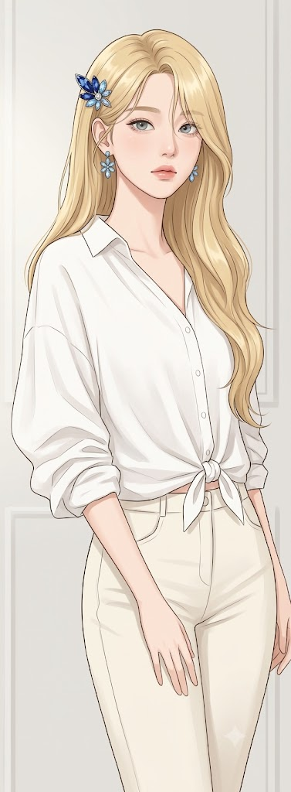
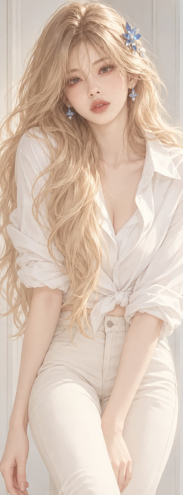

# 피부 질감 1, 보송한 반무광 피부의 반실사 애니메이션 페인팅 프롬프트

## 1. 개요 및 아트 디렉팅 가이드

- **컨셉**: 파우더를 바른 듯 뽀얗고 보송한 반무광 피부 표현에 초점을 맞춘 반실사 애니메이션 페인팅. 연금발 롱헤어에 화이트 블라우스와 아이보리 팬츠 차림의 3/4 상반신, 밝은 아이보리 톤에 블루 액세서리만 포인트 (세로로 아주 긴 약 1:2.7 비율)
- **얼굴 사진 사용 규칙 (최우선)**:
  - 사진에서는 눈·코·입의 생김새만 가져와 알아볼 수 있을 만큼 닮게 옮기되, 반실사 페인팅 그림체로 다시 그림
  - 얼굴형, 피부색과 질감, 헤어, 눈동자 색, 표정, 각도와 시선, 조명·배경·옷·액세서리는 가져오지 않음
- **스타일**:
  - 애니메이션 일러스트 기반의 반실사 디지털 페인팅. 외곽선 없이 면과 부드러운 그라데이션으로 칠하되 형태는 또렷하게
  - 모공, 잔머리, 실 짜임 같은 사진의 미세 질감은 그리지 않음
- **구도 & 포즈**:
  - 정수리부터 허벅지 윗부분까지의 3/4 상반신, 카메라는 눈높이보다 아주 약간 위
  - 몸통은 20~30도 비스듬히 틀고 상체를 살짝 숙인 채 얼굴만 정면으로 돌려 응시
  - 한쪽 팔은 몸 앞으로 대각선을 그리고 다른 팔은 몸 옆으로 곧게 내린 비대칭 자세
- **얼굴 & 피부 (핵심)**:
  - 밝은 아이보리 바탕에 옅은 피치빛 혈색이 도는 반무광 피부
  - 입체감은 넓고 부드러운 명암 전환만으로 표현하고, 코끝·콧대·광대·이마에 점이나 띠 모양의 반사광을 넣지 않음
  - 연한 회청색 눈동자, 가늘고 연한 금갈색 눈썹, 립밤 정도의 은은한 반무광 피치 핑크 입술
  - 입을 다문 차분하고 무심한, 살짝 나른한 표정
- **헤어**: 허리까지 오는 따뜻한 연금발(옅은 버터 골드). 큰 다발 몇 개로 단순하게 정돈하고, 아래로 갈수록 완만한 S자 웨이브. 잔머리나 낱가닥 없이 띠 모양 하이라이트로 윤기 표현
- **액세서리**: 사파이어 블루와 하늘색 크리스털의 꽃잎 모양 헤어핀, 네 장 꽃잎 모양의 하늘색 크리스털 드롭 귀걸이
- **의상**: 비치지 않는 면 원단의 오버사이즈 화이트 블라우스(소매를 걷고 밑단을 작게 매듭지어 묶음), 아이보리·크림색 하이웨이스트 슬림핏 팬츠
- **조명 & 배경**: 방향성이 약한 밝은 확산광과 대비가 낮은 옅은 회베이지 그림자, 소품 없는 밝은 회백색 실내 벽
- **금지**: 실사 얼굴을 붙여 넣은 듯한 합성 티, 윤기 나는 인형 피부와 번들거림, 또렷한 하이라이트와 글로시 립, 은빛·백금 금발, 비치는 원단, 대칭으로 내린 차렷 팔, 글자와 워터마크

---

## 2. 프롬프트 전문

```text
[얼굴 사진 사용 규칙 — 최우선]
업로드한 사진은 얼굴 특징 참고용으로만 쓴다. 사진에서 가져오는 것은 눈, 코, 입의 생김새뿐이다.
- 눈: 크기, 모양, 눈꼬리 방향, 쌍꺼풀 형태, 눈 사이 간격
- 코: 길이, 콧대 형태, 코끝과 콧볼 모양
- 입: 입술 두께, 입 폭, 입꼬리 형태
이 세 가지 특징이 사진 속 인물로 알아볼 수 있을 만큼 닮아 보이게 옮긴다. 단, 반드시 아래 [스타일]의 반실사 애니메이션 페인팅 그림체로 다시 그린다. 사진의 실사 질감을 그대로 붙여 넣지 않는다.

사진에서 절대 가져오지 않는 것:
- 얼굴형, 턱선, 이마, 헤어라인
- 피부색, 피부 질감, 잡티, 메이크업
- 헤어스타일, 머리색
- 눈동자 색
- 표정
- 고개 기울기, 얼굴 방향, 시선 방향, 촬영 각도
- 조명, 배경, 옷, 액세서리
표정, 얼굴 각도, 시선은 사진과 무관하게 아래 [비율·구도]와 [얼굴] 서술대로 새로 그린다. 얼굴을 제외한 구도, 포즈, 헤어, 의상, 조명, 배경, 색감은 아래 내용에서 하나도 바뀌면 안 된다.

[스타일]
애니메이션 일러스트를 기반으로 한 반실사 디지털 페인팅이다(실사 사진 아님). 형태를 단순하고 깔끔하게 정돈한 매끈한 페인팅 질감으로 그린다. 외곽선 없이 면과 부드러운 그라데이션으로 칠하되, 형태는 흐릿하게 뭉개지지 않고 또렷하게 읽혀야 한다. 사진 같은 미세 질감(모공, 잔머리, 실 짜임, 원단 비침)은 그리지 않는다. 전체 색감은 밝고 부드러운 아이보리 톤이며, 포인트 컬러는 액세서리의 블루 하나뿐이다.

[비율·구도]
세로로 아주 긴 비율(약 1:2.7). 정수리부터 허벅지 윗부분까지 보이는 3/4 상반신 구도이고, 인물은 화면 중앙에 둔다.
몸통은 화면 왼쪽 방향으로 약 20~30도 비스듬히 틀어져 있고, 상체를 카메라 쪽으로 살짝 숙인다. 얼굴만 정면에 가깝게 돌려 보는 사람을 똑바로 바라본다. 고개는 아주 살짝 기울인다.
팔 자세는 좌우 비대칭이다.
- 화면 오른쪽 팔(인물의 왼팔): 팔꿈치를 살짝 굽혀 몸 앞쪽으로 대각선을 그리며 내려온다. 손은 화면 아래 중앙의 허벅지 앞쪽으로 향한다.
- 화면 왼쪽 팔(인물의 오른팔): 몸 옆을 따라 곧게 내려가 화면 왼쪽 가장자리에 걸친다.
양손은 화면 아래에서 대부분 잘린다. 카메라는 눈높이보다 아주 약간 위에 있다.

[얼굴]
얼굴형은 갸름한 계란형이고, 이마와 턱선은 매끄럽게 정돈한다. 이 얼굴 위에 사진에서 가져온 눈, 코, 입의 생김새를 배치한다.
피부는 밝은 아이보리 바탕에 옅은 피치빛 혈색이 은은하게 도는 색이다. 얇게 파우더를 바른 듯 뽀얗고 보송한 반무광 피부로 표현한다. 볼과 코의 입체감은 넓고 부드러운 명암 전환만으로 표현하고, 경계선이 생기지 않게 한다. 하이라이트는 넓고 약하게 퍼뜨린다. 코끝, 콧대, 광대, 이마에는 점이나 띠 모양의 반사광을 넣지 않는다. 볼 홍조는 아주 옅은 피치빛으로 넓게 스치듯 넣는다.
눈동자는 연한 회청색이고, 하이라이트는 단순하게 한두 개만 준다. 속눈썹은 깔끔한 다발 형태로 그리고, 눈두덩에는 아주 옅은 피치 섀도를 바른다. 눈썹은 가늘고 연한 금갈색이다. 입술은 연한 피치 핑크이고, 립밤 정도의 은은한 반무광으로 칠한다.
표정은 입을 다문 차분하고 무심한 얼굴이며, 살짝 나른한 분위기다. 사진 속 표정은 따르지 않는다.

[헤어]
허리까지 오는 따뜻한 연금발(옅은 버터 골드)이다. 머리카락은 큰 다발 몇 개로 단순하게 정돈해서 그린다. 위쪽은 매끈한 생머리이고, 아래로 갈수록 다발이 크고 완만한 S자 웨이브를 그리며 흐른다. 긴 옆 앞머리 다발이 화면 오른쪽으로 넘어가 한쪽 눈가를 살짝 덮는다. 양어깨 앞쪽으로 큰 머리 다발이 흘러내린다. 윤기는 다발마다 매끈한 띠 모양 하이라이트로 은은하게 표현한다. 흩날리는 잔머리나 낱가닥 머리카락은 넣지 않고, 다발 끝만 몇 갈래로 가볍게 갈라지게 한다.

[액세서리]
- 헤어핀: 화면 왼쪽 머리 위쪽에 꽂은 뾰족한 꽃잎 모양 핀. 진한 사파이어 블루와 하늘색 크리스털로 장식하고, 가운데에 작은 은색 스톤을 박는다.
- 귀걸이: 양쪽 귀에 단 짧은 드롭형 귀걸이. 네 장 꽃잎 모양의 하늘색 크리스털 장식이다.
- 이 두 가지 외에 다른 액세서리는 없다. 사진 속 안경이나 액세서리도 가져오지 않는다.

[의상]
- 상의: 오버사이즈 화이트 블라우스. 비치지 않는 불투명한 면 셔츠 원단으로, 두툼하고 부드럽게 늘어진다. 카라가 열려 있고, V자 앞섶은 쇄골 아래 가슴 윗부분까지만 벌어진다. 그 아래는 단추가 잠겨 있다. 어깨선은 떨어지는 드롭숄더이고, 소매는 팔꿈치 근처까지 걷어 올린다. 주름은 큼직하고 단순한 몇 개의 면으로 정리한다.
밑단은 허리 앞 중앙에서 약간 왼쪽에 작게 매듭지어 묶는다. 매듭 끈은 짧아서 손바닥 하나 길이 정도이며, 골반 아래로 넘어가지 않는다.
- 하의: 밝은 아이보리·크림색 하이웨이스트 슬림핏 팬츠. 앞 단추와 포켓 라인이 보인다.

[조명]
넓고 은은하게 퍼지는 밝은 확산광. 정면 왼쪽 위에서 들어오지만 방향성은 약하다. 그림자는 머리카락 아래, 목 아래, 옷 주름 사이에만 옅은 회베이지 톤으로 단순하게 깔린다. 피부 위 명암은 대비가 낮고, 밝은 면에서 어두운 면으로 천천히 이어진다. 피부와 입술에는 광택 반사가 없다.

[배경]
밝은 회백색 실내 벽. 화면 양옆에 세로 벽 패널 경계가 희미하게 보이고, 소품이 없는 미니멀한 배경이다.

[금지]
- 사진에서 가져오면 안 되는 것: 실사 얼굴을 그대로 붙여 넣은 듯한 합성 티, 사진의 얼굴형·헤어·피부색·표정·고개 각도·시선 방향
- 질감: 실사 사진 질감, 굵은 외곽선, 잔머리와 흩날리는 낱가닥 머리카락
- 피부: 윤기 나는 인형 피부, 코팅된 듯한 광택, 코·볼·입술의 또렷한 하이라이트, 번들거림, 차가운 흰 피부, 강한 노란 피부 톤, 진한 홍조, 글로시 립
- 머리색: 은빛·백금 금발
- 의상: 비치는 원단, 배꼽 근처까지 깊게 벌어진 앞섶, 긴 매듭 끈
- 자세: 대칭으로 내린 차렷 팔
- 기타: 추가 액세서리, 글자, 워터마크
```

---

## 3. 결과물 비교 갤러리

| 생성 모델 | 생성 결과 이미지 |
| :--- | :--- |
| **제미나이 (Gemini)** |  |
| **ChatGPT (DALL-E 3)** |  |
