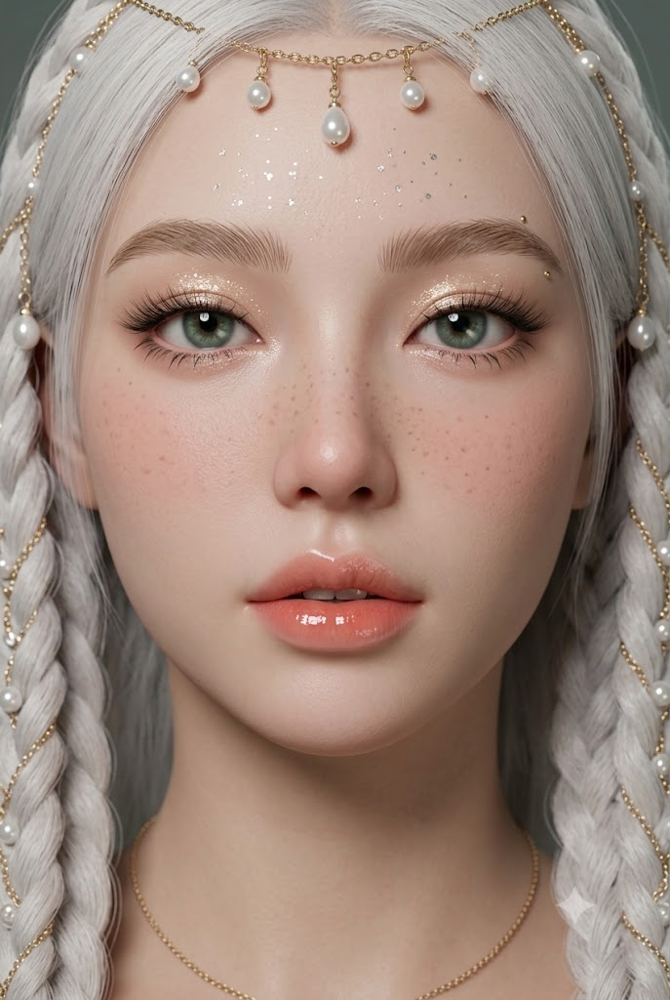
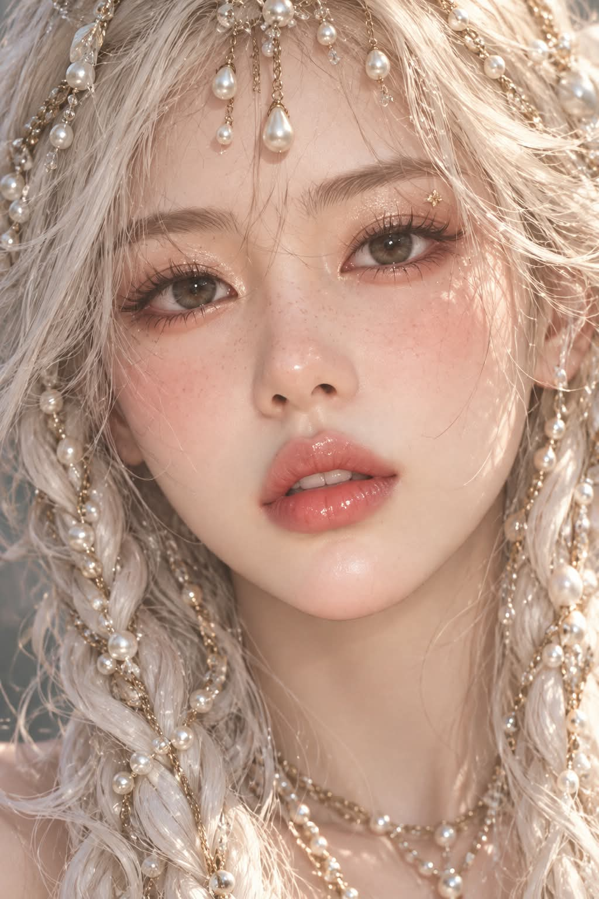

# 피부 질감 2, 진주빛 피부의 3D CG 뷰티 클로즈업 프롬프트

## 1. 개요 및 아트 디렉팅 가이드

- **컨셉**: 모공·잔털 없이 넓은 색면과 진주빛 반사면으로만 피부를 표현하는 스타일화된 3D CG 뷰티 클로즈업. 플래티넘 화이트 드레드 브레이드에 진주와 골드 체인 장식, 회녹색 눈동자가 포인트 (세로 2:3)
- **얼굴 합성 규칙 (최우선)**:
  - 업로드 사진을 편집하는 것이 아니라 완전히 새로 그리는 3D CG 초상화. 사진은 눈·코·입 생김새 참고용으로만 사용
  - 피부톤과 질감, 주근깨, 얼굴형, 헤어, 표정, 고개 각도와 시선, 눈동자 색, 메이크업, 조명과 색감, 배경은 가져오지 않음
- **렌더링 방식 (최우선)**:
  - 형태는 입체적이고 선명하지만 피부 표면에는 미세 질감이 없음
  - 확대해도 모공, 잔털, 미세 요철, 입자성 반짝임이 보이지 않게 넓은 색면과 매끈한 그라데이션으로 표현
- **구도**: 얼굴이 화면을 가득 채우는 극단적인 클로즈업. 이마 윗부분이 살짝 잘리고 턱 끝과 목 윗부분까지. 고개를 기울이지 않은 완전 정면, 카메라 정면 응시
- **피부 (핵심)**:
  - 차분한 뉴트럴 베이지 핑크, 볼과 코끝에 넓고 부드러운 피치 핑크 홍조
  - 콧등과 볼 안쪽에만 옅은 연갈색 주근깨를 색으로만 소량
  - 광택은 눈 아래부터 광대까지 이어지는 진주빛 반사면, 코끝에 작게 응집된 하이라이트. 하이라이트 사이에 차분한 중간톤을 충분히 남김
- **조명**: 넓게 확산된 실내 스튜디오 상단 정면광. 얼굴 밝기를 조금 낮추고 눈두덩·코 옆·턱 밑 음영은 분명하게. 햇빛·역광·노란 색감 없음
- **메이크업**:
  - 맑은 회녹색 홍채, 샴페인 골드 글리터 아이섀도, 스파이키 아래 속눈썹, 눈썹 끝 아래 작은 골드 포인트
  - 위로 빗어 올린 라이트 브라운 솝 브로우, 살짝 벌어진 코랄 피치 글로스 입술
  - 은빛 글리터는 이마에만 몇 알
- **헤어 & 장식**: 얼굴 양옆으로 정돈된 플래티넘 화이트 드레드 브레이드, 사이사이 진주 비즈와 골드 체인. 이마 위로 늘어진 진주 드롭 장식과 목의 골드 체인 목걸이. 앞머리·잔머리 없음
- **배경**: 초점이 완전히 날아간 차분한 그레이 그린
- **금지**: 실사 피부 텍스처와 모공, 오일 광택, 진한 주근깨, 기울어진 고개, 얼굴을 덮는 잔머리, 갈색 눈동자, 붉은 눈 밑 섀도, 인형·마네킹 같은 얼굴, 글자와 워터마크

---

## 2. 프롬프트 전문

```text
[얼굴 합성 규칙 — 최우선]
이 작업은 업로드 사진을 편집하는 것이 아니라, 아래 서술대로 완전히 새로 그리는 3D CG 초상화다. 업로드 사진은 눈·코·입의 생김새를 확인하는 참고용으로만 쓴다.
사진에서 절대 가져오지 않는 것: 피부·피부 질감·피부톤, 주근깨·잡티, 얼굴형, 헤어·잔머리·앞머리, 이마·헤어라인, 표정, 고개 각도·기울기·방향·시선, 눈동자 색, 메이크업, 조명·그림자, 색감·노출, 배경, 사진 특유의 실사 질감.
가져온 눈·코·입의 생김새는 아래 렌더링 방식으로 다시 그린다. 닮음은 이목구비 생김새로만 표현한다.
얼굴 외 구도·헤어·장식·조명·배경은 아래 서술에서 전혀 바뀌면 안 된다.

[렌더링 방식 — 최우선]
사진이 아닌 스타일화된 3D CG 초상화로 생성한다.
얼굴의 형태는 입체적이고 선명하지만, 피부 표면에는 미세 질감이 없다.
피부는 넓은 색면, 매끈한 명암 그라데이션, 부드럽게 이어지는 진주빛 반사면으로 표현한다.
피부를 확대해도 모공, 잔털, 미세한 요철, 입자성 반짝임이 보이지 않는다.
눈·속눈썹·눈썹·장식의 정교함이 피부의 사진식 세부 질감으로 번지지 않게 한다.
업로드 사진은 눈·코·입의 형태만 참고하며, 피부 렌더링에는 사용하지 않는다.

[구도]
세로 2:3 비율의 극단적인 뷰티 클로즈업 초상화. 얼굴이 화면을 가득 채우고, 이마 윗부분은 살짝 잘리며 턱 끝과 목 윗부분까지만 보인다. 고개를 전혀 기울이지 않은 완전 정면, 두 눈이 수평을 이루는 좌우 대칭에 가까운 구도. 시선은 카메라를 똑바로 응시.

[피부]
피부색은 차분한 뉴트럴 베이지 핑크. 흐릿하게 뭉개지지 않고 깨끗하고 선명한 면.
홍조는 연한 피치 핑크 색면으로 볼과 코끝에 넓고 부드럽게 번진다.
주근깨는 콧등과 볼 안쪽에만 아주 옅은 연갈색 점을 적은 양으로 넣되, 질감이나 요철이 아닌 피부 위의 옅은 색으로만 표현한다.

[피부 광택]
광택은 미세한 반짝임이 아니라 넓게 연결된 진주빛 반사면으로 표현한다. 눈 아래부터 광대 윗부분까지 부드러운 밝은 면이 이어지고, 광대와 턱 중앙의 하이라이트는 중심이 밝고 가장자리로 갈수록 천천히 사라진다. 코끝에는 작고 응집된 하이라이트, 콧등에는 짧고 부드러운 반사광. 하이라이트 사이에는 광택이 적은 차분한 중간톤을 충분히 남긴다.

[조명·명암]
실내 스튜디오의 넓게 확산된 조명. 직사광선, 햇빛, 역광, 얼굴 위 머리카락 그림자 무늬는 없다.
넓은 상단 정면 광원으로 부드럽게 비추고, 얼굴 전체 밝기를 조금 낮춰 베이지 핑크 중간톤을 유지한다. 눈썹 아래·눈두덩·코 양옆·얼굴 가장자리·아랫입술 아래·턱 밑의 음영은 부드럽지만 분명하게 남긴다. 보조광은 약하게. 화이트 헤어·진주·하이라이트는 밝게, 노란색·세피아·햇빛 색감 없음.

[글리터]
은빛 글리터는 이마에만 드문드문 몇 알 올린 장식으로 넣고, 볼과 턱에는 넣지 않는다.

[눈]
눈 모양은 사진을 따른다. 홍채 색은 사진과 관계없이 반드시 맑은 회녹색(그레이 그린), 홍채 무늬가 정교하고 선명한 캐치라이트. 눈두덩에 샴페인 골드 글리터 아이섀도우를 글로시하게. 눈 밑과 눈꼬리에 붉은·핑크 섀도 없음. 길고 짙은 위 속눈썹, 아래 속눈썹은 뭉친 듯 뾰족한 스파이키 래쉬. 한쪽 눈썹 끝 아래에 작은 골드 포인트 장식.

[눈썹]
굵고 풍성하게 위로 빗어 올린 라이트 브라운 결 눈썹(솝 브로우).

[입술]
입술 모양은 사진을 따른다. 코랄 피치색에 유리처럼 반짝이는 글로스, 붉은 립 아님. 입술이 살짝 벌어져 윗니가 조금 보임. 몽환적이고 무표정에 가까운 표정.

[헤어·장식]
플래티넘 화이트 헤어가 굵은 실타래 같은 드레드 브레이드로 얼굴 양옆을 따라 정돈되어 늘어진다. 앞머리와 잔머리 없이 이마와 얼굴이 완전히 드러나고, 흐트러진 웨이브나 날리는 머리카락은 없다. 브레이드 사이사이에 하얀 진주 비즈와 얇은 골드 체인이 엮여 있다. 이마 위로 골드 체인에 매달린 진주 드롭 장식이 여러 개 늘어져 이마에 닿는다. 목 아래쪽에 골드 체인 목걸이가 살짝 보인다.

[배경]
초점이 완전히 날아간 차분한 그레이 그린 톤.

[피해야 할 표현]
실사 인물 사진, 사진 피부 텍스처, 모공·잔털·미세 요철, 입자성 반짝임, 번들거리는 오일 광택, 진하고 많은 주근깨, 얼룩진 홍조, 샤프닝, 흐릿하게 뭉개진 피부, 평면 조명, 과노출, 햇빛·역광·그림자 무늬, 기울어진 고개, 반측면 얼굴, 얼굴을 덮는 잔머리·앞머리, 갈색 눈동자, 붉은 눈 밑 섀도, 인형·마네킹 같은 얼굴, 업로드 사진의 피부·각도·표정·헤어·조명·색감이 그대로 들어간 얼굴.

텍스트, 서명, 워터마크는 넣지 않음.
```

---

## 3. 결과물 비교 갤러리

| 생성 모델 | 생성 결과 이미지 |
| :--- | :--- |
| **제미나이 (Gemini)** |  |
| **ChatGPT (DALL-E 3)** |  |
