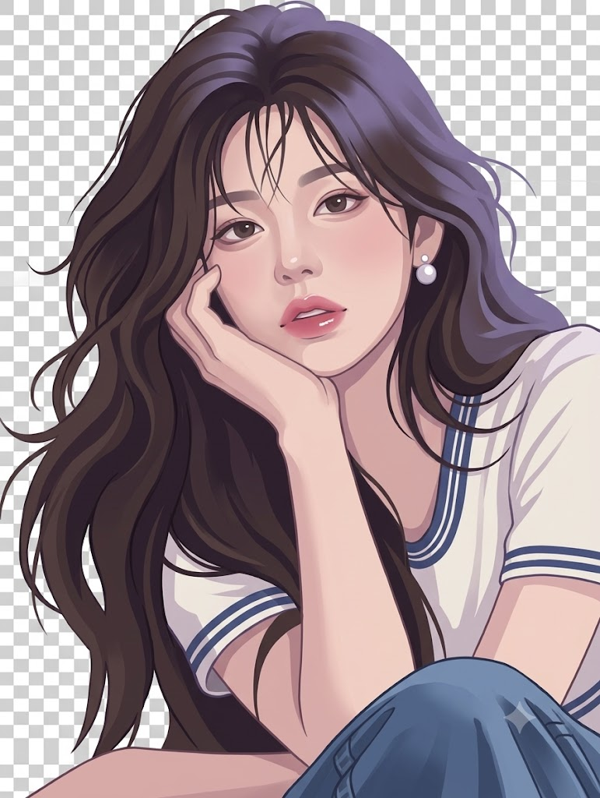
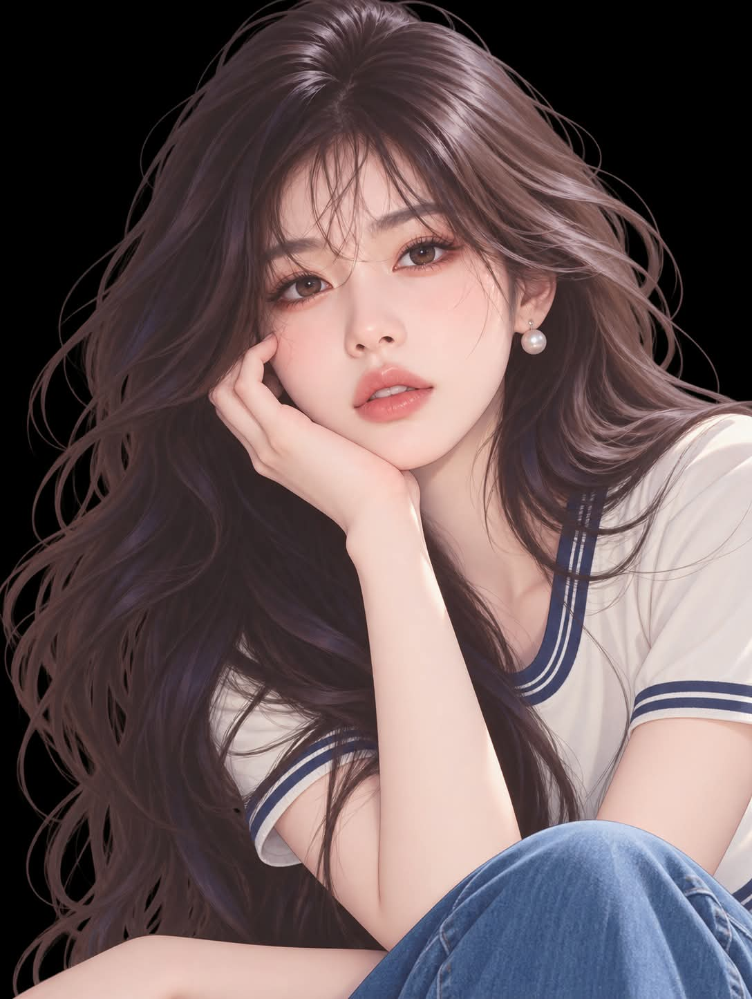

# 피부 질감 3, 넓은 색면의 반실사 2.5D 캐릭터 일러스트 변환 프롬프트

## 1. 개요 및 아트 디렉팅 가이드

- **컨셉**: 실사에 가까운 인물 이미지를 넓은 색면과 매끄러운 그라데이션의 반실사 2.5D 캐릭터 일러스트로 다시 그리는 변환 프롬프트. 피부·머리카락·의상의 미세 질감을 모두 같은 수준으로 단순화하고 배경은 투명하게 유지
- **그래픽 표현 기준 (최우선)**:
  - 확대해도 사진의 미세 질감이 아니라 직접 그린 색면과 그라데이션으로 보여야 함
  - 원본을 선명하게 재현하는 것보다 그래픽 표현을 우선
  - 닮음은 이목구비와 형태·비율로만 유지
- **피부**:
  - 얼굴·목·손·팔을 같은 디지털 페인팅 피부로 통일
  - 작은 굴곡과 잘게 나뉜 명암을 생략하고 넓은 기본색·옅은 음영·부드러운 밝은 면으로 큰 볼륨만 표현
  - 코끝과 입술의 작은 흰 반짝임을 제거하고, 입술은 매끄러운 로즈핑크 색면에 넓고 약한 새틴 광택
- **머리카락**:
  - 실루엣과 큰 흐름은 유지하되 개별 머리카락 대신 굵은 머릿결 덩어리로 다시 그림
  - 광택은 가는 흰 선이 아닌 넓고 흐린 청보라색 면, 정수리의 밝은 광택은 없애고 밝기 차이를 완만하게
- **의상**: 티셔츠 직물결과 청바지의 섬유·얼룩·노이즈를 생략하고 디자인·색·봉제선·큰 주름만 남겨 색면과 그라데이션으로 새로 그림
- **인물 전체**: 낮은 채도의 회보라·청보라 음영을 쓴 반실사 2.5D 캐릭터 일러스트, 배경은 완전히 투명

---

## 2. 프롬프트 전문

```text
[그래픽 표현의 기준 — 최우선]

완성된 인물은 확대해서 보아도 사진의 미세 질감이 아닌,
직접 그린 넓은 색면과 매끄러운 그라데이션으로 보여야 한다.
원본을 선명하게 재현하는 것보다 모든 표면의 그래픽 표현을 우선한다.
닮음은 이목구비와 형태·비율로 유지하고, 사진의 세부 질감으로 유지하지 않는다.

피부:
얼굴·목·손·팔을 동일한 디지털 페인팅 피부로 그린다.
피부의 작은 굴곡과 잘게 나뉜 명암을 생략하고,
넓은 기본색·옅은 음영·부드러운 밝은 면으로 큰 볼륨만 표현한다.
코끝과 입술의 작은 흰 반짝임은 제거한다.
입술은 매끄러운 로즈핑크 색면과 넓고 약한 새틴 광택으로 표현한다.

머리카락:
헤어스타일의 실루엣과 큰 흐름은 유지하되,
촘촘한 개별 머리카락 대신 굵게 묶인 머릿결 덩어리로 다시 그린다.
광택은 가느다란 흰 선이 아닌 넓고 흐린 청보라색 면으로 표현한다.
정수리에 집중된 밝은 광택은 없애고 전체 밝기 차이를 완만하게 한다.

의상:
티셔츠의 직물결과 청바지의 미세한 섬유·얼룩·노이즈를 생략한다.
옷의 디자인·색·봉제선·큰 주름만 유지하고,
주름의 입체감은 넓은 색면과 부드러운 그라데이션으로 새로 그린다.

인물 전체:
피부·머리카락·의상이 모두 같은 수준으로 단순화된
반실사 2.5D 캐릭터 일러스트로 완성한다.
기본색 위에 낮은 채도의 회보라·청보라 음영을 사용한다.
배경은 완전히 투명하게 유지한다.
```

---

## 3. 결과물 비교 갤러리

| 생성 모델 | 생성 결과 이미지 |
| :--- | :--- |
| **제미나이 (Gemini)** |  |
| **ChatGPT (DALL-E 3)** |  |
