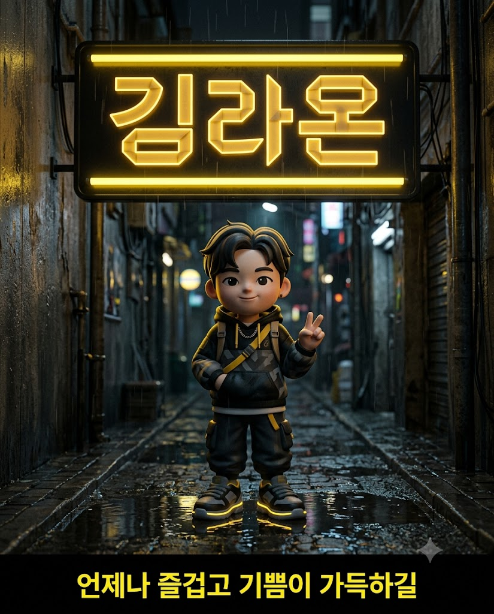
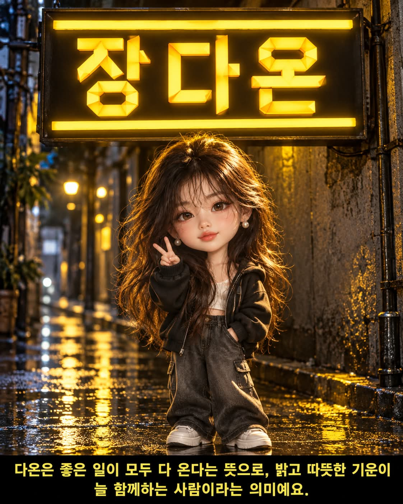

# 순우리말 이름 네온사인, 비 갠 밤 골목의 3D 미니미 프롬프트

## 1. 개요 및 아트 디렉팅 가이드

- **컨셉**: 성을 입력하면 얼굴 인상에 어울리는 두 글자 순우리말 이름을 지어, 비 갠 밤 골목의 노란 네온사인에 그 이름을 띄우고 그 아래 3D 미니미 캐릭터를 세우는 영어 프롬프트 (세로 4:5)
- **첫 답변 규칙 (최우선)**:
  - 첫 메시지에서는 이미지 생성 도구를 절대 호출하지 않고 "성을 입력해 주세요." 한 문장만 출력
  - 나머지 지시는 '성을 받기 전까지 비활성' 블록 안에 넣어, 성을 답한 다음 메시지에서만 실행되게 구성
- **1단계 (이름 짓기)**:
  - 입력한 성은 한글 그대로 사용하고 한자로 쓰지 않음
  - 이름은 한자로 쓰거나 풀이할 수 없는 순우리말 두 글자. 흔한 이름으로 쏠리지 않게 그 사람의 인상에서 출발
  - 순우리말의 뜻과 어울리는 이유를 25자 이내의 한 문장으로 작성
- **2단계 (이미지)**:
  - **장면**: 비 갠 늦은 밤, 젖은 아스팔트가 반짝이는 좁은 골목. 어두운 콘크리트 벽 높이 걸린 가로로 긴 네온사인
  - **네온사인**: 무광 검정 패널의 위아래에 굵은 노란 네온 가로 막대, 그 사이에 한글 이름만 크게 한 줄로 배치
  - **글자꼴**: 일정한 폭의 납작한 종이 띠를 직각과 45도로 접어 만든 듯한 기하학적 한글. 곡선 없이 직선으로만 구성되고 ㅇ은 모서리를 깎은 팔각형, 접힌 면은 주황빛 노랑으로 표현
  - **이름 풀이 자막**: 이미지 맨 아래 무광 검정 띠 안에 밝은 레몬 노란색의 굵은 고딕체로 한 줄
- **캐릭터**:
  - 부드러운 소프트 비닐 질감의 2.5등신 3D 미니미 아트토이, 사진의 눈·코·입을 단순화하되 알아볼 수 있게 유지
  - 정면으로 서서 한 손은 바지 주머니에 넣고 다른 손은 가볍게 V자를 만든 포즈, 부드러운 미소
  - 노란 네온이 돋보이도록 검정·회색·흰색 위주의 캐주얼 스트릿웨어
- **사진 사용 규칙**: 눈·코·입의 형태와 전체 인상만 가져오고 각도·표정·헤어·옷·배경은 가져오지 않음. 안경은 같은 모양으로 유지
- **구도 & 스타일**: 위에서부터 네온사인, 캐릭터 전신, 자막 띠 순서. 검정과 노랑의 강한 대비가 살아 있는 시네마틱 야간 조명의 고퀄리티 3D 렌더
- **금지**: 간판에 이름 외의 글자나 기호, 둥근 글자꼴, 오타와 뭉개진 자모, 한자 이름과 한자 풀이, 실사 인물 표현

---

## 2. 프롬프트 전문

```text
[FIRST REPLY RULE - TOP PRIORITY]
In this message, NEVER call the image generation tool.
Everything inside the [INACTIVE UNTIL SURNAME IS GIVEN] block below is disabled right now. Only read it; do not execute any of it.
The block becomes active ONLY in the next message, after the user replies with their surname.
The ONLY text you may output now is:
성을 입력해 주세요.
Output this sentence and end your reply immediately. Do not analyze the photo, do not create a name, do not describe anything, do not generate any image.

=== [INACTIVE UNTIL SURNAME IS GIVEN] ===

[Uploaded Photo Rules]
Use the uploaded photo ONLY as a face reference. Take only the shape of the eyes, nose, and mouth and the overall impression.
Do NOT take the head/face angle (tilt, direction, gaze), expression, face shape, skin, hair, forehead/hairline, clothing, background, or lighting from the photo.
Draw the expression, pose, hair, outfit, and composition fresh, exactly as described below. If the person wears glasses, keep glasses of the same shape.

[Step 1 - Create a Name (internally, no chat output needed)]
Use the surname the user typed exactly as written, in Hangul. Never change it or write it in Hanja.
Analyze the person's impression, mood, eyes, and overall vibe from the photo, and create a given name that suits them best.

- The given name MUST be a native Korean word (순우리말) of 2 Hangul syllables, NOT a Sino-Korean word. Never use a name that can be written or explained with Chinese characters (Hanja).
- Full name = the user's surname + the 2-syllable given name.
- Do not default to common names; freely create a name that fits only this person's impression.
- Also write a one-line Korean explanation of the given name: the meaning of the native Korean word and why it fits this person. Keep it to ONE short sentence of 25 Hangul syllables or fewer. No Hanja.

[Step 2 - Image]
Scene: Late night after the rain, a narrow alley with glistening wet asphalt. A long horizontal rectangular neon sign hangs high on a dark concrete wall, and the mini-me character stands directly beneath it.

Neon sign design:

- The sign backing is a matte black rectangular panel.
- At the very top and very bottom inside the panel, one thick yellow neon horizontal bar spans the full width of the sign. No other symbols, icons, or decorations.
- Between the two bars, place ONLY the Hangul syllables of the full name from Step 1, large, in a single horizontal row. No other letters, English, or numbers.
- Typeface: geometric Hangul that looks like it was made by folding a flat paper strip (tape) of constant width at right angles and 45-degree angles. All strokes are bold with identical thickness, made only of straight lines with no curves, and corners are chamfered at 45 degrees. ㅇ is not a circle but an octagon with cut corners; the top stroke and bottom of ㅎ use the same angular strip structure.
- At every fold point, triangular and trapezoidal folded faces appear. Folded faces are a deeper orange-tinted yellow, flat faces are bright lemon yellow, with a thin orange outline at the edges.
- Each syllable fills an equal-sized square cell, with tight, even spacing between syllables. Every jamo and final consonant is correct, with no broken or smudged strokes.
- All letters and bars glow like yellow neon, with a warm yellow halo spreading around them. Yellow light spills onto the wall and reflects in the puddles on the ground.

Name explanation caption (inside the image):

- At the very bottom of the image, a solid matte black horizontal caption band spans the full width, about 12% of the image height.
- Inside the band, centered, write the one-line Korean explanation from Step 1 in a clean, bold Korean sans-serif font, bright lemon yellow, no glow.
- The caption text must be exactly the Step 1 explanation, spelled correctly with every jamo clear. One line only, large enough to read easily. No Hanja, no English, no quotation marks.
- The caption band does not overlap the character's feet; the character stands on the ground above it.

Character:

- 2.5-heads-tall 3D mini-me art toy. Smooth soft-vinyl texture, big head, short arms and legs, chubby hands.
- Simplify the eye, nose, and mouth shapes from the photo to fit mini-me proportions while keeping the person recognizable.
- Expression: a soft smile with slightly raised mouth corners, eyes looking straight at the camera.
- Pose: standing straight facing forward, one hand in a pants pocket, the other hand making a light V sign. Head is not tilted.
- Determine gender from the photo and newly choose a casual streetwear outfit (oversized hoodie or jacket, wide pants, sneakers) and hairstyle that match the mood of the name. Keep the outfit mainly black, gray, and white so the yellow neon stands out.
- Yellow neon rim light falls on the top of the character's head and shoulders.

Composition & Style:

- Vertical 4:5, eye level from a slightly low angle. From top to bottom: neon sign in the upper third, character full-body in the middle-lower area at center, caption band at the very bottom. The character never covers the sign's letters.
- Background slightly out of focus; character, sign letters, and caption sharp.
- High-quality 3D render, cinematic night lighting, emotional mood with strong black-and-yellow contrast.

Forbidden: any letters or symbols on the sign other than the name, any text in the image other than the sign name and the caption, rounded or curved typefaces on the sign, typos or smudged jamo, Hanja names / Hanja characters / Hanja explanations, carrying over the photo's angle, expression, clothing, or background, photorealistic human rendering.

=== [END OF INACTIVE BLOCK] ===

Reminder: in THIS message, output only "성을 입력해 주세요." and stop. Do not call the image generation tool.
```

---

## 3. 결과물 비교 갤러리

| 생성 모델 | 생성 결과 이미지 |
| :--- | :--- |
| **제미나이 (Gemini)** |  |
| **ChatGPT (DALL-E 3)** |  |
