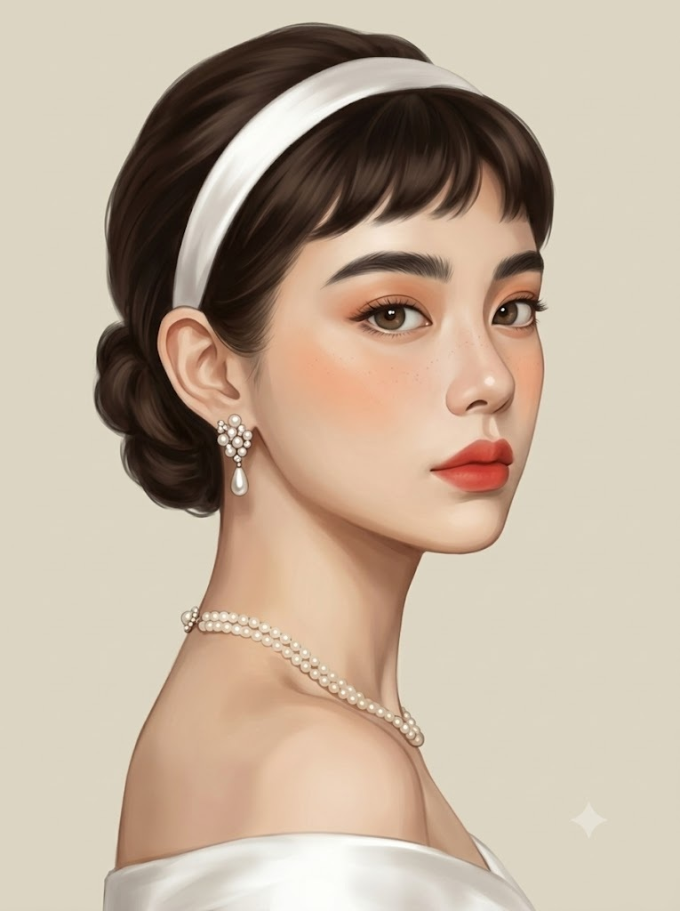
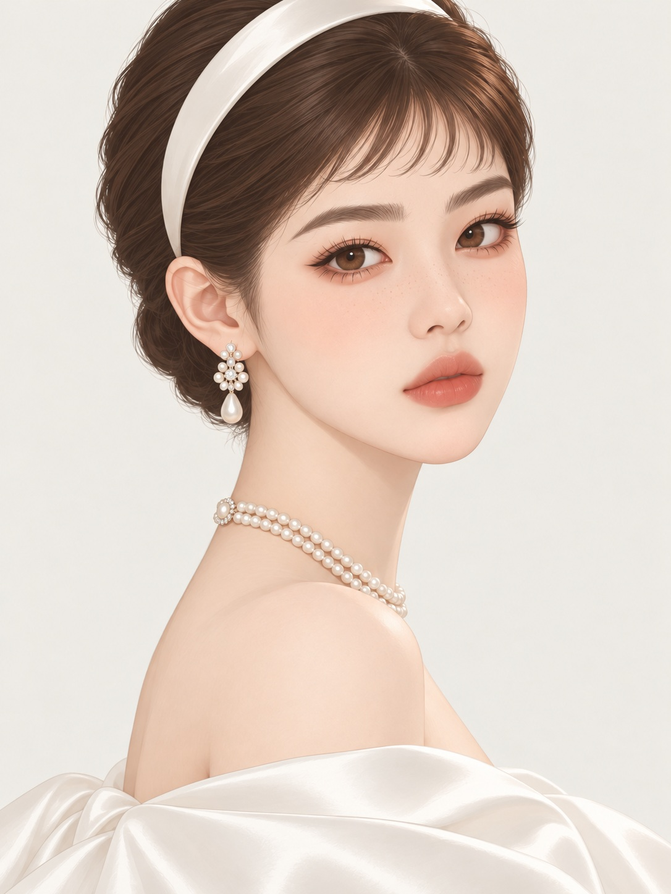

# 헵번 스타일 2, 어깨 너머로 돌아보는 클래식 헵번풍 뷰티 일러스트 프롬프트

## 1. 개요 및 아트 디렉팅 가이드

- **컨셉**: 25번 "헵번 스타일"을 잇는 두 번째 버전. 흰 새틴 헤어밴드와 짧은 앞머리 업두, 진주 두 줄 목걸이로 클래식 오드리 헵번 무드를 낸 오프숄더 뷰티 일러스트. 몸을 옆으로 돌리고 작은 어깨 너머로 돌아보는 포즈가 핵심 (세로 3:4)
- **모델별 버전**: 같은 장면을 모델마다 다른 그림체로 지시한 두 가지 버전
  - **GPT 버전**: 가장자리가 선명하고 깨끗한 매트 디지털 일러스트
  - **Gemini 버전**: 선화·외곽선·셀 채색 없이 명암 차이로만 형태를 만드는 부드러운 반실사 페인팅. 얼굴은 화면 오른쪽, 귀와 업두는 화면 왼쪽으로 고정해 좌우 반전을 막는 규칙을 추가
- **사진 사용 규칙**: 눈·코·입 생김새만 가져오고 얼굴형·피부·헤어·표정·각도·시선·조명·배경·의상은 새로 그림
- **포즈 (가장 엄격히 고정)**:
  - 화면 오른쪽을 향한 거의 옆모습. 가장 가까운 작고 둥근 오른쪽 어깨 끝이 보는 사람을 향함
  - 어깨 너머로 가슴 위쪽 가장자리만 살짝 보이고, 등은 왼쪽 가장자리의 좁은 띠로만. 뒷모습이 아님
  - 귀 아래에서 어깨까지 길고 가는 사선의 목
- **고개 각도**: 정면에서 화면 오른쪽으로 약 35도 돌린 3/4 각도, 턱은 10도 당기고 정수리는 왼쪽으로 살짝 기울임, 시선은 보는 사람
- **크롭 & 비율**: 헤어밴드 꼭대기가 화면 위에 닿고 턱 끝은 약 53%, 어깨는 63~82%, 맨 아래 18%에 흰 새틴. 어깨 폭은 화면의 약 40%로 작고 가녀리게, 머리가 약간 큰 일러스트 비율
- **얼굴 & 메이크업**: 갸름한 계란형, 앞머리에 가리지 않는 굵고 숱 많은 다크 브라운 직선 눈썹, 따뜻한 갈색 눈동자. 피치 브라운 섀도, 코랄 레드 립, 옅은 피치 블러셔, 콧등에 보일 듯 말 듯한 주근깨
- **헤어 (엄격히 고정)**: 옆머리를 귀 뒤로 바짝 넘긴 매끈한 볼륨의 다크 브라운 업두. 앞머리는 눈썹보다 손가락 두세 개 위에서 끝나는 아주 짧은 길이로, 끝이 안으로 말림. 앞머리 바로 뒤에 흰 새틴 헤어밴드
- **주얼리 & 의상**: 포도송이 같은 진주·크리스탈 클러스터에 물방울 진주가 달린 드롭 귀걸이, 목 밑동을 감싸는 짧은 진주 두 줄 목걸이와 진주 클래스프, 흰 새틴 오프숄더
- **배경 & 조명**: 완전히 평평한 따뜻한 상아빛 회색 단색, 부드러운 확산광과 낮은 대비의 웜 그레이 그림자, 아이보리·다크 브라운·피치·코랄의 차분한 저채도 팔레트

---

## 2. 프롬프트 전문

### GPT 버전

```text
[가장 중요 — 매체 고정]
This is NOT a photograph. It is a clean, smooth digital illustration with crisp edges and matte painted skin.
이 이미지는 사진이 아니다. 가장자리가 선명하고 깨끗한 매트 디지털 일러스트다. 업로드한 사진은 눈·코·입의 생김새 정보로만 쓰고, 얼굴형·피부·헤어·표정·각도·시선·조명·배경·의상은 사진에서 가져오지 않고 아래 서술대로 새로 그린다.

[포즈 — 가장 엄격히 고정]
Her body is in near side-profile, facing the right edge of the frame. Her small, slender RIGHT SHOULDER is closest to the camera and points toward the viewer, appearing as a small rounded shoulder cap in the lower center. Just beyond the shoulder on the right side, only the upper edge of her chest is slightly visible. This is NOT a back view.
- 몸은 화면 오른쪽을 향해 거의 옆모습으로 서 있다. 등을 보이는 뒷모습이 아니다.
- 카메라에 가장 가까운 부분은 오른쪽 어깨이고, 어깨 끝이 보는 사람을 향한다. 화면 아래 중앙에서 약간 왼쪽에 작고 둥근 어깨 머리 하나가 보인다.
- 어깨 오른쪽 너머로 가슴 윗부분(쇄골 아래 가슴 위쪽 가장자리)이 살짝만 보인다. 가슴 전체나 가슴골은 보이지 않는다.
- 등은 화면 왼쪽 가장자리에 아주 좁은 띠로만 보인다. 넓은 등, 척추, 견갑골이 보이지 않는다.
- 목은 귀 아래에서 어깨 머리까지 길고 가는 사선으로 이어진다.

[고개 각도 — 엄격히 고정]
Head turned about 35 degrees from frontal toward the right side of the frame (three-quarter view). Chin lowered slightly, about 10 degrees. Head tilted very slightly so the crown leans toward the left side of the frame. Eyes look directly at the viewer. The chin is NOT raised; she is NOT looking down at the viewer.
- 얼굴은 정면에서 화면 오른쪽으로 약 35도 돌아간 3/4 각도. 반대쪽 볼과 눈은 조금 좁게 보이고 콧날 옆선이 드러난다.
- 턱은 약 10도 아래로 살짝 당긴다. 턱을 들거나 위에서 내려다보는 각도가 아니다.
- 정수리가 화면 왼쪽으로 아주 살짝 기운다.
- 화면 왼쪽에 오른쪽 귀가 완전히 드러난다.
- 눈동자는 보는 사람을 똑바로 바라본다.

[크롭·비율 — 엄격히 고정]
- 세로 3:4. 헤어밴드 꼭대기는 화면 위 가장자리에 닿거나 살짝 잘린다.
- 턱 끝은 화면 높이의 약 53% 지점, 목은 그 아래 약 10%를 길게 차지하고, 어깨 윗선은 약 63% 지점에서 시작한다.
- 어깨 머리는 화면 높이 63~82% 사이에 들어가고, 그 아래 화면 맨 아래 18%에 흰 새틴이 걸친다.
- 어깨는 작고 가녀리다. 어깨 폭은 화면 폭의 약 40%, 얼굴 폭의 1.3배를 넘지 않는다. 어깨가 화면을 가로로 가득 채우지 않고 양옆에 배경이 넉넉히 보인다.
- 일러스트 비율: 머리가 약간 크고, 목은 길고 가늘며, 어깨와 몸은 작고 날씬하다.

[얼굴]
- 갸름한 계란형, 작고 날렵한 턱 끝, 매끈한 턱선. 피부는 밝고 맑은 도자기빛.
- 눈썹: 짙은 다크 브라운의 아주 굵고 숱 많은 직선형 눈썹. 앞머리에 전혀 가리지 않는다.
- 눈은 사진 속 눈매를 유지하되 일러스트답게 조금 크고 맑게, 홍채는 자연스러운 따뜻한 갈색.
- 입술은 위아래가 맞닿게 완전히 다물어 치아가 보이지 않는다. 부드럽고 차분한 무표정.

[메이크업]
은은한 피치 브라운 아이섀도, 얇은 아이라인, 또렷한 속눈썹, 코랄 레드 립, 볼에 아주 옅은 피치 블러셔. 주근깨는 콧등에 거의 보일 듯 말 듯 서너 점만.

[헤어 — 엄격히 고정]
- 짙은 다크 브라운. 옆머리는 전부 귀 뒤로 바짝 붙여 빗어 넘겨 귀와 목 옆선이 깨끗하게 드러난다. 얼굴 옆과 귀 주변으로 내려오거나 삐져나온 머리카락이 없다.
- 정수리에서 뒤통수까지 둥글게 살짝 부풀린 매끈한 볼륨을 주고, 뒤통수 아래에 작은 업두로 말아 고정한다.
- 앞머리: 아주 짧은 앞머리. 끝이 눈썹보다 손가락 두세 개 높이 위, 이마 위쪽에서 끝난다. 짧은 끝이 둥글게 안으로 말리며 한쪽으로 살짝 쓸린다.
- 가르마 없음. 머리카락은 매끈한 덩어리로 그리고 결은 부드러운 선 몇 개로만. 부스스한 결이 없다.
- 중간 폭의 흰 새틴 헤어밴드가 앞머리 바로 뒤에서 두상을 따라 매끈하게 감싼다.

[주얼리]
- 귀걸이: 작은 진주와 크리스탈이 세로로 길쭉한 포도송이처럼 촘촘히 모인 클러스터 아래 물방울 진주 하나가 매달린 드롭 귀걸이.
- 목걸이: 작은 크림빛 진주 두 줄짜리 짧은 목걸이. 목 밑동을 감싸고, 목 앞쪽에서 어깨 머리 쪽으로 살짝 늘어지며, 목과 어깨가 만나는 지점에 작은 진주 장식 클래스프가 보인다.

[의상]
흰 새틴 오프숄더. 화면 맨 아래에 크고 단순한 매끈한 면으로만 흐른다.

[배경·색감·조명]
- 배경: 아주 밝은 따뜻한 상아빛 회색(밝은 웜 오프화이트 그레이) 단색, 완전히 평평하다.
- 부드러운 정면 확산광, 대비 낮음, 그림자는 연한 웜 그레이.
- 팔레트: 상아빛 회색, 흰색, 아이보리, 다크 브라운, 피치, 코랄. 차분하고 깨끗한 저채도.

[렌더링]
- 피부는 매트하고 매끈한 그라데이션 셰이딩. 모공·잔털·광택이 없는 그림 피부.
- 윤곽선과 가장자리가 선명하고 화면 전체가 깨끗하다.
- 진주는 부드러운 광택 구체, 새틴은 매끈한 광택 면.

[최종 우선순위]
1. 거의 옆모습인 몸, 작고 가녀린 오른쪽 어깨 끝이 보는 사람을 향함, 어깨 너머로 가슴 윗부분만 살짝 (뒷모습 아님)
2. 정면에서 35도 돌아간 얼굴, 턱 살짝 내림, 정수리 왼쪽으로 살짝 기울임, 시선은 보는 사람
3. 화면 폭 40% 정도의 작은 어깨, 긴 목, 약간 큰 머리의 일러스트 비율
4. 사진이 아닌 깨끗한 매트 디지털 일러스트
5. 옆머리를 귀 뒤로 넘긴 업두, 눈썹 한참 위의 짧은 앞머리, 굵은 눈썹
6. 목 밑동에 걸린 짧은 진주 두 줄
7. 사진에서 가져온 눈·코·입 생김새
```

### Gemini 버전

```text
[가장 중요 — 매체 고정]

Semi-realistic digital painting, like a high-end beauty portrait illustration. Soft painterly rendering with smoothly blended gradients and realistic volume. NO line art, NO black outlines, NO cel shading, NO flat webtoon or comic colors. Not a photograph either.

이 그림은 선 없이 부드럽게 칠한 반실사 디지털 페인팅이다. 형태는 윤곽선이 아니라 빛과 그림자의 색 차이로만 구분한다. 검은 외곽선, 선화, 셀 채색, 평면적인 웹툰·만화 색면이 없다. 사진도 아니다.

업로드한 사진은 눈·코·입의 생김새 정보로만 쓰고, 얼굴형·피부·피부색·헤어·표정·각도·시선·조명·배경·의상은 사진에서 가져오지 않고 아래 서술대로 새로 그린다.

[방향 — 좌우 뒤집기 금지]

The face points toward the RIGHT side of the image. Her visible ear is on the LEFT side of the image. Her hair bun is on the LEFT side of the image. Do NOT mirror or flip this composition.

얼굴은 화면 오른쪽을 향한다.

보이는 귀 하나는 화면 왼쪽에 있다.

뒤통수의 업두는 화면 왼쪽에 있다.

어깨 머리는 화면 아래 중앙에서 약간 왼쪽에 있다.

[포즈 — 엄격히 고정]

Her body is in near side-profile, facing the right edge of the frame. Her small, slender right shoulder is closest to the camera and points toward the viewer, appearing as a small rounded shoulder cap in the lower center. Just beyond the shoulder on the right side, only the upper edge of her chest is slightly visible. Her chest does NOT face the viewer. This is NOT a back view.

몸은 화면 오른쪽을 향해 거의 옆모습으로 서 있다. 가슴이 보는 사람을 향하지 않는다. 등을 보이는 뒷모습도 아니다.

카메라에 가장 가까운 부분은 오른쪽 어깨이고, 어깨 끝이 보는 사람을 향한다. 화면 아래 중앙에서 약간 왼쪽에 작고 둥근 어깨 머리 하나가 보인다.

어깨 오른쪽 너머로 가슴 윗부분 가장자리만 살짝 보인다. 쇄골 전체, 가슴 앞면, 가슴골은 보이지 않는다.

등은 화면 왼쪽 가장자리에 아주 좁은 띠로만 보인다.

목은 귀 아래에서 어깨 머리까지 길고 가는 사선으로 이어진다.

[고개 각도 — 엄격히 고정]

Head turned about 35 degrees from frontal toward the right side of the frame (three-quarter view). Chin lowered slightly, about 10 degrees. Crown tilted very slightly toward the left side of the frame. Eyes look directly at the viewer.

얼굴은 정면에서 화면 오른쪽으로 약 35도 돌아간 3/4 각도. 콧날 옆선이 드러난다.

턱은 약 10도 아래로 살짝 당긴다.

정수리가 화면 왼쪽으로 아주 살짝 기운다.

눈동자는 보는 사람을 똑바로 바라본다.

[크롭·비율]

세로 3:4. 헤어밴드 꼭대기는 화면 위 가장자리에 닿거나 살짝 잘린다.

턱 끝은 화면 높이의 약 53%, 어깨 윗선은 약 63%에서 시작한다.

어깨 머리는 화면 높이 63~82% 사이, 그 아래 맨 아래 18%에 흰 새틴.

어깨 폭은 화면 폭의 약 40%. 양옆에 배경이 넉넉하다.

머리가 약간 크고, 목은 길고 가늘며, 어깨와 몸은 작고 날씬하다.

[얼굴]

갸름한 계란형, 작고 날렵한 턱 끝, 매끈한 턱선.

피부는 따뜻한 베이지가 섞인 밝은 아이보리.

눈썹: 짙은 다크 브라운의 아주 굵고 숱 많은 직선형 눈썹. 앞머리에 가리지 않는다.

눈은 사진 속 눈매를 유지하되 조금 크고 맑게, 홍채는 따뜻한 갈색.

입술은 완전히 다물고, 부드럽고 차분한 무표정.

[메이크업]

은은한 피치 브라운 아이섀도, 얇은 아이라인, 또렷한 속눈썹, 코랄 레드 매트 립, 볼에 옅은 피치 블러셔. 주근깨는 콧등에 아주 옅게 서너 점만.

[헤어 — 엄격히 고정]

짙은 다크 브라운. 옆머리는 전부 귀 뒤로 바짝 붙여 빗어 넘긴다. 얼굴 옆으로 내려오는 머리카락이 없다.

정수리에서 뒤통수까지 둥글게 살짝 부풀린 매끈한 볼륨, 뒤통수 아래에 작은 업두.

앞머리: 아주 짧은 앞머리. 끝이 눈썹보다 손가락 두세 개 높이 위, 이마 위쪽에서 끝난다. 눈썹까지 내려오지 않는다. 짧은 끝이 둥글게 안으로 말리며 한쪽으로 살짝 쓸린다.

머리카락은 부드럽게 칠한 덩어리에 은은한 윤기 띠로 표현한다. 선으로 한 올씩 긋지 않는다.

중간 폭의 흰 새틴 헤어밴드가 앞머리 바로 뒤에서 두상을 감싼다.

[주얼리]

귀걸이: 작은 진주와 크리스탈이 세로로 길쭉한 포도송이처럼 모인 클러스터 아래 물방울 진주가 매달린 드롭 귀걸이.

목걸이: 작은 크림빛 진주 두 줄짜리 짧은 목걸이. 목 밑동을 감싸고 목 앞쪽에서 어깨 쪽으로 살짝 늘어지며, 목과 어깨가 만나는 지점에 작은 진주 장식 클래스프.

[의상]

흰 새틴 오프숄더. 화면 맨 아래에 크고 단순한 매끈한 면으로만 흐른다.

[배경·조명]

배경: 따뜻한 상아빛 그레이지 단색, 완전히 평평하다.

화면 왼쪽 위에서 오는 부드러운 확산광. 하얗게 날아간 부분이 없다.

가장 밝은 것은 흰 새틴과 헤어밴드, 피부는 그보다 한 톤 어둡다.

팔레트: 웜 그레이지, 아이보리, 웜 베이지, 다크 브라운, 피치, 코랄. 차분한 저채도.

[렌더링]

피부는 부드럽게 블렌딩된 그라데이션으로 둥근 입체감을 만든다. 턱 밑, 목 옆, 귀 뒤, 어깨 아래쪽에 웜 토프 그림자가 부드럽게 번지고, 볼과 코끝에 피치빛. 모공·잔털·광택은 없다.

얼굴, 목, 어깨의 경계는 선이 아니라 명암 차이로만 드러난다.

진주는 부드러운 광택 구체, 새틴은 은은한 광택 면.

[최종 우선순위]

선 없는 부드러운 반실사 페인팅 (선화·셀 채색·웹툰 아님)

2. 얼굴은 화면 오른쪽, 귀와 업두는 화면 왼쪽 (좌우 뒤집기 금지)

3. 거의 옆모습인 몸, 작은 오른쪽 어깨 끝이 보는 사람을 향함, 가슴 앞면은 안 보임

4. 정면에서 35도 돌아간 얼굴, 턱 살짝 내림, 시선은 보는 사람

5. 이마 위쪽에서 끝나는 짧은 앞머리, 굵은 눈썹, 귀 뒤로 넘긴 업두

6. 목 밑동의 짧은 진주 두 줄

7. 사진에서 가져온 눈·코·입 생김새
```

---

## 3. 결과물 비교 갤러리

| 생성 모델 | 생성 결과 이미지 |
| :--- | :--- |
| **제미나이 (Gemini)** |  |
| **ChatGPT (DALL-E 3)** |  |
