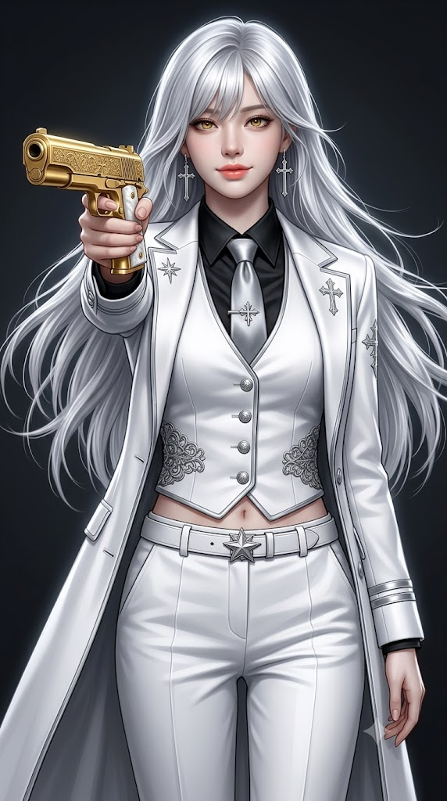
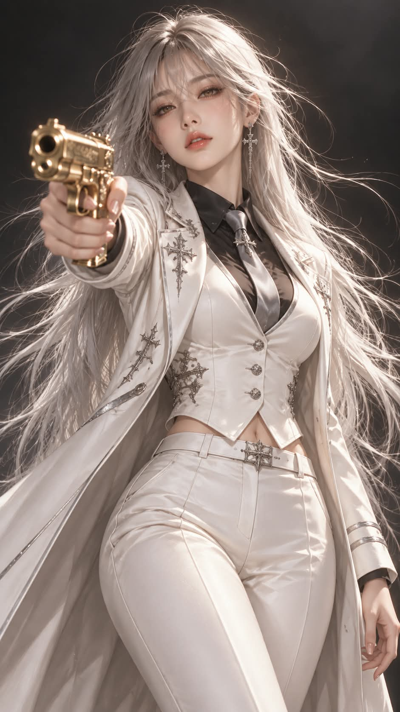

# 화이트 수트 황금 권총 세미실사 포트레이트 프롬프트

## 1. 개요 및 아트 디렉팅 가이드

- **컨셉**: 순백의 수트에 실버화이트 롱헤어, 황금색 눈동자의 여성이 보는 사람을 향해 황금 권총을 겨누는 3/4 샷. 어두운 차콜 배경 위에 화이트·실버와 황금색만 남긴 세미실사 포트레이트 (세로 9:16)
- **업로드 사진 사용 규칙 (가장 중요)**:
  - 사진에서는 눈·코·입의 생김새만 가져오고, 얼굴형·피부·헤어·눈동자 색·각도·시선·표정은 프롬프트 서술대로 새로 그림
  - 인물은 항상 여성으로 그림. 사진이 남성이어도 눈·코·입의 특징만 살려 여성으로 표현
  - 사진에 안경이나 선글라스가 있어도 그리지 않고 맨얼굴로 표현
- **분위기**: 스스로를 정의라고 굳게 믿는 심판자. 흔들림 없는 확신과 자비 없는 차분함, 성스러워 보여서 더 위험하고 섬뜩한 느낌
- **화풍**:
  - 실사 90%, 디지털 페인팅 10%의 실사에 가까운 세미실사
  - 피부 결, 머리카락 한 올, 새틴 원단의 광택, 은색 장식과 황금 권총의 금속 반사까지 실사 수준으로 묘사
  - 하이엔드 화보 퀄리티, 85mm 렌즈의 얕은 심도 느낌
- **구도 & 체형**:
  - 머리끝부터 허벅지 중간까지의 3/4 샷, 8.5등신의 길고 늘씬한 모델 비율
  - 얼굴을 크고 정밀하게 완성한 뒤 비율 그대로 축소해 배치하여, 작게 나와도 이목구비가 또렷하게 유지
- **포즈 & 표정**:
  - 한 팔을 보는 사람 쪽으로 곧게 뻗어 황금 권총을 겨누고, 검지는 방아쇠울 옆에 곧게 펴서 걸침
  - 턱을 약간 들고 권총 너머로 카메라를 똑바로 응시
  - 눈꺼풀을 살짝 내린 차가운 눈빛과 입꼬리만 아주 옅게 올라간 평온한 미소
- **눈 & 헤어 & 메이크업**: 녹인 금처럼 깊고 선명한 황금색 눈동자, 허리 아래까지 내려와 바람에 넓게 흩날리는 실버화이트 생머리, 창백한 피부톤과 연한 코랄 립
- **무기 & 액세서리**: 덩굴·십자 문양 인그레이빙과 하얀 진주빛 그립의 황금색 자동 권총, 길게 늘어지는 은색 십자가 드롭 귀걸이
- **의상**:
  - 검은 실크 드레스 셔츠와 은회색 실크 넥타이, 십자별 모양 타이핀
  - 은색 파이핑과 필리그리 장식이 있는 몸에 딱 맞는 하얀 크롭 조끼
  - 은색 별·십자 문장 자수가 놓인 무릎 근처 기장의 하얀 롱 재킷, 하얀 가죽 벨트와 하이웨이스트 하얀 슬랙스
- **배경 & 조명**: 사물이 전혀 없는 짙은 차콜에서 블랙으로 이어지는 그라데이션, 정면 위에서 오는 차갑고 부드러운 흰빛 키라이트와 은은한 림라이트, 황금 권총과 눈동자에 맺히는 선명한 하이라이트
- **금지**: 안경과 선글라스, 하얀 셔츠, 배경 속 마법진·빛 입자 같은 효과, 손가락 개수 오류, 활짝 웃거나 화난 표정, 애니메이션·만화 느낌, 피·상처·텍스트·로고·워터마크

---

## 2. 프롬프트 전문

```text
[세미실사 아트 – 화이트 수트 황금 권총 포트레이트 / 얼굴 합성용 템플릿]

■ 업로드 사진 사용 규칙 (가장 중요)
- 업로드한 사진은 얼굴 참고용으로만 사용한다.
- 사진에서는 눈·코·입의 생김새만 가져온다.
- 얼굴형, 피부, 헤어, 이마, 헤어라인은 사진에서 가져오지 않는다. 모두 아래 서술대로 그린다.
- 눈동자 색은 사진을 따르지 않고 아래 서술대로 그린다.
- 사진 속 머리 각도, 고개 기울기, 얼굴 방향, 시선은 절대 가져오지 않는다. 각도와 시선은 아래 포즈 서술을 따른다.
- 표정은 사진을 따르지 않고, 아래 표정 서술대로 새로 그린다.
- 얼굴을 제외한 구도, 각도, 헤어, 의상, 배경, 조명은 아래 서술에서 하나도 바뀌면 안 된다.
- 인물은 항상 여성으로 그린다. 업로드 사진이 남자여도 눈·코·입의 특징만 살려 여성으로 그린다.
- 업로드 사진에 안경이나 선글라스가 있어도 절대 그리지 않는다. 안경을 벗은 맨얼굴로 그리고, 눈은 안경 렌즈 왜곡 없이 원래 크기와 모양으로 그린다.

■ 분위기
- 스스로를 정의라고 굳게 믿는 심판자다. 하지만 그 정의는 오직 자기만의 기준이라 누구도 말릴 수 없다.
- 흔들림 없는 확신, 망설임 없는 냉정함, 자비 없는 차분함이 느껴져야 한다.
- 순백의 정장과 황금 권총이 성스러워 보이지만, 그래서 더 위험하고 섬뜩한 분위기다.

■ 화풍
- 실사 90%, 디지털 페인팅 10%의 실사에 가까운 세미실사다.
- 얼굴, 피부, 머리카락, 원단은 실제 사진처럼 사실적으로 표현한다. 피부 모공과 결, 머리카락 한 올 한 올, 새틴 원단의 광택, 은색 장식과 황금 권총의 금속 반사까지 실사 수준으로 묘사한다.
- 일러스트 느낌은 피부 표면의 아주 미세하게 매끈한 보정감에만 살짝 남긴다.
- 하이엔드 화보, 시네마틱 인물 사진 퀄리티로 표현한다. 85mm 렌즈, 얕은 심도 느낌이다.
- 인물은 화이트·실버에 안쪽 셔츠만 블랙이고, 배경은 어두운 차콜이다. 색 포인트는 황금색 눈동자와 황금 권총, 연한 코랄 립뿐이다.

■ 구도
- 세로 9:16 비율이다.
- 머리끝부터 허벅지 중간까지 보이는 3/4 샷이다. 인물이 화면 중앙에 크게 들어온다.
- 8.5등신 비율이다. 머리 하나 크기 대비 전신이 8.5배인 길고 늘씬한 모델 비율로 그린다.
- 얼굴이 작게 나오는 구도지만, 얼굴을 처음부터 작게 그리지 않는다. 얼굴을 크고 정밀하게 완성한 뒤 비율 그대로 축소해 8.5등신에 맞게 배치한다. 축소된 뒤에도 이목구비가 또렷해야 한다.

■ 체형
- 키가 크고 다리가 아주 긴 8.5등신 여성 체형이다.
- 볼륨 있는 글래머 몸매다. 풍만한 가슴, 잘록한 허리, 둥글게 이어지는 골반과 허벅지 곡선을 강조한다.
- 조끼가 가슴 볼륨을 따라 몸에 딱 맞게 핏되고, 허리는 잘록하게 조여 굴곡이 또렷하게 드러난다.
- 슬랙스는 골반과 허벅지 라인을 따라 매끈하게 떨어진다.
- 목은 길고 가늘며, 어깨와 팔은 가늘고 여성스럽다.

■ 포즈
- 정면을 향해 서 있다. 몸통은 아주 살짝 비스듬하다.
- 화면 왼쪽 팔(인물의 오른팔)을 보는 사람 쪽으로 곧게 뻗어 황금 권총을 한 손으로 겨눈다. 총구가 정면의 보는 사람을 향한다.
- 권총을 쥔 손은 원근감으로 살짝 크게 보이며, 검지는 방아쇠울 옆에 곧게 펴서 걸친다. 손가락은 다섯 개로 자연스럽고 정확하게 그린다.
- 다른 팔은 몸 옆으로 자연스럽게 내리고 손끝을 가볍게 편다.
- 고개는 정면에서 아주 살짝 기울이고 턱을 약간 든다.
- 시선은 권총 너머로 카메라(보는 사람)를 똑바로 응시한다.

■ 표정
- 눈꺼풀을 살짝 내린 차갑고 흔들림 없는 눈빛이다.
- 입꼬리만 아주 옅게 올라간 평온한 미소다. 자신이 옳다고 확신하는 사람의 여유다.
- 분노나 광기 없이 담담한데, 그 담담함이 오히려 섬뜩하다.

■ 눈
- 녹인 금처럼 깊고 선명한 황금색 눈동자다. 빛을 받아 은은하게 빛나고, 홍채에 가는 금빛 결이 보인다.

■ 메이크업
- 창백하고 투명한 피부톤
- 은빛이 도는 은은한 아이섀도와 가는 아이라인
- 연한 코랄 립, 촉촉한 광택

■ 헤어
- 허리 아래까지 내려오는 아주 긴 실버화이트 머리다. 차분한 생머리에 끝만 살짝 흩어진다.
- 눈썹을 살짝 덮는 가벼운 앞머리와 얼굴 양옆으로 길게 내려오는 옆머리가 있다.
- 바람에 머리카락이 양옆과 뒤로 넓게 흩날린다.
- 머리카락은 실제 모발처럼 윤기와 잔머리가 살아 있고, 빛을 받은 부분은 은색으로 반짝인다.

■ 무기
- 황금색 자동 권총이다. 슬라이드와 몸체 전체가 광택 나는 금으로 되어 있다.
- 슬라이드 옆면에 섬세한 덩굴·십자 문양 인그레이빙이 새겨져 있다.
- 손잡이는 하얀 진주빛 그립이다.
- 실제 금속처럼 무게감 있고 날카로운 반사광이 맺힌다.

■ 액세서리
- 양쪽 귀에 길게 늘어지는 은색 십자가 모양 드롭 귀걸이를 한다. 실제 금속처럼 반짝인다.
- 얼굴에는 안경 등 어떤 액세서리도 착용하지 않는다.

■ 의상 (화이트 수트 + 블랙 셔츠 + 실버 장식)
- 검은 드레스 셔츠: 뾰족한 칼라, 맨 위 단추까지 채움, 은은한 광택의 실크 질감. 하얀 조끼와 재킷 사이로 검은 칼라와 가슴 부분이 선명하게 대비된다.
- 은회색 실크 넥타이: 은색 십자별 모양 타이핀을 꽂음
- 하얀 조끼: 몸에 딱 맞는 크롭 기장, 가장자리에 은색 파이핑, 은색 둥근 금속 단추 4개, 양옆 허리 부분에 은색 필리그리 금속 장식, 조끼 밑단과 바지 사이로 허리 맨살이 아주 살짝 보임
- 하얀 롱 재킷: 앞을 연 채로 입음, 무릎 근처까지 오는 긴 코트 기장, 라펠과 가장자리에 은색 파이핑, 어깨와 가슴 양쪽에 은색 별·십자 문장 자수, 소매 끝에 은색 띠 장식 두 줄
- 허리: 하얀 가죽 벨트, 은색 별 모양 장식 버클
- 하의: 하이웨이스트 하얀 슬랙스, 앞 주름이 선명함
- 수트 원단은 광택 있는 새틴 질감이다.

■ 배경
- 장식이나 사물이 전혀 없는 단순한 배경이다.
- 짙은 차콜에서 가장자리로 갈수록 블랙이 되는 부드러운 그라데이션이다.
- 인물 뒤쪽만 아주 은은하게 밝아 하얀 인물이 어둠 속에서 떠오르듯 보인다.

■ 조명
- 정면 위에서 오는 차갑고 부드러운 흰빛 키라이트다.
- 하얀 의상과 실버 헤어가 어둠 속에서 은은하게 빛나 보인다.
- 머리카락과 어깨 윤곽에 은은한 흰빛 림라이트를 준다.
- 황금 권총과 황금 눈동자에 작고 선명한 하이라이트가 맺힌다.
- 얼굴 아래쪽과 목에 옅은 그림자를 드리워 차가운 긴장감을 더한다.

■ 금지
- 안경, 선글라스, 안경 자국
- 하얀 셔츠
- 마법진, 빛 입자, 별 장식 등 배경 속 사물이나 효과
- 사진 속 각도·표정·헤어·눈동자 색 반영
- 얼굴을 처음부터 작고 뭉개지게 그리기
- 머리가 큰 비율, 짧은 다리
- 마르고 평평한 체형, 남성적인 어깨와 체형
- 손가락 개수 오류, 뒤틀린 손, 총을 잘못 쥔 손
- 활짝 웃는 표정, 광기 어린 표정, 화난 표정
- 애니메이션·만화 느낌, 플라스틱 같은 매끈한 피부, 과한 일러스트 붓 터치
- 피, 상처, 텍스트, 로고, 워터마크
```

---

## 3. 결과물 비교 갤러리

| 생성 모델 | 생성 결과 이미지 |
| :--- | :--- |
| **제미나이 (Gemini)** |  |
| **ChatGPT (DALL-E 3)** |  |
