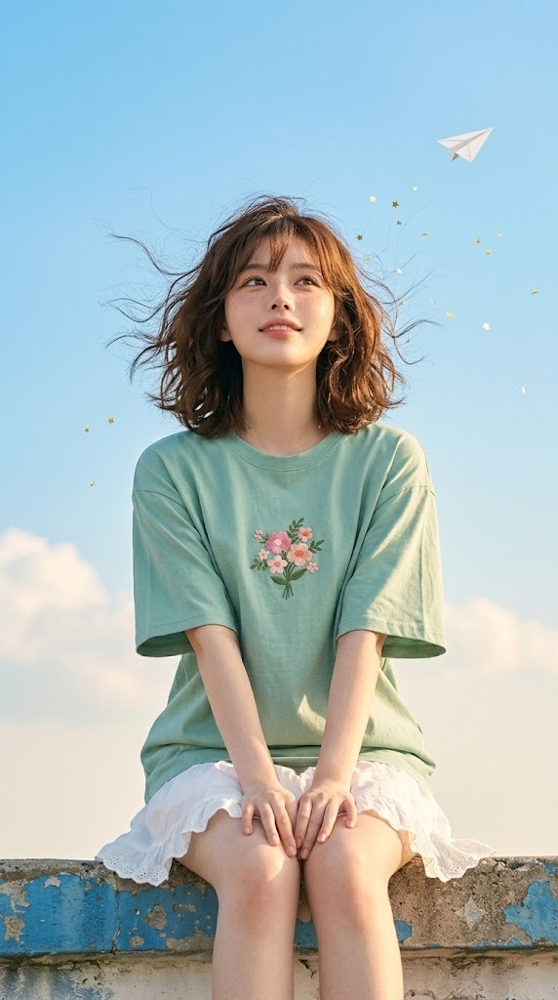
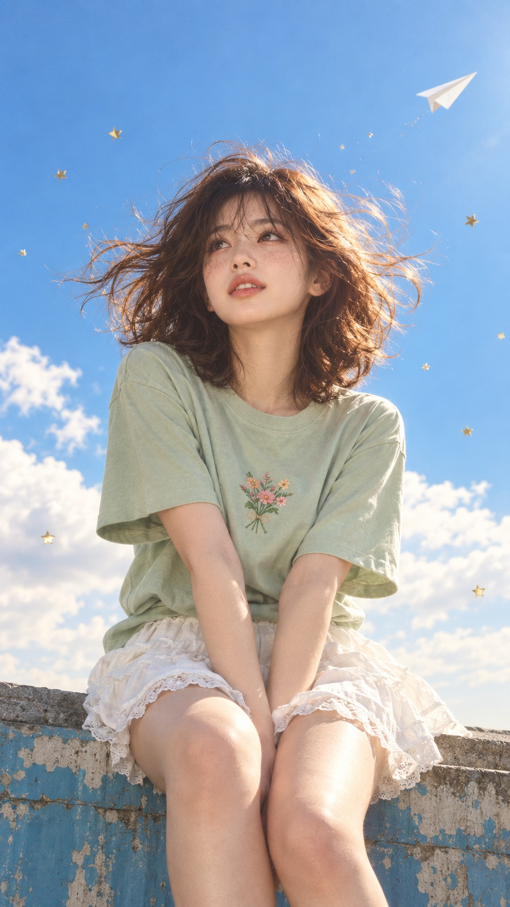

# 하늘색 오후 화보, 옥상 난간과 종이비행기 감성 실사 사진 프롬프트

## 1. 개요 및 아트 디렉팅 가이드

- **컨셉**: 맑은 여름 오후, 바람 부는 옥상 난간에 걸터앉아 종이비행기가 날아가는 하늘을 올려다보는 모습을 담은 파스텔 톤 감성 화보 실사 사진 (세로 9:16)
- **얼굴 사진 사용 규칙**:
  - 사진에서는 눈·코·입의 생김새만 가져오고, 얼굴형·피부·헤어·표정·각도·시선은 장면 묘사대로 새로 만듦
  - 사진에 안경이 있으면 같은 테 모양·색·두께의 안경을 그대로 씌우고, 없으면 추가하지 않음
  - 일러스트가 아니라 실제 카메라로 찍은 사진처럼 표현
- **장면**:
  - 파란 페인트가 군데군데 벗겨진 오래된 콘크리트 난간
  - 화면 전체를 채우는 선명한 하늘색 하늘, 아래쪽의 부드러운 흰 뭉게구름
  - 화면 오른쪽 위를 향해 나는 흰 종이비행기, 공중에 드문드문 흩날리는 작은 금색 별 모양 반짝이
- **구도 & 카메라**: 약간 아래에서 올려다본 로우앵글, 머리 위로 넉넉한 하늘 여백, 무릎 바로 아래에서 잘리는 프레임, 85mm 렌즈
- **포즈 & 표정**: 정면으로 앉아 무릎을 모으고 두 손을 무릎 사이에 가볍게 모은 자세, 고개를 살짝 들어 화면 왼쪽 위 하늘을 올려다보는 시선, 꿈꾸는 듯 설레는 은은한 미소와 옅은 주근깨
- **헤어**: 앞머리가 있는 어깨 위 길이의 갈색 웨이브 단발, 바람에 크게 흩날리며 끝부분이 금빛으로 빛남
- **의상**:
  - 가슴 중앙에 꽃다발 자수가 있는 오버사이즈 민트·세이지 그린 반팔 티셔츠
  - 밑단에 레이스 러플이 달린 흰색 면 프릴 미니 스커트 (남성은 흰색 면 반바지)
- **조명 & 색감**: 오른쪽 위에서 들어오는 따뜻한 오후 햇살과 은은한 림라이트, 하늘색·민트·흰색·금빛의 밝고 맑은 파스텔 톤, 약한 필름 그레인
- **금지**: 일러스트·애니메이션 화풍, 과한 보정 피부, 사진에 있는 안경 제거, 텍스트·워터마크

---

## 2. 프롬프트 전문

```text
[업로드한 얼굴 사진 사용 규칙]
- 업로드한 사진에서는 눈, 코, 입의 생김새만 가져온다.
- 얼굴형, 피부, 헤어, 이마·헤어라인, 표정은 사진에서 가져오지 않는다.
- 사진 속 고개 기울기, 얼굴 방향, 시선은 절대 따라 하지 않는다. 각도와 시선은 아래 장면 묘사를 그대로 따른다.
- 표정은 사진과 상관없이 아래 묘사대로 새로 만든다.
- 얼굴 외의 구도, 포즈, 헤어, 의상, 배경, 조명은 아래 묘사에서 하나도 바꾸지 않는다.
- 결과물은 일러스트가 아니라 실제 카메라로 찍은 사진처럼 보여야 한다.
- 업로드한 사진 속 인물이 안경을 쓰고 있으면 같은 안경(테 모양, 색, 두께)을 그대로 씌운다. 렌즈는 투명하게 유지하고, 하늘을 올려다보는 각도에 맞게 안경 위치와 반사만 자연스럽게 조정한다.
- 사진에 안경이 없으면 안경을 추가하지 않는다.

[장면]
맑은 여름 오후, 옥상의 낮은 콘크리트 난간 위에 젊은 사람이 정면을 향해 걸터앉아 있다. 난간은 파란 페인트가 군데군데 벗겨진 오래된 콘크리트이고, 윗면은 회색 시멘트다. 배경은 화면 전체를 채우는 선명한 하늘색 하늘이며, 왼쪽 아래와 오른쪽 아래에 부드러운 흰 뭉게구름이 있고 하늘 아래쪽으로 갈수록 연한 크림색으로 밝아진다. 화면 오른쪽 위에 흰 종이비행기 하나가 오른쪽 위를 향해 날고 있다. 공중에는 작은 금색 별 모양 반짝이 조각들이 드문드문 바람에 흩날린다.

[구도·카메라]
세로 9:16. 약간 아래에서 올려다본 로우앵글. 머리 위로 하늘 여백이 넉넉하게 있고, 인물은 화면 중앙, 아래는 무릎 바로 아래에서 잘린다. 85mm 렌즈, 배경은 하늘이라 전체가 선명하되 인물에 초점.

[포즈·표정]
몸은 정면, 무릎을 모으고 두 손은 무릎 사이 안쪽에 가볍게 모아 내려놓았다. 고개를 살짝 들어 시선은 화면 왼쪽 위 하늘을 올려다본다. 입술은 살짝 벌어진 채 은은하게 미소 짓는, 꿈꾸는 듯 설레는 표정. 코와 볼 위에 옅은 주근깨가 자연스럽게 있다.

[헤어]
어깨 위 길이의 갈색 웨이브 단발, 앞머리 있음. 바람에 머리카락이 양옆과 위로 크게 흩날리고, 역광을 받은 끝부분이 따뜻한 금빛으로 빛난다.

[의상]
- 상의: 오버사이즈 민트·세이지 그린 반팔 라운드넥 면 티셔츠. 가슴 중앙에 분홍·복숭아색 작은 꽃들과 초록 잎으로 이루어진 꽃다발 자수가 있다. 소매는 팔꿈치 위까지 내려오고 옷감이 자연스럽게 주름진다.
- 하의: 흰색 면 프릴 미니 스커트(밑단에 레이스 러플), 맨다리.
※ 사진 속 인물이 남성이면 같은 구도·포즈·티셔츠를 유지하고, 하의만 흰색 면 반바지로 바꾼다.

[조명·색감]
오른쪽 위에서 들어오는 따뜻하고 부드러운 오후 햇살, 얼굴과 머리카락 가장자리에 은은한 림라이트. 전체적으로 밝고 맑은 파스텔 톤(하늘색, 민트, 흰색, 따뜻한 금빛), 약한 필름 그레인이 있는 감성 화보 사진 느낌. 실제 피부 결과 머리카락 한 올 한 올이 보이는 사실적인 디테일.

[금지]
일러스트·애니메이션 화풍, 과한 보정 피부, 사진 속 얼굴 각도·표정 복사, 사진에 있는 안경 제거, 텍스트·워터마크 추가.
```

---

## 3. 결과물 비교 갤러리

| 생성 모델 | 생성 결과 이미지 |
| :--- | :--- |
| **제미나이 (Gemini)** |  |
| **ChatGPT (DALL-E 3)** |  |
